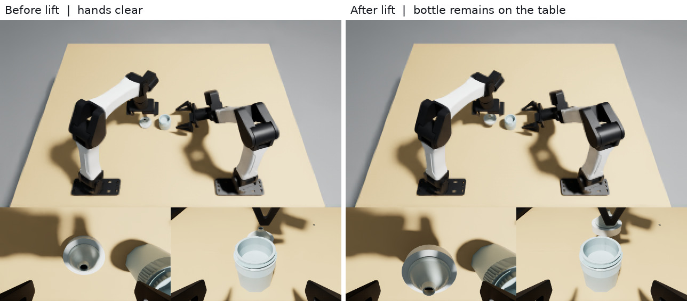

# Fit the teat and screw collar onto a baby bottle

Fit the separate silicone teat through the collar, fasten the collar onto the upright bottle and release the assembly. Either arm may handle any part. The known-layout scripted demonstration uses 1,769 ordinary joint commands per arm at 20 Hz on the calibrated dual-YAM station.

The bottle, collar and deformable teat geometry is generated by the task. The physical reference is the 125 mL Philips Avent SCY900/01 with its matching flow 2 teat. Philips shows how to pull the teat fully through the ring. The YAM model is supplied with the official station runtime under the i2rt MIT license. [Manufacturer assembly illustration](https://www.philips.co.uk/c-f/XC000021143/how-do-i-assemble-my-natural-response-bottle-and-teat) · [Station robot asset license](https://github.com/kairosiann/yam-isaac-lab-arena/blob/0059d02a1a91bc6834c1d0846022891df0c78730/yam_arena/assets/yam/LICENSE.i2rt)

## Run the simulation

With the walkthrough runtime and original YAM station installed, run from this task directory using Python 3.12. Choose an available GPU and a new output directory. Use `python runtime_check.py` to check the versions and revisions listed in `runtime-lock.json`. Each invocation starts one fixed-layout episode with seed 0 and zero object jitter.

```bash
python run.py --gpu 1 --out /tmp/bottle-review-trial
```

For the formal model trial, use `python run.py --mode dream --gpu 1 --out /tmp/bottle-model-trial` with a new output directory and an authorized Dream Labs account. The task uses Dream-1 on the three original 320 × 176 RGB observations and the standard joint state, with 20 Hz control and a limit of 2,400 steps (120 seconds). Cloud recording is disabled. A free reset check is available via `--mode setup`. Adding `--config-only` writes the configuration and runtime pins without contacting the model.

The runner records an automatic collar-only lifting exam after the last policy action. Inspect reports the numeric `collar_retention` metric. `score-trace.json` contains release candidates during the episode. `endpoint.json` gives the final score. A nonzero candidate must also pass the lift. The policy observation ends before this test. The lift data are saved in `collar-exam.npz`. A free intermediate demonstration is available with `--mode demo --collar-only-demo`; it ends at action 962, once the fitted pair has been released beside the bottle.

## Grading

| Score | Final observable result |
| --- | --- |
| 0 | A part is still held, or the teat is absent, folded out of the collar, has its outlet turned inward, or slips out when only the collar is lifted. |
| 0.5 | The released teat is fitted all the way around, follows the collar through a lift and stays captured for one second. The bottle may still be separate. This also earns 0.5 when the pair passes but the final bottle fit fails. |
| 1 | The released bottle follows the collar, both internal lugs and the entire sealing land remain engaged through the lift. In the physical trial both assembly interfaces also pass the leak check. |

During the last policy second both arms must release the parts. At all 48 angular samples the upper teat bead sits above the retaining lip, the lower flange sits below it, and the teat wall passes through the aperture. The outlet edge must project past the exposed face of the collar, measured in the frame of the collar. The teat may lean to either side. For a full-score candidate both lugs must also engage (at least 12 of 15 samples per lug) and the entire sealing land must meet the bottle rim (0.05 mm numerical contact band). The policy can use either arm and any grasp sequence.

The examiner applies force to the collar alone, raising its target 40 mm in one second, settling for 0.5 s and holding for one second. For both score levels the examiner grips the collar by its sides and maintains its initial orientation during the lift. Only the collar receives the lifting force and stabilizing torque. For half credit the fit must remain correct around the collar throughout this motion. During the hold the collar and the lowest teat point must each be at least 20 mm above their own starting heights and the teat must be at least 20 mm above the table. This tests a pair that was already fitted before release. Full credit requires this entire pair test. Both lugs must stay engaged throughout the lift at all 600 physics substeps, and the complete sealing land must stay against the rim at all 51 geometry observations. The bottle must rise at least 20 mm and clear the table by at least 20 mm for the terminal second. A bottle that detaches and catches again can earn up to half credit for an intact pair. The final score is the lower of the released and loaded results. The simulation samples flexible geometry at 20 Hz and rigid contacts at 240 Hz. When an arm obstructs the examiner, the grader repeats the test on a clear bench with the same specimen shape, relative poses and native velocities. The 20 g fixed payload represents the weight of a 20 mL prefill. The simulator measures mechanical retention and rim contact. The physical trial tests leakage.

### What earns half credit



The robot released the loose pair beside the bottle at action 962. In this separate example, the simulated examiner then lifted only the collar. The lowest teat point rose 39.5 mm and the bottle stayed on the table. The left wrist shows the teat in the collar and the right wrist shows the open bottle. The published full-score video continues after the same intermediate step and ends at the robot’s release. The scoring lift follows the policy recording. Run the intermediate example from this directory with a new output path.

```bash
python run.py --mode demo --collar-only-demo --gpu 0 --out /tmp/bottle-retained-pair
```

## Physical reset and grading

Use a Philips Avent Natural Response SCY900/01 bottle with its matching teat and screw collar as the proposed physical reference. The simulated thread profile and flexible section are engineering approximations. Start with the three parts separated and dry on the outside. Add 20 mL of clear water to the upright bottle. With the station origin midway between the arm bases, positive X towards the work and positive Y towards the left arm, place the bottle centre at (304, 18) mm, the collar centre at (318, 112) mm and the teat centre at (301, −131) mm. Place the collar as shown in the reset view and stand the teat on its base. Use the original table, cameras and parallel grippers.

Protect the shared station from the prefilled bottle. Put a thin waterproof liner under the physical work area with absorbent material outside the grasp locations; keep the parts at the stated heights. Start the lift at the released endpoint. Keep both grippers clear. Once the collar and any attached parts have cleared the starting surface, move the dry catch tray underneath for inspection and inversion. Leave the teat, collar and bottle as released until the first lift. Stop, dry the equipment and reset the trial if a spill wets the pads or changes the starting grip conditions.

1. Observe one second with both grippers clear. Check that the outlet projects outside the collar and that the upper bead is out around the full circumference, the flexible edge is captured continuously and no sector is rolled through the aperture. Grip opposite sides of the collar and lift it vertically, keeping its starting orientation and leaving the teat untouched. Use the original support surface as the height reference. Raise the collar about 40 mm over one second, let it settle for half a second, then hold for one full second. Use a ruler beside the assembly to compare the start and hold heights. The numerical rim-contact band in the simulation is a model tolerance. The physical checks below use the visible rim, the lift and the water test. The collar and teat must both rise at least 20 mm, with the lowest part of the teat at least 20 mm above the original support surface for one second. If the bottle stays below, this proves the independent intermediate outcome. A tilted or briefly balanced teat that slips out receives zero.
2. For full credit the bottle must also rise by at least 20 mm, remain at least 20 mm above the original support surface for one second, and stay attached throughout the lift. A visibly skewed, cross-threaded collar or a momentarily detached bottle earns at most half credit. If the bottle passes the lift, invert it for 10 seconds over the dry tray. The prefill must reach both interfaces. Observe the bottle–collar seam and the base of the teat around the whole circumference. Water traced to the intended nipple outlet alone is allowed. A visible assembly leak prevents full credit; award 0.5 if the collar–teat fit was independently confirmed. If needed, inspect the visible retaining rim from another angle without pushing the teat into place. A hidden fit, untraceable drop, or incomplete leak inspection that leaves the score undecidable is unscored. Restore the original reset and repeat.

Apply these decisions to the released endpoint. A regrasp or a corrected early fold during assembly can still earn full credit. During the examiner lift, a teat that slips and then catches again scores zero. A correctly retained pair with a separate or visibly cross-threaded bottle earns half credit. For the physical record, a leak at either or both assembly seams prevents full credit even when the nipple outlet also drips. A positively observed assembly leak counts even if the operator stops the inversion early. If the prefill no longer wets the interfaces or the origin of a drop is unclear, a dry-looking exterior alone cannot establish a pass. An invalid initial setup or an inconclusive trial is recorded separately from a scored attempt. Record any observed seam leak before drying and resetting the equipment.

Record an independent retained pair or a completed bottle with the applicable command below.

```bash
python physical_grading.py --teat-fit retained --retention failed --seams unclear --inspection incomplete
python physical_grading.py --teat-fit retained --retention held --seams outlet-only --inspection complete
```

Use `--teat-fit failed` for an observed failed fit, detachment or parts left held. `--setup invalid` returns JSON `null` for an invalid trial.
