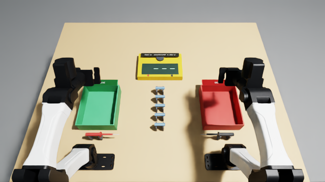

# Test AA batteries with a voltmeter and sort by voltage

Use two loose handheld probes to measure five visually identical AA cells, then
place each cell in the bin selected by its voltage. This models bench inspection
that combines two-handed instrument use, reading a display, and sorting.

**Recorded results:** Dream-1 **0.0** in 4,200 actions; scripted demo **1.0** in
1,737 actions. Both recordings use the same task source and assets.

## Instruction

Use the two loose voltmeter probes to test all 5 AA batteries. Keep the probe tips
touching opposite terminals of the same battery for at least 0.50 seconds. Use the
magnitude of the displayed voltage: put batteries reading **1.20 V or more** in the
green ALIVE bin and lower readings in the red DEAD bin. Leave every battery
released inside its bin.

ALIVE and DEAD denote this voltage cutoff. The task measures open-circuit voltage;
it does not establish remaining capacity or overall battery health.

## Setup



Coordinates use metres: x points forward from the arm bases and +y to the robot's
left. The table top is at world z = 0.7475 m. Heights in this table are relative to
that surface. Both arms start in the standard ready pose with open grippers.

| Apparatus | Dimensions, material and fixed starting layout |
| --- | --- |
| YAM station | Standard calibrated two-arm station, 1,100 × 1,300 × 60 mm table, bases at world (0, ±0.305, 0.75) m, overhead and two wrist RGB cameras, standard lighting and camera support. |
| Five AA cells | Identical unbranded steel cells with blue insulating polymer wrap and exposed terminals; 14.5 mm diameter, 50.5 mm overall, 23 g each. Centers at x = 0.16, 0.21, 0.26, 0.31, 0.36 m, y = 0, height = 54 mm. Axes lie along y, positive buttons toward +y. Positive button diameter 5.5 mm. |
| Cell supports | Two fixed rubber V saddles per cell, 16.5 mm either side of its midpoint along y. Each has a 30 × 6 × 40 mm support and two 14 × 6 × 4 mm faces inclined 45°. Both terminals and the middle grasp region are exposed. |
| Red and black probes | Each 152 mm overall and 28 g; insulated 70 mm long, 16 mm diameter handle, 24 mm guard, 50 mm insulated nose, 28 mm bare steel shaft and 1.5 mm radius rounded tip. Handle centers at (0.11, ±0.30, 0.0603) m, red on +y and black on −y, pointing inward. |
| Probe rests | Two fixed 22 × 6 × 52 mm rubber blocks per handle, 46 mm apart, leaving its middle free for grasping. |
| DC voltmeter | Fixed yellow unbranded polymer case, 165 × 250 × 35 mm, at (0.525, 0, 0) m. Live signed two-decimal LCD, preset DC voltage mode, red and black input jacks, printed 1.20 V cutoff. |
| Leads | Red and black insulated 3 mm diameter visual leads from the meter to the corresponding probe handles; massless and noncolliding. |
| Bins | Fixed polymer boxes at (0.26, +0.30, 0) m for green ALIVE and (0.26, −0.30, 0) m for red DEAD. Each is 220 × 180 × 70 mm, with 210 × 170 mm inner opening, 6 mm floor, 5 mm walls and a raised label. |

[scene_inventory.json](scene_inventory.json) enumerates every task shape, pose,
material and mass. The submitted USD files and textures are original task assets.
Reset restores all initial poses and preset voltages; nothing is consumed.
Object jitter is zero. Seeds do not change the starting layout or cell voltages.

## Environment and run commands

Use the Robocurve YAM / Isaac Lab-Arena simulator environment with an RTX GPU,
Python 3.12, Isaac Sim 6.1 and Arena `release/0.3.1`. The recorded YAM adapter
revision is `0059d02a1a91`; package versions are in the result JSON files. Activate
the installed environment using the competition walkthrough and the existing
NVIDIA license settings.

Run these commands from the repository root:

```bash
# Check the installed environment, GPU and registered adapters.
bash tasks/battery-voltage-sort/run.sh check

# Load the task and hold the ready pose for 100 actions.
bash tasks/battery-voltage-sort/run.sh hold

# Run, score and record the reference demonstration.
bash tasks/battery-voltage-sort/run.sh demo

# Run, score and record one hosted Dream-1 trial.
bash tasks/battery-voltage-sort/run.sh dream
```

`dream` uses the official `yam_arena` embodiment, `dreamlabs/dream-1-beta`, seed 0,
zero object jitter and the `task_score` scorer. It requires configured Dream
credentials and consumes inference credit. RGB observations come from the
overhead and two wrist cameras at 320 × 176 pixels; electrical state is not added
to the model's observations. Read the final `results.metrics.task_score` in its
Inspect Robots JSON log. Render the recorded camera streams with:

```bash
bash tasks/battery-voltage-sort/run.sh video PATH_TO_EVALUATION_LOG.json
```

`dream-start` launches the same model evaluation independently of the terminal
and prints its PID and startup log. `start` opens the initial scene in a persistent
window; close the window to stop it. `gui` runs the reference demo visibly.

The launcher uses `YAM_SIM_ENV` when set, then the active virtual or Conda
environment; its workstation fallback is `/data/conda/envs/yam-arena`. Set
`YAM_SIM_ENV` to the absolute environment path on another host. It clears inherited
ROS Python/library paths and performs no dependency installation. All runtime
helpers and task assets are inside this folder.

New runs are written under the ignored `output/` directory. A reference run writes
`trial/result.json`, `trace.jsonl`, `setup.png`, camera videos and a combined
`demo.mp4`. Read `score`, `success` and `error` in its result file; `demo` exits
nonzero unless the task succeeds.

## Scoring

The score is the fraction of cells that were measured and currently satisfy all
placement conditions: **0.2 per cell**, from 0.0 to 1.0. The score is evaluated in
the final state. A cell loses its credit if subsequently removed or disturbed.

A measurement requires both bare probe tips on opposite exposed terminals of the
same cell for **0.50 continuous seconds**. Either polarity is accepted; the meter
shows the signed voltage and classification uses its magnitude. A missing contact
shows dashes. Touching different cells or sorting an unmeasured cell earns no
measurement credit.

In the simulator, each rounded tip must lie within 0.6 mm of the terminal contact
surface, without penetrating it by more than 0.6 mm. Its projected center must be
inside the exposed terminal disk expanded by the 1.5 mm tip radius. Each probe
must also report at least 0.005 N mean native normal contact force on that cell over
the preceding 12 physics steps (50 ms). This force check rejects near misses. For
physical judging, the visible meter reading held for 0.50 seconds establishes the
measurement; no force gauge is required.

A measured cell earns its 0.2 only when all these conditions hold:

- It is in ALIVE for |V| ≥ 1.20 V, or DEAD for |V| < 1.20 V.
- The complete envelope of its can and both terminals lies inside the correct
  210 × 170 mm opening and between the bin floor and rim, with 1 mm contact
  tolerance on each boundary.
- Linear speed is at most 25 mm/s and angular speed at most 0.8 rad/s.
- Every robot collision envelope is at least 15 mm away from the cell envelope.

The success flag requires all five cells to satisfy the conditions for **1.00
continuous second**. Unmeasured, misplaced, held, moving or partly contained cells
receive zero individual credit. Any battery or probe envelope leaving world
x = −0.19..0.91 m, y = −0.65..0.65 m, z = 0.7325..1.80 m, or any nonfinite object
state, permanently sets the entire trial's score to zero.

## Runtime, seeds and recorded results

The action limit is **4,200 control steps at 20 Hz**: 210 simulated seconds per
trial. Physics runs at 240 Hz. The fixed-layout evaluation seed is 0. Inspect
Robots derives trial seed 1415158438 from that evaluation seed; it changes neither
the fixed layout nor the voltage assignment.

| Recorded policy | Score | Actions | Simulated time | Wall time on RTX 5090 | Outcome |
| --- | --- | --- | --- | --- | --- |
| Dream-1 (`dreamlabs/dream-1-beta`) | 0.0 | 4,200 | 210.00 s | 527.33 s | Action limit; no evaluation error. |
| Scripted reference | 1.0 | 1,737 | 86.85 s | 311.60 s | All five cells measured, correctly placed and released. |

Both runs were recorded on 2026-11-14 with the same executable source and assets.
[model_run.json](model_run.json) contains the model configuration, score,
termination, versions and recording hashes. [validation.json](validation.json)
contains the reference score, individual readings, final cell conditions and
source fingerprint. Raw traces, individual camera streams and the interrupted
preliminary model attempt are preserved locally in `output/`.

## Fidelity

Cells, probes, grasps, impacts and containment use native PhysX rigid bodies.
Robot contact offsets are 0.5 mm and apparatus offsets 0.3 mm, with zero restitution,
0.9 static friction and 0.7 dynamic friction. No moving task prop is teleported,
attached or directly actuated; only the fourteen YAM joint/gripper targets control
the robot. The numeric display and decorative lead curves update visually.

The electrical model uses ideal constant open-circuit DC voltages and a
high-impedance meter. It omits chemistry, discharge, internal resistance, noise,
deformation, probe wear and lead dynamics. The scripted reference uses privileged
pose feedback for manipulation and the numeric instrument state for sorting. It
selects bins using readings obtained during the trial.

## Files and offline checks

| Files | Purpose |
| --- | --- |
| `task.json` | Board metadata, instruction, numeric score, run limit and media ID. |
| `task.py` | Standard YAM task entry point, scene objects, score and success callbacks. |
| `integration.py` | Task-local asset adapter, native contact sensors and live display. |
| `scoring.py` | Measurement history, final-state score and invalidation rules. |
| `settings.json`, `spec.py` | Voltage assignment, cutoff, dimensions and shared constants. |
| `controller.py` | Reference manipulation and sorting controller. |
| `run.py`, `run.sh` | Simulator launch, scoring, recording and preview commands. |
| `assets/`, `build_assets.py` | Original USD/PNG assets and their generator. |
| `scene_inventory.json`, `setup.png` | Exact fixed layout and matching recorded setup image. |
| `validation.json`, `model_run.json`, `media_manifest.json` | Measured results, provenance and selected upload files. |
| `tests/` | Offline scorer checks covering contact validity, partial credit and invalidation. |
| `LICENSE` | MIT license for the task code and original assets. |

Run the eleven offline checks with Python and NumPy:

```bash
python -m unittest discover -s tasks/battery-voltage-sort/tests -v
```

The tested settings use five cells at 1.55, 1.08, 1.35, 0.90 and 1.22 V, with a
1.20 V cutoff. Four or five cells and voltages in 0.01 V increments are supported.
After changing the count or cutoff, rebuild with:

```bash
python tasks/battery-voltage-sort/build_assets.py
```

Rebuilding refreshes geometry, labels and task metadata, and clears score/media
metadata. Any changed configuration needs new demonstrations, model evaluation
and media upload before submission.

## Prepare the submission

The folder follows the [repository submission format](https://github.com/robocurve/benchmark-tasks#submitting-a-task).
Check the signed-in [task board](https://tasks.robocurve.org/board) for accepted and
pending tasks before opening the pull request. The board requires team sign-in.

The selected files are ready locally:

| Upload argument | File | Size | Recording |
| --- | --- | --- | --- |
| `--video` | `tasks/battery-voltage-sort/media/model_run.mp4` | 8.54 MB | Complete Dream-1 trial; score 0.0. |
| `--demo` | `tasks/battery-voltage-sort/media/demo.mp4` | 3.29 MB | Full-score reference; score 1.0. |
| `--screenshot` | `tasks/battery-voltage-sort/setup.png` | 0.16 MB | Recorded initial layout shown above. |

Both videos are H.264 MP4, yuv420p, 20 fps, below 50 MB each, and decoded fully.
They include the overhead and both wrist cameras. The selected files are
byte-identical copies of the verified recordings; hashes and source paths are in
[media_manifest.json](media_manifest.json).

With `ROBOCURVE_TEAM` and `ROBOCURVE_TOKEN` set in the shell, run from the repository
root:

```bash
python tools/upload_media.py tasks/battery-voltage-sort \
  --video tasks/battery-voltage-sort/media/model_run.mp4 \
  --demo tasks/battery-voltage-sort/media/demo.mp4 \
  --screenshot tasks/battery-voltage-sort/setup.png
```

The official uploader writes the real media ID into `task.json`; include that
returned ID before opening the pull request. Keep credentials in the environment.
The uploader is a repository utility used for this step; the submitted task runs
from its own folder.

After upload, commit only this task folder and open the pull request from the
GitHub account registered with Robocurve:

```bash
git switch -c battery-voltage-sort
git add -- tasks/battery-voltage-sort
git diff --cached --stat
git commit -m "Add battery voltage sorting task"
git push -u origin battery-voltage-sort
gh pr create --repo robocurve/benchmark-tasks --base main --fill
```

The task's `.gitignore` excludes `media/`, `output/` and Python caches. The pull
request contains code, assets, metadata, tests, result receipts and the setup PNG;
the videos are uploaded separately. Read the receiving comment with
`gh pr view --comments` after opening it.

## References

- [Energizer E91 datasheet](https://data.energizer.com/pdfs/E91NA0426.pdf): reference AA dimensions and nominal mass. The task uses original unbranded assets.
- [Fluke: battery voltage measurement](https://www.fluke.com/en-us/learn/blog/digital-multimeters/how-to-test-a-battery-with-a-multimeter): two-probe DC voltage measurement and polarity. The 1.20 V cutoff is this task's chosen criterion.
