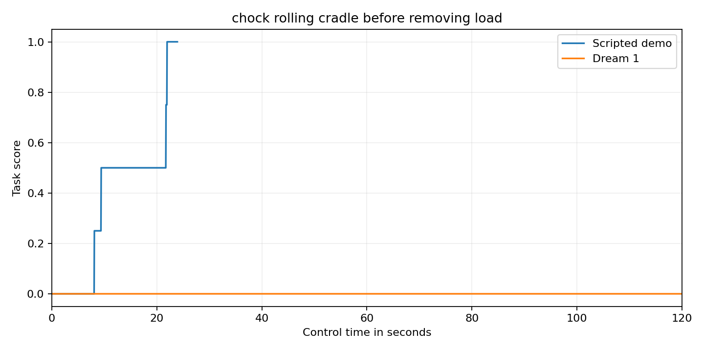

Chock a rolling cradle before removing its load

A rolling cradle can shift while a robot removes its load. Each arm first places a chock on one side of the cradle. Only after both chocks are seated may an arm lift the load and place it on the white storage pad. The equipment is unpowered.

Setup

Use the official bimanual YAM station. The tabletop is at z 747.5 mm. x points forward. y points left. z points up. All props are rigid PA12 polymer prototypes. All joint positions start at zero. The rolling cradle has an initial outer envelope of 140 by 100 by 105 mm. Its authored root is at x 280 mm and y 0 mm and z 792.5 mm. Its initial yaw is 0.0 radians. Its mass is 2.4 kg. Its root is free to move. The left chock has an initial outer envelope of 120 by 139 by 72 mm. Its authored root is at x 160 mm and y 130 mm and z 747.5 mm. Its initial yaw is 0.0 radians. Its mass is 0.1 kg. Its root is free to move. The right chock has an initial outer envelope of 120 by 139 by 72 mm. Its authored root is at x 210 mm and y -130 mm and z 747.5 mm. Its initial yaw is 0.0 radians. Its mass is 0.1 kg. Its root is free to move. The load has an initial outer envelope of 45 by 45 by 100 mm. Its authored root is at x 280 mm and y 0 mm and z 862.5 mm. Its initial yaw is 0.0 radians. Its mass is 0.1 kg. Its root is free to move. The storage pad has an initial outer envelope of 70 by 70 by 2 mm. Its authored root is at x 200 mm and y -300 mm and z 748.5 mm. Its initial yaw is 0.0 radians. Its root is fixed to the tabletop. The inventory lists each collider and body mass and joint anchor and travel limit. Local solid positions are measured from the named body root. Outer envelope sizes describe the reset pose.

Scoring

Score zero if the cradle centre ever moves more than 10 mm from its starting position or the load falls more than 4 mm below the tabletop. Moving the load relative to the cradle by more than 5 mm on any axis while either chock is not seated scores zero. Both chocks must remain seated after removal. Each chock must have its centre within 4 mm in x and y of x 280 mm and y plus or minus 114.5 mm. Its lower face must be within 3 mm of the tabletop. Tilt and yaw must each be below 5 degrees. One seated chock earns 0.25. Both seated chocks earn 0.5. The load must then have its centre within 5 mm on every axis of the storage pad target at x 200 mm and y negative 300 mm and z 799.5 mm. The load and cradle must move below 8 mm per second and rotate below 0.1 radians per second. Cradle tilt must be below 5 degrees. This earns 0.75. Both measured grippers open beyond 35 mm raises this to 1.0. Full success must hold for 2 seconds. All other outcomes score zero.

Fidelity

The grey cradle is a rigid cylindrical shell with a fixed internal ballast. Total mass is 2.4 kg with the centre of mass 24 mm below the axle. The blue chocks and orange load are rigid printed PA12 polymer. The cylinder and chocks contact physically. The white pad is fixed on the tabletop. No powered restraint or human load is present.

Run and reset

Use the official YAM launchable. Run from this task folder. Install the runtime in the simulator environment. Install the policy adapter included in this folder. It uses inspect_robots_dream with the current Dream SDK bridge. Install dreamlabs version 1.0.37 and dreamlabs-client version 1.1.3. Start policy/current_api_bridge.py in a separate process with DREAM_BRIDGE_PORT=8241 and JAX_PLATFORMS=cpu. The Dream credential stays outside the repository.

```bash
source /data/IsaacLab-Arena/yam.env
uv pip install --python /data/IsaacLab-Arena/.venv/bin/python --no-deps -e runtime -e policy
TASK_INSTRUCTION=$(python -c 'import json; print(json.load(open("task.json"))["instruction"])')
OPENBLAS_NUM_THREADS=1 OMP_NUM_THREADS=1 MKL_NUM_THREADS=1 inspect-robots run \
  --embodiment yam_articulated --policy dream_current \
  -P server_url=http://127.0.0.1:8241 \
  -E task="$PWD/task.py" -E object_jitter=0 -E control_hz=20 \
  -E cam_width=1280 -E cam_height=720 --seed 0 --epochs 1 \
  --instruction "$TASK_INSTRUCTION" --scorer task_score --max-steps 2400 \
  --store-frames --log-dir runs/model
```

For the demo use yam_scripted and omit the server_url option. Use a separate log directory. Each trial starts from a fresh reset. Restore every object to the starting pose in scene_inventory.json and every joint to zero. Nothing is consumed. Use one epoch with seed 0 and object_jitter=0.

The current model and demo receipts are stored in validation.json. Scores come from the measured task scorer. A failed API trial is not scored as a valid zero. Model session expiry fails the trial. The model has no scripted fallback. Native camera videos are 1280 by 720 at 20 frames per second. Every recording includes its initial frame and every control step. Render a completed log with inspect-robots video LOG.json.

The source hashes and video checksums describe the evaluated revision. This is an unpowered simulation prototype. The mechanical idea is unchanged from the earlier submission. The revision strengthens the safety gates and supplies separate genuine model evidence.

Recorded score trace



The blue curve is the separate scripted demo. The orange curve is the genuine Dream 1 run. The underlying sampled values are in evidence/score_series.json.
