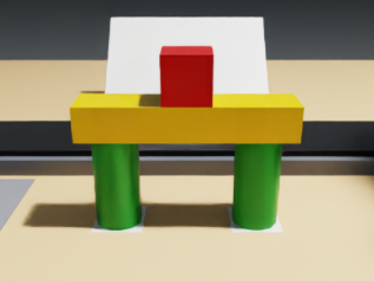

# Build the model in a photo from parts riding past on a conveyor, picking out look-alikes and parking early arrivals

Instruction given to the policy (from `task.json`):

> Build the model shown in the photo on the card, standing on the two white marks, from the parts riding on the
> conveyor. Take only the parts the model needs off the belt and let every other part ride off the end. You may
> park parts on the grey mat. Don't hold parts back on the running belt.

A belt runs left to right across the far side of the station table at 40 mm/s and off the right edge into a tote.
Eight parts ride on it, one every 5 s. Beyond the belt a card leans back on the table, facing the arms, with a
photo of the finished model: two tall green cylinders on the white marks, a yellow beam across them and a red cube
on the middle of the beam. The instruction names none of this; the photo is the only description of the model.

Every extra part differs from a model part in one feature: a green square post (shape), an orange beam (colour), a
blue cube (colour) and a short green cylinder (height). In belt order the parts are the red cube, the square post,
the yellow beam, the orange beam, the blue cube, a tall cylinder, the short cylinder and the other tall cylinder.
The cube and the beam arrive before the cylinders they rest on, so they must be taken off and parked; a part let
past the end of the belt is gone.



## Files

| File | What |
|---|---|
| `task.py` | The yam_arena task file: objects, `success()`, `score()`, `distance()`, `demo()` |
| `layout.py` | Every dimension, position, mass and the belt's speed and timing (NumPy only) |
| `scoring.py` | The scoring rules and the jam watch (NumPy only) |
| `scenekit.py` | Makes the `belt` box a kinematic slab with PhysX surface velocity; leans the card back and maps the photo onto it |
| `photo.png` | The photo on the card (640 x 480) |
| `make_photo.py` | Re-renders `photo.png` in the simulator (one step, studio mode) |
| `studio.py` | The studio camera that takes the photo, in front of the model and 25 degrees down |
| `demo_plan.py` | The two-arm scripted demo and three scripted baselines (NumPy only) |
| `check_plan.py` | Offline kinematic check of every scripted plan (no GPU) |
| `run.sh` | One scored trial with the instruction from `task.json` |
| `tests/test_scoring.py` | The scoring rules on hand-built states (no simulator) |

`scenekit.py` wraps `yam_arena.scene.task_object` when that module loads, without modifying yam_arena, so the task
runs with the standard `yam_arena` embodiment, `yam_scripted` policy and `task_score` scorer. It also draws the three
green cylinders round over box colliders: PhysX's convex cylinders rocked and tipped on the surface-velocity belt
(with the arms parked, every cylinder was knocked or fell within the first 12 s), while upright square prisms ride,
stand, are gripped across 40 mm and carry the beam as the round posts do.

## Environment

Install [yam-arena](https://github.com/kairosiann/yam-isaac-lab-arena) at
`bd62771e60320433893bd1d2df0fc79b5ddcd6d1` with its setup instructions and source `yam.env` (Isaac Sim 6.1,
Isaac Lab 3.0, Inspect Robots). Simulation needs an RTX GPU for the cameras.

**The belt needs CPU physics, `-E device=cpu`.** PhysX applies surface velocity through contact modification, which
runs only in its CPU pipeline. `run.sh` passes it; the task refuses to start on GPU physics, and also without
`-E object_jitter=0` (the parts start in a fixed line on the belt).

## The photo

`photo.png` is the simulator's own picture of the finished model. With `CONVEYOR_STUDIO=1` the task spawns the four
model parts already assembled on the marks, the extra parts in the tote and the card blank, and moves the overhead
camera to the studio camera (`studio.py`: 0.36 m in front of the model, 25 degrees down, so the cylinders' height
shows); `make_photo.py` runs one scripted step at 1920 x 1080, projects the model's corners through that camera,
crops them with a margin to 4:3 and saves 640 x 480. To re-render it:

```bash
python tasks/conveyor-photo-build/make_photo.py /tmp/photo-studio
```

On a real rig, print a photo of the real finished model on the marks, taken from above and in front of the arms, at
the card's size.

## Offline checks, no GPU

From the root of this repository, with yam-arena importable:

```bash
python -m pytest tasks/conveyor-photo-build/tests -q
python tasks/conveyor-photo-build/check_plan.py
```

The tests cover the start (0), the finished model (1.0, success), either cylinder on either mark, the beam either
way round and the cube on any face; each tolerance just inside and just outside (cylinder 10 mm and 5 degrees, beam
10 degrees and 15 mm, cube 10 mm and 5 degrees, 4 mm heights); the cylinders' true extent at any tilt; each
look-alike in a model part's place earning nothing (the short cylinder or the square post on a mark, the orange beam
across the cylinders, the blue cube on the beam); a beam without both cylinders and a cube without the beam earning
nothing; moving parts earning nothing; 0.25 off for each extra part kept back (one to all four), never below 0; parts
riding the belt never jamming; a part stopped on the belt for 2.5 s, held with a jittering velocity or dragged along
at 6 mm/s jamming the line (0 even with the model built), while a 1.4 s stop during a catch, a part slowed to
12 mm/s, a cylinder stalled for 1 s and knocked over upstream, a part lifted off the belt or parts lying still in the
tote under the end of the belt do not; and a reset clearing the jam. `check_plan.py` replays the demo and the
baselines through the arm kinematics at 20 Hz: every IK solution within 1 mm and 1 degree, every joint at least
2 degrees inside its limits, each catch closing where the part will be, and the hands at least 15 cm apart.

## Run and score a trial

From the root of this repository:

```bash
bash tasks/conveyor-photo-build/run.sh "$(which python)" dream ~/yam-eval/photo-dream
bash tasks/conveyor-photo-build/run.sh "$(which python)" yam_scripted ~/yam-eval/photo-demo
```

`run.sh` runs `inspect-robots run --embodiment yam_arena` with `-E task=tasks/conveyor-photo-build/task.py
-E device=cpu -E object_jitter=0 -E control_hz=20 -E cam_width=320 -E cam_height=176`, the instruction from
`task.json`, `--scorer task_score --max-steps 2400 --seed 0 --store-frames`, and an environment revision hashing
every `.py` file in this folder. `task_score` is 1.0 when `success()` has held for 1 s (the episode ends with
`termination_reason="success"`), otherwise `score()` at the end of the episode.

Scripted baselines (fourth argument; `CONVEYOR_PLAN` selects the plan `demo()` returns):

```bash
bash tasks/conveyor-photo-build/run.sh "$(which python)" yam_scripted ~/yam-eval/photo-base no_staging
bash tasks/conveyor-photo-build/run.sh "$(which python)" yam_scripted ~/yam-eval/photo-base hold_on_belt
bash tasks/conveyor-photo-build/run.sh "$(which python)" yam_scripted ~/yam-eval/photo-base keep_extra
bash tasks/conveyor-photo-build/run.sh "$(which python)" yam_scripted ~/yam-eval/photo-base idle
```

- `no_staging` takes each part only when it can be fitted: the cube and the beam ride off before the cylinders stand.
- `hold_on_belt` is the demo with the right arm holding the second tall cylinder still on the belt for 2.5 s first.
- `keep_extra` is the demo with the right arm also taking the green square post off the belt.
- `idle` parks both arms clear of the belt and holds them there while every part rides off.

## Scripted demo

Open loop, both arms. The left arm, upstream, catches the red cube (3 s) and the yellow beam (13 s) as they ride
past and parks them on the staging mat, lets the square post, the orange beam and the blue cube ride on, and
catches the first tall cylinder (23.8 s) and stands it on the left mark. The right arm, downstream, lets the short
cylinder pass, catches the second tall cylinder (48.75 s), stands it on the right mark and moves clear. The left arm
then lays the beam across the cylinders and sets the cube on the middle of the beam. A part is caught by parking the
open fingers across the belt where the part will be, letting it ride in between them and closing while the hand
moves along with the belt; each grip closes 8 mm narrower than the part. The plan reads the photo's answer from
`layout.py`; it is evidence that the task can be done within the run limit, not a vision pipeline.

## Scoring

See `task.json` and `scoring.py`. Gate: a part that rests on the belt for 3 s in a row and goes less than 30 mm
downstream in that time (a free part goes 120 mm; stopping it for about 2.25 s or more) has been held back; that jams
the line and the trial scores 0. Knocking a part over on the belt does not by itself count as holding it back.
Otherwise 0.2 per tall green cylinder standing on a mark, 0.3 for the yellow beam across both, 0.3 for the red cube
on the middle of the beam, each at rest, less 0.25 for each extra part that did not ride off the end of the belt,
never below 0. Success (1.0, ends the trial): the model complete, all four extra parts gone downstream, no jam, held
for 1 s.

## Results

All runs with the code in this folder, seed 0, `-E object_jitter=0`, `-E device=cpu`, 20 Hz, a 2,400-step limit,
320 x 176 cameras, on one RTX 4070 Ti SUPER, with `run.sh`.

| Run | Log | `task_score` | Ended by | Steps |
|---|---|---|---|---|
| Dream-1 (`dreamlabs/dream-1-beta`) | `adhoc_a7fe218f.json` | 0.0 | `max_steps` | 2,400 |
| Scripted demo | `adhoc_017b7f18.json` | 1.0 | `success` | 1,445 |
| Scripted demo, two more fresh simulator starts | `adhoc_98eebce6.json`, `adhoc_075810ba.json` | 1.0, 1.0 | `success` | 1,445 each |
| `no_staging` | `adhoc_9fb19314.json` | 0.4 | `policy_stop` | 1,206 |
| `hold_on_belt` | `adhoc_8bbd8183.json` | 0.0 | `policy_stop` | 1,590 |
| `keep_extra` | `adhoc_6b28c1d4.json` | 0.75 | `policy_stop` | 1,540 |
| `idle` | `adhoc_282e9022.json` | 0.0 | `policy_stop` | 2,101 |

Every log has `eval.environment_revision` `7cad316fb524`, the hash `run.sh` takes of this folder's `.py` files.
Dream-1 moved both arms but took no part off the belt; all eight rode into the tote, and nothing was held back.

`no_staging` stands both tall cylinders and nothing else: the cube and the beam ride off the end before the cylinders
arrive. In `hold_on_belt` the model is complete at the end, but the second tall cylinder was held still on the belt
for 2.5 s, so the line jammed (from 52 s) and the trial scores 0. In `keep_extra` the model is complete and the green
square post sits on the table instead of riding off, so 0.25 comes off. In `idle` every part rides on the belt, upright,
into the tote. These are scripted attempts, evidence about those strategies, not proof that no other strategy scores.

## Runtime and seeds

- Run limit: 2,400 control steps at 20 Hz (120 simulated seconds), `--max-steps 2400`.
- Wall time per trial on an RTX 4070 Ti SUPER with CPU physics, including about 30 s of Isaac Sim start-up:
  the scripted demo about 1.5 min (92 s); Dream-1 about 3 min (169 s) for 2,400 steps; `make_photo.py` under 1 min.
- Seeds: `--seed 0` for every run; `-E object_jitter=0` fixes the layout, and the open-loop demo needs it. Dream-1 is
  a hosted model without a seed, so its trials are not bitwise reproducible; the demo is.

## Submitted media

- Dream-1 run: the `top_cam` stream of `adhoc_a7fe218f.json` (`task_score` 0.0, 2,400 steps).
- Demo: the `top_cam` stream of `adhoc_017b7f18.json` (`task_score` 1.0, `success` after 1,445 steps).
- Setup screenshot: frame 0 of the top camera from the demo command with `-E cam_width=640 -E cam_height=360
  --max-steps 1`; the card with the photo leans behind the belt, and the red cube, the square post and the yellow
  beam are on the table's part of the belt, the other five parts still upstream past the table's left edge.

Videos were rendered with `inspect-robots video <log>` (one H.264 MP4 per camera) and re-encoded with
`ffmpeg -i <top_cam>.mp4 -c:v libx264 -pix_fmt yuv420p -movflags +faststart out.mp4`.

## Reset between trials

Nothing is consumed. With the belt stopped, stand the eight parts back on the belt at their starting positions in
order, empty the tote, start the belt and start the trial. The simulator's reset does this; its belt runs through
the 0.5 s settle, so the parts spawn 20 mm upstream of their stated starting positions.

## Fidelity

The belt is a fixed kinematic slab whose surface carries what rests on it (no rollers, stretch or slip), and it runs
on CPU physics. All parts are rigid with one friction; the green cylinders collide as square prisms of the same
width and height. The photo is the simulator's render of the model, mapped onto the card as a matte texture. The jam is a scoring rule: a held part does not stop the belt in
simulation.
