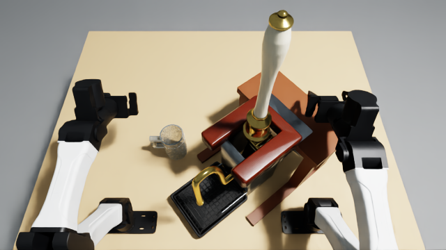

# Serve ale with a UK hand-pull beer engine without spilling

> Use the hand-pull beer engine to serve at least 400 mL of ale in the glass without spilling any beer outside it.

**Native scripted demo: 1.0; Dream-1: 0.0.** The [complete 72-second demo](evidence/demo.mp4) retains 421.2175 calibrated mL with zero recorded spill. All 34,560 native samples reproduce the frozen scorer. An independent approximate surface check gives 413.16 mL at the endpoint. See [results and limitations](validation.json) and the [measured progress trace](evidence/demo-progress.png).

The [actual Dream-1 recording](evidence/dream.mp4) completes the same action limit with no delivery and score 0.0; it made 30 inference requests without evaluation errors. The [canonical Inspect result](evidence/dream-inspect.json) and [audit](evidence/dream-audit.json) are included. Its video includes the reset observation plus 1,440 results (72.05 seconds); the scripted video has 1,440 result frames (72 seconds).

Repeated positive-displacement pumping must be coordinated with glass interception/support. Either arm may hold the glass or pull/return the handle. Grasp, tilt, route and stroke count earn no credit; foam quality and safety reasoning are not evaluated.

## Setup and reset



Use the calibrated bimanual YAM station, unchanged top/wrist cameras, 640 × 360 recordings. Coordinates: metres, X away from bases, Y left, Z up; tabletop Z = 0.7475. Left starts READY; right joints [0, 0.8, 1, -0.6, 0, 0] rad. Grippers open; cap 40 N per finger.

| Object | Dimensions and material | Fixed starting state |
| --- | --- | --- |
| Mug | Glass-like hollow mug, 350 g; inner/outer radii 36/40 mm, 8 mm base, rim 131 mm above base pose, ~500 mL; 400 mL line. Handle opening ~28 × 43 mm, bar 16 × 12 mm. | Empty, upright; base (0.26, 0.16, 0.7475), handle +Y. |
| CQ hand-pull engine | Brass/steel/mahogany-effect reconstruction, cream handle; native crank/rocking cylinder/piston. Approximate published spans: 412.75 mm above mount, 257.175 mm below, 180.975 mm outlet-to-tray; maximum clamp clearance 50.8 mm. | Mount (0.18, -0.10, 1.0125), yaw -0.9 rad; handle upright, cylinder/line primed. Outlet approximately (0.011913, 0.047468, 0.9725). |
| Counter frame | Fixed wooden support: 150 × 330 × 25 mm mounting board, four 35 × 35 × 225 mm posts, two 355 × 35 × 15 mm feet; board 265 mm above table. | Secured fixture; solids/transforms in `geometry.py`. Clamp is not attached to the 60 mm station table. |
| Drip tray | Original brass-effect tray/grate, ~190 × 158 mm. | Attached below outlet; liquid entering it counts as spilled. |
| Dispensed liquid | Amber water-like PhysX PBD fluid, estimated density 1005 kg/m³; 3 mm nominal spacing, 0.0187 mL per particle; no foam/carbonation. | No dispensed particles; ideal primed upstream boundary. |
| Physical supply | Compatible food-grade beer line and vented 2 L water reservoir below tabletop. | Stationary supply, represented by the simulation boundary; not manipulated or scored. |

Product dimensions are approximate. Pin locations, 60-degree stroke, masses/inertia, spring/damping, collision proxies and nozzle routing are estimates. The 40 mm lateral nozzle offset is a clearance estimate. [Dimensions](assets/cq/DIMENSIONS.json) and [sources](SOURCES.json) identify facts/estimates. The [dimensioned fixture plan and cut list](assets/cq/fixture-plan.svg) specifies the wooden support.

For physical registration, use the unmodified product spout and position the stand so its outlet is within 5 mm of the stated outlet coordinate; record the resulting mount position. The estimated mount-to-outlet transform is not a manufacturer dimension. Recheck real arm clearance and pull load: the simulated 40 N finger cap does not establish a measured CQ force match.

Sourcing checked 19 November 2026: a new [Angram CQ](https://shop.angram.com/categories/hand-pumps) starts at £318 excluding VAT, made to order; shipping is extra. [SOURCES.json](SOURCES.json) records a cheaper genuine quarter-pint engine comparison, not a verified geometry/force drop-in. Obtain the named product or verify an alternative before physical trials.

Use noncarbonated potable water at 20 ± 2 °C, optionally one food-grade amber-color drop/litre: an ale stand-in, not a beverage-quality test. Use one batch and refill to the same reservoir mark. Prime at least three complete cycles into a waste jug until visibly air-free; remove it. Calibrate the 400 mL line with a kitchen measure.

Protect the rig with a waterproof deck cover, dry white witness liner, catch pan and loose wrist splash sleeves. Keep pads dry/uncovered; protection cannot assist grasping or obstruct motion. Tray/protections earn no credit. Reset with dry empty mug/tray/surfaces, fresh liner and declared starts. Use a fresh process/output and require native reset validation.

## Scoring and action budget

At the fixed endpoint: **0 after any resolved spill; otherwise min(current retained mL / 400, 1)**. Empty/no action = 0; clean 100 mL = 0.25; clean ≥ 400 mL = 1. Recapture never clears failure. Historical maximum, pump volume and hand identity earn no credit.

`scoring.py` reads unsmoothed native positions at 480 Hz. Retained particles have mug-local radius ≤ 36 mm and height 8–131 mm. Nozzle-to-mouth flight earns no credit. Centres within physical wall/base thickness form an unresolved, uncredited contact band, not exterior spills. Above the rim, escape uses the rim circle’s horizontal projection, so a vertical return through a tilted opening is not falsely rejected.

Central splashes above the opening are pending and may return without failure. Escaping the outer 40 mm footprint, missing below the rim, passing below the bottom, reaching the table uncontained, leaving the monitored workspace or entering the tray is a spill. One resolved particle permanently latches zero. Missing/nonfinite/frozen/incomplete readback invalidates evaluation.

Below the rim, the physical glass-local wall/base envelope applies. Above it, intersect the world-vertical line through each airborne particle with the moving rim plane to check its horizontal footprint. Particle volume is a nominal quantum, not exact spatial/free-surface volume; sub-resolution spray is absent.

Physical checks: video, dry witness surfaces/tray and final contents on a tared 1 g scale (water: 1 g ≈ 1 mL). Any observed exterior escape or wet tray/liner latches zero; a central returned splash does not. Mass alone cannot establish no spill. Human checks do not claim 0.0187 mL/sub-millimetre resolution.

Budget: **1,400 actions at 20 Hz (70 s), then 40 repeats of the final action (2 s observation tail)**; seed 0, fixed layout. Late commands cannot change the tail; the simulator never closes/releases the handle for the policy. The complete scripted trial took 17.5 minutes on an RTX 3090 with three camera feeds and raw evidence recording. Short diagnostics do not establish completion.

## Mechanism and fidelity

Contact drives the passive native crank-pin/piston linkage. Positive measured piston displacement supplies liquid at 142.0653125 mL per nominal full stroke; return/refill and stationary piston supply nothing. Sub-1 µm motion accumulates; raw/accepted readings are logged. Unresolved volume is < 0.003417 mL per monotonic endpoint, not arbitrary reversals. No timed valve, full-home gate or glass-aware source.

The inlet is 3 mm below the lip. Measured volume accumulates until a complete packed cross-section (alternating 19 and 14 particles) is available; pending volume remains explicit and uncredited. Displacement-derived flow divided by the physical 13 mm bore area sets birth velocity; PhysX then moves the particles. Supply follows on the next physics substep (`next_step_displacement_ml` logs it). Upstream supply/check valves are idealized; foam/carbonation are absent.

Packed planes use 3 mm horizontal/2.598 mm axial spacing. Native 100 mL and late-fill samples fitted 0.01868278 mL/sample, rounded to **0.0187 mL** in source volume, scoring and particle mass. A held-out 200 mL trial retained 199.9965 calibrated mL, with a geometric proxy of 201.45 ± 0.15 mL. The complete empty-to-goal robot trial ends at a 413.16 mL geometric proxy; its final-second mean is 418.23 ± 3.64 mL. These approximate surface measurements support the 400 mL outcome, not exact volume metrology. Particle mass is density × calibrated volume; mass-only set density compensates the USD importer's float32 volume floor. An amplified single-particle mass check passed; this does not validate bulk weight transfer.

The demonstrated configuration uses coupled 16-position/4-velocity rigid settings, matching YAM’s defaults, and 16 particle position iterations at 480 Hz. Earlier high rigid counts masked particle-only changes. Water coefficients remain unchanged. Native scripts may read state to plan but issue only robot joint/gripper commands.

**Bulk coupling remains approximate:** a prior 100 mL calibration added 13.154 g support-equivalent for 100.494 g declared mass. Dense liquid under-transfers weight, so this is not a force-calibrated liquid benchmark. The reference raises the mug around the outlet, then lowers it to maintain about 10 mm above the measured bulk pool; it stops delivery at 420 calibrated mL as a margin. Earlier spill, warm-start, camera and solver failures remain in the [unmodified development history](evidence/development-validation.json.gz).

The [raw demo receipt](evidence/demo-receipt.json) retains a failed directory fingerprint flag: three generated USD files appeared when the host's temporary-directory fallback chose the source folder. The [independent audit](evidence/demo-replay.json) verifies every original input byte and the original fingerprint; no simulation input changed. Set an external writable temporary directory as below.

## Install and run independently

Use Linux/NVIDIA RTX with pinned Isaac Sim 6.1.0.0, Isaac Lab `91a0906f93802eb859192dcb0bca879f891e92d6`, Arena (metadata 0.3.0) and YAM below. Read NVIDIA terms; set `OMNI_KIT_ACCEPT_EULA=YES` yourself. See [prerequisites](https://github.com/kairosiann/yam-isaac-lab-arena/tree/bd62771e60320433893bd1d2df0fc79b5ddcd6d1#quickstart). The demonstrated trial ran from an unpacked standalone archive; a fresh dependency installation on a second machine has not been tested.

This task folder includes the runtime and runner. Start in this folder:

```bash
CQ_TASK_DIR="$PWD"
CQ_RUNTIME_DIR="$(dirname "$CQ_TASK_DIR")/cq-runtime"
mkdir "$CQ_RUNTIME_DIR"
cd "$CQ_RUNTIME_DIR"
git clone https://github.com/isaac-sim/IsaacLab-Arena.git
git -C IsaacLab-Arena checkout -B release/0.3.1 c7edf3a9d5d8276565208f72422f8f8a0806d6cf
git clone https://github.com/kairosiann/yam-isaac-lab-arena.git yam-arena
git -C yam-arena checkout bd62771e60320433893bd1d2df0fc79b5ddcd6d1
cd yam-arena
ARENA_DIR="$CQ_RUNTIME_DIR/IsaacLab-Arena" \
DREAM_SPEC=git+https://github.com/kairosiann/inspect-robots-dream@b5e936a201cec66c54c297e522c920d98445e339 ./setup.sh
source "$CQ_RUNTIME_DIR/IsaacLab-Arena/.venv/bin/activate"
uv pip install --override overrides.txt inspect-robots==0.60.0 inspect-robots-yam==0.37.0 dreamlabs-client==1.0.14
cd "$CQ_TASK_DIR"
uv pip install -e .
```

Use `BEER_PHYSICS_GPU=0` for GPU dynamics/CPU readback. Other indices require the movement guard; frozen readback invalidates runs. There is no host or `.git` restriction. Keep outputs and temporary USDs outside the source directory:

```bash
CQ_OUTPUT_DIR="$(dirname "$CQ_TASK_DIR")/cq-output"
mkdir -p "$CQ_OUTPUT_DIR/tmp" "$CQ_OUTPUT_DIR/optix"
export TMPDIR="$CQ_OUTPUT_DIR/tmp" OPTIX_CACHE_PATH="$CQ_OUTPUT_DIR/optix"
export PYTHONPATH="$CQ_TASK_DIR${PYTHONPATH:+:$PYTHONPATH}"
```

```bash
BEER_PHYSICS_GPU=0 python -m tools.run_recovery_pilot . "$CQ_OUTPUT_DIR/hold" \
  --policy hold --device cpu --seed 0 --design-review handpull-review.json
BEER_PHYSICS_GPU=0 python -m tools.run_recovery_pilot . "$CQ_OUTPUT_DIR/serve" \
  --policy serve --device cpu --seed 0 --design-review handpull-review.json
```

`hold` checks linkage/rendering; `acquire_glass` isolates positioning; `one_pull` is diagnostic; `serve` attempts the full reference. Privileged state plans robot joint/gripper commands only. Fresh outputs contain images, three H.264 clips, traces, frozen sources and scorer/receipt data.

Configure Dream credentials outside committed files; from the standalone folder:

```bash
BEER_PHYSICS_GPU=0 python -m inspect_robots.cli run --config /dev/null \
  --embodiment resist_isaac --policy dream \
  -P model=dreamlabs/dream-1-beta -P dry_run=false -P record=false -P server_url=null \
  -E task="$PWD" -E condition=recoverable -E device=cpu -E control_hz=20 \
  -E cam_width=640 -E cam_height=360 -E object_jitter=0 \
  -E evidence_dir="$CQ_OUTPUT_DIR/dream/native" \
  --instruction "Use the hand-pull beer engine to serve at least 400 mL of ale in the glass without spilling any beer outside it." \
  --scorer task_score --max-steps 1440 --epochs 1 --seed 0 \
  --grader none --no-prompt --store-frames --no-rerun --no-rerun-save \
  --log-dir "$CQ_OUTPUT_DIR/dream/inspect"
```

Report final-step `task_score` from canonical Inspect JSON; completed evaluation is not success, and errors are unscored. Encode with `python -m inspect_robots.cli video <canonical-log.json> --out /tmp/cq-dream-video --fps 20`.

## Refine the task

`geometry.py`: apparatus/contact solids; `cq_assets.py`: reproducible meshes/texture/manifests; `pump.py`: joints/metering; `fluid.py`: inlet/liquid; `task.py`: reset/stepping/evidence; `controller.py`: reference actions; `contacts.py`: contact evidence; `scoring.py`: outcomes. `pilot.json` sets budget/seed; `task.json` describes the task submitted for review.

Read [design review](handpull-review.json) and [validation](validation.json). `probe_fluid.py` isolates liquid; `replay.py` rechecks traces. Arithmetic checks do not validate physics. The full native demo, frozen replay and actual Dream-1 run are complete.

## Assets and licenses

Original CQ meshes/texture, mug, frame, code/documents are MIT (`LICENSE`, `assets/cq/LICENSE`). No manufacturer CAD/photos/drawings are bundled or relicensed.

Third-party **I2RT YAM arms/parallel grippers are MIT**, copyright I2RT Robotics (source pinned by the license link below). Under dependency `yam_arena/assets/yam/`: `yam_arm.urdf`; `assets/{base,link1,link2,link3,link4,link5,gripper,tip_left,tip_right}.stl`; derived `collision/` and `usd/yam_arm/`; `dream/link2_{black,white}.stl`, `link3_{black,white}.stl` (I2RT splits from `dreamlabs` 1.0.23; see `dream/SOURCE`). These are dependency-loaded, not bundled.

MIT permits use/copying/modification/redistribution/sublicensing/sale, retaining notices and warranty/liability disclaimers. Preserve `LICENSE.i2rt` with redistributed robot assets ([license](https://github.com/i2rt-robotics/i2rt/blob/120c3c81400171174604e503943f8d1ebc891058/LICENSE)); see `SOURCES.json` for provenance.

External `yam-arena` generates floor/table/camera stand (`scene.py`, `station.py`) and declares no integration-code license. I2RT MIT applies only to robot assets. This package imports that runtime without bundling/relicensing it or NVIDIA software.
