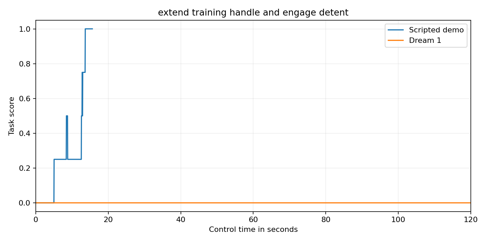

Extend a training handle and engage its detent

Adjustable assistive equipment must lock at a selected setting before release. This unoccupied training module tests pin withdrawal and measured extension followed by positive pin engagement. Extension alone does not earn full credit. It is a tabletop mechanism and must never support a person.

Setup

Use the official bimanual YAM station. The tabletop is at z 747.5 mm. x points forward. y points left. z points up. All props are rigid PA12 polymer prototypes. All joint positions start at zero. The adjustable handle has an initial outer envelope of 340 by 90 by 120 mm. Its authored root is at x 140 mm and y -30 mm and z 807.5 mm. Its initial yaw is 0.0 radians. Its root is fixed to the tabletop. The locking pin has an initial outer envelope of 80 by 174 by 109 mm. Its authored root is at x 140 mm and y 25 mm and z 807.5 mm. Its initial yaw is 0.0 radians. Its root is fixed to the tabletop. The length mark has an initial outer envelope of 3 by 25 by 1 mm. Its authored root is at x 320 mm and y -75 mm and z 748 mm. Its initial yaw is 0.0 radians. Its root is fixed to the tabletop. The inventory lists each collider and body mass and joint anchor and travel limit. Local solid positions are measured from the named body root. Outer envelope sizes describe the reset pose.

Scoring

Score zero if extension is between 5 mm and 75 mm while pin retraction is 45 mm or less. The green pin must retract more than 45 mm before handle extension exceeds 5 mm. Extension beyond 5 mm before this unlock makes the entire episode score zero. A correct unlock earns 0.25. Extension within 2 mm of 80 mm earns 0.5 after the unlock. Pin retraction below 2 mm and handle speed below 4 mm per second raises this to 0.75. Both measured grippers open beyond 35 mm raises this to 1.0. Full success must hold for 2 seconds. All other outcomes score zero.

Fidelity

This is a rigid printed training module with no human load. The slider and locking pin are separate passive articulations with physical contact. The handle has two actual transverse rectangular openings. The pin fits into the selected opening and blocks extension by contact. The pin spring stiffness is 35 newtons per metre with damping 0.8 and maximum force 2.5 newtons. The model does not represent structural load capacity or clinical suitability.

Run and reset

Use the official YAM launchable. Run from this task folder. Install the runtime in the simulator environment. Install the policy adapter included in this folder. It uses inspect_robots_dream with the current Dream SDK bridge. Install dreamlabs version 1.0.37 and dreamlabs-client version 1.1.3. Start policy/current_api_bridge.py in a separate process with DREAM_BRIDGE_PORT=8241 and JAX_PLATFORMS=cpu. The Dream credential stays outside the repository.

```bash
source /data/IsaacLab-Arena/yam.env
uv pip install --python /data/IsaacLab-Arena/.venv/bin/python --no-deps -e runtime -e policy
TASK_INSTRUCTION=$(python -c 'import json; print(json.load(open("task.json"))["instruction"])')
OPENBLAS_NUM_THREADS=1 OMP_NUM_THREADS=1 MKL_NUM_THREADS=1 inspect-robots run \
  --embodiment yam_articulated --policy dream_current \
  -P server_url=http://127.0.0.1:8241 \
  -E task="$PWD/task.py" -E object_jitter=0 -E control_hz=20 \
  -E cam_width=1280 -E cam_height=720 --seed 0 --epochs 1 \
  --instruction "$TASK_INSTRUCTION" --scorer task_score --max-steps 2400 \
  --store-frames --log-dir runs/model
```

For the demo use yam_scripted and omit the server_url option. Use a separate log directory. Each trial starts from a fresh reset. Restore every object to the starting pose in scene_inventory.json and every joint to zero. Nothing is consumed. Use one epoch with seed 0 and object_jitter=0.

The current model and demo receipts are stored in validation.json. Scores come from the measured task scorer. A failed API trial is not scored as a valid zero. Model session expiry fails the trial. The model has no scripted fallback. Native camera videos are 1280 by 720 at 20 frames per second. Every recording includes its initial frame and every control step. Render a completed log with inspect-robots video LOG.json.

The source hashes and video checksums describe the evaluated revision. This is an unpowered simulation prototype. The mechanical idea is unchanged from the earlier submission. The revision strengthens the safety gates and supplies separate genuine model evidence.

Recorded score trace



The separate demo and model traces are in evidence/score_series.json.
