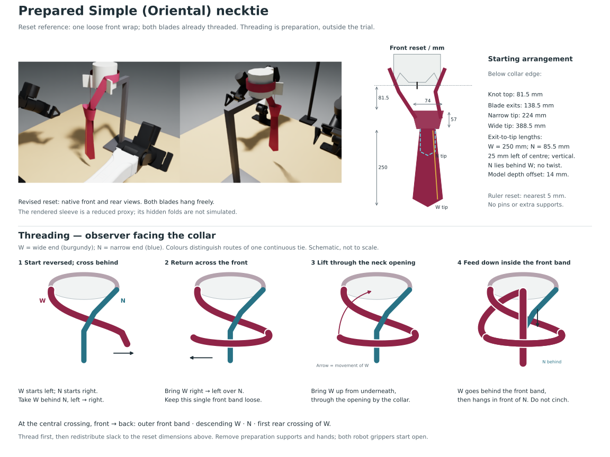

# Tighten and fit a loose necktie

Finish a prepared necktie on a collar form: hold the knot, draw the wide blade
through, slide the knot up, and release both hands. The knot starts threaded
but loose. This task does not claim to tie a knot from an untied strip.

## Prepared knot and reset

The physical reference is a **Simple (Oriental) necktie knot**, with one front
wrap. It is not a Four-in-Hand or Windsor knot. The simulator represents its
prepared state with a sliding outer sleeve; it does not resolve the internal
crossings. The diagram below specifies the physical threading that the earlier
setup image left ambiguous. Its coloured routes identify two parts of the same
continuous tie, not separate pieces.



**Threading.** All left/right directions below are from an observer facing the
collar, as in the diagram. W is the wide end; N is the narrow end.

1. Drape the tie around the form, W on the observer's left and N on the right.
   Start with the reverse face outward. This tie is reversible; use the gold
   stripe to keep track of twists.
2. Take W **behind N**, from left to right.
3. Bring W back **in front of N**, right to left, making one loose front band.
4. Lift W through the neck opening from underneath, then feed it down **behind
   that front band and in front of N**. Leave it loose; do not cinch it.

This is the Simple knot's under/over sequence, also illustrated in the
[Ties.com Simple knot guide](https://www.ties.com/how-to-tie-a-tie/simple).
The diagram here uses the facing observer's view rather than the wearer's
left/right. Threading is preparation by the operator, outside the trial.

**Set the loose starting state.** Keep the knot centred on the black collar
mark. Loosen and redistribute the material until the following ruler
measurements match, to the nearest 5 mm. Measure blade lengths from their lower
exit from the knot to the tip, along the straight, untwisted blade.

| Feature | Starting measurement |
|---|---|
| Knot envelope | 96 mm wide, 62 mm high |
| Knot top / lower blade exits | 79 / 141 mm below the collar's lower edge |
| Wide blade, exit to tip | 250 mm; tip 391 mm below the collar edge |
| Narrow blade, exit to tip | 89 mm; tip 230 mm below the collar edge |
| Blade alignment | Both hang straight down, centred; wide blade in front of narrow, no axial twist |
| Free blade depth separation | 14 mm in the model, narrow blade closer to the form |

Keep the narrow blade free behind the wide one, outside any keeper loop. Do
not use pins, tape, clips or hidden supports. Remove the operator's hands and
check the front and side views before starting. If the knot has tightened,
loosen it and repeat the measurements. Reset both robot arms to their normal
ready poses with open fingers. After a trial, reverse the sliding adjustments
or rethread the same knot; replace damaged fabric. The prepared state must
score zero, even after a five-second released hold.

**Exact simulated reset.** Coordinates are metres in the scene frame; the
robot faces towards +x, +z is up, and the tie's broad faces lie in the yz plane.
The collar's lower reference edge is z=1.200. Knot centre: (0.319, 0, 1.090).
Wide blade exit: (0.313, 0, 1.059), tip: (0.313, 0, 0.809). Narrow blade exit:
(0.327, 0, 1.059), tip: (0.327, 0, 0.969680). Both tip directions are (0, 0, -1),
their width direction is (0, 1, 0), and initial twist is zero. The narrow blade
is 0.089320 m long. The neckband follows a 64 mm-radius, 270-degree arc at
z=1.250 around the 55 mm-radius form, with two front descents to
(0.328, 0, 1.110). Its model length is 0.600680 m; the wrap uses 0.320 m, so
neckband + wrap + both blades total 1.260 m. These are model dimensions,
not measured cloth calibration. Each new run constructs `Tie()` with zero
draw, no grips and no retained state from a previous trial.

## Run

Use Python 3.12 and the Isaac 6.1 / YAM environment pinned in `ENVIRONMENT.json`, including the public asset-root patch. An NVIDIA GPU renders the cameras; robot physics runs on the CPU. From the repository root:

```sh
python tasks/fit-a-loose-necktie/run.py --mode demo --out /tmp/tie-demo
python tasks/fit-a-loose-necktie/run.py --mode dream --steps 1200 --out /tmp/tie-dream
python -m unittest discover -s tasks/fit-a-loose-necktie -p 'test_*.py'
```

Dream uses its normal credential file or `DREAM_API_KEY`. Credentials are never
included in the task or evidence. Both runs use the same scene and material
model, normal joint limits and 20 Hz actions. The layout is fixed; no randomized
seed is needed. The demo scores **1.0** in 580 actions (29 seconds), including a final hold.
Dream-1 scores **0.0** after all 1,200 actions in one session. On an A40, the
final demo took 239 wall seconds and Dream took 524 seconds, including startup
and API latency. The earlier ambiguous instruction caused an API refusal; its
record is included, and the final instruction explicitly names the plastic form.
The model receives measured robot poses and finger openings, never policy
labels, desired actions or a target score. The demo uses joint tracking only;
it does not read the tie state. Dream receives its normal three cameras and
joint observations. Run only one Dream trial at a time per shared API key.

Outputs include front/rear/side videos and photographs, the policy camera
video, measured robot actions, material measurements and source hashes.
`run.json` contains the computed score. To recompute it from a saved report:

```sh
PYTHONPATH=tasks/fit-a-loose-necktie python -c 'import json; from material import score; print(score(json.load(open("/tmp/tie-demo/run.json"))["measurements"]))'
```

Inspect the videos against `JUDGING.md`
before treating that score as submission evidence.

The 16 November revision adds the physical threading/reset specification and
the diagram to the setup image. Runtime code, policy instruction, scoring and
both recorded videos are unchanged. Their source hashes still match, and the
saved runs rescore to 1.0 and 0.0 respectively. No new simulation run is claimed.

## Material approximation

This is a reduced model of a **prepared knot**, not full cloth physics. Its
topology is fixed. Closing fingers around visible material captures a small
patch; reopening releases it. This is idealized capture, not a resolved pinch:
a material sample must lie between the closing pads with a gap no greater than
30 mm (1.5 mm contact tolerance); opening beyond 40 mm releases it. Relative motion of a held knot and held wide
blade feeds material through the wrap. Reversing that motion loosens it.
Pulling the wide blade without supporting the knot moves the assembly instead
of tightening it. The neckband, wrap and two tails share a fixed 1.26 m material
budget. Pulling an end out invalidates the trial.

The wrap's displayed width follows the material left in it. The knot stays in
the form's front plane; released blades approach their gravity drape. Internal
folds, full cloth contact, reaction forces on the fingers, tearing and arbitrary
untying/rethreading are not simulated. A displaced grasp slips after 25 mm of
separation. Parameters are engineering approximations, not calibrated textile
measurements. The robot and rigid collar still use native PhysX dynamics.

These simplifications limit the task to finishing and adjusting the disclosed
prepared necktie. They cannot establish an ability to tie a necktie from scratch.
The real-world rubric judges the resulting tie with photographs and a ruler.
