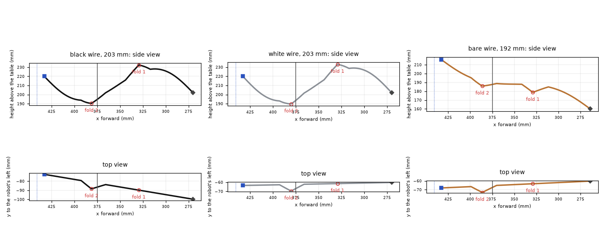

# Fold an outlet's three stiff copper wires back into its wall box, seat the outlet and drive its two mounting screws

A short piece of off-white wall stands on the station table in front of the two arms, a little to the robot's right.
Set into it, flush with its face, is an empty blue single-gang wall box. An ivory outlet on a steel mounting strap
hangs out of the box on three solid copper wires, 11.5 cm in front of the wall: a black wire to its right side, a
white wire to its left side and a bare wire to its left side, lower down. A mounting screw sits in the slot at each
end of the strap, backed out. A ratcheting Phillips screwdriver lies on a grey rest (a base plate with a post under
each end of the handle) in front of the left arm.

The robot has to end with the outlet back in the box with every wire inside it, both mounting screws driven home
with the screwdriver, and both grippers and the screwdriver away from the outlet.

The wires are 12 AWG solid copper. They keep whatever bend they are given and push back. Pushed straight in, the
black and white wires stand up in loops over the box's top edge and are trapped between the outlet and the wall. The
loops have to be folded into the box before the outlet will go home. Let go without its screws, the outlet is pushed
back out a few millimetres by the copper; the screws pull the strap flat onto the wall and hold it there.

The task file is [fold_outlet_wires_into_wall_box.py](fold_outlet_wires_into_wall_box.py), for the `yam_arena`
embodiment ([yam-isaac-lab-arena](https://github.com/kairosiann/yam-isaac-lab-arena), Isaac Lab-Arena 0.3.1) on the
station scene. [outlet_logic.py](outlet_logic.py), [copper.py](copper.py), [labkit.py](labkit.py), [screws.py](screws.py) and
[screw_moves.py](screw_moves.py) must stay next to it.

## Run a trial

Dream-1:

```bash
inspect-robots run --embodiment yam_arena --policy dream -P model=dreamlabs/dream-1-beta \
  -E task=tasks/fold-outlet-wires-into-wall-box/fold_outlet_wires_into_wall_box.py -E object_jitter=0 \
  -E control_hz=20 -E cam_width=320 -E cam_height=176 \
  --instruction "Put the outlet back in its wall box with every wire inside the box, then drive its two mounting screws home with the screwdriver and let go." \
  --scorer task_score --max-steps 4800 --store-frames --log-dir ~/yam-eval/fold-outlet-wires-into-wall-box-dream
```

Scripted demo: the same command with `--policy yam_scripted` in place of `--policy dream -P model=dreamlabs/dream-1-beta`.

The run prints `task_score` at the end. `OUTLET_LOG=1` prints the measurements behind the score twice a second: where
the outlet is, how far each strap corner is from the wall, how far each screw hole is from its boss, how far each
wire's furthest point is from the wall, how long both grippers have been clear, whether the bit is on a screw, and
each screw's turns and how far its head stands off the wall.

`scripted_demo.py` is the logger the wire part of the demo was built with. It plays those moves and also writes, per
camera, an MP4 and a fuller log (each wire's points, the arms' targets and torques). It has not been run since the
screws and the screwdriver were added to the scene:

```bash
python tasks/fold-outlet-wires-into-wall-box/scripted_demo.py \
  tasks/fold-outlet-wires-into-wall-box/fold_outlet_wires_into_wall_box.py \
  ~/yam-eval/fold-outlet-wires-into-wall-box-log --sweep j-run --budget-min 40
```

## Scoring

Scored on the end state, from the outlet's pose, 20 or 21 points along each wire, the two screws' positions and the
positions of the grippers and the screwdriver's tip. The
score is 0 unless all of these hold:

- the outlet is upright: its long axis within 15 degrees of vertical;
- every corner of its strap is within 15 mm of the wall's face (near enough for a 1 in mounting screw to reach its
  hole; with nothing holding it, the folded copper pushes the outlet back out several millimetres, so flat on the
  wall is not asked for);
- every wire is inside the box: no point of a wire more than 2 mm in front of the wall's face, and none outside the
  opening's outline within 3 mm of the face. The last 5 mm of each wire, at the outlet's terminal, is part of the
  outlet, and is judged with the strap, not by the 2 mm rule;
- the outlet has been let go: the grip centre and pad tips of both grippers and the screwdriver's tip at least 3 cm
  from the outlet and from every wire, with the outlet at rest (no corner of its strap moving more than 1 mm), for
  the last 2 s.

| Outcome | Score |
|---|---|
| Nothing done; outlet left hanging | 0 |
| Outlet pushed in with a wire trapped under its strap, looped over the box's edge, or showing in front of the wall | 0 |
| Outlet tipped more than 15 degrees, or any strap corner more than 15 mm from the wall | 0 |
| Outlet in place with every wire inside, but still held, pressed or moving | 0 |
| Let go, every wire inside, within 15 mm, but a screw slot more than 3 mm from its screw hole in the box | 0.25 |
| Let go, every wire inside, within 15 mm, both slots within 3 mm of their holes, no screw driven home | 0.5 |
| The same, with one screw driven home | 0.75 |
| The same, with both screws driven home | 1.0 |

A screw is home when it is threaded into its hole and its head is down on the strap with that end of the strap on
the wall: no more than 1 mm between the head's underside and the strap's front. The slots are measured across the
wall. The trial ends with 1.0 once the last row has held for 1 s.

### Checking a trial on a real rig

Strap and screw holes: a ruler from the wall to each corner of the strap, and a ruler across each screw hole.

Screws: a screw is home when a 1 mm feeler will not go under its head and the strap does not lift off the wall at
that end.

Wires: three photos, taken once the grippers are away, with a strip 2 mm thick stuck to the wall 3 cm below the
opening as the reference:

1. square-on from the front;
2. along the wall's face from the robot's left, level with the opening's centre;
3. the same from the robot's right.

A wire fails if, anywhere other than the last 5 mm at its terminal, more than half its thickness stands further from
the wall than the strip's face in photo 2 or 3, or if any part of it lies on the wall or the box's rim outside the
opening in any photo.

The box does not need to be see-through, because the rule is only about wire in front of the wall's face. A scoring
outlet is at most 15 mm from the wall, and photos 2 and 3 look straight into that gap. The outlet's body is as wide
as its strap, so nothing in the gap can sit behind it: each side photo shows its own side of the body and the open
space behind the strap's two ends. Any part of a wire that no photo shows is therefore behind the wall's face, inside
the box, which is where the rule wants it. Wire hidden behind the outlet cannot break the rule unseen.

## Preparing the wires on a real rig

Every trial starts with three fresh wires, so the starting shape and the starting stiffness are the same each time.
About 5 minutes.

1. Cut three new lengths of solid 12 AWG copper from the same reels: one black and one white, insulated, 20.3 cm
   (8 in) from the cable entry to the terminal; one bare, 19.2 cm. Add what the entry clamp and the terminal screw
   take.
2. Mark each fold's place, measured along the wire from the terminal end, and bend it once on a three-pin block (two
   6 mm pins 32 mm apart and a third midway) until the V stands 9 mm off the wire's line, within 1 mm, over 32 mm of
   wire.

   | Wire | Fold 1, from the terminal | Fold 1 points | Fold 2, from the terminal | Fold 2 points |
   |---|---|---|---|---|
   | black | 7.0 cm | up | 13.8 cm | down and to the robot's right |
   | white | 7.0 cm | up | 13.8 cm | down and to the robot's right |
   | bare | 7.3 cm | down | 13.5 cm | down and to the robot's right |

3. Fit each wire to its terminal and to the cable entry with its folds pointing as the table says, and pull the
   outlet out until the back of its strap is 11.5 cm in front of the wall.
4. Lay each wire against its page of [wire_start_shapes.pdf](wire_start_shapes.pdf) (1:1 when printed at 100%; a
   50 mm bar on each page checks the print) and shape it by hand until it follows the drawing to within 3 mm, in the
   side view and in the top view. [wire_start_points.csv](wire_start_points.csv) lists the same paths, a point every
   5 mm. The simulated wire is a chain of 10.7 mm links laid along this path: every joint starts within 1 mm of the
   drawing.

5. Back both mounting screws out of the box until their heads rest against the strap, and put the screwdriver back
   on its rest, set to drive, the middle of its handle 40 cm forward of the arm bases' midpoint and 30 cm to the
   robot's left, pointing away from the robot, flats upright.



Used wires are thrown away, never straightened and used again. Copper work-hardens where it is bent, so a wire that
has been through a trial is stiffer at every place it was folded; only new wire, bent once the same way, starts with
the same stiffness. In the simulator every reset puts the wires back in this shape, with each fold hardened by the
bend it holds and nothing carried over from the trial before.

The outlet is not connected to power, and the strap's edges are deburred so they cannot cut the gripper pads.

## The scripted demo

`demo()` in the task file plays the trial named `j-run` in `outlet_logic.py`, then the screw part in
`screw_moves.py`. It is closed loop: an `on_step` hook in
the task file reads the wires' and the outlet's positions from the simulator after every step and sets where each hand
goes next, which a scripted demo may do. It never moves an object or edits the simulation. Thirteen steps:

1. The right gripper takes the outlet by the sides of its body and carries it toward the wall.
2. It holds the outlet low, about 6 cm below the opening's centre. The wire loops ride with the outlet, so this
   brings both loops under the box's top edge.
3. The left gripper, closed, pushes the white wire's loop sideways toward the centre with the side of its fingers,
   off the edge of the opening.
4. It sweeps the black wire's loop into the box: the fingertips travel along their own axis on a line through the
   loop's top, pushed about 4 cm past where the wire should end, because the arm is a soft spring.
5. It sweeps the white wire's loop into the box the same way.
6. The right gripper lifts the outlet back to the opening. The loops stay under the top edge.
7. It pushes the outlet home, kept centred on the opening, and lets go.
8. Closed fingertips press the outlet's face once, low on the side the bare wire is on, and both grippers move away.
9. The right gripper goes back to its ready pose, out of the screwdriver's way. The left gripper comes down on the
   screwdriver's handle from above, closes on its two flats and lifts it off the rest.
10. It carries the bit to 3 cm in front of the top screw's head, with the wrist rolled back, and then puts the bit
    on the head.
11. It drives the screw with ratchet strokes of the wrist: 170 degrees forward at 45 degrees a second, then back
    at 80 degrees a second, which the ratchet lets slip, until the screw is home.
12. It backs the bit off and does the same on the bottom screw.
13. It backs off again, carries the screwdriver 10 cm to the robot's left of the outlet and holds it there.

What it reads from the simulator: the highest point of each wire's loop in front of the wall, just before each of
steps 3 to 5 (to aim the left gripper); the wire's sideways position during a sweep (to keep the fingertips on it);
the outlet's position and roll during step 7 (to keep it centred, and to hold the push back until it is); and, in
steps 9 to 13, the screwdriver's handle and tip, each screw head's position, and whether the bit is on a screw and
the screw is home (to steer the tip by its error and to end each stage).

## Runtime and seeds

- Demo: 2,971 steps (148.6 s simulated): the outlet is seated and let go by 67 s (score 0.5), the top screw is home
  at about 112 s and the bottom one at about 145 s; full score once the grippers and the screwdriver have been clear
  for 2 s, and the trial ends with success once that has held for 1 s. About 68 minutes of wall time on an A10 GPU
  with GPU physics (the default), including Isaac Sim's start.
- Dream-1: up to 4,800 steps (4 minutes simulated).
- One fixed layout: `-E object_jitter=0`, so no seed is needed.

## Fidelity

- **Wires:** each is a chain of rigid links 10.7 mm long on two-axis joints that bend like solid 12 AWG copper
  (conductor 2.05 mm): bending stiffness from E 117 GPa, first yield at 59 N mm, about 100 N mm once fully plastic,
  and work hardening from annealed copper's stress-strain curve, so a bend stays and gets harder to bend further
  (`copper.py`). Each wire starts with two folds, each hardened by the bend it holds, as fresh wire bent once is.
  Twist along a wire, stretch and the insulation's own stiffness are left out. A wire cannot pull off its terminal.
- **Screws:** a rule in `screws.py`, not simulated threads. The bit engages a screw while its tip is on the head
  within 2 mm of the screw's axis and within 15 degrees of its direction; a spring then holds the tip on the axis, as
  the recess does. Forward turns count and back turns slip (the ratchet). A turn starts the thread only when the
  strap's slot is within 3 mm of the hole in the box; from then the screw stays on the hole's axis and goes in with
  each turn, and its head draws the strap onto the wall by contact. 2 turns take a screw home (a real 6-32 thread
  takes about 30 for the same travel), and no driving torque or push is needed. A started screw's shank is a spring
  that keeps its slot near the hole (at most 30 N); no hole is cut in the strap or the box.
  The bit and a screw's head do not collide as bodies: the rule stops the tip at the head. The head has no friction
  on the strap.
- **Screwdriver:** a rigid body of true size and weight (18 cm, 150 g), held by friction on its two flats.
- **Outlet, box and wall:** true size (a duplex outlet's strap and body, an 18 cubic inch single-gang box, half-inch
  board), rigid.
- **Grip:** the gripper pads hold the outlet by friction alone. Nothing is attached by rule at any point.

## Checks without the simulator

```bash
python -m pytest -q tasks/fold-outlet-wires-into-wall-box/test_fold_outlet_wires_into_wall_box.py
```

They check the layout, the copper bending rule, a made-up end state for every row of the scoring table (including
an outlet in place but still held, and a wire's end at its terminal against a wire showing), the screw rule (the bit
engaging, the ratchet, the thread catching, a screw going home), and the demo's plan and screw moves.
They need `yam_arena` but not Isaac Sim.

## Files

- `fold_outlet_wires_into_wall_box.py`: the scene, `score()` and `success()`.
- `outlet_logic.py`: every size, the wires' starting shape, the scoring rules, and the demo's moves.
- `copper.py`: how the copper conductor bends.
- `labkit.py`: builds the outlet and its three wires as one articulation and applies the copper rule each step.
- `screws.py`: the two mounting screws, the screwdriver and its rest, and the rule that stands in for the thread.
- `screw_moves.py`: the demo's screw-driving part.
- `scripted_demo.py`: the logger the demo was built with (optional; see Run a trial).
- `wire_start_shapes.pdf`, `wire_start_shapes.png`: each wire's starting shape, one 1:1 page per wire, and all three
  on one sheet.
- `wire_start_points.csv`: each wire's starting path, a point every 5 mm.
- `make_wire_drawings.py`: writes those three files from `outlet_logic.py` (needs numpy and matplotlib, not the
  simulator).
- `test_fold_outlet_wires_into_wall_box.py`: the checks above.
