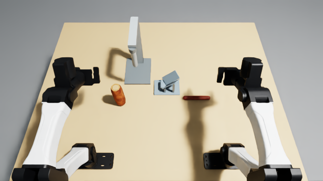

# Make a French-style hot dog by piercing and filling the bun

> Use the spike to make a hole in the end of the bun. Put the bun in the stand, then insert the sausage into the hole.

The bimanual YAM starts with a solid, unsplit roll. It presses the roll onto a fixed rounded spike, withdraws it, and leaves it in a sloped cradle. The cradle takes the insertion load while the robot slides the sausage into the passage. This tests aligning and pressing soft food against a fixed tool, then finding and filling the resulting opening.

The native scripted demo scored **1.0** in 1,469 controls (73.45 simulated seconds). Spike contact began at 15.65 s, qualified depth reached 100 mm at 21.10 s, and the roll cleared the spike at 25.00 s. The roll was released in its cradle at 37.35 s. Sausage entry exceeded 2 mm at 60.30 s, after release. The assembled hot dog reached full credit at 67.65 s and finished with **108 mm** of sausage in the bun. Dream-1 scored **0.0** after 1,600 controls and 33 live inference requests. It displaced the roll and left the sausage on the table. [Scripted demo](evidence/demo.mp4) · [Dream-1 recording](evidence/dream.mp4) · [Native measurements](validation.json) · [Open passage after withdrawal](evidence/passage-after-withdrawal.png) · [Final demo frame](evidence/finished.png)

French-style hot dogs use an end-filled roll. A field account describes stands pressing intact baguettes onto thick spears, compressing the crumb at the closed end. A current bun producer documents trimming one tip before punching the passage. The sloped serving cradle is based on the Żabka assembly footage, which shows an already bored roll. This task combines documented piercing with the supported insertion stage. [Field account, pp. 18–19](https://www.lcafood.dk/lca_conf/djfrapport_paper_2_poster.pdf#page=18) · [Bun producer](https://www.frenchhotdog.de/) · [Counter equipment](https://www.rollergrill-international.com/en/professional-range/7/cooking/hot-dog-concepts.html) · [Assembly clip](https://www.youtube.com/shorts/Wac1SEai_E0)

The shipped scorer accepts either sausage end and treats entry beyond 2 mm before seating as out of order. The native pose audit reproduces the demo’s depths and verifies the order under the shipped rules. [Scorer audit](evidence/either-end-check.json)

## Setup and reset



Use the calibrated YAM station, with tabletop at world Z = 0.7475 m. Coordinates below are metres in the station frame.

| Object | Size and material | Starting pose |
| --- | --- | --- |
| Bun | Soft wheat roll, 155 mm long by about 54 mm wide, unsplit and unbored. Expose flat crumb at the intended mouth by trimming a thin end cap. | Centre `(0.30, 0.20, 0.825)`, mouth up. |
| Sausage | Fully cooked frankfurter, 145 × 22 mm nominal. | Centre `(0.32, -0.20, 0.7585)`, long axis +Y. |
| Spike | Fixed, tapered, rounded 25 mm diameter food-grade metal mandrel. | Tip `(0.40, 0.11, 0.924)`, points down. |
| Stand | Fixed stainless V cradle at 45° with a closed low end and open access to the bun mouth. | Target bun centre `(0.39, -0.065, 0.850)`, mouth direction `(0, -0.707, 0.707)`. |

For physical trials, pick fully baked, unsplit soft rolls from one batch. Trim only the mouth end to 155 ± 5 mm total length and select rolls 54 ± 3 mm across the middle. Examine the cut face for solid crumb and keep the far end closed. Use a fresh matched roll each trial at the same room temperature (18–22 °C). A fully baked La Lorraine Rohlík KLASIK 4229834 is one example of the starting type. Thaw according to the supplier and select and trim to the dimensions above. Use a dry, fully cooked frankfurter within 145 ± 5 mm length and 22 ± 1 mm diameter. Keep the spike unpowered, secure both fixtures to the tabletop and restore positions from the table above. Use clean removable gripper pads and a washable crumb mat for trials with food. [Roll supplier](https://llbg.com/cs-CZ/vyrobky/4229834-rohlik-klasik)

### Fixture cut list

Use the following nominal full dimensions and mounting centres in millimetres. [Geometry source](geometry.py)

- **Piercer.** Fix a 182 × 146 × 8 base plate at `(501, 121, 751.5)`. Fit a 28 × 34 × 308 upright on it at `(566, 110, 909.5)`. Bolt the 172 × 34 × 16 crossbar to the top at `(483, 110, 1072)`. Clamp the food-contact mandrel underneath at X = 400 and Y = 110. Its tip is at Z = 924. Use 119 mm of exposed Ø25 rod below a Ø34 × 20 collar, with a smooth rounded taper over the lowest 20.5 mm.
- **Cradle.** Fix a 96 × 140 × 6 base plate at `(390, -43, 750.5)`. Mount two 95 × 48 × 4 rails longitudinally at 45° above the tabletop. Their upper ends point toward −Y. Tilt each rail’s transverse face 45° to form a V. Set the rail centres at X = 370 and 410, Y = −61.7, Z = 817.3. Use four 10 × 10 posts. The lower pair is about 40 mm tall at X = 361 and 419, Y = −31.1. The upper pair is about 86 mm tall at the same X positions, Y = −77.0. Fit a 50 × 38 × 6 end stop square to the rail axis at `(390, -23.3, 777.2)`.

Deburr the plates and secure the joints. Use the fixed cold fixture with a smooth rounded mandrel. Its diameter matches a commercially available bun-spike size. Mark 100 mm from the tip for scoring and 115 mm as a physical setup guide. Before trials, check on a spare roll from the batch that a centred stroke to the 115 mm guide leaves the base intact and seats the matched sausage to 95 mm. The taper prevents treating tool travel alone as a guarantee of sausage fit. Confirm the holder supports the roll and the arms clear both fixtures. [Commercial rod reference](https://www.hendi.eu/de/wrstchen-und-hotdog-brtchenwrmer-657564.html)

## Scoring

- **0.00** before forming a qualified hole. In a physical trial, a side exit, torn wall or puncture through the far end fails the trial.
- **0.25** after making a blind axial hole at least 100 mm deep and withdrawing the spike.
- **0.50** after releasing the pierced bun in the stand before the sausage begins entry.
- **1.00** after inserting the sausage at least 95 mm into the hole with the bun in the stand. The bun must remain intact, with both pieces fully released and stable for one second. The simulated evaluator rejects insertion beyond 2 mm before the bun is supported in the stand.

For a physical audit, check the sequence on video. Read piercing depth from the mark at the bun face before withdrawal. For a hole-only trial a blunt gauge can verify the passage after the robot stops. Stop the gauge at first resistance. At the end, use a ruler along the bun axis to check insertion: measured sausage length minus visible length from the mouth must be at least 95 mm, equivalent to at most 50 mm exposed for a 145 mm sausage. Reject a sausage resting outside the bun. Measure the insertion loads on the bench and check that the pads hold the ingredients without crushing them.

## Simulation and run budget

The task uses native Isaac Sim contacts. A passive sliding plug inside the bun represents displaced crumb. It starts flush with the mouth and resists the spike before receding and leaving an open cavity. Breakaway and sliding loads of about 4 N and 3 N are engineering estimates. A 30.5 mm simulated bore around the 25 mm mandrel represents local crumb give. The rigid shell constrains the spike and sausage. It approximates compressed crumb and omits crust tearing, recovery and heating. The simulator's insertion check requires the sausage inside the bore. The native run reached 9.40 N peak axial spike contact, including contact while the plug approached its stop. The physical bread and sausage loads remain unmeasured.

The run limit is 1,600 policy controls at 20 Hz (80 s), with fixed layout and seed 0. The reference trial records native traces and standard station cameras. The complete scripted trial took 267 s wall time with CPU PhysX and RTX 3090 rendering. Check `receipt.json` for the final task score and `trace.jsonl` for piercing depth, release in the cradle, and final insertion.

## Reproduce the native trials

Use Linux with an NVIDIA RTX GPU, Isaac Sim 6.1.0.0, Isaac Lab `91a0906f93802eb859192dcb0bca879f891e92d6`, and the pinned public dependencies below. Review the NVIDIA terms before setting `OMNI_KIT_ACCEPT_EULA=YES`.

```bash
# Start in the task folder.
HOTDOG_TASK_DIR="$PWD"
HOTDOG_RUNTIME_DIR="$(dirname "$HOTDOG_TASK_DIR")/hotdog-runtime"
mkdir -p "$HOTDOG_RUNTIME_DIR"
cd "$HOTDOG_RUNTIME_DIR"
git clone https://github.com/isaac-sim/IsaacLab-Arena.git
git -C IsaacLab-Arena checkout -B release/0.3.1 c7edf3a9d5d8276565208f72422f8f8a0806d6cf
git clone https://github.com/kairosiann/yam-isaac-lab-arena.git yam-arena
git -C yam-arena checkout bd62771e60320433893bd1d2df0fc79b5ddcd6d1
cd yam-arena
ARENA_DIR="$HOTDOG_RUNTIME_DIR/IsaacLab-Arena" \
  DREAM_SPEC=git+https://github.com/kairosiann/inspect-robots-dream@b5e936a201cec66c54c297e522c920d98445e339 ./setup.sh
source "$HOTDOG_RUNTIME_DIR/IsaacLab-Arena/.venv/bin/activate"
uv pip install --override overrides.txt inspect-robots==0.60.0 inspect-robots-yam==0.37.0 dreamlabs-client==1.0.14
cd "$HOTDOG_TASK_DIR"
uv pip install -e .

HOTDOG_OUTPUT_DIR="$(dirname "$HOTDOG_TASK_DIR")/hotdog-output"
mkdir -p "$HOTDOG_OUTPUT_DIR/tmp"
export TMPDIR="$HOTDOG_OUTPUT_DIR/tmp"
export HOTDOG_RENDER_DEVICE=cuda:0
python -m tools.run_recovery_pilot . "$HOTDOG_OUTPUT_DIR/full" \
  --policy full --device cpu --seed 0 --design-review design-review.json
```

Select the visible rendering GPU with `HOTDOG_RENDER_DEVICE`. The `hold` and `pierce` policies record reset and piercing diagnostics. Use fresh output directories for each run. A full-score demonstration requires native cavity formation, release in the stand, and successful insertion. The partial diagnostics cannot establish it.

Configure authorized Dream credentials separately, then run the model from the task folder:

```bash
python -m inspect_robots.cli run --config /dev/null \
  --embodiment resist_isaac --policy dream \
  -P model=dreamlabs/dream-1-beta -P dry_run=false -P record=false -P server_url=null \
  -E task="$PWD" -E condition=recoverable -E device=cpu -E control_hz=20 \
  -E cam_width=640 -E cam_height=360 -E object_jitter=0 \
  --instruction "Use the spike to make a hole in the end of the bun. Put the bun in the stand, then insert the sausage into the hole." \
  --scorer task_score --max-steps 1600 --epochs 1 --seed 0 \
  --grader none --no-prompt --store-frames --no-rerun --no-rerun-save \
  --log-dir "$HOTDOG_OUTPUT_DIR/dream/inspect"
```

Read the final `task_score` from the canonical Inspect JSON after completion. An execution error is unscored. Encode with `python -m inspect_robots.cli video <canonical-log.json> --out <output-dir> --fps 20`.

## Assets and licenses

Original food and fixture meshes, the bun crust and sausage casing textures, and the task code are MIT licensed. The clip, manufacturer drawings and photographs are linked as references.

The station loads I2RT YAM arm and gripper assets from the pinned `yam-arena` dependency under `yam_arena/assets/yam/`: `yam_arm.urdf`, base/link/gripper meshes in `assets/`, collision variants in `collision/`, assembled robot assets in `usd/yam_arm/`, and visual variants in `dream/`. These robot assets are MIT, copyright I2RT Robotics. Retain the license and copyright if redistributing robot meshes. [I2RT license](https://github.com/i2rt-robotics/i2rt/blob/120c3c81400171174604e503943f8d1ebc891058/LICENSE)

The dependency generates the floor, table and camera stand through its integration code. That external code has no declared license and is installed separately under the pinned dependency.
