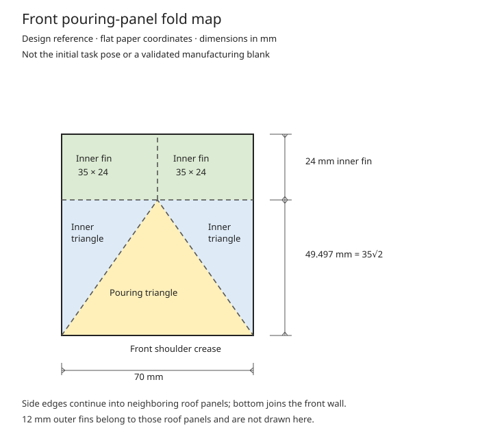

# Carton specification and repeatable starting geometry

This task forms the integral pouring spout of an already-unsealed, cap-free
gable carton. It ends before pouring. The specimen is a stated carton design,
not an identified commercial SKU or a scale model of a larger package.

## Objects and materials

Only one free carton is added to the original YAM station. No added handle,
support fixture, opening tool or camera is part of the task.

| Feature | Specification |
|---|---|
| Sheet | Pre-creased liquid-packaging paperboard with a polymer barrier lining; nominal total sheet thickness 0.45 mm and areal mass 350 g/m² |
| Body | 70 × 70 mm external footprint; 110 mm from base to shoulder |
| Closed rear roof | 35 mm vertical rise above the shoulder |
| Outer sealing fins | 12 mm high |
| Two inner pouring-fin halves | Each 35 × 24 mm; joined along the central 24 mm crease |
| Front pouring panel, flattened | 70 mm wide; lower folded region 49.497 mm high, followed by the 24 mm inner fin |
| Lower body and stationary contents | Combined mass 520 g; the simulation lumps these into one rigid body rather than modeling sloshing |
| Surface | Pale paperboard with the pouring-side arrow shown in the setup image; colors carry no hidden goal |

These material values are the chosen design specification, not measured sample
properties. In simulation the lining is not a separate material, walls do not
crush, and liquid, seals and paper self-contact are absent. Nominal friction and
crease parameters are disclosed in the README; they have not been fitted to a
real carton. A physical specimen's crease resistance and the YAM's ability to
handle it remain unmeasured.

The extended inner edge follows the structural idea in
[Elopak US5816487A, figures 8–11](https://patents.google.com/patent/US5816487).
Our dimensions are not claimed to be the patent's production dimensions. Generic
real-world carton shape alone is not enough: a physical comparison needs this
specified extended inner edge, not an arbitrary screw-cap or short-lip carton.

## Fold map and exact geometry

This diagram shows the front panel's **unfolded topology**, not the initial task
pose, a camera observation or a tested cutting/assembly template. Solid outer
edges delimit this panel region; dashed lines are its creases. The two neighboring
roof pieces and the fixed body are specified separately in `carton_probe/geometry.py`.
Do not cut the front region out of an assembled carton.

The map's 49.497 mm height is 35√2 mm: the model's inward apex is 35 mm behind the
front wall and 35 mm above the shoulder. This prevents mistaking the 35 mm roof
rise for a flat-paper length. `fold-reference.json` lists every facet vertex,
crease connection and initial transformed vertex in millimetres. It is an
engineering reference generated from the unchanged initialization code, not
policy input and not a result of a physical experiment.

Coordinates are relative to the shoulder centre: x points toward the back wall,
y across the front, and z up. The front wall is x = −35 mm. The shoulder centre
is at world (0.18, 0.05, 0.8575) m; the base rests on z = 0.7475 m. The figure
and JSON specify the custom geometry sufficiently to reconstruct the simulator;
manufacturing a continuous paper blank and validating its forces are separate
physical engineering steps, not completed validations.

## Preparing the initial state

1. Use an intact carton with this geometry. Separate the outer seal before the
   trial; no bonded surfaces should need tearing during the scored operation.
   Do not cut, detach or remove any inner pouring panel or fin.
2. Put the inner pouring triangle inward. Its apex is (0, 0, 35) mm in the
   shoulder frame; the front base corners are (−35, −35, 0) and (−35, 35, 0) mm.
3. Spread the two outer roof pieces to the specified start. The model parameter
   `outer_deg = 120` is a rotation from the closed reference about each diagonal
   roof crease, **not** a measured 120° angle between the two visible wings.
   Match the individual initial vertices in `fold-reference.json` and the setup
   image; leave the inner apex inward, rather than pre-forming the scored spout.
4. Place the carton upright, with its pouring side toward the robots, at the
   stated fixed position. Remove setup aids; both robots start in the original
   open ready pose. The carton must stand freely with the folds staying in their
   starting shape before actions begin.

The reset image and engineering coordinates define the start; a reviewer need
not reproduce the scripted grasp or assign either arm a particular role.

## Reset and evidence boundary

Every simulated trial starts a new process. The launcher reconstructs the ten
bodies, twelve hinges and plastic crease rest angles. The 120-second no-action
verification remains at score zero; it does not spontaneously form the spout.

Real paper retains crease history. Merely pushing a used spout back inward does
not restore the same material state. Use equivalently prepared specimens and
record prior folding; replace damaged or fatigued cartons. A real-world repeat
protocol would still need to measure the spread in crease resistance. We do not
claim that the simulation's exact reset of plastic memory can be reproduced in
used paper by hand.

Front/side photographs with a scale can measure the mouth and projection;
continuous video establishes release, support and the three-second hold. An
intact joined sheet is the physical analogue of the crease-integrity checks.
These checks establish the stated opening outcome, not that liquid can be poured
without leakage or spill. No liquid-flow result is part of this submission.
