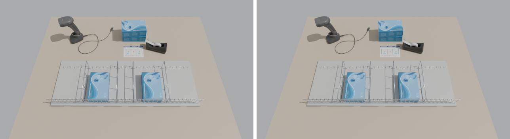

# Re-space a gondola shelf's wire dividers to a new planogram: lift each, move it one hole, re-seat foot and fence hook

A 36 x 13 in steel gondola shelf deck (`914 x 330 mm`) stands on two bench stands, its top `1.5 cm` above the bench.
It carries two rows of `1/4 in` (`6.35 mm`) perforations on `1 in` (`25.4 mm`) centres and a `3 in` wire front fence
(vertical wires on `1 in` centres). Four `3 in` standard wire dividers for a `13 in` shelf (`260 mm`, zinc-plated
wire) divide the planogram section: the two outer dividers stay at holes `+10` and `-10`. The middle lane's two
dividers start at holes `+2` and `-2` (lanes `8-4-8` holes). Each has a rear foot down through a perforation and a
front hook over the fence top wire. A box of 100 nitrile exam gloves lies flat in each outer lane. The laminated
planogram card on the bench behind the shelf shows the new lane widths, `7-6-7`. Hole `k` sits at `y = 2.54 k cm`
(`x` forward, `y` left, from the midpoint between the arm bases).



Goal (the instruction states only this end state): lanes `7-6-7` holes, each moved divider with its rear foot down in
its shelf hole and its front hook over the fence top wire, the glove boxes still in place, the grippers off the shelf.
This is a planogram reset as stockers do it (O*NET 53-7065.00). A divider is lifted about `17 mm` to free its foot from
the hole and its hook leg from the fence wire, moved one hole, and lowered so the foot finds the next perforation.

## Scoring

End state only (`score()` reads the dividers' poses, the glove boxes and the grippers at the step being scored;
nothing earlier counts). Everything can be checked on the end-state top-camera photo with a ruler: count holes, see
the foot down in its hole and the hook in front of the fence wire.

| part | credit | condition at the end |
|---|---|---|
| left divider foot | `0.2` | rear foot axis within `3.2 mm` of hole `+3` (the hole radius), its tip at least `2 mm` below the deck top; any other hole, or resting on the deck, scores `0` |
| left divider hook | `0.2` | hook leg in front of the fence top wire with its tip below the wire top, front post behind it, both within `6.35 mm` of hole `+3`'s line |
| right divider foot / hook | `0.2` / `0.2` | the same at hole `-3` |
| hands clear | `0.2` | all four parts above hold and both grippers' tool-centre points are more than `5 cm` from the middle-lane zone (deck front edge to back edge, holes `-4` to `+4`, bench top to divider tops) |

A divider whose lane's glove box is knocked over (tilt over `10 deg`), off the deck or out of its lane scores `0`
(failure condition only; boxes that merely stay put earn nothing). The run ends as a success once `1.0` has held for
`1 s`. Lanes `7-6-7` follow from the two planogram holes (outer dividers at `+-10`). Possible: `0, 0.2, 0.4, 0.6, 0.8,
1.0` (the same text is task.json `scoring`).

Shortcuts, measured with the MuJoCo pre-check on this code (`mj_check` SHORTCUTS): doing nothing `0.0`, sweeping
the arms across the shelf `0.0`, lifting and dropping the loose objects `0.0`, stopping at half the demo (one divider
moved) `0.4`, finishing and then replaying the arm path backwards (undo) `0.4`. A divider set down without its foot
in a hole, or held up at the end, scores `0` for that part.

## Sub-action evidence

The scripted demo (`demo()`, open loop, yaw `0` only, one arm per divider): the left arm grips the left divider's
`4 mm` top rail mid-span, lifts it `25 mm`, carries it one hole outward, lowers it (foot into hole `+3`, hook leg in
front of the fence wire), releases and parks. Then the right arm does the same at hole `-3`, and both hold parked for
`2.5 s`. `_watch` prints `SUBACTION_END {...}` on every step of the `1 s` success hold. Last line of each in the
Official simulator (scripted demo, `1280 x 704` and `320 x 176`, both `task_score 1`; `SUBACTION_END` at the run end,
step `351`):

| sub-action | quantity | target | Isaac |
|---|---|---|---|
| left foot in hole `+3` | foot tip (x, y, z) m | `(0.390, 0.0762, TOP + 0.005)`, `+-3.2 mm` in x/y, z `<= TOP + 0.013` | `(0.38945, 0.07639, 0.75250)` (seated `10 mm` deep) |
| left hook over the fence wire at `+3` | hook leg tip (x, y, z) m | `x < 0.12775`, `y` within `6.35 mm` of `0.0762` | `(0.12345, 0.07572, 0.82720)` |
| right foot in hole `-3` | foot tip | mirror | `(0.38877, -0.07574, 0.75071)` |
| right hook at `-3` | hook leg tip | mirror | `(0.12333, -0.07582, 0.82736)` |
| glove boxes standing | tilt deg | `<= 10` | `0.0`, `0.0` |

Visible end state: in the official top camera each divider spans about `148 px` at `1280 x 704` (`37 px` at
`320 x 176`, mj_check VISUAL); the perforation pitch is about `20 px` at `1280 x 704`. The end-state photo shows the
middle lane `6` holes wide instead of `4`.

## Run a trial

From this folder, on a machine with the official simulator (`yam-isaac-lab-arena` `setup.sh`, or the Robocurve Brev
launchable):

```bash
INSTRUCTION="$(python -c 'import json; print(json.load(open("task.json"))["instruction"])')"

# Dream-1
inspect-robots run --embodiment yam_arena --policy dream \
  -E task=$PWD/gondola_divider_planogram_respace.py -E scene=station -E object_jitter=0 -E control_hz=20 \
  -E cam_width=320 -E cam_height=176 \
  --instruction "$INSTRUCTION" --scorer task_score --max-steps 1200 --store-frames --log-dir ~/yam-eval/gondola-dream

# The scripted demo, which reaches full score
inspect-robots run --embodiment yam_arena --policy yam_scripted \
  -E task=$PWD/gondola_divider_planogram_respace.py -E scene=station -E object_jitter=0 -E control_hz=20 \
  -E cam_width=320 -E cam_height=176 \
  --instruction "$INSTRUCTION" --scorer task_score --max-steps 1200 --store-frames --log-dir ~/yam-eval/gondola-demo

for log in ~/yam-eval/gondola-*/*.json; do inspect-robots video "$log"; done
```

Runtime: on the official simulator the demo ends as a success after `352` steps (`17.6 s` at `20 Hz`); Dream-1 runs up
to `1,200` steps (`60 s`). Seeds: none needed, the layout is fixed and `object_jitter=0`; the dividers are not jittered by
construction (seated parts), so runs are deterministic up to the simulator. Reset: both middle dividers back at holes
`+2` / `-2`, glove boxes flat at their start positions (task.json `reset_notes`). Offline tests:
`pytest test_gondola_divider_planogram_respace.py` (official runtime on `PYTHONPATH`; 26 tests). Media (setup image,
demo and Dream-1 videos) are attached by the official upload tool at submission, which writes the media ID into
task.json.

## Fidelity

- Shelf hole size and pitch, fence height and vertical-wire pitch, divider length and height, finish (zinc): Lozier
  2016 shelves catalog pp.3 and 25 (quoted in SCENE.md).
- Estimates (not published, not measured): wire diameters (`4 mm` divider, `4.5 mm` fence top wire), foot (`10 mm`)
  and hook leg (`14 mm`) lengths, the `24 mm` cross-wire base, the glove-box mass (`450 g`). Divider mass (`90 g`) is
  computed from that geometry.
- The catalog's "foot attachment creates tension" is modelled as a plain `4 mm` peg in the `6.35 mm` hole (no
  preload; no rate is published). Retention is geometric: foot in the hole, hook leg in front of the fence wire,
  divider standing on its base.
- Wire flex is negligible: `260 mm` top rail of `4 mm` steel, `48EI/L^3 = 6.9 N/mm`, `0.17 mm` under its own weight.
- Each moved divider rides an unpowered six-axis joint chain (x, y, z slides; yaw, roll, pitch hinges; no springs,
  drives or joint friction; light damping `5 N s/m` / `0.005 N m s/rad` stops PhysX chain wobble): a loose rigid body that starts exactly seated, because reset jitter would otherwise push a
  seated foot into the deck.
- Collider simplifications: a `60 mm` stretch of the top rail where the fingers grip is a `4 mm` square bar (PhysX
  pads slipped through the `4 mm` round wire alone); the round perforation is a `6.35 mm` square opening; the deck collider is `4 mm` thick
  (sheet `1.2 mm`) for the solver.
- Shelf on bench stands instead of a gondola upright.

## Assets and provenance

| object | source | revision / sha256 | licence |
|---|---|---|---|
| shelf deck, wire fence, outer and middle wire dividers (`assets/visual/shelf.usdc`, `assets/visual/divider.usdc`) | builder-made true-to-size model, `assets_build/build_visuals.py` (Blender 5.x), dimensions from the Lozier 2016 shelves catalog (https://www.midwestretailservices.com/docs/Lozier02-shelves-2016.pdf, sha256 `df2310a28c5b8319...`), reference photos: catalog p.25 (Standard Wire Fencing fronts and dividers on a shelf) and p.3 (bullnose shelf) | `shelf.usdc` `faf67a745e3822d2...`, `divider.usdc` `934159242237c394...` | task licence |
| box of nitrile exam gloves (task objects `glove_l`, `glove_r` and two spare boxes; `assets/props/glove_box_model/`, `assets/props/glove_box.usda`) | NVIDIA SimReady `box_glove_a01` (Hugging Face `nvidia/simready-assets`, rev `7879e0e5`) | `b5661a03be7d4b74...` | CC-BY-4.0 |
| handheld barcode scanner in its cradle (`assets/props/barcode_scanner/`) | NVIDIA SimReady `computer_scanner_barcode_d01` (rev `7879e0e5`) | `e7cb815814fb432c...` | CC-BY-4.0 |
| tape dispenser (`assets/props/tape_dispenser/`; bench layout `assets/props/bench_props.usda`) | NVIDIA SimReady `misc_tape_dispenser_a01` (rev `7879e0e5`) | `aca96d19075d3012...` | CC-BY-4.0 |
| planogram card (`assets/props/planogram_card/`) | builder-made, `assets_build/planogram_card.py` (drawn lanes, no brand text) | `planogram_card.png` `70fa4b742de84107...` | task licence |
| lettering on the planogram card texture | DejaVu Sans Bold font, version 2.37 (https://dejavu-fonts.github.io/), used by `assets_build/planogram_card.py` to draw `planogram_card.png`; the font file itself is not shipped | `DejaVuSans-Bold.ttf` | DejaVu Fonts License (Bitstream Vera derivative, free to use and embed) |
| setup screenshot (`setup.png`) | rendered from this scene (top camera, start state) | - | task licence |

SimReady packages are flattened visual-only (physics, MDL shaders stripped; textures at `<= 512 px`) by
`assets_build/build_props.py`; each folder keeps its `LICENSE.txt`.

Asset searches (library first; `search.py` = assets index, `search_cloud.py` = SimReady/ArtVIP/GSO/Fuel,
`search_oci.py` = ABO/Objaverse): `"gondola shelf"` -> index 0, cloud 0, oci 7 (best: an Objaverse store-brand
gondola display, not a perforated shelf with wire dividers; rejected); `"store shelf"` / `"retail shelf"` -> no
perforated shelf; `"shelf divider"` / `"wire divider"` -> no match (oci: furniture shelves); `"wire fence"` -> a barbed
wire fence (no match); `"planogram"` -> 0 -> shelf, fence, dividers and card are builder-made under the built-model
decision. `"glove box"` -> SimReady `box_glove_a01` (chosen); `"cereal box"` / `"cracker box"` -> GSO / Fuel cartons
with brand word marks (not used); `"barcode scanner"` -> SimReady `computer_scanner_barcode_a01` / `d01` (`d01`
chosen); `"tape dispenser"` -> SimReady `tape_dispenser_a02` / `a03`, local `misc_tape_dispenser_a01` (chosen).
The SimReady mini basket was dropped for size (`9 MB` mesh); scissors and packing tape carry maker-style marks.

No maker names, word marks or part numbers appear in the models or the task text.

## Review-display limitation
The separate high-resolution review movie used a 2 mm replay-link tolerance (maximum observed 1.999 mm; 37 of 353 frames exceeded 1 mm). This is a display/replay exception, not a relaxation of the task scorer or a claim of measured physical precision. Submitted demo and Dream videos are the original official 320 x 176 recordings. The catalogue tensioned foot remains an unpreloaded plain peg, as disclosed above; a real preloaded retention mechanism is not qualified.
