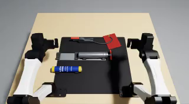

# Reload a grease gun: catch the follower rod in the end-cap slot, then push a new grease cartridge into the barrel

A lever grease gun's barrel (cylinder) lies clamped in a rubber bench holder with its head already unscrewed and set
down on the mat. Inside the barrel a follower disc rides on a compression spring; its rod comes out through a keyhole
in the rear end cap and ends in a red T-handle. A new 14 oz grease cartridge, cap removed, lies on a small rest beside
the holder.

The scorer accepts either order (catch the rod first, as the maker's guide does, or hold it back by hand while loading and then catch it). The scripted demo draws the T-handle back 24 cm against the spring and holds it, lays the cartridge in the holder's loading V and pushes it
into the barrel, open end first, until it bears on the follower; then it lowers the T-handle so the rod's neck drops
into the slot of the end cap, eases forward until the rod's shoulder seats on the slot edges, lets go, and parks both
arms. If the rod is not caught, the spring snaps the follower back and pushes the cartridge out of the barrel.



## Real mechanism (sources)

| Mechanism | Real product | Model here |
|---|---|---|
| Reload procedure | The maker's grease-gun service guide (lever grease gun series; https://cdn.skfmediahub.skf.com/api/public/0901d19680a7cd8c/pdf_preview_medium/670849-en-es-fr-it-de_pdf_preview_medium.pdf): pull the follower rod back, lock the rod in the slot of the cylinder end cap, insert the cartridge open end first, then refit the head and release the rod. Lever guns of the 500 series load the same 14 oz cartridge the same way. | Head refit and rod release are out of scope (the task ends with the barrel ready for its head). |
| Follower spring | Compression spring between the follower and the end cap; it pushes the grease toward the head. No published rate. | `plunger.follower`: Y slide, 58.3 N/m from its rest, so 14 N at the 240 mm catch. Force at full draw: no published figure (the maker's guide gives none); estimated range 10-20 N, modelled 14 N; bench check below. |
| Keyhole catch | End cap with a round hole joined to a narrow slot; the rod's neck (a groove behind the follower) slides into the slot and its shoulder bears on the slot edges. | Cap plate 3 mm with a 16 mm hole and a 6.5 mm slot running 16.5 mm down; rod 10 mm, neck 5 mm x 9 mm long. `plunger.rod` is a Z slide on the follower: the rod can drop in the cap plane only as far as the keyhole lets it (contact with the cap plate). No latch is code-held. |
| Cartridge | 14 oz (397 g) grease cartridge: tinplate ends, spiral-wound tube about 2 in (50 mm) across. | 50 mm x 240 mm, 0.45 kg rigid tube, 1 mm radial play in the 52 mm bore. |
| Bench holder | Bench-mounted reload: the barrel strapped in rubber V-blocks on an aluminium rail (as in a bench vise), the front blocks forming a loading V on the bore axis. | Fixed. Holding a loose barrel is out of scope; the scored skill is drawing the rod against the spring, catching it in the slot by contact, and loading the cartridge. One hand must hold the 14 N spring back while the other loads, or the rod must be caught first. |

### Declared values and how a real bench measures them

| Value | Declared here | Real-bench measurement |
|---|---|---|
| Spring force at the catch | estimated 10-20 N (no published figure); modelled 14 N at 240 mm draw | Hook a 0-25 N spring scale to the T-handle and read it with the neck level with the cap. |
| Keyhole | 16 mm hole, 6.5 mm slot, 16.5 mm deep | Calipers on the cap. |
| Cartridge play | 1 mm radial | Calipers: barrel bore minus cartridge diameter. |
| Rod caught | stroke >= 230 mm, neck >= 10 mm down the slot | Ruler from the cap face to the T-handle (>= 23 cm); the handle sits visibly below the barrel axis. |

## Physical, driven or computed

| Quantity | Kind |
|---|---|
| Rod draw, neck drop, catch on the slot edges | physical (contact between the rod and the cap plate; the spring joint is the only actuator, a passive spring) |
| Cartridge insertion and stop on the follower | physical (contact with the bore, the loading V and the follower) |
| Barrel position | fixed (clamped in the holder) |
| Score | computed from the current state each step (joint positions, poses, gripper positions), held 2 s; one remembered failure (cartridge off the bench) |

## Run a trial

From this folder, on a machine with the official simulator (runtime: Isaac Sim yam_arena, 20 Hz, 2,400-step limit;
`object_jitter=0`, so there is no seed and every trial starts from the same layout):

```bash
INSTRUCTION="$(python -c 'import json; print(json.load(open("task.json"))["instruction"])')"

# Dream-1
inspect-robots run --embodiment yam_arena --policy dream \
  -E task=$PWD/grease_gun_cartridge_load.py -E object_jitter=0 -E control_hz=20 \
  -E cam_width=320 -E cam_height=176 \
  --instruction "$INSTRUCTION" --scorer task_score --max-steps 2400 --store-frames --log-dir ~/yam-eval/grease-dream

# The scripted demo
inspect-robots run --embodiment yam_arena --policy yam_scripted \
  -E task=$PWD/grease_gun_cartridge_load.py -E object_jitter=0 -E control_hz=20 \
  -E cam_width=320 -E cam_height=176 \
  --instruction "$INSTRUCTION" --scorer task_score --max-steps 2400 --store-frames --log-dir ~/yam-eval/grease-demo

# Render one MP4 per camera
for log in ~/yam-eval/grease-*/*.json; do inspect-robots video "$log"; done
```

`score()` is evaluated every control step on the current state; it remembers two things: how long the full state has
held, and whether the cartridge has ever fallen off the bench (then the run scores 0 to the end, even if it is put back). `task_score` is 1.0 once `success()` has held for `SUCCESS_HOLD_S` = 1 s
after the 2 s hold inside `score()`, otherwise `score()` at the end (`SCORE_OVER = "end"`).

## Scoring

| Credit | Condition | Check on a real bench |
|---|---|---|
| 0.35 | Follower drawn back >= 230 mm and the rod neck dropped >= 10 mm into the cap slot, with no gripper within 6 cm of the T-handle (the cap holds it) | ruler: T-handle >= 23 cm from the cap; handle below the barrel axis |
| +0.45 | Only with the rod caught: cartridge in the bore, open end first, its end within 5 mm of the barrel mouth face, axis within 5 degrees and 4 mm of the barrel axis | top view: cartridge end flush with the mouth; ruler |
| +0.20 | All of that, cartridge centre moving < 2 cm/s (it may roll slightly about its own axis in the 1 mm play), both grippers >= 10 cm from the gun (the line from the drawn-out T-handle to the mouth), held 2 s | top view, stopwatch |

Every total `score()` can return: 0, 0.35, 0.8, 1.0 (`test_every_total_is_listed_in_task_json`); a rod held by a hand earns nothing (`test_rod_held_by_a_hand_earns_nothing`); a cartridge dropped and put back still scores 0 (`test_drop_then_recover_is_remembered_as_failed`). Cartridge ever off the bench
during the run, or a tracked part missing: 0. An untouched bench scores 0; a cartridge pushed in without the rod caught scores 0.

## Mechanism proof (MuJoCo, same demo)

| Run | End state | Score |
|---|---|---|
| Nominal demo | stroke 236.9 mm, neck 14.1 mm down the slot, cartridge end 2.1 mm proud of the mouth | 1.0 |
| Hand never lowers the neck into the slot | rod snaps back (stroke 11.6 mm), cartridge pushed 227 mm out of the barrel | 0.0 |
| Cap without the slot (plate solid below the hole) | rod hangs on the hole's lower edge (neck 5.6 mm down), not in the slot | 0.0 |

## Sub-action end states and visible proxy

Each sub-action prints one `SUBACTION_END` JSON line per step during the final hold (observe-only on-step hook; it
moves nothing and writes no joint target): `rod drawn back` (plunger.follower, m), `neck in cap slot` (plunger.rod, m),
`cartridge seated` (cartridge centre in the barrel frame, m), `arms clear` (both TCPs, m). In the top camera the start
shows the T-handle against the cap and the blue cartridge on its rest; the end shows the T-handle 24 cm out behind the
cap and the cartridge gone from the rest, its end flush in the barrel mouth.

## Demo (scripted, open loop, fixed bench constants only)

1. Right arm pinches the T-handle bar 32 mm beside the rod (fingers opened 28 mm so they fit between bar and cap) and
   draws it back to the follower stop (commanded 70 mm past it: the arm's servo sags under the 14 N spring).
2. Meanwhile the left arm picks the cartridge at mid-length (fingers across it), carries it over the loading V, lays
   it in, lets go, and with closed fingers pushes its tab end until the cartridge bears on the follower.
3. Right arm lowers the T-handle 14 mm (the neck drops into the slot), eases forward 10 mm so the spring seats the
   shoulder on the slot edges, and lets go.
4. Both arms park at (140, +-320, 150) mm for the last 8 s.

Plan 24.8 s in MuJoCo (mj_check); worst IK error 0.08 mm; all TCP targets <= 0.22 m above the table. Robustness
(mj_check): +-5 mm / +-3 degree jitter of the cartridge (5 seeds) and friction x0.7 / x1.3 all score 1.0.

## Measured run metadata

Runtime per trial: about 2 min for the scripted demo and about 7 min for Dream-1 on one A10 (Isaac Sim start-up included).
Seeds: reset seed 1415158438 as recorded; object_jitter=0, so the layout is fixed and there is nothing to seed.

| Run | Policy | task_score | Steps | Wall time | Seed |
|---|---|---|---|---|---|
| Scripted demo | `yam_scripted` | 1.0 (ended on success) | 483 | 110 s | 1415158438 (reset seed in the record; `object_jitter=0`, so the layout is the same every trial) |
| Dream-1 | `dream` | 0.0 (cartridge left on its rest) | 2,400 (step limit) | 414 s | 1415158438 |

Isaac Sim yam_arena on one NVIDIA A10, 20 Hz, 320 x 176 cameras. At the end of the demo the run log prints the rod caught with
no hand on it: `plunger.follower` -0.237 m, `plunger.rod` -0.014 m, cartridge centre 7.0 mm inside the barrel centre line
(end 2 mm proud of the mouth), both grippers parked at (0.14, +-0.32) m.

## PROVENANCE

| Asset / reference | Source URL | Revision | sha256 | Licence |
|---|---|---|---|---|
| Barrel, keyhole cap, holder, follower, rod, cartridge, rest, mat, bench props (gun head with hose, shop rag): `assets/visual/{gun,follower,rod,cartridge,rest,mat,bench_props}.usda` and textures `assets/visual/tex/{cartridge_label,mat_albedo,mat_rough,rag_albedo,steel_albedo}.png` | authored here: `assets/visual/src/build_visuals.py` (Blender 5.2.3) + `make_textures.py`, to the dimensions above | generated 2026-11-16 | regenerate with the two scripts | original work in this package (task licence); label text rasterised with DejaVu fonts (Bitstream Vera licence, embedding allowed) |
| Setup screenshot `setup.png` | first frame of the official top camera in the scripted-demo run (this package) | 2026-11-16 | - | original work in this package (task licence) |
| `labkit.py` | https://github.com/robocurve/benchmark-tasks (`tasks/analytical-balance`) | vendored + `visuals`/`hide_shapes` hook | `54e35fe930fbddd21d0a2dd91deaccda093e11a823b21b4702908e5665cb3edc` | as upstream task |
| `arena_assets_fix.py` | https://github.com/robocurve/benchmark-tasks (`tasks/analytical-balance`) | vendored unchanged | `4804d30037ebf6392a7146ca37868d1256182cdd82285505c21925f9227bbb4c` | as upstream task |

Library search: nvidia/simready-assets 2,677-name index (`grease`, `gun`, `cartridge`, `caulk`, `tube`). It has an
assembled lever grease gun (`serviceTool_greaseGun_lever_a01`, one closed assembly: no separate barrel, keyhole cap or
moving rod) and three 14 oz grease cartridge models (`consumable_grease_a01`, `consumable_lubricant_grease_*`, 30-40 MB
of textures each). They are not used in this build (no keyhole parts; texture downscale and fit not done); every part
here is authored to size.

Materials: barrel zinc-plated steel; end cap and collar dark oxide steel; rod and T-bar bare steel with red vinyl grips;
follower leather cup; cartridge spiral-wound paper tube with tinplate ends and amber grease at the open end; holder
black rubber V-blocks on an aluminium rail with a steel strap; mat ribbed rubber.

## Offline checks

```bash
python -m pytest -q test_grease_gun_cartridge_load.py
```
