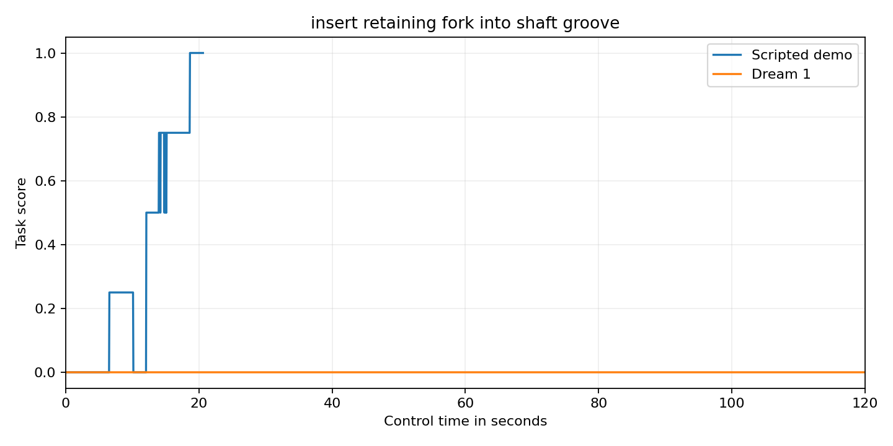

Insert a retaining fork into a shaft groove

Captive shafts need a retaining part inserted from the side below a head. One arm stabilises the loose fixture while the other feeds a rigid fork into a narrow axial groove. Both tines must pass the shaft centre.

Setup

Use the official bimanual YAM station. The tabletop is at z 747.5 mm. x points forward. y points left. z points up. All props are rigid PA12 polymer prototypes. All joint positions start at zero. The fixture has an initial outer envelope of 120 by 290 by 66 mm. Its authored root is at x 280 mm and y 0 mm and z 747.5 mm. Its initial yaw is 0.0 radians. Its mass is 0.65 kg. Its root is free to move. The fork has an initial outer envelope of 54 by 165 by 53 mm. Its authored root is at x 190 mm and y -140 mm and z 790.5 mm. Its initial yaw is 0.0 radians. Its mass is 0.035 kg. Its root is free to move. The staging stand has an initial outer envelope of 100 by 220 by 43 mm. Its authored root is at x 190 mm and y -190 mm and z 747.5 mm. Its initial yaw is 0.0 radians. Its root is fixed to the tabletop. The side stop 0 has an initial outer envelope of 12 by 290 by 12 mm. Its authored root is at x 210 mm and y 75 mm and z 753.5 mm. Its initial yaw is 0.0 radians. Its root is fixed to the tabletop. The side stop 1 has an initial outer envelope of 12 by 290 by 12 mm. Its authored root is at x 350 mm and y 75 mm and z 753.5 mm. Its initial yaw is 0.0 radians. Its root is fixed to the tabletop. The end stop 0 has an initial outer envelope of 124 by 12 by 12 mm. Its authored root is at x 280 mm and y -79 mm and z 753.5 mm. Its initial yaw is 0.0 radians. Its root is fixed to the tabletop. The end stop 1 has an initial outer envelope of 124 by 12 by 12 mm. Its authored root is at x 280 mm and y 229 mm and z 753.5 mm. Its initial yaw is 0.0 radians. Its root is fixed to the tabletop. The inventory lists each collider and body mass and joint anchor and travel limit. Local solid positions are measured from the named body root. Outer envelope sizes describe the reset pose.

Scoring

The episode scores zero if the fixture ever moves more than 5 mm or the fork falls more than 5 mm below the tabletop. Fork tilt and yaw must each be below 5 degrees. A fork whose lowest face rises more than 15 mm above its reset height earns 0.25. A partly inserted fork earns 0.5 when x is within 6 mm of 280 mm and z is within 5 mm of 814 mm and y lies between negative 82.5 mm and negative 47.5 mm. Full seating needs the fork centre within 4 mm on every axis of x 280 mm and y negative 47.5 mm and z 814 mm. Translation must be below 8 mm per second and rotation below 0.1 radians per second. This earns 0.75. Both grippers open beyond 35 mm raises this to 1.0. Full success must hold for 2 seconds. All other outcomes score zero.

Fidelity

All solids are rigid printed PA12 polymer. The fork has two actual tines and an open slot. The shaft has an 8 mm high groove below its square head. The tines are 6 mm thick. The raised handling tab provides gripper access. Contact offsets are 0.25 mm for the compound solids. Small physical locators constrain the loose fixture. There is no elastic snap fit or powered motion.

Run and reset

Use the official YAM launchable. Run from this task folder. Install the runtime in the simulator environment. Install the policy adapter included in this folder. It uses inspect_robots_dream with the current Dream SDK bridge. Install dreamlabs version 1.0.37 and dreamlabs-client version 1.1.3. Start policy/current_api_bridge.py in a separate process with DREAM_BRIDGE_PORT=8241 and JAX_PLATFORMS=cpu. The Dream credential stays outside the repository.

```bash
source /data/IsaacLab-Arena/yam.env
uv pip install --python /data/IsaacLab-Arena/.venv/bin/python --no-deps -e runtime -e policy
TASK_INSTRUCTION=$(python -c 'import json; print(json.load(open("task.json"))["instruction"])')
OPENBLAS_NUM_THREADS=1 OMP_NUM_THREADS=1 MKL_NUM_THREADS=1 inspect-robots run \
  --embodiment yam_articulated --policy dream_current \
  -P server_url=http://127.0.0.1:8241 \
  -E task="$PWD/task.py" -E object_jitter=0 -E control_hz=20 \
  -E cam_width=1280 -E cam_height=720 --seed 0 --epochs 1 \
  --instruction "$TASK_INSTRUCTION" --scorer task_score --max-steps 2400 \
  --store-frames --log-dir runs/model
```

For the demo use yam_scripted and omit the server_url option. Use a separate log directory. Each trial starts from a fresh reset. Restore every object to the starting pose in scene_inventory.json and every joint to zero. Nothing is consumed. Use one epoch with seed 0 and object_jitter=0.

The current model and demo receipts are stored in validation.json. Scores come from the measured task scorer. A failed API trial is not scored as a valid zero. Model session expiry fails the trial. The model has no scripted fallback. Native camera videos are 1280 by 720 at 20 frames per second. Every recording includes its initial frame and every control step. Render a completed log with inspect-robots video LOG.json.

The source hashes and video checksums describe the evaluated revision. This is an unpowered simulation prototype. The mechanical idea is unchanged from the earlier submission. The revision strengthens the safety gates and supplies separate genuine model evidence.

Recorded score trace



The blue curve is the separate scripted demo. The orange curve is the genuine Dream 1 run. The underlying sampled values are in evidence/score_series.json.
