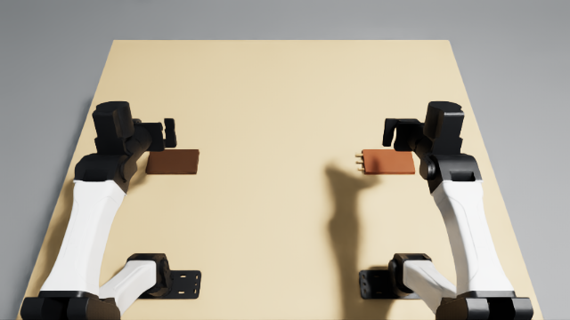
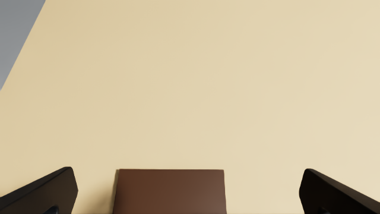
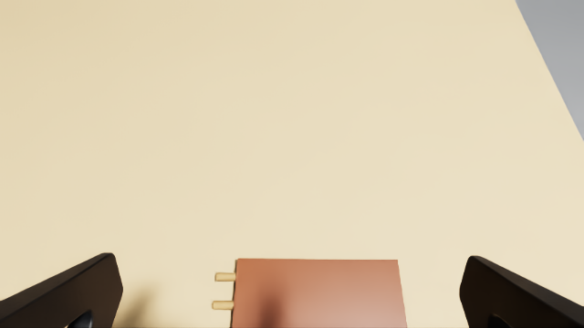
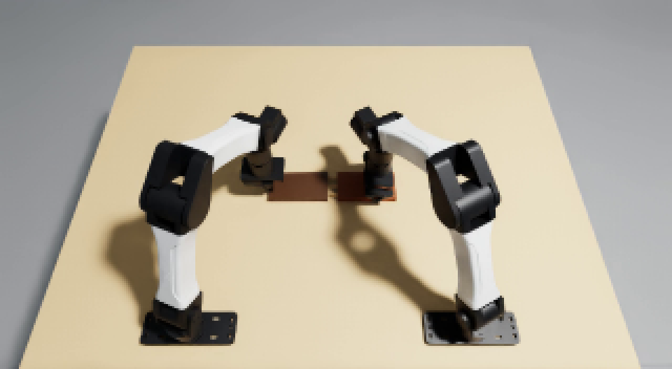
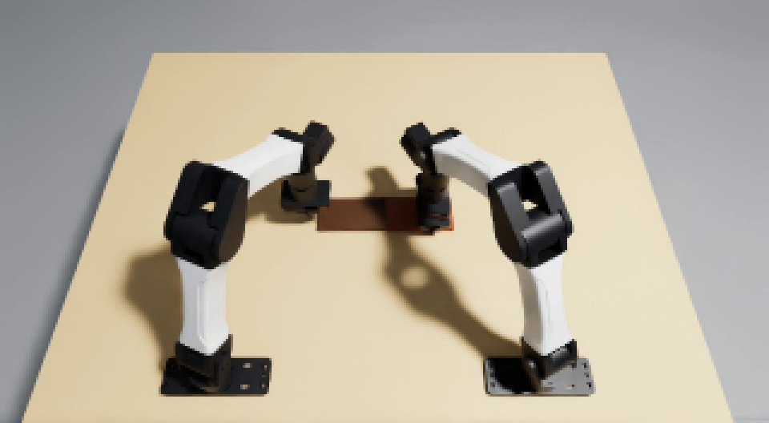

# Join two boards on three dowels

Instruction given to the policy: `Join the two boards on the three dowels so that their ends meet, flat on the bench, then let go.`

Files: `task.py` (scene, rules, score), `mechkit.py` (the mechanism kit the task file imports), `demo.py` (the scripted full-score run, the two lower levels as the same join cut short, a join made with one board turned 2 degrees, the hands that stay, and a join with both boards gripped), `demo_kit.py` (the runner behind the scripted runs), `trials.py` (checks in the simulator: rest and the first pictures, and the boards put in place and pushed together with no arm), `start_*.png` (the first pictures of a trial), `cue_*.png` (pictures at the size a policy gets), `README.md`.



 

The first pictures of a trial, both arms in their ready pose. Top camera: the walnut board beside the left arm and the cherry board beside the right, their ends facing each other across the middle of the bench, the three dowels as small pale pins on the cherry board's end; each board's outer end lies under its arm's hand. The right wrist camera sees the cherry board's near end and two of its dowels, the left one the walnut board's near end.

## Scene

Bench coordinates in metres: x forward from the line through the two arm bases, y left from the midline, z up from the bench top. The arms' bases are at (0, -0.305) and (0, +0.305).

| Part | Size, mass | Where |
|---|---|---|
| Cherry board, red-brown | 18 x 80 x 150 mm, 125 g | lying flat, its middle at (0.36, -0.33), its long axis along y; its doweled end towards the midline, at y = -0.255 |
| Three beech dowel pins, glued into the cherry board's end | 8 mm across, 40 mm long, 20 mm of it in the board; the ends chamfered 1 mm at 45 degrees | at 25 mm pitch on the end's centre line, 9 mm over the bench (mid-thickness); their tips at y = -0.235 |
| Walnut board, dark brown | 18 x 80 x 150 mm, 140 g | lying flat, its middle at (0.36, +0.33), its long axis along y; its socketed end towards the midline, at y = +0.255 |
| Three sockets in the walnut board's end | round bores 8.2 mm across, 22 mm deep | at the same pitch and height as the dowels |

The two ends are 51 cm apart. Nothing clamps, guides or stops either board. Nothing varies by seed. Each board lies beside its own arm: the walnut board where it starts is 0.60 m from the right arm's base, out of its reach (the arm's inverse kinematics misses it by 79 mm), so the task needs both arms.

Sizes and sources. Beech dowel pins 8 x 40 mm with chamfered ends are sold by the bag; an 8 mm brad-point bit drills their sockets. Assumed, to be measured on the bought parts: the boards' masses (weighed on a kitchen scale); the chamfer of the dowels' ends, 1 mm at 45 degrees (a caliper across the flat tip: 6 mm); the friction of the boards on the bench and on each other, 0.25 (a waxed laminate top; a spring scale pulls the cherry board along with about 0.3 N). The real check of a socket is a dowel from the same bag: it slides in by hand and does not rattle.

## What stands in for what

- **A round bore is a polygon.** The simulator has no round holes. Each socket is built from twenty-four flat staves round the bore's axis, inside the walnut board's end; their inner faces make a 24-sided bore whose flats stand 4.10 mm from the axis (its corners 1 per cent further). 8.2 mm is the tightest of the bores tried (8.2 and 8.3 mm here; the earlier build used 8.4), and aligned boards pushed together with 2 N each close the seam there (see "The checks before the script"): the dowel has 0.1 mm a side to the bore's flats.
- **A dowel's chamfer is sixteen plates.** The dowel is a cylinder 8 mm across standing 20 mm out of the cherry board's end; its last millimetre narrows at 45 degrees to a flat tip 6 mm across, built from sixteen thin plates round the tip. The chamfer is what lets a dowel that is a little out of line find its socket; a dowel more than a millimetre out of line stands on its flat tip.
- **A dry fit.** No glue and no press fit: a joined pair is held together only by the dowels in their sockets and by friction. The boards are each one rigid body; the dowels are part of the cherry board.

## Rules

The seam: the two openings between the boards' facing ends, at their two corners (where the cherry end's upright edges stand in front of the walnut end's face, along the walnut board).

Every level needs both seam gaps not under -2 mm (the boards do not overlap), the boards' middles within 2 mm of the same height and both boards flat within 3 degrees (on a real bench: a straightedge across the two top faces). A state that misses any of these, or the first level, scores 0.

| Score | Asked | On a real bench |
|---|---|---|
| 0.25 | both gaps 19 mm or less (the dowels' tips are in), the long edges in line within 1 mm and the boards square within 2 degrees | a tape at the two corners; a straightedge along a long edge |
| 0.5 | both gaps 10 mm or less | the tape |
| 0.75 | both gaps 0.5 mm or less, the long edges flush within 1 mm | a 0.5 mm feeler gauge enters neither corner; the straightedge along a long edge |
| 1.0 | and both grippers 3 cm or more from both boards, everything at rest | the video of the release |

Only the state at the end of the trial counts: a pair joined and pulled apart again scores as it ends. A trial succeeds when the score has been 1.0 for one second; it then ends. The run limit is 1,200 steps (60 s); the scripted full run takes 836.

## Can it be seen

 

The top camera at the size a policy gets (320 x 176), enlarged three times here, in the run `full`: left, 29.0 s, the ends 25 mm apart while the left hand waits for the line-up; right, 40.0 s, the seam closed. At this size a pixel is about 5.5 mm on the bench (the joined boards, 300 mm, are 55 pixels long). The open seam shows as a light line of bench between the brown ends, about 3 pixels wide at 25 mm and 2 at 19 mm (read along rows 92 to 95 of the picture, below the left arm's shadow); at 8 mm (36.0 s) it is one dim pixel in that shadow, and closed there is none, so the picture tells a seam with the tips just in from one nearly closed, but not 8 mm from 0.5 mm. The wrist cameras do not see the seam while the hands hold or push: each looks down on its own board.

## The checks before the script

No arm (`trials.py checks`): the boards put 20.5 mm apart, the dowels' tips half a millimetre short of the walnut board's end, and pushed together with a steady force at their middles, along the walnut board, for 4 s. (a) in line and square; (b) the cherry board 1.5 mm out of line; (c) the cherry board turned 2 degrees about the middle of its end. The task's bore, 8.2 mm.

| Bore | Push | (a) in line and square | (b) 1.5 mm out of line | (c) turned 2 degrees |
|---|---|---|---|---|
| 8.2 mm (`c5m`) | 2 N each | closed, seam 0.00 mm | closed, seam 0.00 mm | closed, seam 0.00 mm |
| 8.2 mm (`c5m`) | 8 N each | closed, seam 0.00 mm | closed, seam -0.01 to 0.00 mm | closed, seam -0.01 mm |

Free boards line themselves up on the dowels' chamfers: pushed together with 2 N each, boards 1.5 mm out of line slide into line and close the seam, and a board turned 2 degrees turns square, against nothing but the bench (friction 0.25, about 0.3 N). Under 8 N each all three close here too. In an earlier check (`c5b`, before the boards were renamed and recoloured) the boards 1.5 mm out of line stood on the dowels' tips under 8 N instead (the seam 19.9 mm open, 0.98 mm out of line): at that force the case is on the edge. In the task the hands hold the boards, or one of them; what held boards do is shown by the runs `both_gripped` and `skew`.

## Reference runs

Scripted, recording `c5l` of 2026-11-19 (commit `bde704f`), bores 8.2 mm, 20 Hz. Each hand comes down over its own board 25 mm from the board's middle, away from the seam end (held at their middles, the boards stopped with the dowels 14 mm in, where the two arms' wrists met; 25 mm further out each, the grasp points are 200 mm apart when the seam is closed), pointing down and open, closes on the board's long sides with its grasp point 15 mm over the bench, and slides the board along the bench towards the middle, 6 cm a second, until the ends are 30 mm apart. A board turns a little in the fingers as it slides, so the right hand then moves its board across until the ends are in line within 0.3 mm. Then the right hand holds the cherry board where it is, and the left hand lets go of the walnut board, comes down closed behind its outer end, turned a quarter turn so that its broad face meets that end, and pushes the board along the bench towards the dowels, 2.5 mm a second. With the ends 26 mm apart it stops and the right hand lines the ends up again, since a board pushed at one end does not go quite straight (recording `c5k`, pushed without that stop: the ends came to the dowels 2.3 mm out of line, and the tips stood on the walnut board's end); then the left hand pushes on until the seam is closed: free on the bench, the walnut board finds the dowels' line by itself, as the free boards in the checks do. Side by side, the two figures behind that choice: the arms hold a place to 0.2 to 0.3 mm across (and the boards level to 0.1 to 0.16 mm), and the bore leaves a dowel 0.1 mm a side; with both boards gripped, whether the dowels go in or stand at the sockets' mouths turns on small differences (the run `both_gripped` went in; recordings `c5i` and `c5j` stood). Any method that closes the joint scores the same: the score reads only where the boards are at the end and how far the grippers are from them. Then the left hand backs off the board's end, the right hand opens, and both hands go up 8 cm and stay there.

| Run | What it does | Score | What the recording shows |
|---|---|---|---|
| `full` | the left hand pushes the walnut board home; both let go | 1.0 | the right hand lines the ends up, from 2.0 to 0.06 mm out of line (13.0 s); the left hand lets go, comes down behind the walnut board's outer end and pushes the board 9 mm along the bench, where the ends are 1.6 mm out of line again, and the right hand lines them up to 0.26 mm (28.8 s); pushed on, the walnut board meets the dowels' chamfers at 31 s and comes into line on them (0.56 to 0.01 mm), and the seam closes at 2.5 mm a second, the left hand pressing 1.1 N or less, closed at 39.0 s; the left hand backs off, the right hand opens, both go up: 1.0 at 40.85 s, the seam 0.05 and 0.14 mm open, 0.015 mm out of line, square within 0.06 degrees; success after 41.8 s |
| `tips` | the same; the left hand stops when both gaps are 15 mm or less | 0.25 | the seam ends 14.6 to 14.7 mm open: the tips in, 19 mm or less, more than 10 mm |
| `half` | the left hand stops when both gaps are 6 mm or less | 0.5 | the seam ends 5.0 to 5.1 mm open: 10 mm or less, more than 0.5 mm |
| `skew` | both hands keep their boards and bring the ends together, 2.5 mm a second each, the cherry board turned 2 degrees about the middle of its end | 1.0 | the cherry board, turned 2.1 degrees to the walnut board as the join begins, meets the sockets at its far corner first; the dowels go in and the boards turn square in the fingers as the seam closes (1.9 degrees at 16.0 s, 0.47 at 23.0 s); the hands reach the end of their travel, 25 mm each, as it closes and let go with it 0.63 and 0.00 mm open, and it settles to 0.49 and 0.00 mm, 0.35 degrees: 1.0 at 24.15 s, by 0.006 mm on the 0.5 mm limit. Held boards turned 2 degrees do not wedge here: the fingers let them turn |
| `held` | as `full`, but the hands stay: the right hand on the cherry board, the left against the walnut board's end | 0.75 | the seam closed (0.00 to 0.29 mm); at the end the hands are 0 to 6 mm from the boards (3 cm asked for 1.0) |
| `both_gripped` | both hands keep their boards, in line and square, and bring the ends together, 2.5 mm a second each, as `skew` does | 1.0 | lined up to 0.22 mm before the join, the ends come to the sockets 0.6 mm out of line (16.0 s); the chamfers bring them into line (0.00 mm at 16.5 s), the dowels go straight in and the seam is closed at 20.0 s: 1.0 at 21.55 s. In two earlier recordings, lined up with less care, the dowels stood at the sockets' mouths with the ends 0.2 and 0.3 mm out of line: `c5i` for 5 s, until the seam closed with a snap (19 mm in half a second), `c5j` to the end of the run (0) |

Contact sheets looked at, of this recording: all three cameras of `full`, the top camera of `both_gripped`. In `full` the top camera shows each hand bring its board in from beside its arm, the left hand go over to the walnut board's outer end and push that board towards the cherry board, which the right hand holds, until the ends meet; at the end both hands are up and the boards lie joined. The right wrist camera, closed on the cherry board, sees only the board's top until the hand opens; the left one, behind the walnut board's outer end, sees that end and the board's top, not the seam. In `both_gripped` both hands bring their boards together and the seam closes between them.

What the script reads from the simulator: the seam's two gaps and how far the ends are out of line (a person sees the ends close and come into line, and feels them meet), to line the ends up, to let go in `tips` and `half` where they are meant to stop and to know when the seam is closed. It does not read the score, and it does not look at a camera.

## Limits and readings

| Limit in the score | Reading in the full-score run | Run that shows the limit |
|---|---|---|
| boards overlapping: a gap under -2 mm; heights more than 2 mm apart; a board tilted more than 3 degrees | gaps 0.05 to 0.14 mm; heights 0.00 mm apart; tilted 0.00 degrees | none: tests by state (stacked and overlapping boards) |
| tips in: both gaps 19 mm or less, in line within 1 mm, square within 2 degrees | in line 0.01 mm, square 0.06 degrees at the end | `tips` (0.25) |
| both gaps 10 mm or less | closed | `half` (0.5) |
| closed: both gaps 0.5 mm or less, flush within 1 mm | 0.05 to 0.14 mm | `half` |
| both grippers 3 cm from both boards | 77 to 80 mm | `held` (0.75) |

All of these are distances and angles; no force is scored. The levels the reference reaches by stopping short are met with room: `tips` ends 14.6 and 14.7 mm open, 4.3 mm inside the 19 mm of 0.25 and 4.6 mm from the 10 mm of 0.5; `half` ends 5.0 and 5.1 mm open, 4.9 mm inside 10 mm. In `held` the seam closes to 0.29 mm or less and the hands stay 0.0 and 6.2 mm from the boards, where 3 cm is asked for 1.0. The run that comes nearest a limit is `skew`, whose seam ends 0.494 mm open where 0.5 mm is asked.

## States set directly

Every rule of the scorer is checked by tests that set the state directly (`tests/test_dowel_join.py`): each gap a hundredth of a millimetre either side of 19, 10 and 0.5 mm; out of line by 0.99 and 1.01 mm either way; turned 1.9 and 2.1 degrees; one board 1.9 and 2.1 mm higher; tilted 2.9 and 3.1 degrees; a turned board's two corner gaps; overlapping by 2.1 mm and lying on the other board (0); a pair closed, then pulled 15 mm and 80 mm apart (0.25, then 0: only the end counts); 1.0 with a board moving at 3 cm/s, and with a gripper 2.9 and 3.1 cm from a board.

## Review of this submission (TK-369JYP)

The review: "Importance (not met): Three-dowel alignment is distinct, but ordinary construction carpenters do not all regularly dry-fit dowelled end joints, and cabinetmakers alone are insufficient to establish the 500,000-worker bar." Its request: "Change the domain to Societal relatability and explain how the dowel joint represents a familiar furniture-assembly activity. The present jobs justification counts construction carpenters broadly without establishing that 500,000 workers regularly dry-fit this particular kind of joint."

What changed: the domain, now Societal relatability, and the context in `task.json` (the keyword `woodworking` became `furniture assembly`). The context no longer counts carpenters, cabinetmakers or any other workers; it says what the joint is in everyday life. Wooden dowels hold most flat-pack furniture together: a bookcase or a wardrobe arrives as panels with rows of holes and a bag of 8 mm dowels, and whoever puts it up at home pushes each panel onto the dowels standing in the next. How that goes wrong is what the task tests: several dowels must find their holes at once, with about a tenth of a millimetre to spare, and a part pushed on a little askew jams on the first dowel and stops. The task makes the same joint dry with two short boards on three 8 mm dowels. A practised assembler holds one part still and pushes the other home, so that it finds the dowels' line by itself; the run `full` does the same.

What did not change: the scene, the scorer, the instruction, the run limit, the recorded runs, and the uploaded videos and screenshot with their scores. As before, the three dowels are glued into the cherry board's end (in the simulation they are part of that board): none can come out, and the seam closes only with all three in their sockets.

## Earlier reviews of this idea

This idea was submitted before as pull request #2003 and reviewed three times. This is a new build (scene, code and text are our own); the reviews are answered as follows.

- *First and second reviews: 9 mm square mortises round 8 mm dowels; "appropriately sized round sockets"; bounds on every partial level so that stacked or overlapping boards cannot score; text and scorer agreeing that only the end state counts.* The sockets here are round bores, 8.2 mm across for 8 mm dowels (see "What stands in for what" for why that width). Every level needs both seam gaps no less than -2 mm, the boards' middles within 2 mm of the same height and both flat within 3 degrees; a stacked board and overlapping boards score 0 (tests by state). Only the state at the end counts, in the score's text and in the scorer: a pair closed and pulled apart again scores as it ends (tested).
- *Third review: nothing but the runs on the round sockets ("the demo must reach full score within 1,200 steps"), and a socket of 8.0 to 8.1 mm against an 8.1 mm go gauge.* The full run reaches 1.0 at 40.85 s (817 steps); the run limit is 1,200 steps. There is no gauge to contradict a figure: the real check of a socket is a dowel from the same bag, which slides in by hand and does not rattle.

## How to run

Rule tests, no simulator: `scripts/rta check dowel_join`.

Checks in the simulator: `scripts/rta simpy <id> mech/tasks/dowel_join/trials.py /workspace/robocurve/outputs/<id> rest,checks [bore=<mm>]` (the task's own bore, 8.2 mm, without it).

The reference runs: `scripts/rta demo <id> mech/tasks/dowel_join full,tips,half,held,skew,both_gripped` (results in `outputs/<id>/<run>/`: three videos, a contact sheet per camera, `result.json` with a row per step, `readings.json`); `--quick` checks every run's plan against the arms' reach without the simulator.

One model trial with the stock embodiment and scorer (20 Hz, 320 x 176 pictures):

```bash
inspect-robots run --embodiment yam_arena --policy dream \
  -E task=mech/tasks/dowel_join/task.py -E object_jitter=0 -E control_hz=20 -E cam_width=320 -E cam_height=176 \
  --instruction "Join the two boards on the three dowels so that their ends meet, flat on the bench, then let go." \
  --scorer task_score --max-steps 1200 --seed 0 --no-prompt --store-frames --log-dir <log dir>
```

`-E object_jitter=0` is required: the boards lie where the task puts them.
