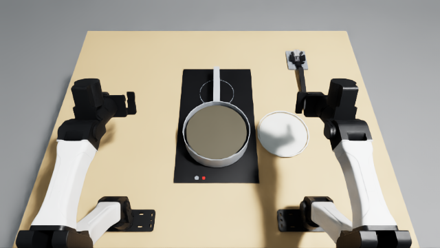
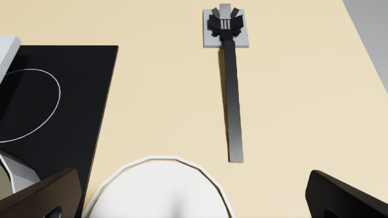
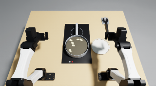
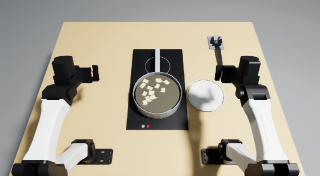

# Lift gnocchi out of simmering water with a slotted spoon as they float up, then switch the heat off

Instruction given to the policy: `The gnocchi are cooking; each is done when it floats up. Lift them out onto the plate with the slotted spoon as they are done, then put the spoon down and switch the heat off.`

Files: `task.py` (scene, the water as computed loads, rules, score), `mechkit.py` (the mechanism kit the task file imports), `skim.py` (the slotted spoon's planner: where the hand sits on the handle, a scoop and a serving as poses, the arm's reach and collision check without the simulator), `demo.py` (scripted full-score run and the runs that show what each rule costs), `demo_kit.py` (the runner behind the scripted runs), `trials.py` (checks in the simulator: rest, the cue pictures, the lamp, floating, digging at a gnocco on the pan's floor), `start_top.png` and `start_right_wrist.png` (the first pictures of a trial), `cue_none_up.png`, `cue_six_up.png`, `cue_twelve_up.png`, `cue_lamp_out.png` (the top camera's picture as a policy gets it), `README.md`.

 

The first pictures of a trial, both arms in their ready pose. Top camera: hob, pan, plate, and beyond the plate the slotted spoon on its rest (the whole bowl and the first 12 cm of the handle; the rest of the handle is behind the right hand). Right wrist camera: the whole slotted spoon.

## Review of this submission (TK-U47F4D)

The review, in its own words, and what this version does about each point.

| The review | This version |
|---|---|
| "Flags: Note for the team: Use trial video as well as the final photo to check the whole-trial pan displacement rule." | The scoring text now says it: the overhead trial video gives the pan's place against the front zone's ring through the whole trial, the final photo confirms the end state. The scorer always read the pan at every step and kept the zero: a pan pushed more than 3 cm and put back scores 0 (a test by state, and the run `shove`). |
| "Importance (not met): Cooking and scooping gnocchi is societally recognizable, but the submission does not establish that over 500,000 restaurant cooks regularly perform this specific operation." "Please change the domain to Societal relatability and explain the familiar cooking skill being tested" | The domain is Societal relatability. The context no longer counts cooks. It says what somebody cooking gnocchi at home does: the pieces sink, lie on the pan's floor for over a minute, come up within seconds of one another, and from then on are lifted out in time with a slotted spoon; the heat goes off at the end. |
| "Clarity and reproducibility (not met): The fresh gnocchi have no sourcing, storage temperature or repeatable preparation specified to produce the stated initial and floating conditions." "Specify how to source or prepare a consistent batch of fresh gnocchi, including its storage temperature and handling" | A named product in a named pack; how it is stored and at what temperature it goes into the water; how a batch of twelve is handled; how much water and how it is held at a simmer; when the trial starts. Section "The gnocchi and the water", and the setup and the reset notes of `task.json`. The product is not a chilled one, so the word "fresh" is gone. |
| "test the real setup to establish reproducible starting and float times; adjust the simulated timing and run limit if the tested procedure requires it." | Said plainly: this setup has not been cooked on a bench of ours. The start is now defined: the trial starts within 3 s of the batch going into the water. The float times are no longer an assumption of ours (15 to 50 s in the first submission) but those of a published kitchen test of the same gnocchi: all pieces afloat 80 to 90 s after they went in. The simulated timing and the run limit follow that test: the twelve come up within 10 s of one another, a floating piece may stay 90 s, the run limit is 4,400 steps (it was 3,000). Section "Float times: source and status" quotes the test, says what it does not cover, and gives the procedure by which a bench confirms or corrects the three numbers, which are named constants of `task.py`. |

What changed besides the text. `task.py`: the three timing numbers and what follows from them (when a piece is done, the run limit); nothing else of the scene or the scorer. `demo.py`: the run that lets pieces float too long keeps three in the water whatever a spoonful could take; a what-if option for other timing numbers; the full run's times by arithmetic. `trials.py`: the float trial follows the window. Tests: the timing, and that `task.json` states the task file's numbers. `mechkit.py` and `demo_kit.py` are the kit as it stands now (a hinge that turns freely, a repair to moving a joint's stops, a runner that closes its videos when a step fails); this task has no joint and uses none of it. The reference runs and the Dream-1 run are new, at the new timing and over the new run limit. The scene, the instruction and the scoring ladder are unchanged, and the first pictures and the cue pictures are those of the first submission.

## Where the task comes from

The idea is that of the program's pull request #2048: gnocchi are lifted out of the water with a spoon as they float up. Its review left one point open: "Replace the staged two-at-a-time cooking schedule with a realistic batch of gnocchi ... while retaining spoon-based retrieval."

How this task meets it: one small serving, twelve gnocchi (72 g), goes into the water together as the trial starts. The pieces lie on the pan's floor for over a minute and then come up within ten seconds of one another, each at a time of its own between 80 and 90 s after the start, in an order and at places drawn from the seed: what a published kitchen test of the same gnocchi found a batch to do (see "Float times: source and status"). They are lifted out with a slotted spoon, several to a spoonful where they float together (one to three; 1.33 a spoonful in the full-score run). Scene, kit, numbers and text are this task's own.

## Scene

Bench coordinates in metres: x forward from the line through the two arm bases, y left from the midline, z up from the bench top. The arms' bases are at (0, -0.305) and (0, +0.305). Everything stands free except where stated.

| Part | Size, mass | Where |
|---|---|---|
| Built-in induction hob with two zones (black glass), fixed | glass 306 mm wide, 527 mm deep, lying 6 mm proud of the bench; the zones are grey rings on the glass, 210 mm (front) and 145 mm (rear) across | x from 0.1275 to 0.6545, centred on y = 0; front zone's middle (0.305, 0), rear zone's (0.520, 0) |
| On/off key and lamp of the hob | key: a grey disc 16 mm across printed on the glass; lamp: a red square of 10 mm that glows while the heat is on | on the glass's front strip: key (0.1455, +0.070), lamp (0.1455, +0.045) |
| Pan: stainless sauté pan with water | 240 mm across and 70 mm deep inside, wall 2 mm, base 5 mm, 55 mm of water (2.5 litres), 4.0 kg with the water; handle 180 mm long, pointing away from the arms | stands loose on the front zone, middle (0.305, 0); its rim is 81 mm and the water's surface 66 mm above the bench |
| Potato gnocchi, twelve, from a 500 g bag of De Cecco Gnocchi di Patate no. 401 | 26 x 18 x 15 mm, 6 g each (assumed: to be measured on the bought pack) | on the pan's floor at the start, on the side away from the right arm, at places drawn from the seed |
| Plate | 200 mm across, rim 6 mm high, 450 g | middle (0.325, -0.260) |
| Slotted spoon: nylon, cranked handle | 334.5 mm long, 60 g; bowl 90 x 69 mm and 15 mm deep; handle 20 x 8 mm, its underside 14 mm above the plane of the bowl's rim | its bowl on the spoon rest, its handle towards the arms with the end on the bench, 7.8 degrees nose up |
| Spoon rest | 110 x 90 x 8 mm, 150 g | middle (0.710, -0.370) |

The pan stands on the front zone; its water is drawn as an opaque grey-beige surface (cooking water clouds with starch; a bench's plain water is clear at the first batch: see the stated departures). A gnocco on the floor cannot be seen. A floating one stands 1 mm out of the water and shows pale.

Hidden state, from the seed: when each gnocco reaches the surface (between 80 and 90 s after the start, each on its own), where each lies at the start and how it is turned, and the phase of its slow drift. With seed 0 the twelve reach the surface between 80.0 and 89.35 s (run `rvg3`, `full`); where they lie is as in the first submission. The stock run command under "How to run" does not hand the task its `--seed 0` as it stands: in the Dream-1 run the twelve came up at other times than in the scripted runs, between 80.35 and 89.05 s.

Sizes. The hob has the glass and the zones of the Bosch PIB375FB1E, a 30 cm domino induction hob: "Dimensions 51x306x527 mm", "Number of cooking zones 2", "Dimensions of the heating elements 1 x (21,0 cm Ø), 1 x (14,5 cm Ø)", "Type of control DirectSelect touch control" (maker's product page, https://www.bosch-home.co.uk/en/product/PIB375FB1E, read 2026-11-18; the page marks the model as no longer available). Where the zones sit on the glass the page does not say: here the front zone's middle is 17.75 cm and the rear zone's 39.25 cm from the glass's front edge, and the key and the lamp are on the front strip. The pan is a 24 cm sauté pan 7 cm deep, without a named maker; its 1.5 kg empty is assumed (4.0 kg with its 2.5 l of water). The slotted spoon has the outer sizes given for the Click Clack nylon slotted spoon in grey and chrome, 13.17 x 2.72 x 1.46 in or 334.5 x 69 x 37 mm (a retailer's listing, https://www.everythingkitchens.com/click-clack-nylon-slotted-spoon-grey-chrome.html; the sizes are from a search summary of 2026-11-18 and are to be checked on the bought spoon); the bowl's depth of 15 mm and its flat floor of 30 x 24 mm are assumed, the listing does not give them.

## The gnocchi and the water

What a bench buys and does, so that every trial starts from the same batch in the same water.

| | |
|---|---|
| Product | De Cecco Gnocchi di Patate (potato gnocchi) no. 401, a 500 g bag; in the United States a 17.5 oz pack. By the pack's storage directions the unopened bag is kept in a cupboard, not chilled. |
| The maker's directions, as retailers' listings of the pack give them (Tesco, United Kingdom, the 500 g bag; Jewel-Osco, United States, the 17.5 oz pack; looked up 2026-11-20) | into salted boiling water, 5 litres for 500 g; cooking time 2 minutes; strain as soon as they float to the top. The maker's own product page gives the cooking time as 2 minutes. |
| Storage | the bag unopened, as the pack directs: away from light and heat. The pack allows an opened bag three days in a refrigerator at 4 C; here a bag is opened just before the first trial of a session and is not kept for another day. |
| Temperature of the pieces | room temperature, 18 to 24 C, when they go into the water |
| A batch | a fresh twelve for each trial, separated by hand and laid on a second plate |
| Water | 2.5 litres of plain tap water in the 24 cm pan, 5.5 cm deep, without salt (the maker salts the water for taste). Held at a gentle simmer: 95 C, give or take 3, by a kitchen thermometer; topped up to 5.5 cm and brought back to that before each trial |
| Start of a trial | the twelve are tipped off the plate into the water together, on the side of the pan away from the right arm; the trial starts within 3 s of that. Nothing is cooked beforehand |
| A piece | 26 x 18 x 15 mm and 6 g in the scene: assumed. To be measured on the bought pack: a caliper on a piece, twelve pieces on a kitchen scale |

## Float times: source and status

The task's clock rests on three numbers of `task.py`. None of them has been measured on a bench of ours. They are read from one published kitchen test of the same maker's gnocchi: FoodCrumbles, "Are Gnocchi Cooked When They Float (and Why)?", 25 May 2021, https://foodcrumbles.com/are-gnocchi-cooked-when-they-float-and-why/ (read 2026-11-20). Its setup, in its words: "Our gnocchi were from the DeCecco brand and as a reference, we followed the instructions on the pack to cook our gnocchi. The pack told us to cook them for 2 minutes in boiling water." "To keep the water temperature up high, we only cooked small (that is, 6 little gnocchi at a time) batches of gnocchi in 1 liter (approx. 1 quart) of boiling water. All gnocchi were kept at room temperature before being cooked."

| Number | Value | What the source says | Status |
|---|---|---|---|
| `FLOAT_FROM`, `FLOAT_TO`: when the pieces reach the surface, counted from the batch going into the water | 80 to 90 s, each piece at a time of its own | "The gnocchi would sink to the bottom for the first approx. 45 seconds. They’d move around on the bottom, but stay down low. Next, the gnocchi would start to bounce up and down a bit. They might come floating to the top and then sink again. Also, one half of a piece of gnocchi might start to lift up, while the other half remained down at the bottom. Then, at 1 minute and 20-30 seconds, all gnocchi would pop up and float completely. This time point was very consistent, over and over again." | from the source, not measured by us. How the single pieces' times lie inside those 10 s the source does not say: the task draws each evenly from the window |
| `LATE_S`: how long a floating piece may stay in the water and still count | 90 s | "the gnocchi were cooked for either 30, 60, 90, 120, 150 or 180 seconds." "Interestingly, starting at 150 seconds, our gnocchi did start to become a little more sticky and crumbly. However, differences were still minor. In other words, had we been served any of the 60-180s gnocchi samples, we would have judged them all as being ‘cooked’!" | from the source, not measured by us. A piece that floats at 80 to 90 s and leaves the water within 90 s has cooked for 180 s at most, the longest the source covers; what happens after that it does not say |

What the source does not cover, and what the task leaves out:

- The source's water boiled, with six pieces in a litre; this setup simmers at 95 C with twelve pieces in 2.5 litres (about the same water for a piece). The source found the same float time in water just boiling and boiling hard; it did not try water under the boil.
- The bobbing before the final float is not modeled. In the simulation a piece lies on the floor until 2.4 s before its time and then rises once.
- The same source found pieces cooked for 60 s, which did not float yet, as soft as those cooked for 90 or 120 s. Floating is the cook's sign by the pack's directions, and the instruction's; the task scores the sign.
- Other times in print, used for no number here: the maker's cooking time of 2 minutes (above); a retailer's listing of another maker's chilled gnocchi (Giovanni Rana Skillet Gnocchi, at Albertsons) has them boiled about 2 to 3 minutes, until they rise.

How a bench sets the numbers: three batches by the procedure of "The gnocchi and the water", filmed from above; for each of the thirty-six pieces the time from the batch going into the water until the piece stays at the surface is read off the video; `FLOAT_FROM` and `FLOAT_TO` are set to the earliest and the latest of them. Everything else follows in `task.py`: a piece is done 2.37 s before its time at the surface (its way up in the simulation), and the run limit is the last moment at which a piece can still count, `FLOAT_TO + LATE_S`, and 40 s more for the last spoonfuls, the slotted spoon and the key, rounded up to ten seconds: 90 + 90 + 40 = 220 s, 4,400 steps. `tests/test_gnocchi_lift.py` holds the three numbers, the run limit and the text of `task.json` together, and checks by arithmetic that the reference script, at its slowest (one gnocco a spoonful), brings every gnocco out within the 90 s and ends inside the run limit.

## Rules

- A gnocco is done 2.37 s before its time at the surface and then rises; it has floated when its top is within 2 mm of the water's surface.
- It has left the water when its lowest part is 3 mm or more above the surface, or it is no longer over the pan.
- A gnocco counts when it floated, left the water after that and no more than 90 s after it floated, lies on the plate at rest, and was never touched by a gripper (a gripper's grasp point within 20 mm of its middle, at any time). A gnocco lying on another on the plate counts.
- The heat: a fingertip on the hob's key switches it, off and on again like a real key. A touch is a gripper's grasp point within 15 mm of the key's middle and up to 30 mm over the glass for 0.2 s; one touch switches once. The lamp is red while the heat is on.
- The slotted spoon is put down when it lies at rest and no gripper is within 4 cm of its handle.

Score, by outcome, read at the end of the trial (the trial ends early with 1.0 once the 1.0 condition has held for 1 s):

| Score | Condition |
|---|---|
| 0 | the pan was pushed more than 3 cm from where it stood, at any time, for the rest of the trial; or a gnocco that never floated lies on the plate (raw food served) |
| 0.25 | 3 gnocchi count |
| 0.5 | 6 count |
| 0.75 | 9 count, the heat is off and the slotted spoon is put down |
| 1.0 | 11 of the 12 count, the heat is off and the slotted spoon is put down |

While the heat is on or the slotted spoon is in a gripper the score is never above 0.5. The top level asks for 11 of 12 because one gnocco may end where the slotted spoon cannot take it (see "What the slotted spoon cannot do here").

The score that counts is the one at the end of the trial. "Lies on the plate" asks for rest (slower than 2 cm/s), in the counting and in the zero rule about a gnocco that never floated alike: both are about what lies on the plate at rest. The score shown during a trial can therefore change for a moment while a gnocco on the plate is knocked. In the reference run `raw` it reads 0.25 for one step at 102.1 s, while the two gnocchi of one spoonful land beside the raw one, and 0 before and after.

Run limit: 4,400 control steps at 20 Hz (220 s): 90 s until the last gnocco is up, 90 s that it may float, 40 s for the last spoonfuls, the slotted spoon and the key. The scripted full run takes 3,201 steps.

## Can the floating gnocchi be seen

The instruction's "as they are done" has to be readable from a camera. The pictures below are the top camera's at the size a policy gets in the program's model runs (320 x 176): none up, six up and six down, all twelve up (run `l7rt`, `trials.py cue`).

  

- None up: the water is an even grey-beige, (124, 117, 98) of 255 on average; nothing shows of the twelve on the floor.
- Six up: six pale gnocchi, about (212, 208, 187), each apart from the others by eye. Counting by pixels (those that differ from the none-up picture) finds three patches of 74, 42 and 29 pixels: neighbours touch at this size.
- Twelve up: a cluster in which about ten to twelve can be told apart by eye; the pixel count finds four patches (148, 74, 49 and 20 pixels). At this size a policy can see that gnocchi float and where, not always how many.
- Each floating gnocco stands 1.0 mm out of the water and is level; left alone it wanders 6 to 10 mm from where it came up in 60 s (run `l7ru`, `trials.py float`).

The lamp at the same size: 6 red pixels while the heat is on, none when it is off (`cue_lamp_out.png` against `cue_none_up.png`).


## Limits and readings

What the scored limits are, how a real bench reads them, and what was read at rest and in ordinary handling (reference runs below, run `rvg3`):

| Limit | Value | A real bench reads it from | Readings |
|---|---|---|---|
| Pan pushed from where it stood, at any moment of the trial | 30 mm | the overhead trial video against the front zone's ring, through the whole trial; the final photo for where it ends | at rest 0.0 mm in 60 s (run `l7ru`); through the 47 spoonfuls of the runs below 0.1 mm at most; pushed on purpose 73.1 mm (`shove`) |
| A floating gnocco's time in the water | 90 s | the overhead trial video: when it comes up, when it leaves the water | full-score run 5.0 to 62.8 s; the longest in a run not made late is that same 62.8 s (under 58 s in the others); made late on purpose 97.0, 97.9 and 103.7 s (`late`) |
| A gripper at a gnocco | grasp point within 20 mm of its middle | the video | with the slotted spoon in the hand the nearest a grasp point came to a gnocco was 69.3 mm (the runs below but `raw`); the hand that closes on one 7.1 mm (`raw`) |
| Heat off, slotted spoon put down, gnocchi on the plate | at the end | the final photo (lamp, slotted spoon, plate) | as scored |

## Tipping the pan is not scored

The pan's tilt is read and reported (`pan tilted at most (deg)`) and no rule uses it, because no run can show such a rule: nothing these arms do tips this pan.

- The left hand pinched the pan's wall where it is nearest the arms and went 7 cm up: the fingers slid up the wall and the pan stayed level, tilt 0.0 degrees, moved 0.1 mm (`tip_only` in the first submission's recording, run `l7ref` of 2026-11-18, and the same in run `l7u`; nothing floats in its 11 s, so the timing does not touch it). Lifting that side of a 4.0 kg pan takes about 20 N; the pinch on a wall 2 mm thick holds less.
- The pan's handle points away from the arms; with the hand pointing down the arms' reach ends 5 to 13 cm short of it.
- A hand that pushes the pan slides it and does not tip it: 73.1 mm with 0.05 degrees of tilt (`shove`).

## What the slotted spoon cannot do here

- **The part of the pan nearest the arm that holds it.** To get under a floating gnocco the bowl goes into the water nose down by 10 to 15 degrees and its handle leaves over the pan's rim towards the arm, with the hand on it (the rim is 15 mm over the water, the handle's underside 14 mm over the plane of the bowl's rim). For a gnocco near the arm's side of the pan there is no room for handle and hand. On a grid of 25 places 3.5 cm apart a whole scoop (down behind the gnocco, under it, up, level) is possible at 21; with 10 degrees or more to spare at every joint only beyond a straight line across the pan, at right angles to the direction to the right arm's base and 2.5 cm from the pan's middle on that arm's side. So the gnocchi lie, at the start, on the side of the pan away from that arm, where the batch is tipped in: each middle at least 15 mm beyond that line and within 9 cm of the pan's middle, any two at least 8 mm apart. One that drifts into that part stays in the pan: in the first submission's recording (run `l7ref`, `raw`), where the hand had stirred the gnocchi, one came up 13 mm from the pan's middle on the arm's side and was left. It did not happen in the runs below.
- **Against the pan's wall.** The bowl's nose has to pass beyond the gnocco. No scoop fits a gnocco whose middle is more than about 102 mm from the pan's middle (96 to 100 mm towards the sides); the wall is at 120 mm. A scoop on two gnocchi can push one of them out there: in one run on an earlier layout a gnocco ended 104 mm from the pan's middle and stayed in the pan (run `l7x`, `handled`); in the runs below it happened for a few seconds. In `full`, `raw` and `heat_on` the gnocco that starts nearest the far wall, on which the bowl of the third scoop had come down, lay 10 cm from the pan's middle when its turn came; no scoop fitted it for 2 to 6 s, until it had drifted back, and it was taken last, 100.7 to 102.5 mm from the pan's middle.
- **A gnocco on the pan's floor.** With the bowl nose down 27 degrees and its lowest point on the pan's floor, a gnocco was pushed 7.6 cm along the floor to the wall and left leaning there, under water; the slotted spoon shifted 13 mm in the hand; steeper the arm has no way (run `l7ru`, `trials.py dig`). In this simulation the slotted spoon does not bring a gnocco up before it floats, which is why the rule about raw food is shown with a hand (run `raw` below).
- The reference script leaves a gnocco it cannot reach: when nothing more is to float and no scoop has fitted what is left for 12 s, it tidies up. The top level allows for one such gnocco.
- **Where a serving lands.** A gnocco leaves the bowl late in the tip and comes down about 7 cm beyond the nose, or early in the swing (the second of two on the bowl) and comes down about 11.5 cm beyond it; then it skids. The six places the reference tips out over leave both landings 3.0 to 4.8 cm to the plate's rim. Before they were chosen for that, one and the same serving came down 83, 96, 101 and 103 mm from the plate's middle in four recordings, twice on the plate and twice off it (runs `l7g3` and `l7r`). With them, one gnocco of the 102 served in the first submission's recording still skidded 13 cm, over the rim and onto the hob's glass (run `l7ref`, `spoon_kept`); of the 64 gnocchi the slotted spoon brought out in the runs below, one, of a spoonful of three, skidded off the plate onto the bench (`three`).
- **The bowl's height: about 2 mm decide.** The bowl has to pass under a gnocco whose underside is 14 mm under the surface and over the gnocchi still on the floor, 40 mm under it. With the fingers 2.2 mm off on the handle, so that the bowl rode that much higher than planned, and the plunge into the water taking 0.6 s, one scoop in seven brought a gnocco out (run `l7z`, stopped and void). With the plunge slowed to 1.0 s: three of three (run `l7g2`). With the fingers where the plan has them and the slower plunge: 73 of 73 (run `l7ref`; 72 of 72 in the recording before, run `l7g3`), and 47 of 47 in the runs below, where up to twelve float at once. On the earlier layout, fingers right and the plunge in 0.6 s: 42 of 43 (runs `l7q`, `l7t`, `l7x`). No run shows how much more than this the scoop stands.
- **Where the fingers close on the handle.** Where the slotted spoon lies, 56 cm from the right arm's base, the simulated arm ends its pinch 2.2 mm low and 1.4 mm short of its target (0.3 mm off at 22 cm; runs `l7g1` and `l7q`). The script's `TAKE_SHORT` makes up for that: the hand is sent that much beyond the planned grasp point, and the pinch then ends 0.0 mm from it (`grip_only`, run `l7ref`). Whoever moves the spoon rest has to read this again.

## What is simulated and what is computed

Simulated (PhysX, 240 Hz): every part as rigid bodies of boxes and cylinders; contact and friction between grippers, slotted spoon, gnocchi, pan, plate, spoon rest, hob and bench. The bowl is a flat floor with eight flat walls; a gnocco is carried on it by contact alone.

Computed by the task file, once per control step and held for the step: the water's load on each gnocco (lift on each of its eight parts by how much of that part is under the surface, drag, a slow drift); which gnocchi have floated, left the water, been touched; how far the pan has been pushed; the key and the lamp.

Stated departures from a real pan of gnocchi:

- The water is not a fluid. It does not move, splash or pour, nothing drains from a spoonful, and it acts on the gnocchi only: not on the slotted spoon, the pan or a hand. The slots are drawn.
- A raw gnocco gets 0.78 of the weight of the water it displaces as lift and lies on the floor; done, it gets 0.916 and floats with 1 mm showing; it turns from one to the other over 1 s and reaches the surface 2.35 to 2.39 s after it is done (run `l7ru`; in run `rvg3`, `full`, every gnocco reached the surface within 0.03 s of the time drawn for it); the task file puts that moment 2.37 s before the time drawn for the surface. Drag 0.17 N s/m, a drift of 0.3 mN. These stand in for measurements on real gnocchi.
- A piece rises once. The bobbing that the published test saw before the final float (pieces coming up and sinking again from about 45 s) is not modeled.
- The gnocchi are rigid boxes. A cooked gnocco is soft: that a gripper may not touch one stands in for squashing it.
- The water's surface is drawn opaque, so a gnocco on the floor is hidden altogether. A bench's water is plain: clear at the first batch and cloudier with each, so there a gnocco on the floor can be seen, smaller and dimmer than one at the surface.
- Nothing is hot. Real trials use real gnocchi in simmering water with the gripper pads sleeved, and a fresh batch each trial.
- The renderer builds each picture from the frames before it. A small thing that vanishes or jumps stayed in the pictures for seconds: the lamp after it had gone out, and after a reset the gnocchi that the trial before had left afloat (12 to 26 pixels on the water brighter than 150 of 255 in the first picture, gone 3 s later; run `l7g3`). So the kit makes the renderer forget its earlier frames at every reset until the scene has settled, then renders eight more pictures before the first one is handed out (in the first submission's recording, run `l7ref`, no pixel on the water is brighter than 150 in any run's first second, and 6 at most differ by more than 25 from a clean first frame; in the runs below the water in each run's first picture differs from that of the session's first run, by more than 25 of 255, in 57 pixels at most of 5,049, where one floating gnocco covers about 90), and the task does the same at the step the heat is switched. For about a quarter of a second after the switch the whole picture is slightly softer: of the 230,400 pixels of a 640 x 360 picture, 6,875 to 7,615 differ from the picture before the switch by more than 25 of 255 one step after it, 1,911 to 2,292 five steps after and 561 to 732 twenty steps after (run `l7ru`, four switches). The lamp is out, or lit again, in the picture by the second or third step.
- The hand on the slotted spoon in the reference runs: a pinch across the handle 8 cm from where it starts, the hand leaning 30 degrees along the handle towards the bowl. With the hand straight above the handle a whole scoop was possible at 2 of 9 places.

## Reference runs

All scripted (`demo.py`), seed 0. Run `rvg3` of 2026-11-20, recorded on commit 025b5ff (what came after it changes words only: this file, `task.json`, and a sentence of the comment that opens `task.py`); a folder per run with `result.json`, `trips.json` (which names the timing numbers the run was made with), a video per camera, `setup.png` and contact sheets. Six runs: the full score, one lower level (`three`), the cap while the heat is on (`heat_on`), and the three rules that take gnocchi or the whole score away (`late`, `shove`, `raw`). What no run shows is checked by tests that set the state directly (see "States set directly"). The start and cue pictures (run `l7rt`) and the lamp, float and dig trials (run `l7ru`) are those of the first submission: the scene has not changed.

A recording is not repeatable to the step. With the same seed and the same script, runs that follow each other in one simulator session differ in the last digits of their contacts, and a gnocco that lands near an edge ends on either side of it: in the first submission's recordings one and the same serving came down 83, 96, 101 and 103 mm from the plate's middle, and here the third spoonful, three gnocchi, landed whole on the plate in `full` and lost one over the rim in `three`. A rerun gives the levels below; its figures may differ from these. A second recording of `full` on another machine (run `rvg2`) took the same course to the step: 3,201 steps and the same nine trips; of its figures, the moment the plate held six differs by 0.05 s and the nearest a gripper came to a gnocco by 0.3 mm.

What the script reads from the simulator: where the floating gnocchi are and since when each has floated. A person at the pan sees both. It never reads where a gnocco on the floor lies or when it will be done, and it decides nothing from a camera picture. Each trip is chosen for the most floating gnocchi over the bowl, then for the one that has floated longest; the arm's way is checked against its joint limits and the scene before it is taken.

The full-score plan: the right arm takes the slotted spoon off its rest (a pinch across the handle) and holds it level over the pan from 9.7 s on, for the 70 s until the first gnocchi come up. Then it brings the bowl into the water behind floating gnocchi, nose down 15 degrees, passes it under them, lifts, carries them level to the plate and tips them out nose down 60 degrees: one trip, 7.6 s, and the next. When the pan is empty it lays the slotted spoon back on its rest while the left arm puts a fingertip on the hob's key.

| Run | What the script does | Score | Gnocchi at the end | Trips (gnocchi brought out by each) | Readings |
|---|---|---|---|---|---|
| `full` | everything | 1.00, ended as a success after 160.1 s (3,201 steps) | 12 on the plate, 12 count | 9 (1, 1, 3, 2, 1, 1, 1, 1, 1) | floated 5.0 to 62.8 s before leaving the water; pan moved 0.0 mm. The last gnocco lay by the far wall, 10 cm from the pan's middle, and no scoop fitted it from 141 to 147 s |
| `three` | stops taking gnocchi once three lie on the plate, then tidies up | 0.25 | 4 on the plate, 4 count; a fifth, one of the three of the last spoonful, skidded off the plate onto the bench; 7 left in the pan | 3 (1, 1, 3) | ran 111.3 s |
| `heat_on` | everything, but the key is not touched | 0.50 | 12 on the plate, 12 count; the slotted spoon is put down; the lamp is red | 9 (1, 1, 3, 2, 1, 1, 1, 1, 1) | ran 158.9 s; floated 5.0 to 57.8 s before leaving the water |
| `late` | once nine have left the water it waits until those still floating have floated for more than the 90 s, then takes them | 0.75 | 12 on the plate, 9 count: the three taken 97.0, 97.9 and 103.7 s after they floated do not count | 8 (1, 2, 2, 1, 2, 1, 2, 1) | waited from 125.8 to 180.3 s; ran 203.8 s, 4,076 of the 4,400 steps |
| `shove` | everything, and before the key the left hand, closed, pushes the pan back on the hob | 0.00; without the rule 1.00 | 12 on the plate, 12 count, heat off, slotted spoon put down | 9 (1, 1, 3, 2, 1, 1, 1, 1, 1) | pan pushed 73.1 mm, tilt 0.05 degrees; the score reads 0.5 until the push, at 153.6 s, and 0 from then on; ran 162.3 s |
| `raw` | before it takes the slotted spoon the empty right hand reaches into the water, closes on what lies on the floor there and puts it on the plate; then everything | 0.00; without the rule 1.00 | 12 on the plate: the one that never floated, and 11 that count; heat off, slotted spoon put down | 9 (1, 1, 2, 2, 1, 1, 1, 1, 1) | the raw gnocco is out of the water at 4.7 s and on the plate at 8.35 s; the others floated 5.0 to 57.8 s before leaving |

In the six runs the slotted spoon made 47 trips and every one brought gnocchi out: 64 in all, one to three a trip (seven times a scoop planned for two or three brought out one fewer). 63 of the 64 ended on the plate; one skidded over its rim onto the bench (`three`). In no run does the first picture show anything of the run before.

Where the raw gnocco comes from: the hand goes down at a place fixed in `demo.py`, 2 cm beyond and 2 cm to the right of the pan's middle. That is the part of the gnocchi's side of the pan that the right hand, pointing straight down, reaches at all (its joints 5.7 degrees inside their limits there, nothing beyond). The script does not read where gnocchi lie; with seed 0 one lies at that place, which was looked up beforehand so that the run would show the rule. The left hand reaches the gnocchi's side well, and not the plate.

What the contact sheets show (the top camera's of all six runs and the wrist cameras' of `full` were looked at). `full`: the untouched scene; the right hand at the handle beyond the plate; from 14 s the slotted spoon held level over the pan and the water even, until two gnocchi show pale at 83.5 s; at 90.5 s ten float on the far half of the water; nine scoops, the plate filling; from 139 to 146 s the last gnocco lies at the far wall and the arm waits; at 160 s both arms are parked, the pan is empty, twelve lie on the plate and the lamp is out. Its right wrist camera sees the whole slotted spoon at the start, then, past the handle in the hand, the pan's near rim with the key and the red lamp, and the plate as the spoonfuls land on it; its left wrist camera sees the bench and the hob's edge throughout. `three`: the same wait and three scoops; at 111 s seven gnocchi float in the pan, four lie on the plate, the slotted spoon is on its rest and the lamp is out. `heat_on`: as `full`, and at the end the lamp is still red. `late`: after six scoops three gnocchi float at the far wall from 124 to 177 s while the arm holds the slotted spoon level beside the plate, on which nine lie; at 204 s the pan is empty, twelve lie on the plate and the lamp is out. `shove`: as `full` until the pan is empty; at 155 s the left hand is at the pan, and at 162 s the pan stands about a third of its width back from the front zone's ring, which shows in front of it. `raw`: at 7 s the right hand is on its way from the pan to the plate; at 14 s one gnocco lies on the plate while the hand takes the slotted spoon; then as `full`.

## States set directly

Rules and levels that no run above shows are checked by tests that put the state in by hand (`tests/test_gnocchi_lift.py`): 3, 6, 9 and 11 gnocchi that count, with and without the heat off and the slotted spoon down (0.25, 0.5, 0.75, 1.0, and the cap at 0.5); the slotted spoon taken up again after a 1.0 (0.5); a gnocco taken out a second after its 90 s are over, and one taken out exactly when its time is up (it counts); a gnocco a gripper has touched; one still sliding on the plate; one on the bench beside the plate; a raw gnocco taken out and put on the plate (0) and put back into the water (the score returns); the pan 2.9 and 3.1 cm from where it stood, and pushed and put back (0 stays); the pan tilted (reported, not scored); the key touched for 0.15 and 0.25 s, held, touched again, missed by 3 cm and by 5 cm of height.

## How to run

Rule tests, no simulator: `scripts/rta check gnocchi_lift` (21 tests), `scripts/rta check gnocchi_skim` (6), `scripts/rta check mechkit` (38) and `scripts/rta check demo_kit` (12).

The reference runs: `scripts/rta demo <id> mech/tasks/gnocchi_lift full,three,late,heat_on,shove,raw` (results in `outputs/<id>/<run>/`; the runs of the first submission that are not repeated here, `nine`, `six`, `spoon_kept`, `handled`, `tip_only` and `grip_only`, are still in `demo.py`); `--dry` appended checks the fixed parts of the plan against the arm's reach and the scene without the simulator and prints the full run's times by arithmetic; `window=<from>,<to>,<late>` appended runs a what-if with other timing numbers. The checks in the simulator: `scripts/rta simpy <id> mech/tasks/gnocchi_lift/trials.py /workspace/robocurve/outputs/<id> rest,cue,lamp,float,dig`.

One model trial with the stock embodiment and scorer (20 Hz, 320 x 176 pictures, fixed layout):

```bash
inspect-robots run --embodiment yam_arena --policy dream \
  -E task=mech/tasks/gnocchi_lift/task.py -E object_jitter=0 -E control_hz=20 -E cam_width=320 -E cam_height=176 \
  --instruction "The gnocchi are cooking; each is done when it floats up. Lift them out onto the plate with the slotted spoon as they are done, then put the spoon down and switch the heat off." \
  --scorer task_score --max-steps 4400 --seed 0 --no-prompt --store-frames --log-dir <log dir>
```

`-E object_jitter=0` is required: the scripted runs take the layout from the task file's constants, and the task lays the gnocchi from the seed by itself.

A teleoperated take, recorded: `scripts/rta teleop <id> mech/tasks/gnocchi_lift/task.py 220 --mac`; the take lands in `outputs/<id>_teleop/demo/`.
