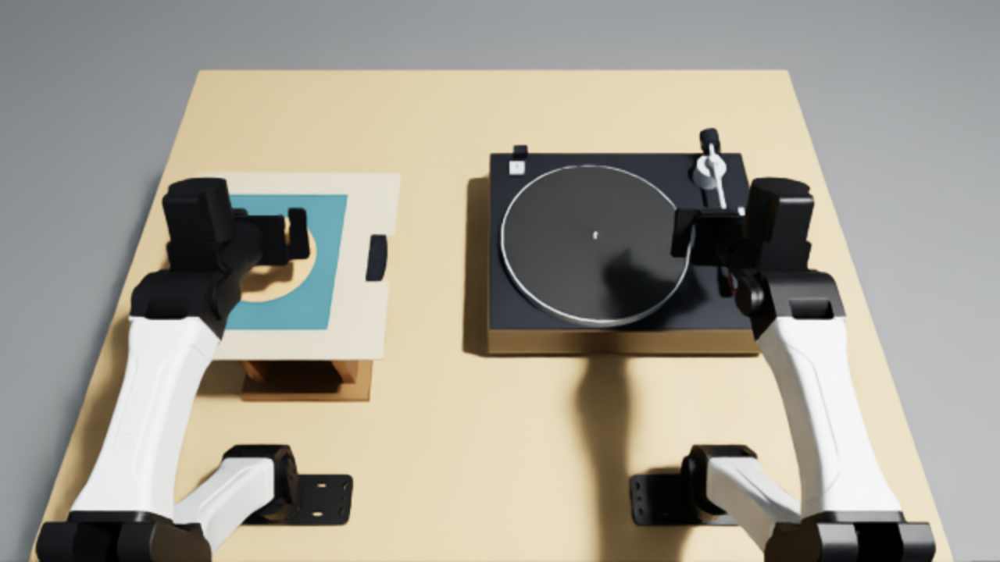
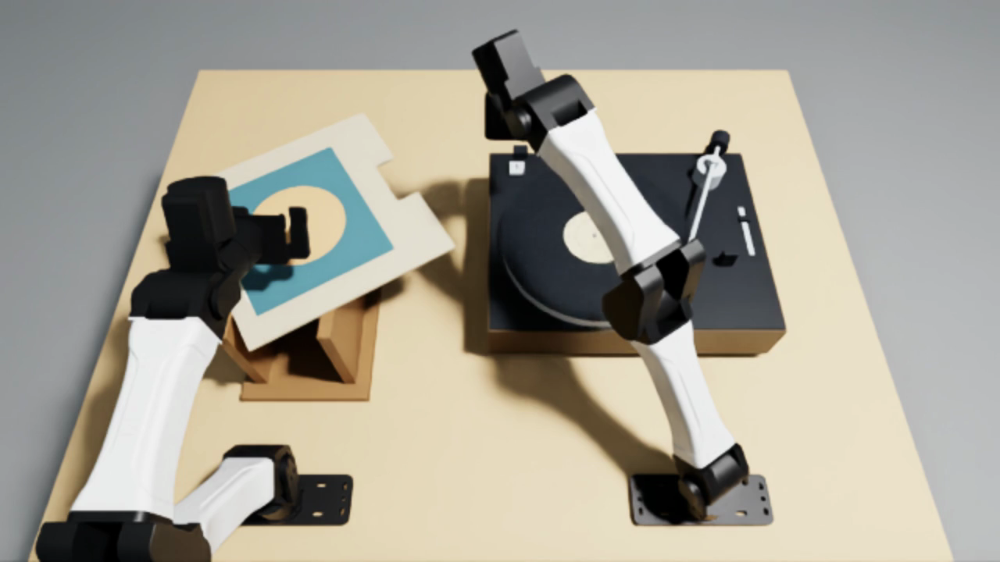

# Load an LP, lower the stylus and start playback

Take the LP out of its sleeve and seat it on the turntable spindle. Set the sleeve aside. Lift the tonearm by its headshell, lower the stylus onto the outer recorded band, then press START to play the record. Leave both hands clear without dropping the LP or dragging the stylus.

## Validation

The actual hosted **Dream-1 (`dreamlabs/dream-1-beta`) run scored 0.0 after 2400 controls (120 seconds)**, seed 0, with 50 inference requests and no errored trials. It completed in 514.41 seconds wall-clock time. All three camera recordings decoded successfully at 1280 × 720, H.264, 20 fps; each has one reset frame followed by 2400 control frames. The top-camera recording is submitted. `model-run-audit.json` records the source, evaluation and video hashes.

The complete scripted native Isaac demonstration reached **1.0 at control 2280 of 2400 (114 seconds)** from the original sleeve reset, including five seconds of stable playback with both hands clear. No handling violation occurred. It used native CPU PhysX at 240 Hz and the standard GPU-rendered YAM cameras at 1280 × 720. Wall-clock runtime was 874.76 seconds.

The final scorer also rejects a discarded or unstable sleeve, detects stylus drag before seating and when the record moves beneath the stylus, and requires 60 mm TCP clearance from the LP and jacket. All 2,280 unchanged native state samples were replayed through this scorer: the demonstration retains 1.0 at the same control. `demo-score-audit.json` records the trace/scorer hashes and result. The 25 unit checks cover scoring and geometry; the recorded native demonstration establishes feasibility.



## Objects and fixed reset

All coordinates are metres in the calibrated YAM station frame: +X away from the robot bases, +Y toward the left arm, +Z up. Table surface is Z=0.7475. `pilot.json` and `geometry.json` are the exact machine-readable geometry, poses and scoring constants; `build_assets.py` regenerates them and the retained meshes.

| Object | Dimensions, material and mass | Starting state |
| --- | --- | --- |
| LP | 300 mm diameter, 1.8 mm thick, 7.3 mm through-hole; black rigid PVC approximation, 180 g; printed labels and visual grooves | Centre (0.30, 0.30, 0.9389), horizontal, fully inside jacket |
| Jacket | 315 × 315 × 4.4 mm; 0.5 mm rigid cardstock faces, 3.4 mm internal gap, 75 g | Centre (0.30, 0.30, 0.9397), horizontal; open edge faces −Y. Both faces have an 80 × 35 mm thumb notch |
| Display stand | Two wooden support panels, each 250 × 18 × 190 mm | Centres (0.30, 0.225, 0.8425) and (0.30, 0.365, 0.8425); fixed to a 300 × 200 × 15 mm wooden base at (0.30, 0.295, 0.755) |
| Record player | Generic 452 × 352 mm deck; wooden plinth, metal platter, felt mat, rubber feet, movable arm, counterweight, cartridge with exposed stylus, controls and cover hinge sockets | Fixed root (0.40, −0.22, 0.7475); dust cover removed, motor off |
| Platter and spindle | 300 mm platter, 294 mm mat; 6.8 mm spindle shaft with a rounded 3.4 mm radius nose | Centre XY=(0.38, −0.165); mat top Z=0.8755, spindle top Z=0.8875 |
| Robot station | Standard bimanual YAM station and bench supplied by `yam-arena` | Both arms in READY, fingers open; standard calibrated top and wrist cameras |

The LP and jacket are free rigid bodies. There are no object attachments, grasp constraints, post-reset teleports or success-triggered object movements. The player base and stand are fixed fixtures. Each trial restores the same geometry and robot state; no consumables are modeled.



## Playback mechanisms and fidelity

The power connection, speed selector at 33⅓ rpm, audio connection and counterweight are prepared. The arm starts unclipped on its rest; the cartridge is installed, stylus guard and dust cover removed. The robot seats the LP with a bounded press on its centre label, withdraws, then handles the headshell rather than the needle tip. The prescribed order is stylus first, START second, as requested; this is a generic manual deck, not a claim that every manufacturer's operating sequence is identical.

The player is one fixed-base PhysX articulation: 1.1 kg platter on a vertical revolute axle, 25 g yaw gimbal, 180 g counterbalanced tonearm on a pitch hinge, and an 8 g START cap with 4 mm spring-loaded vertical travel. Tonearm effective length is 225 mm, with a balanced COM 2.5 mm toward the stylus, approximately 2 g nominal tracking force. Yaw range is −0.95 to 0.08 rad; pitch −0.08 to 0.35 rad. The stylus is a 0.7 mm radius rigid spherical contact proxy. The button is 25 × 26 × 8 mm with a 250 N/m spring and 1 N·s/m damping. Its released centre is (0.530, −0.043, 0.8645).

A passive yaw torsion spring of 0.00114 N·m/rad toward parked yaw models prepared anti-skate. It supplies about 0.439 mN·m at the cue angle, calibrated against native sliding contact torque and approximately 2 g measured tracking force. This is a generic apparatus setting, not a manufacturer-specific spring specification.

A physical button depression of at least 3 mm toggles motor power, and it must return to less than 1 mm depression before another toggle. A speed controller applies at most 0.06 N·m to the native platter link. The free record turns only through actual mat friction. No object poses or velocities are written after reset; the scripted policy sends only robot joint and gripper commands. Motor electronics are independent of the policy and scorer.

`build_assets.py` creates original dimensioned meshes, with materials and mesh data embedded in USD. The LP uses one watertight annular SDF collider with 1024 resolution and sparse subgrids, preserving its actual centre hole and eliminating internal collision seams. The exterior mesh has 128 angular segments and two radial bands; volume differs from an ideal circular annulus by 0.040%. The asymmetric label marks make rotation visible. The deck is a generic model informed by the manufacturer references in `SOURCES.json`, not copied commercial CAD.

Card and vinyl remain rigid. The jacket is pre-opened, with no flexible inner bag. Grooves are visual: no paper tearing, record scratches, warping, stylus wear, groove tracking microgeometry, cartridge transduction or acoustic simulation is claimed. The modeled audio output is an original synthesized phrase gated by native stylus-contact and measured-rotation metrics. `render_audio.py` produces a separate audio version of the native camera video and preserves its original silent video and trace.

## Scoring

The limit is 2400 controls at 20 Hz (120 seconds); physics is 240 Hz with native PGS and external-forces-every-iteration disabled. All geometry and speed checks use measured native body states. Platter/LP RPM use a 20 Hz pose encoder; stylus horizontal speed uses consecutive native tip positions. Raw instantaneous record angular velocity is retained separately to expose solver chatter. The scripted demonstration is privileged and is not Dream-1.

Removal means the entire record clears the jacket's open edge in its moving frame; this is latched. Seating requires spindle-centre offset below 0.25 mm, normal within 1° of vertical, bottom within 0.6 mm of mat height, linear speed below 10 mm/s and X/Y angular speed below 0.1 rad/s. Rotation around the spindle is allowed.

Stylus placement requires its tip within −0.1 to +0.1 mm of the record top, on an already seated LP. Initial cueing uses the 135–147 mm radial outer band; ongoing playback permits the recorded annulus 58–147 mm. A qualified start is a fresh physical START press after stationary cueing (tip horizontal speed below 10 mm/s and LP angular speed below 0.1 rad/s). Pressing START with the arm parked physically spins the platter but cannot satisfy that sequence requirement.

Playback requires motor on, stylus on the recorded annulus with horizontal motion below 1 mm/s, and both measured LP and platter speeds within 1.5 rpm of clockwise 33⅓ rpm. Full score also requires radius within 5 mm of the qualified cue radius. Both TCPs must be more than 60 mm from the LP and jacket and 60 mm from the entire tonearm segment (counterweight to stylus), with every full-score condition held for five seconds. START must be released to less than 1 mm depression. These are TCP clearance checks, not whole-arm contact guarantees.

| Outcome | Score |
| --- | --- |
| Latched handling violation, or LP not removed | 0 |
| Removed but not seated | 0.25 |
| Seated but stylus not on recorded annulus | 0.5 |
| Stylus placed, but playback/order/clearance incomplete | 0.75 |
| Qualified playback and clear hands, held five seconds | 1.0 |

Handling violations latch zero: LP's oriented lowest point at/below table+0.5 mm; centre outside Z≤1.45 m, |Y|≤0.65 m, −0.18≤X≤0.90 m; or a stylus within 2 mm of the LP surface and inside its 150 mm radius that penetrates more than 1 mm, reaches inside the 58 mm label boundary, or has horizontal speed (in the world or relative to the LP) above 30 mm/s with the motor off. These stylus checks apply before seating too. Dropping the jacket more than 10 mm below the bench or moving its centre outside the LP workspace also latches zero. Full credit requires the jacket to be stable (linear speed below 20 mm/s, angular speed below 0.1 rad/s), fully over the bench footprint X=[−0.05,0.75], Y=[−0.60,0.60], with its lowest point no more than 1 mm below the bench. This is an operational handling check, not simulated damage. Invalid native states abort rather than earn a score.

## Reproduce

Use Linux, Python 3.12, Isaac Sim 6.1.0.0, Isaac Lab 17.0.2, Isaac Lab-Arena 0.3.0 and the pinned YAM package in `pyproject.toml`. The supplied runtime helpers are bundled under `runtime/`; this task needs no private repository. Install into a provisioned Isaac environment using `uv pip install --python /path/to/isaac/python tasks/lp-sleeve-to-turntable` (or its environment's pip). Accept NVIDIA's terms yourself and set `OMNI_KIT_ACCEPT_EULA=YES` when authorized.

From the benchmark repository root:

```bash
TASK=tasks/lp-sleeve-to-turntable
export PYTHONPATH="$PWD/$TASK/runtime${PYTHONPATH:+:$PYTHONPATH}"
python "$TASK/run_demo.py" "$TASK" /absolute/new-demo --policy recovery --device cpu
python "$TASK/render_audio.py" /absolute/new-demo /absolute/playback-with-audio.mp4
```

For Dream-1, install the official Inspect Robots Dream integration, configure its credential outside the repository, and run the exact `instruction` from `pilot.json`:

```bash
inspect-robots run --embodiment lp_turntable --policy dream \
  -P model=dreamlabs/dream-1-beta -P record=false \
  -E task=tasks/lp-sleeve-to-turntable -E condition=recoverable \
  -E object_jitter=0 -E control_hz=20 -E cam_width=1280 -E cam_height=720 \
  -E device=cpu --instruction "$(python -c 'import json; print(json.load(open("tasks/lp-sleeve-to-turntable/pilot.json"))["instruction"])')" \
  --scorer task_score --max-steps 2400 --seed 0 --store-frames \
  --log-dir /absolute/new-dream
```

`task_score` uses the task's numeric score and the runtime's five-second consecutive full-condition hold. A transient full-condition frame cannot earn 1.0. Failed/partial runs retain their measured score. Defaults use one fixed reset and seed 0; no consumables. The authored demonstration plan has 2,360 controls (118 seconds), but stops when the held endpoint succeeds.

For scoring checks and rescoring retained native state evidence:

```bash
python -m unittest discover -s "$TASK/tests" -q
python "$TASK/rescore_native.py" "$TASK" /absolute/native-demo /absolute/rescore.json
```

`playback_probe` and `button_probe` are mechanism diagnostics and cannot establish full-task feasibility. Use `recoverable` for the submitted task.

To export editable native USD props from the Isaac environment:

```bash
python "$TASK/export_assets.py" /absolute/new-props
```

`scene.usdc` contains the player, jacket, LP and stand in the fixed reset. The full runtime adds the calibrated robot station and cameras, button electronics, motor torque and scoring. Meshes, materials and native mechanism definitions are embedded. The standard YAM camera pose and field of view are unchanged.
