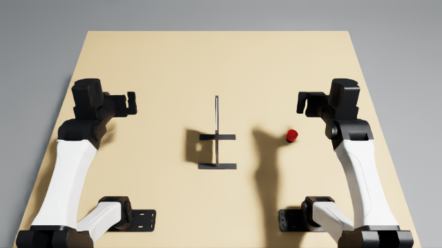
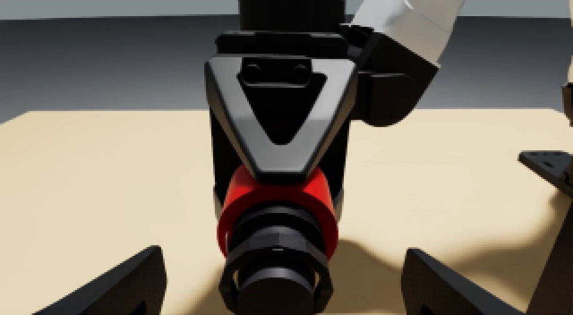
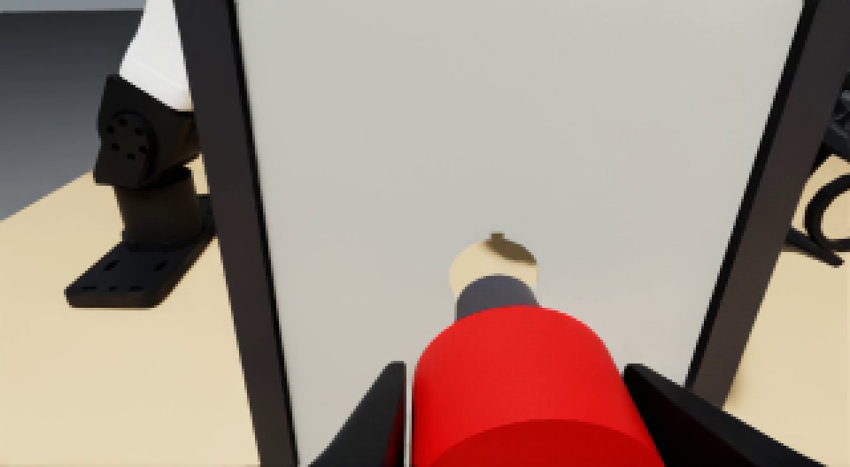
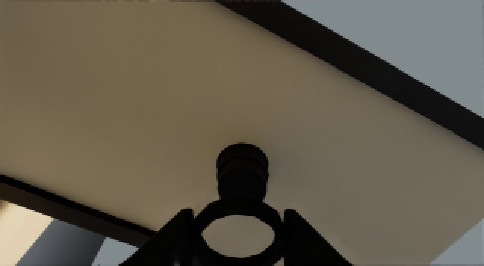
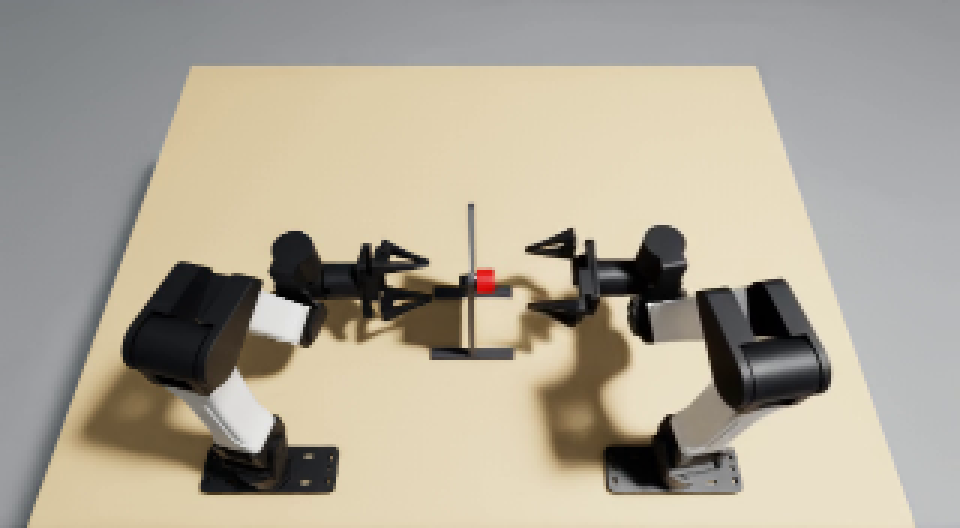

# Mount an emergency-stop button in a panel and screw its locking ring on hand-tight

Instruction given to the policy: `Mount the emergency-stop button in the panel hole with its tab in the notch, then screw its locking ring on from behind until it is hand-tight, and let go.`

Category: Impact on jobs. Mounting panel controls falls under core tasks of electricians and of electrical and electromechanical equipment assemblers; counted only in nonresidential and plant work, about 633,600 US workers (see "Who does this work, and how many").

Files: `task.py` (scene, mechanisms, rules, score), `mechkit.py` (the mechanism kit the task file imports), `demo.py` (the scripted full-score run and the short trials), `demo_kit.py` (the runner behind the scripted runs), `trials.py` (checks in the simulator with no arm: rest and the first pictures, the thread, the seat, the spring of the tightening, the scorer's pull), `start_*.png` (the first pictures of a trial), `cue_*.png` (pictures at the size a policy gets), `test_estop_mount.py` (the rule tests: every state set directly, no simulator; 11 tests), `README.md`.



 

The first pictures of a trial, both arms in their ready pose. The top camera sees the panel side-on as a thin upright line on its two feet across the middle of the bench, and the red head of the button standing on the bench at the right, in front of the right arm; nothing stands in front of the left arm. The hole, the ring and the tab are not seen from above (see "Can it be seen"). Both wrist cameras see the bench only. Left alone for 3 s nothing moves: the button 0.0 mm, the ring 0.011 mm (check `f1c`).

## Scene

Bench coordinates in metres: x forward from the line through the two arm bases, y left from the midline, z up from the bench top. The arms' bases are at (0, -0.305) and (0, +0.305).

| Part | Size, mass | Where |
|---|---|---|
| Panel: a plate of 2 mm cold-rolled steel, its cut-out punched to the catalogue's size with a keyed knockout punch for 22 mm devices, standing upright between two posts screwed to the bench (it is worked from both sides, like the open door of a small enclosure) | plate 2 mm thick, 110 mm wide between the posts, 230 mm tall, its lower edge 45 mm over the bench; a cut-out 22.3 mm across with the anti-rotation notch at its top, 3.2 mm wide, 24.1 mm across hole and notch; posts of 10 mm square aluminium bar, 275 mm tall, each standing on a foot of 20 x 8 mm flat bar 140 mm long that is screwed to the bench; each of the plate's side edges sits in a 2 mm slot sawn down the inner face of a post and is held there by a screw through the post | upright on the midline, side-on to the arms: its front faces the right arm (-y), its back the left (+y); the hole's centre at (0.25, 0), 16 cm over the bench |
| Emergency-stop button (IDEC HW1B-V4 operator, 40 mm mushroom head, push-to-lock turn-to-reset; its contact block taken off, as the maker's first mounting step leaves it) | red head 40 mm across standing 32 mm in front of the panel; black bezel 30 mm across; a rubber gasket 0.5 mm; a threaded barrel M22 x 1 mm, 12 mm long behind the gasket; a plain stem 20 mm across, 8 mm long beyond it; the anti-rotation tab 3 mm wide and 1 mm high along the barrel from the panel's back to the bezel, its TOP mark on the bezel beside it; 40 g | standing head up on its stem's end at (0.30, -0.28), its tab pointing 30 degrees from +x |
| Locking ring (IDEC HW9Z-LN) | black polyamide, 28.4 mm across, 5 mm high, thread M22 x 1 mm, four notches in its back face; 2 g | two turns on the end of the barrel's thread, its back face 5 mm over the bench |

By the trial's seed the button is turned about its own upright axis: its tab points 30, 120, 345 or 300 degrees from +x when the seed leaves 0, 1, 2 or 3 over a multiple of 4 (no seed: 30). Under the harness, `--seed 0` gives the trial seed 1415158438: the third start, 345 degrees. Nothing else varies. The button stands in front of the right arm and the panel is between the arms, so the button goes into the hole from the right arm's side and the ring reaches it from the left arm's.

Sizes and sources. From IDEC's catalogue EP5204A "HW Series Emergency Stop Switches": the head 40 mm across standing 32 mm in front of the panel; the panel cut-out 22.3 mm (+0.4, 0) with the anti-rotation recess 3.2 mm (+0.2, 0) wide, 24.1 mm (+0.4, 0) across hole and recess; panel thickness 0.8 to 6 mm; the gasket HW9Z-WM 0.5 mm; the ring HW9Z-LN 28.4 mm across and 5 mm high on an M22 x 1 mm thread; the switch's mounting steps (remove the contact block; remove the locking ring; insert the operator into the cut-out from the front; tighten the locking ring from the back) and its tightening torque, 2.0 N m with the maker's ring wrench (MW9Z-T1). This task ends with the ring hand-tight (0.68 N m, see "The tightening level"): the final torque with the maker's ring wrench is a separate step outside this task. Not in the catalogue, assumed, to be measured on the bought parts with a caliper and a scale: the thread 12 mm long behind the gasket (at least 11.5 mm follows from a 6 mm panel, the gasket and the ring's 5 mm), the stem 20 mm across and 8 mm long, the tab 3.0 mm wide and 1 mm high, the operator alone 40 g, the ring 2 g, four notches in the ring's back face (drawn only); the friction as set, at rest: ring 0.7, gasket 0.9, button 0.6, panel 0.4 (assumed; on the bench, each part tilted on its partner until it slides).

## What stands in for what

- **Round parts are polygons.** The simulator has no round holes: the panel's cut-out is sixteen flat staves round its axis (the notch is the top stave taken out and its two neighbours cut back to the notch's 3.2 mm), the ring is twelve staves. The barrel, the stem and the head are cylinders.
- **The thread is a mechanism.** The ring is welded to a hidden "turner" that turns freely about the barrel's axis on a hidden "carrier"; the carrier slides along the barrel, and its stops are moved every control step to where the turn has brought it: 1 mm along for a turn, the ring's front face from 11.5 mm behind the gasket (the thread's end) to 2 mm (the panel's back). Unscrewed past the thread's end, the ring comes free. A free ring is taken on again when it is held within 1 mm and 5 degrees of the barrel's line, its front face within 1 mm of the thread's end, and turned on (screwing) while not drawn away; one found in line further on the barrel is taken on as well, where the thread's first turn stops it.
- **The seat.** The barrel goes into the cut-out only with the tab in the notch: the button is taken into the hole (written in line with it and joined to a hidden slide along the hole's axis) once its axis is within 1 mm of the hole's centre at the panel's front, within 5 degrees of the hole's axis, its tab within 5 degrees of the notch, and its thread's rear end between 8 mm in front of the panel (the stem's end at the panel's front) and all the way through. A barrel whose tab is off the notch stands on the panel's face with 9.5 to 10.3 mm of it in the hole (it leans in the bore's play) and turning it under a light push brings the tab to the notch: then it goes in. The slide holds the seated button with 0.25 N of friction (its weight, 0.39 N, resting in the bore, times the button's friction on steel, 0.6 as set): without it a seated button left alone coasted out at 1.35 mm/s after the hand's jolt as it let go (check `e2i`). Pulled back 25 mm out of a seat that no tightened ring holds, it is free again.
- **The tightening.** On a seated button, a ring screwed to within 0.2 mm of the panel's back leaves the thread and is held against the panel's back by a hidden "tightener" on the hole's axis, hinged to the world with a spring, 0 to 60 degrees past the touch. At that moment the seat's slide is closed at the panel: the ring drawn against the panel's back pulls the flange onto the panel (it is within 0.2 mm of it then) and holds it there. While a hand is closed on the ring (its fingers closed to 32 mm or less, its grasp point within 20 mm of the middle of the ring's front face) the tightener turns against its spring; while no hand is closed on it, the tightener is held where it stands (the thread's grip on a real ring). The most it was turned past its touch is the ring's tightening: a real thread's friction keeps the ring where the fingers left it, while here the spring turns the ring back as a hand closes on it again for the next grip (in the tighten trial below, by up to the whole angle). The spring's rate is assumed: it is built as 2.0 N m at 30 degrees past the touch (the first placeholder) and reads 2.05 N m/rad in the scene (see the checks below); on the bench: the angle past the touch at 0.68 and at 2.0 N m, read off a pen mark on the ring with the spring scale on the wrench.
- **Stand-ins for the solver.** The ring moves with the inertia of 50 g (real 2 g; its weight over the real one is carried by an upward push); the hidden bodies (carrier, turner, tightener, seat slide) weigh 50 g each, their weight carried, each made of four small blocks 8 mm off its axis: built lighter or slimmer, they lost their turning in the solver. At rest is read from how far each part has gone over the last 0.25 s.

## Rules

| Score | Asked | On a real bench |
|---|---|---|
| 0 | a part (button, ring) 2 cm or more under the bench top | the video |
| 0.25 | the button in the hole with its tab in the notch and its gasket within 1 mm of the panel's front | the tab in the notch, seen from the back; a 1 mm feeler does not go under the bezel |
| 0.5 | and the ring at least one turn on the barrel behind the panel | the ring turned by hand: it does not come off within a turn |
| 0.75 | and the ring against the panel's back | it cannot be run on further by hand without tightening |
| 1.0 | and the ring hand-tight: turned 19.0 degrees past its first touch (0.68 N m at the spring's rate as read in this scene, 2.05 N m/rad), the gasket within 0.2 mm of the panel's front, both grippers 3 cm or more from button and ring, everything at rest | hand-tight: a spring scale pulling the maker's ring wrench square to its handle at a mark r from the ring's axis does not turn it on below 0.68 N m / r (a check, the wrench is not part of the task); clamped: with the head pulled out with 10 N on a spring scale, a 0.2 mm feeler does not go under the bezel; the video for the rest |

Only the state at the end of the trial counts. A trial succeeds when the score has been 1.0 for one second; it then ends. The scorer's 10 N pull on the head is not made at the end of a trial: the check before the script shows what it does to a ring home against the panel (see there). Over-tightening is not scored: the pinch slips at about 1.13 N m, under the maker's 2.0 N m. Run limit: 2,500 steps (125 s at 20 Hz): the scripted full run (101.05 s) plus 24 %.

## Can it be seen

 

 

The wrist cameras at the size a policy gets (320 x 176), enlarged three times here, from the recording `f1e`. At the hand-over (15.9 s, the left hand coming onto the ring) the left wrist camera sees the ring's back face and the stem end-on, in front of the red head that the right hand holds. Coming in line with the hole (35.2 s), the right wrist camera sees the panel face-on with the hole as a lighter disc, the notch a nick at its top a few pixels across, and the barrel in line with it beyond the head. Behind the panel (45.7 s) the left wrist camera sees the panel's back with the barrel's end standing out of the hole and the ring held round in the fingers in front of it. Home (87.4 s, the end of the first tightening grip) the ring stands against the panel's back between the fingertips; how far it has been turned does not show, it is felt (the wrist's turn stops short of where it was sent).



The top camera at the end of the same run (101.0 s): the head stands at the panel as a red spot of a few pixels, both hands clear of it.

What no camera shows at this size: the tab (3 mm wide, 1 mm high, 2.5 mm long beside the bezel) and the TOP marking beside it (white, 6 by 3 mm, on the bezel's side). In a check of 2026-11-20 (recording `e2a`) the left wrist camera, about 10 cm from the bezel on the approaches the arms can make, showed neither; no larger mark is drawn, as the real part bears none. The tab is found as an installer finds it, by feel (short trial `search`, below): pushed in lightly a step at a time, the barrel stops going in with the tab on the panel's face; turned under the push, it goes in when the tab meets the notch, and the hand goes on. The full run reads the tab's angle from the simulator instead and says so (see "Reference run"). That the button is seated, that the ring has come home and that it is tight are felt the same way: besides its pictures a policy gets the arm's joint readings, in which the hand stops going in and the wrist's turn stops short of where it was sent. The top camera sees the panel side-on as a thin line; the head in front of it and the ring behind it are a few pixels each (see the first pictures).

## The checks before the script

No arm (`trials.py`, recordings `e1i`, `e1j` and `e1l` of 2026-11-20), the button set into the hole in line, the ring started by hand, steady torques put on the ring or the head directly.

The thread (`e1i`):

| After | Turns | Ring's front face (mm from the gasket) | On the thread |
|---|---|---|---|
| the start | 0.000 | -9.52 | yes |
| unscrewed with 0.02 N m for 1 s | -0.318 | -9.81 | yes |
| unscrewed on until it comes off | -2.004 | -11.50 | off at the thread's end |
| set on the thread's end, pushed on and turned | -2.004 | -11.50 | taken on |
| screwed on with 0.03 N m until it stops (button not in the panel) | 7.304 | -2.23 | at the tab's end |
| turned on with 0.5 N m for 1 s there | 13.931 | -2.03 | it turns there, going no further |
| unscrewed with 0.03 N m for 1 s | 13.464 | -2.45 | it comes back at once |

The seat (`e1l`): driven in line with the hole at 10 mm/s with its tab in the notch, the button is taken in with its stem's end at the panel's front and goes on in against the seat's friction; held in with 2 N it seats (the gasket 0.003 mm off the panel). With its tab 10 degrees off it stops with 10.33 mm of the barrel in the hole, leaning 4.35 degrees in the bore's play, and is not taken in; drawn back with 3 N, a button that no tightened ring holds comes out.

The spring of the tightening, read with known loads on the ring of a seated button, the hold off (`e1j`; `e1l` read the same angles to 0.01 degree):

| Torque on the ring | Turned past its touch | Rate |
|---|---|---|
| 0.1 N m | 2.74 degrees | 2.09 N m/rad |
| 0.5 N m | 13.75 degrees | 2.08 N m/rad |
| 1.0 N m | 27.70 degrees | 2.07 N m/rad |
| 1.5 N m | 42.08 degrees | 2.04 N m/rad |
| 2.0 N m | 57.20 degrees | 2.00 N m/rad |

The spring is built with 3.82 N m/rad (2.0 N m at 30 degrees, the spec's first placeholder) and reads 0.547 of that here; a rotary spring in this simulator keeps the stiffness it is built with only where the body it hangs from is held once (in separate checks, two joints side by side at that body gave the same 0.547), and the tightener hangs from the world, so the cause here is not found. The score therefore reads the tightening at the rate measured, 2.05 N m/rad.

The scorer's pull (`e1l`): the button seated, the ring screwed home with 0.03 N m and tightened with 2.0 N m, then let go; the head pulled out with 10 N for 1 s: the seat's slide moved 0.030 mm and the button 0.03 mm (read from its pose). In the scene the clamp is the seat's slide closed at the panel once the ring is home, whatever the torque. The score does not pull: it reads the gasket's gap at rest, 0.2 mm or less.

## The tightening level

The maker asks for 2.0 N m with its ring wrench; that final torque is a separate step outside this task, which ends with the ring hand-tight, turned on by the fingers. Hand-tight is what fingers put on a ring 28.4 mm across: a fingertip force of about 25 to 50 N at its 14 mm radius, 0.35 to 0.7 N m (an estimate, to be read on the bench: three people turn the ring on as hard as their fingers can, then a spring scale pulling the maker's ring wrench MW9Z-T1 square to its handle reads the torque at which it turns on further). The level is 0.68 N m, at the top of that range and under the 1.13 N m this gripper's pinch carries on the ring before it slips (table below): a ring merely run home does not pass, a finger-tight one does.

The tighten trial (recording `f1a`, commit `b2c66d5`; the start set directly): the button seated and pushed in with 2 N, the ring screwed on by a small torque to 0.52 mm short of the panel's back. The left hand takes the ring with its front face 0.5 mm ahead of its fingertips (so that the ring bears on the panel and the tips stay 0.5 mm clear of it), runs it to the panel and turns it on in nine grips of 230 degrees (closes, turns, opens, turns back), the touch coming in the first:

| Grip | Most turned past the touch during the grip | Kept so far (the most reached) |
|---|---|---|
| 1 | 27.73 degrees | 27.73 degrees |
| 2 | 28.01 degrees | 28.12 degrees |
| 3 | 31.29 degrees | 31.29 degrees |
| 4 | 27.87 degrees | 31.29 degrees |
| 5 | 31.64 degrees | 31.64 degrees |
| 6 | 27.47 degrees | 31.64 degrees |
| 7 | 29.74 degrees | 31.64 degrees |
| 8 | 28.85 degrees | 31.64 degrees |
| 9 | 28.34 degrees | 31.64 degrees |

The ring touched the panel's back in the first grip (23.7 s). The pinch turned it 27.7 degrees past the touch in that grip, 31.6 degrees at most (by the fifth) and no further over four more: at the scene's 2.05 N m/rad, 31.6 degrees is 1.13 N m, the most this pinch carries on the ring. At that rate the level, 0.68 N m, is 19.0 degrees past the touch. A hand that tightens on reaches it in its first grip past the touch; a ring merely run home is at 0.

What that clamps, as an estimate only: by the torque-tension rule T = K F d, with d = 22 mm (the thread's size) and a nut factor K of 0.2 to 0.3 (assumed for a plastic ring on its thread), 0.68 N m presses the button's flange onto the panel with about 100 to 155 N, ten times the 10 N pull of the bench check. The scene does not model this force: once the ring is home the seat's slide is closed at the panel (see "What stands in for what").

## Reference run

Scripted, 20 Hz, trial seed 0 (the first start, the tab 30 degrees from +x): the recording `f1e`, made from the submitted commit `3ed299e`, scored 1.0. It ended in success at 101.05 s (2,021 steps): the score reached 1.0 at 100.1 s, as the right hand backed off, and held for 1 s. The arms' inverse kinematics missed by 0.09 mm and 0.02 degrees at most. The same script recorded at the same start two commits earlier (`f1b`, from `441c684`; the run limit was set from it) went step for step the same: every reading below is equal in both.

The right hand, pointing down and open, comes down over the head, closes on it, lifts it 10 cm, turns it level at the hand-over (x 0.38, 16 cm over the bench), its head towards the right arm, and turns about it so that its fingers close from above and below. The left hand comes in line from behind, pointing at the head, open, until the ring's front face is 4 mm behind its fingertips' ends, unscrews the ring in four grips of 230 degrees (closes, turns, opens, turns back; it follows the ring 0.64 mm a grip), draws it off the stem and keeps it 6 cm away. The right hand turns the tab to the top, brings the button in line with the hole with the stem's end 10 mm in front of the panel, corrects its aim by where it sees the barrel's axis meet the panel (at most three looks; 0.3 mm accepted), pushes it in and holds it in with 8 N. The left hand brings the ring behind the panel, sets it on the barrel's end in line and screws it on in grips of 230 degrees, from the second grip holding it with its front face 0.5 mm behind the fingertips' ends, until its front face is 1 mm short of the panel's back (the fingertips 0.5 mm off it). It then takes the ring with its front face 0.5 mm ahead of the fingertips and turns it on in grips until it sees it home against the panel's back, and three grips more: hand-tight. It lets go of the ring and backs off 6 cm; the right hand lets go of the head (it opens with its push still on and eases the push off after) and goes clear. The ring home against the panel keeps the button in the hole and the tab in the notch keeps it from turning. Both hands then stay still for 2 s.

The model run, Dream-1 (`f1d`, 2,500 steps, score 0), was made one commit earlier (`ce69725`) with `--seed 0`, which the harness turns into the trial seed 1415158438, the third start; at that commit the third start was 210 degrees, now 345. The tab's angle is the only difference, and it is not visible to the top camera.

What the script reads from the simulator: where the button and the ring are, to put a hand on them and to aim them (a person sees them), and in the full run the tab's angle (not seen at this size: see "Can it be seen"; the short trial `search` finds the tab by feel). The ring is home when the poses put its front face within 0.1 mm of the panel's back (a person feels the turn stiffen). The script does not read the thread's state, the tightening or the score. It takes every start the same way: at all four its plan stays within the arms' reach (checked without the simulator, `--quick`: the inverse kinematics within 0.09 mm, every joint 3.5 degrees or more inside its limits).

| Time (s) | What | Read from the simulator |
|---|---|---|
| 0.1 | the right hand takes the head from above, lifts it, levels it at the hand-over (6.2 to 9.1 s) and turns so that its fingers close from above and below (9.7 to 11.1 s) | |
| 11.5 | the left hand comes in line behind the ring, onto it, and turns open round it | |
| 17.2 | unscrews the ring in four grips of 230 degrees | off the thread at 25.25 s |
| 25.7 | draws it off the stem and keeps it 6 cm away | |
| 29.7 | the right hand turns the tab to the top (its angle read from the simulator), brings the barrel in line with the hole and corrects its aim twice | misses at the panel's front 1.38, 0.82 and 0.17 mm |
| 39.3 | pushes it in and holds it in with 8 N | taken into the hole at 40.75 s, 0.91 mm off, 0.2 degrees tilted, the tab 0.9 degrees off |
| 42.8 | the left hand brings the ring behind the panel and sets it on the barrel's end | taken on by the thread at 48.3 s |
| 47.8 | screws it on in 16 grips (to 86.1 s) | 165 degrees turned in the first grip (taken on during it), 175 to 176 degrees in each of the others, 0.41 to 0.48 mm along a grip; the ring within 0.09 mm and 0.3 degrees of the barrel's line; the seat within 0.007 mm of home; the ring 0.62 mm short of the panel's back after the sixteenth |
| 86.2 | takes the ring with its front face 0.5 mm ahead of the fingertips and turns it on in four grips (86.2, 88.6, 91.0, 93.4 s) | against the panel's back at 87.2 s; the most turned past the touch 25.1, 26.0, 30.4 and 31.1 degrees after grips 1 to 4 (31.1 degrees: 1.11 N m) |
| 95.8 | lets go of the ring and backs off 6 cm | |
| 97.7 | the right hand opens with its push on, eases the push off, backs off 7 cm and goes clear | the gasket 0.01 mm off the panel from the let-go on |
| 100.1 | | score 1.0; success at 101.05 s |

The lower levels and the shortcuts are shown by states set directly (the rule tests, see "States set directly"), not by recordings. Short trials, recorded as checks on earlier commits (since then the scene has lost the ring wrench of the first version and the thread's hold was made to let go under a closed hand; neither touches what these trials do):

| Trial | Recording, commit | What it shows | Score |
|---|---|---|---|
| `seat` (does `ring` first) | `e2a`, the first version's code (before `96bac80`) | the ring turned 195, 191 and 201 degrees in the first three grips and came off in the fourth, kept in the fingers; the button taken into the hole 0.90 mm off, its gasket ending 0.03 mm off the panel | 0.25 |
| `seated` | `e2r`, `90a6517` | the button into the hole (taken in 0.91 mm off, 0.2 degrees tilted, the tab 0.9 degrees off), the ring laid on the bench, both hands off: the gasket 0.005 mm off the panel at the end | 0.25 |
| `search` | `e2r`, `90a6517` | the tab 20 degrees off the top: pushed in 1.5 mm a step, it stopped going in after 20 steps with the tab on the panel's face; turned under a 2 N push, it was taken in after 18 degrees (the tab 4.7 degrees off the notch); the gasket 0.0 mm off the panel | 0.25 |
| `tighten` | `f1a`, `b2c66d5` | the table in "The tightening level" | (not scored: no hand-over) |

## Limits and readings

The run's end (101.05 s) against each limit of the top level, and the closest a limit came while the score was 1.0 (100.1 to 101.05 s):

| Asked for 1.0 | Limit | At the end of `f1e` | Closest while 1.0 |
|---|---|---|---|
| the button seated: the tab in the notch, the gasket off the panel's front | within 1 mm, and within 0.2 mm for 1.0 | 0.01 mm; the axis 0.001 mm off the hole's centre and 0.03 degrees tilted, the tab 0.0 degrees off | 0.01 mm |
| the ring at least one turn on, against the panel's back | 1 turn; within 0.2 mm | 9.47 turns; its front face 0.03 mm behind the panel's back (put there by the clamp) | as at the end |
| the ring's tightening (the most it was turned past its touch) | 19.0 degrees (0.68 N m) or more | 31.09 degrees (1.11 N m); the spring's own angle at the end 16.5 degrees (turned back as the hand closed on it again; the most reached is kept, see "What stands in for what") | 31.09 degrees |
| both grippers from button and ring | 30 mm or more | left 55.9 mm, right 61.7 mm | 33.3 mm (the right hand backing off, 100.1 s) |
| every part at rest (over the last 0.25 s) | under 20 mm/s | button 0.0, ring 0.0 mm/s | as at the end |
| no part 2 cm or more under the bench top | | both in the panel | |

Run limit 2,500 steps (125 s); the run took 101.05 s, 81 % of it.

## States set directly

`test_estop_mount.py` (in this folder, run with `python -m pytest test_estop_mount.py` in the task environment) sets every state without the simulator: the scene as specified (the cut-out, its notch and the plate's staves leave the barrel's 22 mm free on the hole's axis and its tab only at the top; the button on its stem's end with the ring two turns on and 5 mm clear of the bench; the head 32 mm in front of the panel, the thread 12 mm behind the gasket, the stem 20 mm across and 8 mm long; no tool in the scene). The thread step by step: 1 mm a turn, off at the thread's end; a free ring taken on again only in line (1 mm, 5 degrees) on the thread's end while turned on, or found on the barrel past the end, and not when only pushed; out of the panel, the ring turns at the tab's end and goes no further; on a seated button the ring goes onto the tightener at the panel's back, the seat's stops close at the panel (the flange drawn home), and the tightener is held unless a hand is closed on the ring (an open hand round it, or a closed one 3 cm off, does not let it go; the most angle kept). The seat: taken in only with the axis within 1 mm of the hole's centre and 5 degrees of its axis and the tab within 5 degrees of the notch (1.2 mm off, 6 degrees tilted or the tab 6 degrees off: not taken; 0.3 mm off, 2 degrees tilted and the tab 4 degrees off: taken and put on the hole's line; in to the tab's end with the tab 4 degrees off: taken, 20 degrees off: not; the stem's end 1 mm short of the panel, or further in than the barrel goes: not), let go when pulled 25 mm back. The level: 0.68 N m, 19.0 degrees at 2.05 N m/rad, under the 1.13 N m the pinch carried. Each limit of the score set just inside and just outside it: the gasket 0.99 and 1.01 mm off the panel (0.25 and 0); the ring 0.99 and 1.01 turns on (0.25 and 0.5); home but not tightened 0.75; tightened 18.95 and 19.05 degrees past the touch (0.75 and 1.0); the gasket 0.19 and 0.21 mm off (1.0 and 0.75); a hand 30.1 and 29.9 mm from the ring (1.0 and 0.75); a part moving at 19 and 21 mm/s (1.0 and 0.75); a part 1.99 and 2.01 cm under the bench top (1.0 and 0).

## Who does this work, and how many

An earlier review of this idea found: "Installing panel controls is regular work for electricians and team assemblers". Mounting an operator in a panel cut-out and securing it from behind falls under core tasks of electricians (O*NET 47-2111.00: "Assemble, install, test, or maintain electrical or electronic wiring, equipment, appliances, apparatus, or fixtures, using hand tools or power tools.") and of electrical, electronic and electromechanical assemblers (O*NET 51-2022.00, core: "Assemble electrical or electronic systems or support structures and install components, units, subassemblies, wiring, or assembly casings, using rivets, bolts, soldering or micro-welding equipment."; 51-2023.00, core: "Assemble parts or units, and position, align, and fasten units to assemblies, subassemblies, or frames, using hand tools and power tools."). A supplemental task of 51-2022.00 names the cut-out itself: "Drill or tap holes in specified equipment locations to mount control units or to provide openings for elements, wiring, or instruments." The Bureau of Labor Statistics' handbook opens its page on electricians with: "Electricians install, maintain, and repair electrical power, communications, lighting, and control systems in homes, businesses, and factories."

The review asked us to count only the electricians and assemblers who do this, not the full occupations. No official survey counts a single operation, so we count those in nonresidential and plant work, where such panels are built, installed and kept up, and leave out the rest:

| Group counted | Workers | Source |
|---|---:|---|
| Electricians employed by electrical contractors, nonresidential part | an estimated 371,600 | BLS OEWS May 2025: 541,390 electricians in NAICS 238210 (electrical contractors), times 68.6 %, the nonresidential contractors' share of that industry's employment (BLS QCEW 2025: 770,808 of 1,123,060). An estimate: it assumes electricians are divided between residential and nonresidential contractors as all their employees are |
| Electricians in all other industries except building equipment contractors, home builders and staffing agencies (plants, utilities, mines, public agencies, institutions, other construction) | 172,110 | BLS OEWS May 2025: 757,220 electricians in all, less 560,290 in NAICS 2382 (building equipment contractors), 4,310 in NAICS 2361 (residential building construction) and 20,510 in NAICS 5613 (employment services); 52,580 of them in manufacturing |
| Electrical, electronic and electromechanical assemblers in electrical equipment (NAICS 3353: switchgear, relays and industrial controls), machinery (333) and control instrument (3345) manufacturing | 89,930 | BLS OEWS May 2025: 30,940 + 18,790 + 40,200, out of 246,970 in the occupation |
| Together | about 633,600 | |

Left out: electricians at residential contractors (about 169,800) and at home builders (4,310), whose houses have no control panels of this kind; electricians placed by staffing agencies (20,510), whose work places are not known; assemblers in circuit-board, vehicle, lighting and appliance plants; team assemblers, whom the BLS survey publishes only together with other assemblers and fabricators (51-2090), so that their share cannot be cut; and the electrical and electronics repairers of commercial and industrial equipment (49-2094, 65,010), whose O*NET description begins "Repair, test, adjust, or install electronic equipment, such as industrial controls", because the review asked for electricians and assemblers. The total is the number of electricians and assemblers who work where these panels are built, installed and kept up. No public source says how often each of them mounts a device, and we put no figure on it.

Background, not support for the number: such stop and control stations are required in these work places, for instance OSHA 29 CFR 1910.144(a)(1)(iii): "Stop buttons or electrical switches which letters or other markings appear, used for emergency stopping of machinery shall be red."; OSHA 29 CFR 1910.217(b)(7)(ii), mechanical power presses: "A red color stop control shall be provided with the clutch/brake control system."; OSHA 29 CFR 1910.306(e), information technology equipment rooms: "The control for these disconnecting means shall be grouped and identified and shall be readily accessible at the principal exit doors."

How to check a number: `https://api.bls.gov/publicAPI/v2/timeseries/data/OEUN000000023821047211101` returns the electricians in NAICS 238210 (2025: 541390); the series name is `OEUN`, area `0000000`, six-digit industry, six-digit occupation, `01`. The QCEW figures are the rows `area_fips` US000, `own_code` 5 of `https://data.bls.gov/cew/data/api/2025/a/industry/238211.csv` and `.../238212.csv` (column `annual_avg_emplvl`).

## Review of this submission (TK-ELTFWY)

Thank you for looking at this task again after our reply. The second review asked: "please substantiate that more than 500,000 US workers regularly install panel controls like this, counting only the electricians and assemblers who perform that operation rather than the full occupations. Clarify the evidence and occupational scope in the context."

What changed: the context now names the occupations by their O*NET task statements and gives the count cut to nonresidential and plant work (about 633,600, of which 371,600 is an estimate and says so), with its sources; the section above gives the table, what was left out and why, and how each number can be checked. The full-occupation figure and the team assemblers are no longer used. We say plainly that no survey counts the single operation and which number is an estimate.

What did not change: the instruction, the scene, the code, the scorer, the run limit, both runs and their videos.

## Earlier review of this idea

This idea was submitted before by another team (13 November) and reviewed once; that submission's hold lapsed without a revision. This is a new build (scene, code and text are our own). The review asked for four things; each is answered here:

- *"Change the domain to Impact on jobs and explain the relevance to electricians or team assemblers."* The task is filed under Impact on jobs; who does this work and how many is in "Who does this work, and how many" above, and the scene is the maker's own mounting procedure for a 22 mm switch.
- *"Replace the prepositioned interlocked ring with a realistically handled threaded ring."* There is no ring in a carrier or on a track: the ring starts on the button's own thread, two turns on, as it comes from the maker. One hand unscrews it (four grips of 230 degrees) and keeps it while the other puts the button into the panel; it sets the ring on the barrel's end behind the panel, screws it on and turns it on hand-tight. The thread holds the ring only while it is on the barrel, 1 mm a turn, and takes it on only in line and turned on (see "What stands in for what").
- *"Specify the starting setup."* See "Scene": the button standing on its stem's end with the ring two turns on, the panel side-on between the arms, where each part stands and what varies by seed (the button's turn about its own axis, four ways).
- *"Score secure clamping of the button rather than ring position alone."* The top level asks for the ring hand-tight, turned 19.0 degrees past its touch against a spring read with known loads (0.68 N m, by the torque-tension rule about 100 to 155 N on the panel, an estimate), with the gasket within 0.2 mm of the panel, not for the ring's place: a ring run home and not tightened scores 0.75. On a real bench, clamped is checked with the head pulled out with 10 N and a 0.2 mm feeler at the bezel.

The review also asked to update the fidelity note (task.json's, and "What stands in for what" here) and for a full-score demo within the run limit: `f1e` scored 1.0 in 101.05 s of the 125 s.

## How to run

Rule tests, no simulator: `scripts/rta check estop_mount`.

Checks in the simulator: `scripts/rta simpy <id> mech/tasks/estop_mount/trials.py /workspace/robocurve/outputs/<id> rest,thread,seat,search`.

The reference run: `scripts/rta demo <id> mech/tasks/estop_mount full` (results in `outputs/<id>/full/`: three videos, a contact sheet per camera, a result file with a row per step and a readings file); the short trials likewise with `ring`, `seat`, `look`, `search`, `seated`, `fingers` or `tighten` in place of `full`; `--quick` checks every run's plan against the arms' reach without the simulator, `--check` runs it in the simulator without videos.

No meshes, textures or sounds: every shape is built in task.py from boxes and cylinders. A trial of 2,500 steps takes about 6.5 minutes (155 ms a step, median of f1b).

One model trial with the stock embodiment and scorer (20 Hz, 320 x 176 pictures):

```bash
inspect-robots run --embodiment yam_arena --policy dream \
  -E task=mech/tasks/estop_mount/task.py -E object_jitter=0 -E control_hz=20 -E cam_width=320 -E cam_height=176 \
  --instruction "Mount the emergency-stop button in the panel hole with its tab in the notch, then screw its locking ring on from behind until it is hand-tight, and let go." \
  --scorer task_score --max-steps 2500 --seed 0 --no-prompt --store-frames --log-dir <log dir>
```

`-E object_jitter=0` is required: the button stands on its stem's end with the ring on its thread where the task puts them, and the seed turns it (`--seed 0`: the third start, see "Scene").
