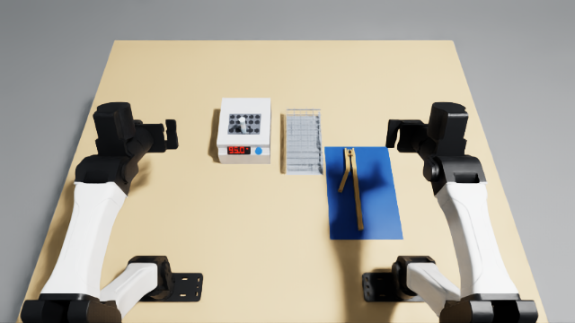
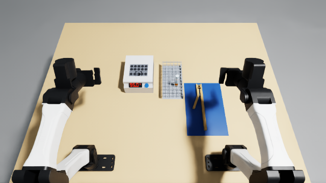

# Move a glass reaction tube from a 95 C dry bath to a cooling rack with a self-closing wooden test-tube holder

Instruction: `Move the glass test tube from the dry bath into the stainless cooling rack with the wooden test-tube holder, without touching the tube or the heating block with the grippers, then lay the holder back on the blue mat.`

Files: `task.json`; `task.py`; `scene.py`; `parts.py`; `checks.py`, `trials.py`, `demo.py`; `test_hot_tube_clamp.py`; `mechkit.py`, `demo_kit.py`, `kit_extra.py`; `start_top.png`, `start_top_policy.png`, `start_left_wrist.png`, `start_right_wrist.png`, `end_top.png`, `end_top_policy.png`.



## What the task tests

- **Wet-lab glass-tube handling (`Other`).** Chemistry labs (qualitative cation analysis, acid hydrolysis, colorimetric assays) heat 16 x 100 mm borosilicate tubes in block heaters (`TC0401001` manual: *"For heating media in block heaters... Laboratories, Schools, Pharmacies and universities"*) under standard safety rules (Malik §2.2: *"Hold the hot test tube with a test tube holder... Never hold the hot test tube with a bare hand"*).
- **Reverse-acting cross-action clamp.** Unlike culinary tongs that close when squeezed, a wooden clothespin holder clamps under its spring when let go (10.0 mm closed V-aperture) and opens (up to 31.8 mm) only while its short lever is squeezed against the 260.4 mm handle: one hand carries and plumbs the rear shaft lengthwise while the other squeezes and releases 120.0 mm ahead.
- **Close-clearance bore & Z-rack threading (real tighter than simulated).** The 16.0 mm tube lifts plumb out of a 45.0 mm dry-bath well, threads both guide tiers (`z = 50` and `24 mm`) of a 50-hole stainless Z-rack onto its 2 mm floor, releases on a second squeeze, and the holder returns flat to the mat. Real wells are tighter than the simulator's: real `16.4` and `17.0 mm` bores leave `0.4` and `1.0 mm` play (binding near `0.5 deg` tilt over `45.0 mm`), whereas the faceted PhysX cylinder uses chamfered `18.6` and `18.4 mm` bores (`2.6` and `2.4 mm` play, binding near `3.3 deg`), so the real bench demands stricter vertical plumbness during lift and insertion than simulation.

## Scene, grasps and stand-ins

- **Dry bath (`bath`):** FOUR E'S `TC0401001` (190 x 152 x 86 mm, 1.50 kg) at `(45.8, +11.5 cm)` with `-84` block (76 x 96 mm at `(45.3, +11.5 cm)`, 45.0 mm well at `(42.8, +11.5 cm)`). On a shared rig the real unit runs switched off at room temperature with a dark display (or in idle standby without pressing `Run/Stop`, showing ambient `~22.0 C` and flashing `95.0` when setting `TEMP/TIME`, whereas simulation draws `95.0` steadily); because the real block and dry empty tube stay unheated, the gripper-contact zeros on the tube and block are explicit rules.
- **Tube (`tube`), rack (`rack`), mat (`mat`) & holder (`long_arm`, `short_lever`):** PYREX `1620/09M` (16.0 x 100.0 mm, 18.4 mm rim, 13.5 g) upright in `(42.8, +11.5 cm)` (55.0 mm exposed); BOCHEM `8291` / `B8291` Z-rack (220 x 110 x 50 mm, 10 x 5 holes, 20.0 mm pitch, 380 g) at `(43.5, -6.5 cm)`; blue mat (300 x 200 x 2 mm) at `(27.5, -23.0 cm)` with a closed Eisco `CH0726B` holder (260.4 mm, 16 x 12 mm bars, 45.4 g) flat on its side, pin at `(34.0, -20.5 cm)`, jaws `+x` (`+-2 mm`, `+-2 deg`).
- **Grasps (real surfaces, <= 94 mm jaw, <= 160 mm TCP z):** right grips the 12.0 mm shaft lengthwise (48 deg pitch, TCP z 18..159 mm, 28.9 N/pad steady, 36.8 N/pad peak at 11.5 s <= 40 N, effort <= 2 %); left squeezes the 52.2 -> 30.2 mm tail 120 mm ahead (TCP z 60..130 mm, 32.3..37.5 N/pad <= 40 N, inter-arm gap >= 63.1 mm across `link3..tip`).
- **Stand-ins, shortcuts & visibility (320 x 176):** 1:1 primitives (`contact_offset` 0.3 mm); `>= 4.0 N` jaw contact in `task.py` stands in for barrel clamping at `0.25`; anti-creep `weld("w_grip")` (`tube` to `long_arm`) engages where the tube stands after >= 10 deg opening and bilateral >= 6 N jaw load, cutting at >= 11.5 deg opening or > 18 N jam (`demo.py` sets zero states directly; `trials.py` sets test states). Gripper touch on tube/block (`0`), closed-jaw push (`0`), mid-air drop (`0`), rack-top rest (`0`), holder off mat (`0.5`). `start_top_policy.png` & `end_top_policy.png` show `95.0`, tube, 50-hole rack, and holder on mat.

## Rules and score

- **0 for good** (video + end photo) if at any step either gripper touches the tube or 96 x 76 mm block, the tube touches bench/mat or tilts > 35 deg, or bath/rack slides > 20 mm or tilts > 10 deg.
- **0.25:** holder's jaws hold the tube by its barrel clear of the dry bath, underside >= 90 mm over bench, tilt <= 15 deg (video + rule).
- **0.5:** tube upright (<= 8 deg, inclinometer) through both tiers of any rack hole, underside within 6 mm of the 2 mm floor (rule), the other 1.0 conditions not all met.
- **1.0:** `0.5` met, holder flat on either side (<= 12 deg, centre <= 26 mm over bench) inside the 300 x 200 mm mat (within 5 mm of edge) and >= 20 mm clear of tube, bath and rack, and both hands >= 30 mm clear for 1.0 s (20 steps) moving <= 3 mm. Limit: 2,000 steps (100 s at 20 Hz).

## Key figures and their sources

| Figure | Value | Source |
|---|---|---|
| Dry bath & plate | 152 x 86 x 190 mm, 1.5 kg, 96 x 76 mm | maker: *"Dimensions (W x H x D) 152 x 86 x 190mm"*, *"Weight 1.5kg"*, *"96 x 76mm"* [4es-ds] |
| Block `-84` well | 16.4 mm x 45.0 mm | maker: *"TC0401001-84"*, *"15 x 16mm"*, *"Φ16.4mm x 45mm"* [4es-ds] |
| Tube OD & length | 16.0 x 100.0 mm | standard: ISO 4142 borosilicate glass test tube series (`16 x 100 mm`) |
| Holder `CH0726B` | 260.4, 31.8, 30.0 mm | maker: *'10.25" Wooden Test Tube holder'*, *'Jaws open to 1.25" wide'*, *'up to 30mm dia tubes'* [eisco] |
| Rack `B8291` | 50 tubes, stainless | listing: *"Z-Style for 50 Tubes"*, *"corrosion-resistant, stainless steel"* [b8291] |
| Tube wall, rim, mass | 1.2, 18.4 mm, 13.5 g | estimate: ISO 4142 medium wall + lip; borosilicate 2.23 g/cm3 |
| Holder mass, bars, k | 45.4 g, 16 x 12 mm, 2.20 | estimate: 0.1 lb (`Weight: 0.1` [eisco]) & ~650 kg/m3 wood; ~14.6 N clamp |
| Rack size, hole, mass | 220 x 110 x 50, 17 mm, 380 g | estimate: 10 x 5 grid at 20 mm pitch + margins; 1.5 mm 18/10 sheet |
| Mat; sim bores | 300 x 200 x 2; 18.6 & 18.4 mm | estimate: standard 300 x 200 x 2 mm mat; chamfered PhysX octagons |

`parts.FIGURES`: 12 maker, 2 standard, 1 listing, 23 estimate.

## First minutes of a real trial

On bought items (~6 min): caliper `CH0726B` bar, pivot, V-pocket and tail span, and weigh it (2 min); press tail on a scale for opening force at 28-31 mm gap (1.5 min); caliper and weigh `1620/09M` (1 min); caliper `-84` bore, `8291` footprint/hole/tiers and mat thickness (1.5 min); a different reading replaces the estimate.

## Forces and checks run

| Force / hold | Code (`scene.py`, `task.py`) | Acts on / reaction | Ends when | Demo |
|---|---|---|---|---|
| Cross-spring (`jaw_h`) | hinge (`k=2.20`, `rest=-0.24`) | `short_lever` / `long_arm` | squeezed / released | 32.3-37.5 N/side at 27.8-32.1 mm |
| V-jaw clamp | 4 V-cheeks + `w_grip` (>=6 N) | `tube` / jaws | `jaw_h >= 11.5 deg` or >18 N | `[8.64, 9.26] N`; `[0, 0] N` release |
| Bore / Z-rack | chamfered 8-wall / 50-hole | `tube` / `bath`, `rack` | plumb clearance | <= 3.43 N lift; 0.00 deg end tilt |

- Rule tests: 13 pass. Reach: 20 poses IK <= 0.072 mm / <= 0.015 deg, margin >= 7.7 deg, TCP z <= 159.0 mm, arm gap >= 63.1 mm.
- Start: 2 s idle 0.0. Trials: `bare_touch_zero` 0.0, `midair_drop_zero` 0.0, `tilted_bore_jam` 0.0, `quarter_clamped_lifted` 0.25, `half_racked_holder_out` 0.5, `full_end_state` 1.0.
- Demo (`demo.py`): **1.0** in 741 steps (37.05 s; 0.25 at 16.15 s, 0.5 at 24.25 s, 1.0 at 34.10 s, ready at 37.05 s, tilt 0.00 deg in `[3, 1]`). Dream-1: **0.0** (2,000 steps).



## How it differs

Unlike the accepted squeeze-shut spring-tongs task where squeezing closes the jaws and letting go opens them, a cross-action wooden holder clamps under its spring when released and opens only while a second hand squeezes its short lever against the 260.4 mm handle, plus plumb extraction from a 45 mm well and two-tier 17 mm Z-rack insertion without bare-gripper contact on tube or block. Public suites (`LabUtopia`, `BEHAVIOR-1K`, `RoboCasa`) grasp vessels directly.

## Assets and sources

No third-party meshes, textures or sounds (`mechkit` primitives only). Opened pages (2026-11-21): [4es-ds] https://selectumllc.com/attachments/four-e-s-scientific/Four_E_s_Dry_Baths_Datasheet.pdf ; [4es-im] https://selectumllc.com/attachments/four-e-s-scientific/User_Manual_for_TC0401001-TC0401002-TC0401003_IM.pdf ; [eisco] https://www.eiscolabs.com/products/ch0726b ; [b8291] https://selectumllc.com/i/brandtech-scientific-b8291 ; [malik] https://chem.libretexts.org/Bookshelves/Analytical_Chemistry/Qualitative_Analysis_of_Common_Cations_in_Water_(Malik)/2%3A_Experimental_techniques/2.2%3A_Water_bath ; ISO 4142 (`16 x 100 mm`).

## How to run

`scripts/rta check mech/tasks/hot_tube_clamp` · `scripts/rta simpy <id> mech/tasks/hot_tube_clamp/checks.py --frame0 /workspace/robocurve/outputs/<id>` · `scripts/rta simpy <id> mech/tasks/hot_tube_clamp/trials.py /workspace/robocurve/outputs/<id>` · `scripts/rta demo <id> mech/tasks/hot_tube_clamp --check` (omit `--check` to record).

Trial <= 100 s (2,000 steps at 20 Hz); reference run 37.05 s (~2 min wall); `--seed 0` -> harness seed `1415158438`.

```bash
inspect-robots run --embodiment yam_arena --policy dream \
  -E task=mech/tasks/hot_tube_clamp/task.py -E object_jitter=0 -E control_hz=20 -E cam_width=320 -E cam_height=176 \
  --instruction "Move the glass test tube from the dry bath into the stainless cooling rack with the wooden test-tube holder, without touching the tube or the heating block with the grippers, then lay the holder back on the blue mat." \
  --scorer task_score --max-steps 2000 --seed 0 --no-prompt --store-frames --log-dir <log dir>
```
