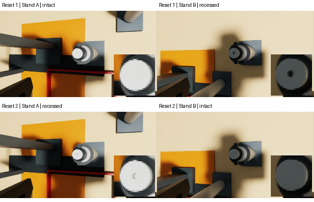
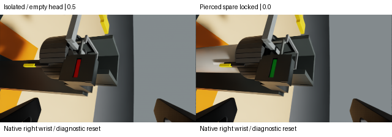

# Service a manual lifejacket inflator for repacking

The robot receives a fired manual head, a usable inert spare and a defective spare. It collects the original, quarantines the defective piece and leaves a released, bayonet-locked assembly for dry handoff. This functional replica models the exposed Mustang MD3075 head and the MA7203 interface. The spare faces can be inspected before installation. Both spare adapters can engage the mechanism and show green. Suitability for the handoff depends on the seal as well as the mechanical installation. [Reference equipment, workcell and grading](WORKCELL.md)

For the physical dry bench, the fabrication folder contains six printable masters, a parts list, assembly drawings and commissioning checks. [Assembly and parts](fabrication/ASSEMBLY.md)

## Run in the calibrated walkthrough environment

Use the original dual YAM station, original three 320 × 176 cameras, the locked walkthrough versions and 20 Hz controls. Run from this folder with a new output directory per episode. FFmpeg with libx264 is needed for video. [Official walkthrough](https://tasks.robocurve.org/walkthrough) · [Setup source](https://github.com/ttpierson/YAM-inspect-Isaac/blob/d825f0c51724f750f26e8c3f5620a14b5b0261b0/launchable/setup.sh)

```bash
python runtime_check.py
python run.py --mode setup --gpu auto --log-dir /tmp/pfd-setup
python verify.py /tmp/pfd-setup --media-dir /tmp/pfd-media/setup
python run.py --mode demo --stock-order intact-first --gpu auto --log-dir /tmp/pfd-a
python run.py --mode demo --stock-order pierced-first --gpu auto --log-dir /tmp/pfd-b
python verify.py /tmp/pfd-a --media-dir /tmp/pfd-media/a
python verify.py /tmp/pfd-b --media-dir /tmp/pfd-media/b
python verify_pair.py /tmp/pfd-a /tmp/pfd-b
```

The two named resets specify which face is recessed. All stand, camera and head poses stay fixed. The policy receives the same instruction for both. The demonstration reads two series of right-wrist RGB images to select a preplanned joint path. Unknown or contradictory readings stop the exchange. The trajectory uses the known bench geometry. The grader alone uses native poses and contacts. Report both episode scores and their mean. Judge the last second after release by the lock stripes, freely hanging cartridge, window colour and parts in their receptacles. Small motion is allowed while these conditions hold. [Marking placement and grading](WORKCELL.md#mark-the-inert-fixture-for-inspection)

Dream uses the official model with cloud recording disabled, 32 preroll actions and 48 rows per request. The limit is 2,800 actions (140 s) per assignment. A configuration-only check does not contact the service. With separate authorisation for model evaluation, run each assignment in its own episode.

```bash
python run.py --mode dream --config-only --log-dir /tmp/pfd-rev-config
python run.py --mode dream --stock-order intact-first --gpu auto --log-dir /tmp/pfd-dream-a
python run.py --mode dream --stock-order pierced-first --gpu auto --log-dir /tmp/pfd-dream-b
python verify_pair.py /tmp/pfd-dream-a /tmp/pfd-dream-b
```

The dimensional geometry and control paths are task-authored. The external manufacturer drawings are references. Upstream robot assets and simulator components are supplied by the walkthrough under their respective terms. [YAM attribution](https://github.com/kairosiann/yam-isaac-lab-arena/tree/0059d02a1a91bc6834c1d0846022891df0c78730) · [IsaacLab-Arena](https://github.com/isaac-sim/IsaacLab-Arena)

## Revised-scene results

Both episodes started with the same fired original installed. Only the seal condition assigned to the two supply stands changed. The scripted controller received the same instruction and selected the cartridge from its right-wrist images.

| Episode | Stand A | Stand B | Selected for installation | End score |
| --- | --- | --- | --- | ---: |
| 1 (`intact-first`) | Intact | Pierced | A | 1.0 |
| 2 (`pierced-first`) | Pierced | Intact | B | 1.0 |

The right wrist looks at stand A at 39.30 s and stand B at 42.55 s in both recordings. The insets enlarge the central seal from the same frame. Under the functional-hold scoring rule each recording reaches full credit at action 2,661 and ends after 2,780 actions (139 s). The paired mean is 1.0.



The two indicator checks below start from separate diagnostic resets. The empty head with the defective spare quarantined showed red and scored 0.5. A released, pierced cartridge on both bayonet supports showed green and scored 0.0. Holding the reset lever on the empty head also left the indicator red.



Dream-1 received the same handoff instruction as the scripted controller. Both episodes ran to the 2,800-action limit.

| Intact spare at | Dream-1 | Scripted demonstration |
|---|---:|---:|
| A | 0.0 | 1.0 |
| B | 0.0 | 1.0 |

Model and scripted scores are graded at the released handoff. The primary model and demonstration videos show placement A. Each model episode was verified against its own source, three camera streams and native contact and pose history.

Use the default verifier for the current recordings. It checks the recorded policy instruction, runtime sources, native 240 Hz poses and contacts, action log, final score and three original image streams. The legitimate lock and the failed release below the shelves can be compared at the same wrist pose. [Release controls and real-world scoring](WORKCELL.md#grade-the-released-handoff)
