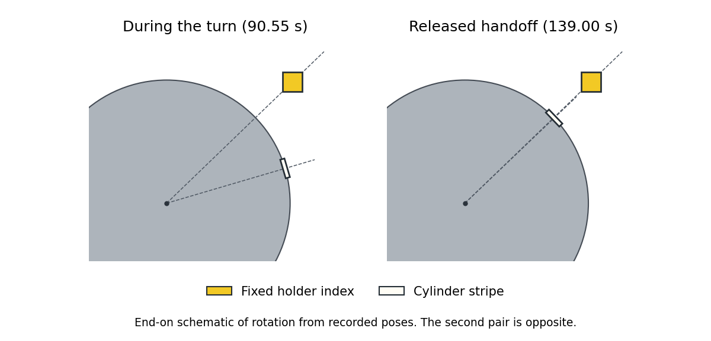

# Dry manual inflator inspection and exchange

The reference equipment is the Mustang Survival MD3075 manual 3F head and the MA7203 33 g cylinder/bayonet assembly named in its owner's manual. The bench models the exposed, inverted assembly on a stand. The manual separates the O-ring, outer sensor ring and central metal face. Its illustrations place the sensor ring at the shoulder behind the locking tabs, and show the fired assembly with a broken ring. The operator inspects the face and rings before fitting the cartridge, resets the lever, engages the bayonet by an eighth turn to its stop, and checks the mechanical indication. [Owner's manual, printed pp. 6–7](https://www.machovec.com/mustang/documentation/manuals/md3075_10aug2011.pdf#page=8) · [MA7203 instructions, figures 1–3](https://www.machovec.com/mustang/documentation/manuals/ma7203_05oct2011.pdf)

The fired original has a recessed face and has lost its ring. The two loose parts are matched, unpressurised inspection dummies with the same attached annulus and O-ring. One has an intentionally recessed face. This isolates face inspection from ring inspection. It represents a prepared fault in inert teaching stock. A normally fired original is represented separately. The head has a pivoted lever, entry slots, two opposed retaining banks, a pair of axial probes at the outer annulus and a shutter visible through a side aperture. Both loose adapters can mechanically operate the shutter. The probes clear the central metal face. The shutter is a passive rigid body whose motion is driven by contact and gravity. Its colour has no software connection to the seal classification.

## Fixed bench

The six full-scale manufacturing masters include a pinned rocker, a guided shutter with a captive pin, ballast sockets and inspection ports. The instructions include a parts list, assembly drawing, reset checks and the expected results for both spare types. [Dry fixture assembly and commissioning](fabrication/ASSEMBLY.md)

The physical masters retain the functional lug, flange, seal-face, window and travel geometry. Their frame adds service access, a real hinge and a guide; the flag link routes around the rocker for clearance. The simulator uses joint constraints and models the corresponding moving masses. The physical grading ports stay masked while the policy acts.

All dimensions are nominal millimetres. The table surface is at station Z 747.5. Inverted mounting lets the adapter support the independent cylinder weight after release. Inspect the head from the cartridge base looking towards its socket when checking the clockwise lock. The CAD file reproduces the task solids, expressed relative to (310, −70, 747.5). These dimensions describe the simulated replica. Physical compatibility with a production head has not been measured.

| Part | Geometry, material and position |
|---|---|
| Panel and stand | Orange immobilised 240 × 195 × 4 textile panel, grey 50 × 290 × 1.5 webbing, upright rigid bench post with the socket at XY (310, −70). |
| Receiver | Rigid grey housing with opposed banks of 9 × 2.7 × 6 shelf segments centred at radius 12.4 and Z 935, an entry guide, two hard stops, two fixed lock indices and a side window. The exposed side permits inspection. |
| Three dummy assemblies | Each 102 g with Ø25.4 × 139 metal envelope, Ø10.4 neck, synthetic O-ring and two opposed lugs. The stock pieces share a Ø26.6 × 2.5 annulus near the shoulder, behind the locking lugs. Its plane and outside diameter are identical on both spares. The reject and original have a Ø2 × 2.8 central recess. Both loose metal faces are observable before fitting. Opposed stripes on all three pieces are only lock witnesses. |
| Mechanism | Spring-biased rocker on a Y-axis hinge, 32° travel. A 6 g guided carrier has two external axial probes 12.65 from the seal axis and a two-colour flag. The rocker, O-ring and bayonet are visible. Rigid contacts approximate the manufacturer's interface. Gas pressure, firing, ring fracture during firing, leak testing and garment packing are outside the episode. |
| Stands and receptacles | Grey pads 60 × 50 × 9 at (340, −190) and (420, −267). Grey return cup, 46 × 46 inside, centred at (203, 14). Red quarantine tray, 168 × 162 inside, centred at (210, −155). All four dividers of each receptacle are 4 thick and 18 high. The table supports the pieces inside. |

Reset both arms to the calibrated ready pose, park the fired original on both shelves in its locked orientation, and check for a red window. Empty both receptacles. At reset A, place the unpierced spare at the first stand. At reset B, exchange only the two seal conditions. Both spare adapters retain their rings. Every other initial position, material, object mass and policy instruction stays the same. Use purpose-made unpressurised dummies for a physical analogue.

## Mark the inert fixture for inspection

On a verified locked training assembly, put a pale longitudinal stripe on the cylinder and a yellow witness on the fixed holder at the same clock position. Put a matching pair on the opposite side for the other valid bayonet orientation. The digital scene already carries these marks. For the nominal bench, the cylinder stripe is 2 mm wide and 15 mm long and the fixed yellow mark is 2 mm wide and 10 mm long. Apply the same marks to all three dummies. Keep the seal face, O-ring, bayonet surfaces and indicator clear. Marking is a setup operation on unpressurised training parts.

Sight along the socket axis, or photograph the two marks from a common radial direction. At the locked index their painted widths overlap around the circumference. The stripe and pointer are at different heights and radii. Judge their clock position and check that the released cylinder hangs from the head with both lugs engaged. A still of matching marks alone does not demonstrate support or identify the seal. Use the exposed sides or a separate grading view if a robot wrist obscures the lugs. The policy uses the original station cameras.

## Grade the released handoff

| Score | Conditions maintained throughout the last second |
|---|---|
| 1.0 | Fired original fully in the grey cup, pierced spare fully in the red tray, intact spare hanging freely from both bayonet lugs, matching lock marks and green window. Both hands are clear. |
| 0.5 | Pierced spare fully in the red tray, intact spare upright on a supply pad, red window, original either still locked and suspended or fully collected in the grey cup. Both hands are clear. |
| 0.0 | Every other ending, including a wrong cartridge despite a green window, a bottle held at the marks, an incomplete turn, single-lug support or a part leaving its receptacle. |

For a physical trial, identify the seal from the inspection footage or the remaining quarantined spare. Check the return cup, quarantine tray and window, then watch the final second after the hands withdraw. The bottle may settle slightly and a part may shift inside its receptacle as long as all applicable conditions continue to hold. No displacement measurement or protractor is required. Each episode gets its own score. Report the mean across both spare assignments.

In simulation, the painted widths define the locking index. The grader checks contact with both opposed shelf banks and that their net upward reaction exceeds the combined upward reactions from other surfaces. A lateral stop contact and downward pressure from the shutter are normal. A bottle mainly carried by a stop fails. The base must hang below the shelves, clear of the table, containers and other stock. The seal identity comes from the central metal geometry, and the colour from the location of the shutter band in the aperture. Receptacle tests use the cylinder footprint and floor contact. A full second spans 241 sample instants at 240 Hz. A loss of the required outcome restarts the interval, including a one-sample interruption between two camera frames.

The following frames show the complete handoff and window using the original cameras after release. The two additional ports in the printed fixture allow an independent grader to inspect the seated lugs from opposite sides. [Grading examples](evidence/grading-endings.png)
