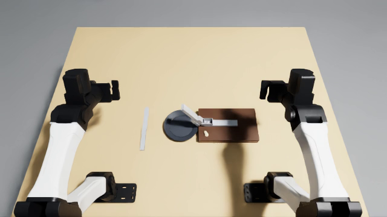
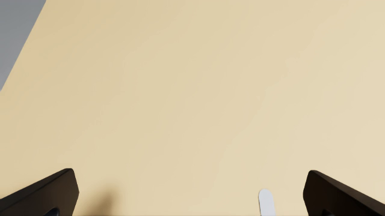
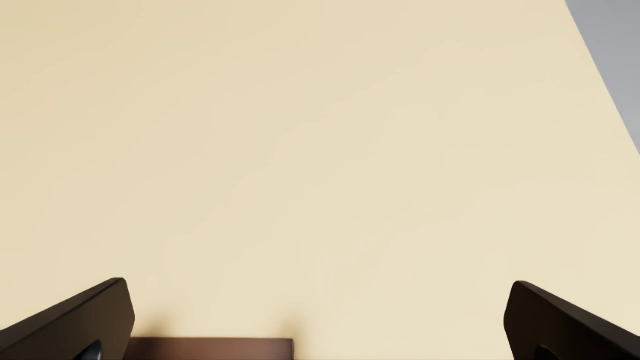
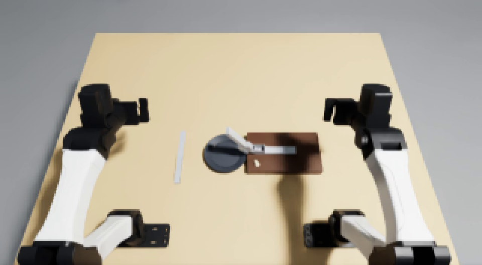
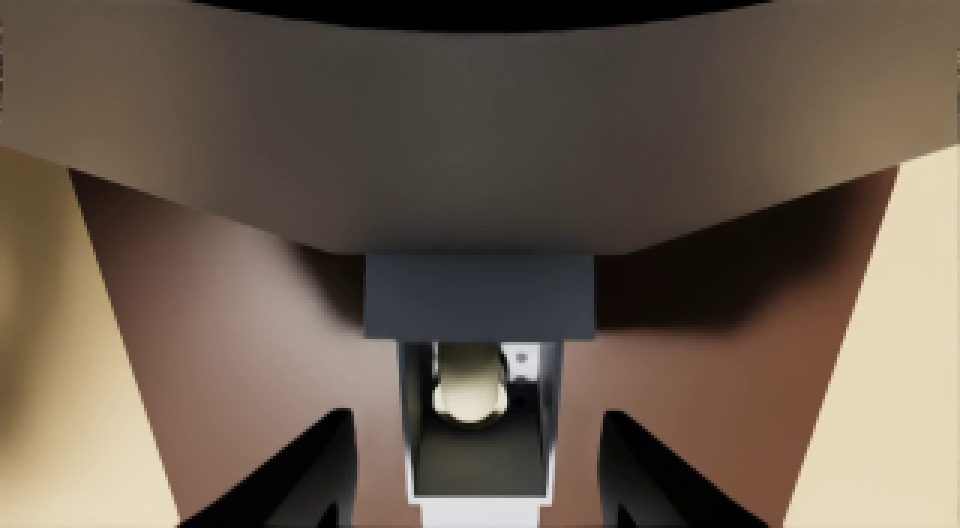
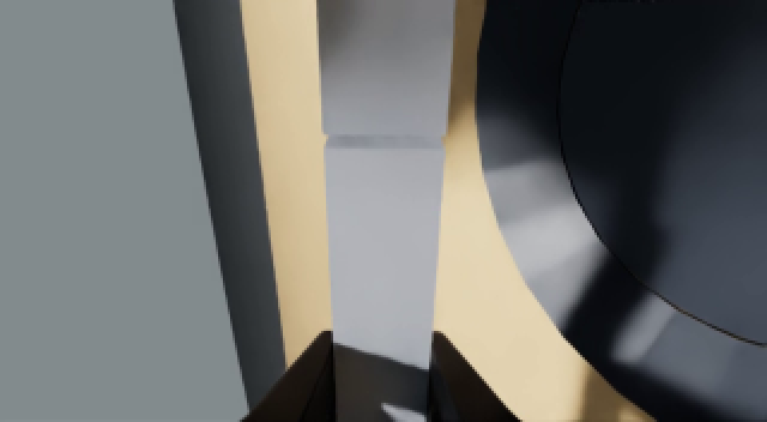
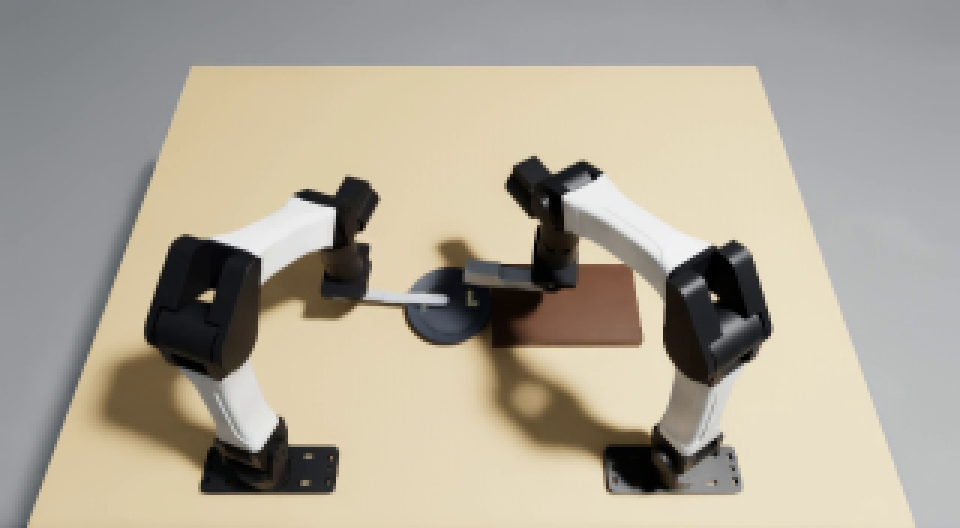
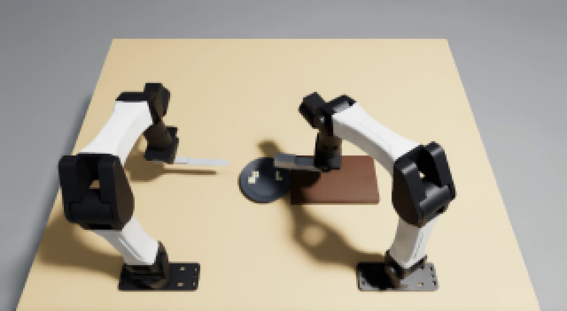
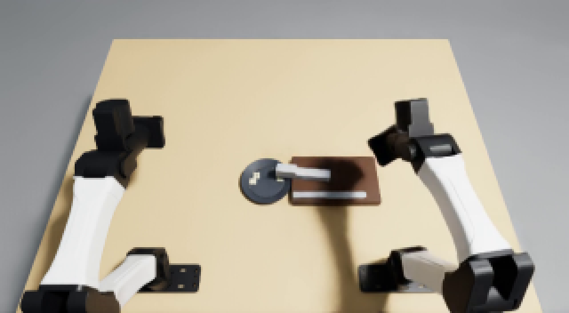

# Press a garlic clove through a garlic press onto a saucer, and scrape what hangs under it off with a knife

Instruction given to the policy: `Press the garlic clove through the garlic press onto the saucer, scrape what clings to the press onto the saucer with the knife, then put the press and the knife down.`

Files: `task.py` (scene, the garlic as a material, the clove's resistance under the plunger, rules, score), `mechkit.py` (the mechanism kit the task file imports), `demo.py` (the scripted full-score run, recorded, and five other runs, not recorded for this revision: see "Reference runs"), `demo_kit.py` (the runner behind the scripted runs), `trials.py` (checks in the simulator: without an arm rest, the clove let go over the chamber and the press under known torques; with both arms the run's last part from a set pressed start, the knife's scrape and wipe by contact), `push_gauge.py` and `push_check.py` (the arm's push on a spring gauge), `test_garlic_press.py` (the rule tests, without the simulator), `start_*.png` (the first pictures of a trial), `cue_*.png` (pictures at the size a policy gets), `README.md`.



 

The first pictures of a trial, both arms in their ready pose. Top camera: the bench; on it, in front of the right arm, the dark walnut board with the open garlic press lying on it and the pale clove on the board's near left part; left of the board the slate-grey saucer; left of that the knife on the bare bench. The clove measures 28.5 x 16.5 mm and shows as a pale spot of about 6 x 3 pixels on the dark board at the size a policy gets (see "Can it be seen"); no arm's shadow falls on it at the start. Neither wrist camera sees the board from the ready pose.

## Scene

Bench coordinates in metres: x forward from the line through the two arm bases, y left from the midline, z up from the bench top. The arms' bases are at (0, -0.305) and (0, +0.305).

| Part | Size, mass | Where |
|---|---|---|
| Cutting board: a walnut board cut to 250 x 150 x 30 mm, loose | 0.73 kg (walnut, 650 kg/m3) | x 0.205 to 0.355, y -0.285 to -0.035: long side along y, its left edge 3.5 cm right of the midline |
| Garlic press, Zyliss Susi 3, cast aluminium, its clip-in cleaning tool taken out | 155 x 26 x 57 mm closed (the maker's page), about 150 g (our figure: the maker states no weight); lower part 80 g, upper part 70 g (assumed split); chamber inside 34 x 24 mm, 24 mm deep, its floor a sieve of thirty 2.5 mm holes; plunger face 31 x 22 mm, its middle 26 mm from the hinge pin; opens 120 degrees (our reading of the maker's product pictures) | lying on the board along y, on its middle line x 0.28, its tip (the hinge end) 10 mm inside the board's left edge (y -0.045); open, the upper handle on its 120 degree stop |
| One peeled garlic clove | by seed one of four: 28.5 x 16.5 x 13 mm, 5 g; 26 x 14 x 11 mm, 4 g; 31 x 19 x 15 mm, 6 g; 31 x 15 x 12 mm, 5 g (length, width, thickness). Four convex parts: a blunt root end and a narrower middle, both flat underneath, a rounded back, a rounded tip | on the board's near left part, its middle within 1 cm of (0.232, -0.065), on its flat face or its side, turned any way (seed 0: the 5 g clove on its flat face, 25 degrees from the press's line) |
| Saucer, slate-grey stoneware, loose | 150 mm across, 20 mm high, 200 g (assumed); a flat well 104 mm across, 6 mm over the bench, inside a sloping rim | middle (0.280, 0.040), against the board's left edge |
| Table knife, stainless, blunt | 210 mm, 70 g (handle 95 x 18 x 9 mm, blade 115 x 20 x 2 mm with a round tip: assumed) | on the bench left of the saucer, along x, handle towards the arms: the handle from x 0.170 to 0.265 at y 0.200, the blade on to x 0.380 |

The three cloves not in use lie on the floor under the bench, out of every camera.

Sizes and sources. From the makers' pages: the press, Zyliss Susi 3 (maker's number E12150), 15.5 x 5.7 x 2.6 cm, with a removable polypropylene cleaning tool that is stored clipped inside its handle; the garlic, Christopher Ranch Peeled Garlic in its 6 oz (170 g) bag, sold refrigerated; the saucer, a dark stoneware saucer of 150 mm such as the Fiesta saucer no. 470 (149 mm across, 22 mm high; it has a cup ring in its middle where the scene has a flat well, which changes nothing in the score, the weight on the saucer); the knife, a plain stainless table knife of 21 cm with a round tip such as IKEA FORNUFT. Our reading of the maker's product pictures: the press's chamber, sieve, plunger and hinge. Assumed: the press's weight, about 150 g (the maker states none), and its split between the two parts, the knife's handle and blade (95 x 18 x 9 mm, 115 x 20 x 2 mm), the masses of the saucer (200 g) and the knife (70 g), and the clove's widths and thicknesses. The board is a walnut board cut to 250 x 150 x 30 mm (0.73 kg). The press's cleaning tool is taken out before the trial and plays no part; the scene's press has none.

## What stands in for what

A rigid-body simulator cannot crush a clove, push it through thirty holes or let it hang under a sieve. The task replaces that by rules (every number from the table `MATERIAL` in `task.py`, under "The clove as a material"):

- **The plunger passes through the clove; the clove's resistance is put on the hinge.** The press's upper part does not collide with cloves. The plunger arrives on the clove when its face comes down to the clove's highest point inside the chamber's outline, read in the press's own frame (`touch_angle`: exact for any angle of the handle). A handle that came down past that point within one control step (a free fall does: 10 degrees in a step) is put back there and its fall is taken up. From then on the hinge's drive is the clove: a stiff spring (338 N m/rad) capped at the yield (6.5 N m at the hinge, that is 250 N on the plunger's face 26 mm from the pin), whose rest is the clove's top as crushed so far. The rest sinks with the load the spring carries, 2.5 mm at the yield; with the spring's own 0.5 mm the plunger has then gone 3 mm from the touch, as the table asks. Past the yield the plunger goes on down and the rest follows it 1 mm behind: let go, the plunger comes back 1 mm. The spring pushes and never pulls: with the handle lifted off the clove the drive gives nothing, and a handle that comes down again is stopped where the clove was crushed to.
- **The clove is consumed when the plunger arrives.** Its share outside the chamber's outline is pinched off (waste, drawn as garlic on the rim); its body leaves the scene and the chamber is drawn filled with crushed garlic up to where its top was. The drawing goes down with the plunger.
- **Through the sieve in proportion to the plunger's travel.** Nothing before the yield (3 mm from the touch); 85 % of the pressed part with the plunger's face 3 mm over the sieve, in proportion between; the 15 % left is skin and fibre and stays in the chamber. Of what comes through, 30 % falls straight down onto whatever is under the sieve (the saucer, the board or the bench, drawn as spots there) and 70 % hangs under the sieve, one strand of 6 to 10 mm under each of the thirty holes (drawn). With the sieve resting on the board, everything that comes through goes onto the board.
- **Scraping and wiping, by contact.** The simulator's contact sensor on the knife reads every control step how hard the knife presses on the press's lower part and on the saucer (the mean over the step). A strand goes onto the knife only while the blade presses on the press with 0.5 N or more and an edge of the blade slides past the strand's hole with the blade on the sieve there (within 0.5 mm): lying flat, a long edge passes under the hole; standing on its edge, a corner of that edge does. The hole has to move past the edge by 0.05 mm or more in a control step (1 mm/s): a blade pushed up onto a hole, or trembling at it, takes nothing. The garlic then lies along that edge, 3 mm either side of where it was taken, on the face that took it (flat) or on the face that led into the strand (on its edge). It goes onto the saucer only while the blade presses on the saucer with 0.5 N or more and that loaded part touches the saucer's surface, well or rim (within 1.5 mm: the garlic stands that far proud of the blade), and is drawn along it: in proportion to the length drawn, all of it after 30 mm. Near but not touching, touching without sliding or without being drawn, or touching with another part of the blade: nothing moves. The garlic on the blade is drawn as a pale strip along the edge that took it, on the face that carries it, and on the saucer as spots. Rubbing the press's sieve on the saucer moves nothing: a strand leaves the sieve only by a blade's scrape.
- **The clove free on the board** is a rigid body of four convex parts, slippery (friction 0.3), that a hand can pick up, drop and roll. A pinch does not damage it (the gripper cannot press hard enough to bruise a clove in a way that changes a level).

## The clove as a material

Every number the simulation takes for the garlic, from `MATERIAL` in `task.py`. "Assumed": our estimate; the method given is how a bench measures it.

| Quantity | Value | Source, or how to measure it |
|---|---|---|
| the clove | one clove of 4 to 6 g, 26 to 31 mm long, taken from a bag of ready-peeled garlic cloves as supermarkets sell them (for instance Christopher Ranch Peeled Garlic), the bag within its use-by date and kept closed in a refrigerator at 2 to 4 C (36 to 40 F); the clove taken out of the refrigerator not more than 10 minutes before the trial and patted dry with a paper towel; a clove with a cut or bruised surface is not used | bench text |
| length | 26 to 31 mm | bench text |
| width, thickness | 14 to 19 mm, 11 to 15 mm | assumed from such cloves; calliper |
| mass | 4 to 6 g | bench text; 0.1 g scale |
| friction | 0.3 | assumed: a peeled clove is slippery; tilt the board until it slides |
| yield at the plunger | 250 N | assumed; the press on a kitchen scale, the peak reading while a clove goes through |
| travel from the touch to the yield | 3 mm | assumed; the plunger's travel from touching the clove to that peak |
| springback | 1 mm | assumed; how far the plunger comes back up when the press is let go |
| through with the face 3 mm over the sieve | 85 % | assumed; weigh what is left inside the chamber, the sieve's underside scraped clean first |
| of what is through: falls straight down | 30 % | assumed; weigh what is on the saucer before scraping |
| of what is through: hangs under the sieve | 70 % | assumed |
| the blade's push that takes a strand off the sieve, and leaves garlic on the saucer | 0.5 N or more, as the simulator's contact sensor reads it | set from a reading: in the knife trial (`b3g16`, the script's scrape and wipe with both arms) the sensor read 1.18 N on the sieve and 1.19 N on the rim (medians); a blade near but not touching reads 0 |
| the blade on the sieve at a hole | within 0.5 mm | assumed: the solver keeps touching bodies within a few hundredths of a millimetre |
| how far the scraped garlic stands proud of the blade | 1.5 mm | assumed |
| a strand's garlic along the edge that took it | 3 mm either side of where | assumed (strands taken 5.8 mm apart join up) |
| drawn along the saucer, all of it off the blade after | 30 mm, in proportion before | assumed |
| strands | 6 to 10 mm | assumed (drawn only) |

The yield is assumed, and so is everything that follows from it below (the push the task needs).

## Rules

The amounts are shares of the clove's weight. What counts as on the saucer is pressed garlic on it.

| Score | Asked | On a real bench |
|---|---|---|
| 0 | the saucer or the board has left the bench (2 cm or more under its top); or more than a third of the clove was pinched off outside the chamber; or none of the levels below | the trial's video, over the whole trial; the waste pinched off on the chamber's rim weighed |
| 0.25 | the clove in the chamber with the plunger on it (the face no more than 1.5 mm over the lowest the clove was pressed to) | a photo of the press |
| 0.5 | 70 % or more of the clove through the sieve, under 45 % on the saucer | through = the clove before, less the waste on the rim, less what is left inside the chamber (the sieve's underside scraped clean first: what hangs there has gone through; the press weighed with the remnant and empty); 0.1 g scale |
| 0.75 | 45 % or more on the saucer | the saucer weighed empty before and with the garlic after, on a 0.1 g scale |
| 1.0 | 65 % or more on the saucer; the press and the knife lying on the board or the bench (set down: within 3 mm of the board's top or the bench's top, nothing lower than the board's top where they lie on it), both grippers 3 cm or more away from them, everything at rest (press, knife, saucer and board under 2 cm/s over a quarter second) | the saucer weighed as for 0.75; the final photo and the video of the release |

The score that counts is the one at the end of the trial. A trial succeeds when the score has been 1.0 for one second; it then ends. The run limit is 3,000 steps (150 s at 20 Hz). Only pressed garlic counts as on the saucer (an unpressed clove or piece on it is taken off before weighing); if the trial video shows the sieve rubbed on the saucer instead of scraped with the knife, the trial scores 0.5 at most. The simulation scores both the same way: it counts only pressed garlic on the saucer, and rubbing moves nothing (a strand leaves the sieve only by a blade's scrape), so such a trial keeps only what dropped while pressing, at most 25.5 % of the clove, under the 45 % for 0.75. That the board and the saucer stayed on the bench is checked over the whole trial from the trial video; the final photo and the weights give the end state.

The thresholds: a clean run puts 85 % of the clove on the saucer (25.5 % falls while pressing, 59.5 % comes off the knife); 65 % leaves room for a scrape that misses some strands; 45 % is a little more than what falls while pressing.

## Setting up and resetting the real bench

- The clove: one clove of 4 to 6 g, 26 to 31 mm long, without a cut or bruised surface, from a bag of Christopher Ranch Peeled Garlic (6 oz, 170 g) within its use-by date, kept closed in a refrigerator at 2 to 4 C (36 to 40 F); taken out not more than 10 minutes before the trial, patted dry with a paper towel and weighed (0.1 g scale); the bag closed and put back at once. It is laid as the trial's seed gives: on its flat face or its side, its middle within 1 cm of the place 27 mm from the board's near edge and 30 mm from its left edge, turned as given (seed 0: on its flat face, 25 degrees from the press's line). A new clove for every trial.
- The press (Zyliss Susi 3), emptied, washed and dried before every trial (skin and fibre out of the chamber, the sieve's holes brushed clear), the cleaning tool that clips into its handle taken out: open on its stop, lying on the board along the board's long side, its tip 10 mm inside the board's left edge, on the board's middle line.
- The walnut board (cut to 250 x 150 x 30 mm, 0.73 kg), wiped with a damp cloth and dried, loose on the bench in front of the right arm, its long side along the bench's width, as under "Scene"; the slate-grey saucer, washed, dried and weighed empty, against the board's left edge, its middle in line with the press; the knife, washed and dried, on the bench beyond the saucer, handle towards the arms. The bench top wiped clean.
- The grippers' pads: powder-free nitrile finger cots, one fresh pair on each gripper's pads for every trial, thrown away after it with the trial's garlic, so that no garlic juice reaches the rig's pads. The simulation gives the pads the bare pads' friction; a cot is about 0.1 mm thick and is assumed to grip the dry press, the knife and the patted-dry clove about as well.
- The reference run lays the used knife on the board (the score takes the board or the bench); after the trial the press, the knife and the saucer are washed and dried, and the board and the bench top wiped with a damp cloth and dried.
- At the end: the saucer weighed with what lies on it; on it, as a share of the clove = (saucer after - saucer before) / clove before. The waste pinched off on the chamber's rim scraped off and weighed. The sieve's underside scraped clean, and the press weighed with what is left inside the chamber (against its weight empty). A photo from above and the video for the rest.
- A reset takes about 8 minutes: weighing the saucer twice, the press twice and the clove; washing and drying the press (the sieve's holes brushed clear), the knife and the saucer; wiping the board and the bench top; new finger cots; laying everything out.

## Repeating the real trial

One bag of Christopher Ranch Peeled Garlic (6 oz, 170 g), kept closed in a refrigerator at 2 to 4 C, serves a series of trials. A 6 oz bag holds about 30 cloves, of which about 15 to 20 fall in the 4 to 6 g band: our estimate from the bag's weight. For each trial: a new clove taken out not more than 10 minutes before it, patted dry, weighed and measured (used only if 4 to 6 g and 26 to 31 mm long, without a cut or bruise); the dry press and the empty saucer weighed; the clove laid as the seed gives. After it, on the same 0.1 g scale: the saucer, the waste scraped off the chamber's rim, and the press with what is left in its chamber (the sieve's underside scraped clean first). Then the reset above.

## Can it be seen

At the size a policy gets (320 x 176), enlarged three times here, from the reference run (recording `b3g23`).

 

Left: the top camera at the start; the clove is the pale spot of about 6 x 3 pixels on the dark board beside the open press. Right: the right wrist camera as the clove is let go in the chamber (9.1 s): the clove lies lengthways between the fingertips, the chamber's walls round it.

 

Left: the left wrist camera during the scrape (48.0 s): the knife on its edge under the lifted press, the saucer below. Right: the top camera during the wipe (56.5 s): the knife flat across the saucer's near rim, being drawn back.

 

Left: the top camera after the wipe (66.3 s), the knife held clear of the saucer for half a second: the garlic shows as pale spots on the slate. Right: the top camera in the trial's last frame (80.15 s): the press lies on the board with the knife beside it, the garlic on the saucer; the left arm is back in its ready pose and the right on its way there.

The strands under the lifted press: no camera shows them. The top camera sees the press from above, which covers them (`cue_top_lifted.png`); the right wrist camera, on the hand that holds the press, sees the handles a few centimetres away (`cue_right_holding.png`). The strands are drawn as they are (6 to 10 mm under each hole) and are not made bigger or moved to where a camera would see them. Nor does any camera see the garlic on the blade: it rides on the blade's underside, the face that leads in the scrape and lies on the rim in the wipe. What a policy sees of the scrape and the wipe is the blade under the sieve and on the rim, and then the garlic on the saucer.

## The arm can press that hard

The clove yields at 250 N on the plunger's face (assumed), 6.5 N m at the hinge. The arm was checked first on a spring gauge (recording `b3g4`, `push_check.py`): a bar hinged where the press's hinge is, with a spring of 200 N m/rad, standing at 25 degrees; known torques on the bar read it as 200.0 N m/rad (199.99 to 200.1). The right hand, pointing down, pinched the bar 25 mm from its end and pressed straight down, the push asked for ramped up and then down again.

| Push asked for | The arm's own reading of its push, going up | coming down | What the gauge's spring read, going up | coming down |
|---|---|---|---|---|
| 30 N | 28.8 N | 22.1 N | 39.3 N | 34.1 N |
| 45 N | 42.7 N | 36.8 N | 66.5 N | 53.5 N |
| 60 N | 56.4 N | 51.4 N | 85.7 N | 72.7 N |
| 75 N | 66.3 N (its hardest-working joint at 91 % of its effort) | | 90.0 N | |

The gauge read 1.3 to 1.6 times more than the arm. It is the gauge that is wrong: a joint whose two bodies are both held (the bar in the hand and on its hinge) reads more torque from its travel than it carries; the press's own hinge, with its lower part welded in place, read 1.31 times its known torque by the same reckoning and 1.00 standing free (below). The arm's own reading is the one to go by: it presses 0.94 to 0.96 of what is asked going up and less coming down (friction in its joints holds), and in the full-score run the clove gave exactly where that reading says it should (below).

In the reference run (recording `b3g23`) the right hand presses with its closed fingertips on the upper handle's top face 15 mm from the handle's end, tilted half the handle's angle from straight down towards the grip end (so that the fingertips do not slide on the face and the press does not skate on the board). The clove gave at 34.65 s. Half a second before, with about 50 N asked, the arm read 49.1 N straight down and 10.7 N towards the grip end on the face 136 mm from the pin, the handle at 26.0 degrees: 6.53 N m at the hinge, against the clove's 6.5 N m. The most its own reading came to while pressing was 62.9 N, with 75 N asked, the handle closed (36.25 s).

With 75 N asked, the most the script asks, the arm gives 61 to 66 N on the handle, which puts at most about 300 to 330 N on the plunger's face where a clove gives, against the 250 N assumed: a press and clove that need more than that cannot be pressed by this arm as scripted.

A pinch across the handle does not do: it presses only through the pads' friction on the handle's sides, and in recording `b3g8` it slid down the handle at 48 N (5.75 N m), short of the yield; the clove stayed 3 mm in.

## The clove's resistance, checked with steady loads put on directly

No arm (recording `b3g7`, `trials.py press`). The press free on the board where it is pressed (51 mm past the board's edge), opened 45 degrees. First the hinge's drive by itself, before any clove: known torques of 1, 2 and 4 N m read 337.9 N m/rad for the 338 the scene gives it; with the lower part welded in place instead, 257.5 (the kit's known fault of a joint between held bodies, see above). Then the 5 g clove lengthways in the chamber, the handle let fall onto it by its own weight, and known closing torques on the handle with the same opening torque on the lower part (so that the press as a whole feels none).

| Load | Plunger into the clove (from where it touched) | |
|---|---|---|
| its own weight, after the handle came 10.2 degrees past the clove in one control step and was put back | 0.03 mm | the fall taken up where it touched |
| a quarter of the yield (1.6 N m), 1 s | 0.82 mm | stands |
| a half (3.3 N m), 1 s | 1.63 mm | stands |
| three quarters (4.9 N m), 1 s | 2.44 mm | stands |
| nine tenths (5.9 N m), 0.5 s and 2 s | 2.92 mm and 2.92 mm | stands |
| eleven tenths (7.2 N m), 3 s | down to the stop, the face 1.4 mm over the sieve | 85 % through: 30 % of it on the saucer, 70 % hanging |
| let go | came back 0.99 mm | |

The plunger goes about 7 % further than the model's 3 mm at the yield: the model reckons the face's travel on a 26 mm arm, and the face's middle, 11 mm below the pin, moves 28 mm for each radian.

## Laying the clove in

The clove let go over the open chamber as a hand lets it go, its middle 15 mm over the rim, with nothing pressing (recording `b3g3`, `trials.py drop`; the 5 g clove unless named).

| Let go | Inside the chamber's outline | Lowest, highest point over the sieve | Tilt |
|---|---|---|---|
| lengthways; 3 mm off the middle; turned 15 degrees; turned 30 degrees | all of it | 0.6, 12.6 mm | 0 degrees: the walls turn it lengthways |
| on its side, lengthways | all of it | 0.2, 15.3 mm | 90 degrees |
| the largest clove (6 g), lengthways | all of it | 0.6, 13.8 mm | 0 degrees |
| across | 94 % | 24.0, 36.4 mm: on the rim | 1.5 degrees |

A clove let go across the chamber stays across it, on the rim; the plunger then meets it high (near 57 degrees in the test) and pinches off what lies over the side walls.

## The press at the board's edge

Lying on the board where it starts, the press stands open on its stop. Pushed to where it is pressed, 51 mm past the board's edge, it stands on the board as long as its centre of mass is over the board: closed it is 75.1 mm from the tip, with the handle on a clove (30 degrees) 69.9 mm, open on its stop (120 degrees) 31.4 mm. At the edge it tips once opened past 76.9 degrees. The split of its 150 g between its two parts is assumed (80 g lower, 70 g upper): with 10 g more in the lower part it tips past 89.0 degrees, with 10 g more in the upper part past 67.7 degrees. The handle is let go onto the clove at 74 degrees where the press starts, wholly on the board, and pressed below 35 degrees.


## Reference runs

The full-score run from committed code is the demo video: recording `b3g23` of 2026-11-20, commit `d32c7f3`, seed 0, 20 Hz, scored 1.0.

| Time | What happens | Score |
|---|---|---|
| 0 to 9.6 s | the right hand picks the clove up and lets it go over the chamber; it lies lengthways on the sieve | 0 |
| 10.0 to 14.9 s | meanwhile the left hand picks the knife up off the bench and holds it | 0 |
| 18.1 s | the handle, carried to 74 degrees and let go, falls onto the clove: the plunger meets it at 33.6 degrees, 17.2 mm over the sieve, all of it inside the chamber's outline | 0.25 |
| 22.65 to 27.15 s | the right hand pushes the press 62 mm along the board, until it stands 51.8 mm past the board's edge | 0.25 |
| 32.15 to 35.35 s | pressed with the fingertips; the clove gives at 34.65 s (the arm's own reading half a second before: 49.1 N down and 10.7 N towards the grip end, 6.53 N m at the hinge) and is through at 35.05 s: 85 %, of which 25.5 % of the clove falls onto the saucer and 59.5 % hangs under the sieve. As the push came on the press slid 2.7 mm back onto the board, to 48.6 mm past the edge, and stood there | 0.5 |
| 40.9 to 42.4 s | the closed press lifted 6 cm over the saucer | 0.5 |
| 42.4 to 52.35 s | the knife turned 65 degrees onto its edge, slid in under the press, lined up with the sieve (a look at knife and press every 0.2 s), its edge pushed up against the sieve (2 N asked) and run across in 2.5 s: 29 of the 30 strands taken (2.88 g; one strand at the end of the run was missed, 0.1 g); then down and out | 0.5 |
| 52.35 to 64.65 s | the blade laid flat, its loaded underside across the saucer's near rim, pressed (1.5 N asked) and drawn back 43 mm, twice: 0.75 from 56.65 s; all 2.88 g wiped onto the saucer by 57.4 s (30.0 mm drawn), 83 % of the clove on it | 0.75 |
| 65.25 to 66.55 s | the knife drawn back clear of the saucer and held there for half a second: the top camera sees the garlic on the saucer | 0.75 |
| 66.55 to 75.05 s | the right hand carries the lifted press 10 cm aside; the left brings the knife to its line beside the saucer, slides it in along its length onto the board's near strip, lets go and goes back to its ready pose | 0.75 |
| 75.05 to 79.25 s | the right hand brings the press back and sets it down near where it was pressed, 45.9 mm past the board's edge, beside the knife; lets go; 1.0 as it passes 3 cm from the press, everything at rest | 1.0 |

The trial ended a second later, at 80.2 s (1,604 of 3,000 steps), with the right arm on its way back to its ready pose and the left arm in its own.

Frames looked at, of `b3g23` (top, left and right wrist cameras). Top camera: every step can be followed; the clove is a pale spot on the board until the hand takes it, the open handle stands up over the board's left part, the press goes past the board's edge over the saucer, the left hand takes the knife under the lifted press and then to the saucer's rim; after the wipe the garlic shows on the saucer; in the last second the press and the knife lie on the board and no arm is over them or the saucer. Right wrist camera: the clove between the fingers over the open chamber and its sieve, the clove lying in the chamber, then, holding the press, the handles a few centimetres away. Left wrist camera: the bench and the arm's base until it takes the knife, then the knife along the middle of the picture, the saucer below it during the scrape.

The script, at 20 Hz: the right hand picks the clove up with a light pinch across its width (0.5 mm per finger past touching, about 2.5 N per pad), carries it over the open chamber turned lengthways and lets it go with its fingertips 2 mm over the rim. It pinches the open upper handle lightly 45 mm from its end, coming to it level from the grip end's side, carries it along its arc from the stop (120 degrees) to 74 degrees, past where its weight turns it shut (84 degrees), and lets go: the handle falls onto the clove. Meanwhile the left hand picks up the knife. The right hand, closed, pushes the end of the lower handle until the press stands 51 mm past the board's edge, 5 mm a look; sets its fingertips on the upper handle's top face 15 mm from its end and presses (30 N asked at first, 10 N more a second, at most 75 N), tilted half the handle's angle towards its grip end, until the handle is within 2 degrees of closed; presses on for a second, eases off; pinches the closed press across both handles there and lifts it 6 cm. The left hand turns the knife 65 degrees onto its edge, slides it in under the press, lines it up with the sieve by looks at the knife and the press every 0.2 s, pushes that edge up against the sieve (2 N asked) and runs it across in 2.5 s; lays the blade flat with its loaded underside across the saucer's near rim and draws it back 43 mm, twice (1.5 N asked); draws it back clear of the saucer and holds it there for half a second. The right hand carries the lifted press 10 cm aside; the left brings the knife to its line beside the saucer, slides it in along its length onto the board's near strip, lets go and goes back to its ready pose; the right hand brings the press back, sets it down near where it was pressed, beside the knife, lets go and goes back to its ready pose.

How each level is shown: 1.0 by the reference run; the lower levels by the rule tests ("States set directly") and by trials in the simulator: the press trial (`b3g7`: crushing under known loads, 85 % through, 30 % of it dropped and 70 % hanging), the drop trial (`b3g3`: a clove let go across the chamber stays on the rim, where the plunger pinches it off) and the knife trial (`b3g16`: the scrape and the wipe by contact with both arms, from a set pressed start: all 30 strands taken at 1.18 N, all 2.97 g wiped off at 1.19 N, 1.0). `demo.py` also holds five other runs, not recorded for this revision: `pressed` (no scraping: 0.5), `half` (the blade run part of the way across: 0.75), `in_chamber` (nothing pressed: 0.25), `across` (the clove let go across the chamber, then as full) and `held` (the right hand stays on the press: 0.75), each by plan; all six plans pass the reach and joint-limit check (`--quick`: 6.5 degrees or more from every joint limit).

## What the reference script reads

From the simulator, to put the hands where things are, as a person sees or feels them: where the clove, the press's two parts, the knife and the saucer are; how far the handle is open (a person sees it); how far the press stands past the board's edge (to stop pushing it); the hands' own turn; and during the scrape, every 0.2 s, where the knife and the press are, to keep the knife's edge along the sieve (a person watches the blade against it). Not the garlic's amounts, not the clove's resistance or any force (the contact sensor's reading is the score's, not the script's), not the score, and no camera.

## Limits and readings

| Limit in the score | On the real bench | In the reference run | Set directly (test) |
|---|---|---|---|
| 65 % of the clove on the saucer (1.0) | the saucer weighed before and after, the clove before (0.1 g scale) | 83 % | 64.9 %: 0.75; 65 %: 1.0 |
| 45 % on the saucer (0.75) | the same | 83 % | 44.9 %: 0.5; 45 %: 0.75 |
| 70 % through the sieve (0.5) | the clove less the waste on the rim and what is left inside the chamber (the sieve's underside scraped clean, the press weighed with the remnant and empty) | 85 % | 69.9 % through, 44 % on the saucer: 0.25 |
| the plunger on the clove in the chamber (0.25) | a photo of the press | from 18.1 s | on it, 69.9 % through: 0.25; nothing touched: 0 |
| more than a third pinched off (0) | the waste on the rim weighed | none | 34 % with 100 % on the saucer: 0 |
| the saucer or the board off the bench (0) | the trial's video | on the bench | the saucer 2.1 cm under the bench top: 0; 1.9 cm: kept |
| the press and the knife lying (1.0) | the final photo | the press 45.9 mm past the board's edge, lying on it; the knife on the board | held 1 cm over the board: 0.75; tipped 10 degrees over the edge: not lying |
| both grippers 3 cm or more away from them (1.0) | the video of the release | both on their way to or in their ready poses | 2.9 cm: 0.75; 3.1 cm: 1.0 |
| everything at rest (1.0) | the video | at rest | 19 mm/s: 1.0; 21 mm/s: 0.75 |

## States set directly

`test_garlic_press.py` in this folder, without the simulator (`scripts/rta check garlic_press`, which runs `python -m pytest -q mech/tasks/garlic_press/test_garlic_press.py` in the image): 10 tests, one per line.

- the scene as specified (sizes, masses, places, the press's two parts, the four cloves within the bench text);
- the press starts wholly on the board; at the board's edge it tips only opened past 76.9 degrees;
- by seed the clove lies on the board on its flat face or its side, turned any way, within 1 cm of its place;
- the clove's crushing (2.5 mm at the yield, 3 mm of the plunger's travel with the spring's give) and what goes through the sieve with the plunger's travel (none before the yield, 85 % with the face 3 mm over the sieve);
- the plunger arriving on a clove lying lengthways: the handle closed half a degree a step, the touch put at the exact opening where the face first meets the clove (checked against the part's pose: the face's plane passes through the clove's highest covered point there), all of it pressed;
- the clove under a load: crushed in proportion and standing below its yield; a lifted handle free (the drive gives nothing) and, let down again, stopped where the clove was crushed to; past the yield the spring's rest follows the handle 1 mm behind;
- over the saucer 30 % of what comes through drops onto it and 70 % hangs as strands; over the board all of it goes onto the board;
- a clove across the chamber, lying on the rim: the plunger meets it above 55 degrees and pinches it off at both side walls; more than a third pinched off scores 0 whatever lies on the saucer;
- the knife: it takes a strand only pressing on the press (0.5 N or more, as the contact sensor reads it) with an edge sliding past the hole and the blade on the sieve there: not with 0 or 0.45 N (0.3 N on its edge), not 1.5 mm under the holes, not touching without sliding, not pushed up onto a row of holes at its edge (0.1 mm in at the end), not trembling 0.02 mm to and fro across a corner; run across flat it takes every strand, onto its top face along the leading edge, and run across on its edge every strand, onto the leading face (the underside) along that edge; the loaded part is a band 3 mm either side of each place a strand was taken. The garlic leaves the knife only pressing on the saucer, touching it with the loaded part and drawn along it: not touching without being drawn, not drawn without pressing, not drawn 3 mm over the well, not with the blade flat on the well and the garlic on its top face; half after 15 mm along the well, all after 30 mm; drawn back over the saucer's rim across the whole band, all of it; not with the unloaded edge on the rim. The garlic on the knife is drawn where it rides: after a scrape on its edge, on the underside along the +y edge over the band, and nowhere else; after the wipe, nowhere;
- the score's levels and the release, as in the table above.

## Nearest tasks elsewhere

- BEHAVIOR-1K has make_garlic_mushrooms and make_king_prawns_with_garlic, where garlic is an ingredient of a recipe and no press is used.
- RoboCasa365 has SpicyMarinade and GatherMarinadeIngredients, where garlic is picked up and placed.
- RoboCasa365 has JuiceFruitReamer, where fruit is pressed against a reamer: another tool, no lever, nothing scraped.
- On this board the nearest are the earlier submission of this idea by another team (see below), a silicone tube peeler and a potato masher.
- Apart from that earlier submission, none of them presses a clove through a sieve with a lever or scrapes the press.

## Review of this submission (TK-K497AJ)

We thank the reviewers for their careful review, for confirming that the clove's shape and its sourcing now answer the earlier concerns, and for withdrawing the one about spelling out the method. Review TK-K497AJ asked for two changes; each is quoted word for word, then what changed.

"require the simulated knife to contact and scrape the sieve, and require a realistic wipe or scrape of the loaded blade onto the saucer rather than transferring all garlic by proximity."

What changed: garlic now moves onto and off the knife only by contact, as the simulator's contact sensor on the knife reads it ("What stands in for what"). A strand goes onto the knife only while the blade presses on the press with 0.5 N or more and an edge of the blade slides past the strand's hole with the blade on the sieve there (within 0.5 mm). The garlic leaves the knife only while the blade presses on the saucer with 0.5 N or more and its loaded part touches the saucer, well or rim, and is drawn along it: in proportion to the length drawn, all of it after 30 mm. Near but not touching, touching without sliding, a blade pushed up onto a hole, or touching without being drawn moves nothing (rule tests, "States set directly"). In the reference run the left hand turns the knife onto its edge, pushes that edge up against the sieve and runs it across, then lays the blade flat with its loaded underside across the saucer's rim and draws it back, twice: the rim wipes the garlic into the saucer.

"Specify removable gripper-pad protection or another repeatable way to keep garlic juice off the shared rig."

What changed: powder-free nitrile finger cots, one fresh pair on each gripper's pads for every trial, thrown away with the trial's garlic; the reference run lays the used knife on the board; after every trial the press, the knife and the saucer are washed and the board and the bench top wiped (task.json's setup and reset notes; "Setting up and resetting the real bench"). The simulation keeps the bare pads' friction; a cot is assumed to grip the dry press, knife and clove about as well.

What did not change: the scene, the instruction, the run limit and the score's levels; the clove, the press's resistance and what goes through the sieve. The reference run and the model run were both made again from the revised code. The model run is recording `b3g22` (Dream-1 under the programme's harness, from commit `b9c9cc6`, whose task file, mechanism kit and scorer are those of the demo's commit `d32c7f3`; harness seed 0, which gives the task the trial seed 1415158438: the 6 g clove on its side; the whole 3,000 steps): it scored 0. For the 150 s the right hand hovered at the board's near edge by the press's handle ends and the left hand came down near the knife's handle, but neither took anything: the clove, the open press and the knife stayed where they started.

## Earlier review of this idea

An earlier submission of this idea by another team was reviewed before; its points on the clove's shape and sourcing are met, as this pull request's first review confirmed.

## How to run

A trial runs at most 3,000 control steps at 20 Hz (150 s); the scripted full-score run takes 80 s. The score is the task's own (`score` in `task.py`, read at the end of the trial). The task's seed 0 is the reference run's: the 5 g clove on its flat face, turned 25 degrees from the press's line, at its place on the board. Under the harness, `--seed 0` gives the task the trial seed 1415158438, which lays the 6 g clove on its side (the model run); the reference run takes the task's seed 0 directly (the 5 g clove on its flat face). Other seeds take one of the four cloves, on its flat face or its side, turned any way, its middle within 1 cm of that place; everything else is the same for every seed.

```
scripts/rta check garlic_press                                          # the rules' tests (test_garlic_press.py), no simulator
scripts/rta demo <id> mech/tasks/garlic_press full --quick              # the plan against reach and joint limits (any of the six runs)
scripts/rta demo <id> mech/tasks/garlic_press full                      # the full-score run, recorded
scripts/rta simpy <id> mech/tasks/garlic_press/trials.py /workspace/robocurve/outputs/<id> rest,drop,press
scripts/rta simpy <id> mech/tasks/garlic_press/trials.py /workspace/robocurve/outputs/<id> knife   # the run's last part with both arms, from a set pressed start
scripts/rta simpy <id> mech/tasks/garlic_press/push_check.py /workspace/robocurve/outputs/<id> 25
```

The two recorded runs as they are run, inside the simulator's container, from the repository's root. The model run (recording `b3g22`; the stock embodiment and scorer, 20 Hz, 320 x 176 pictures, fixed layout):

```bash
inspect-robots run --embodiment yam_arena --policy dream \
  -E task=mech/tasks/garlic_press/task.py -E object_jitter=0 -E control_hz=20 -E cam_width=320 -E cam_height=176 \
  --instruction "Press the garlic clove through the garlic press onto the saucer, scrape what clings to the press onto the saucer with the knife, then put the press and the knife down." \
  --scorer task_score --max-steps 3000 --seed 0 --no-prompt --store-frames --log-dir <log dir>
```

The scripted demo (recording `b3g23`; `scripts/rta demo <id> mech/tasks/garlic_press full` runs this line; its seed, 0, is set in `demo.py`, and its limit, 3,000 steps, is `RUN_LIMIT_STEPS` in `task.py`):

```bash
python mech/tasks/garlic_press/demo.py <out dir> full
```
