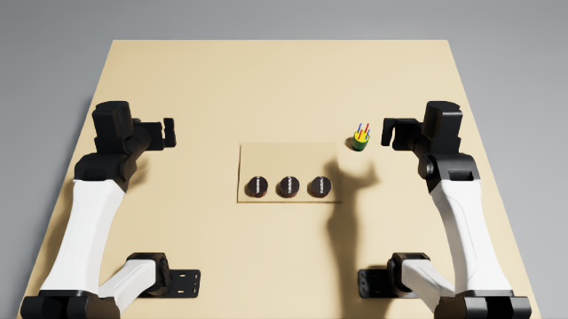
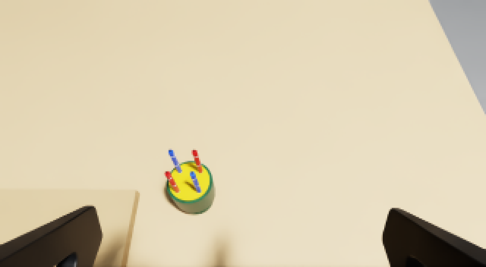
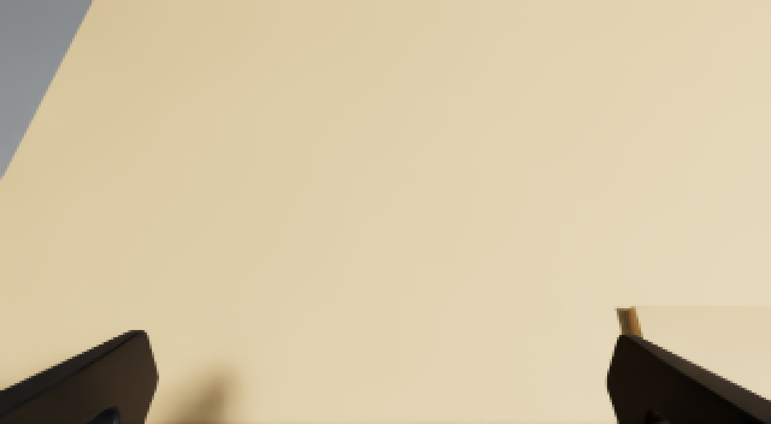
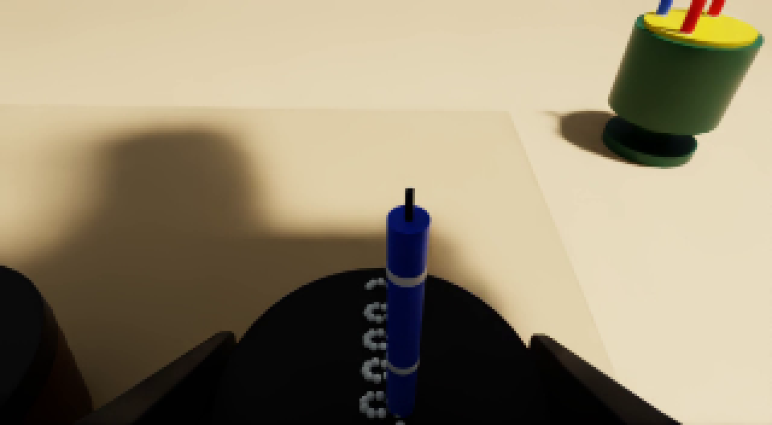
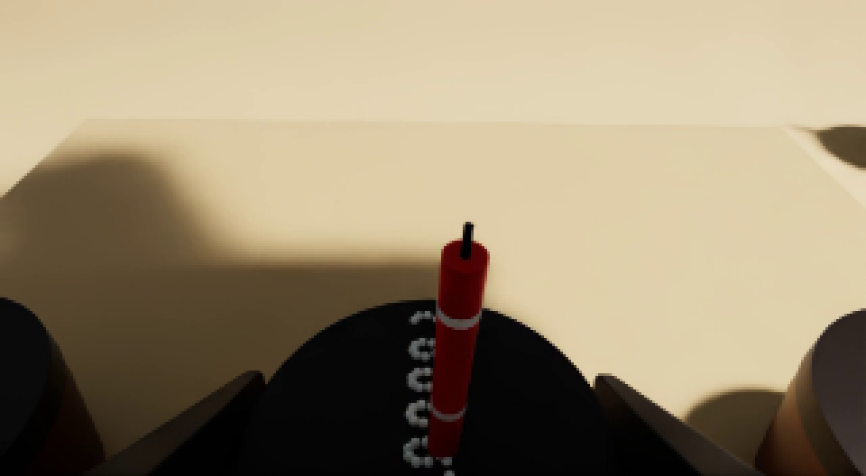
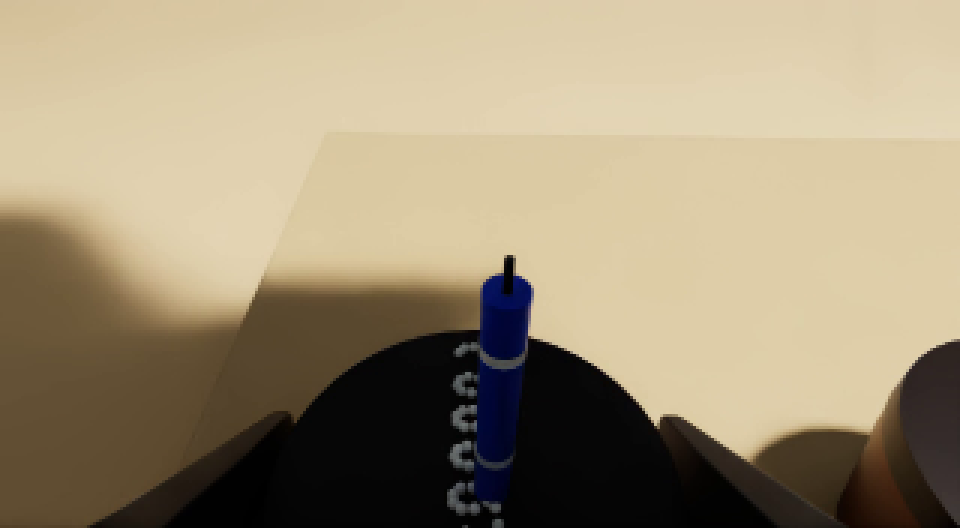
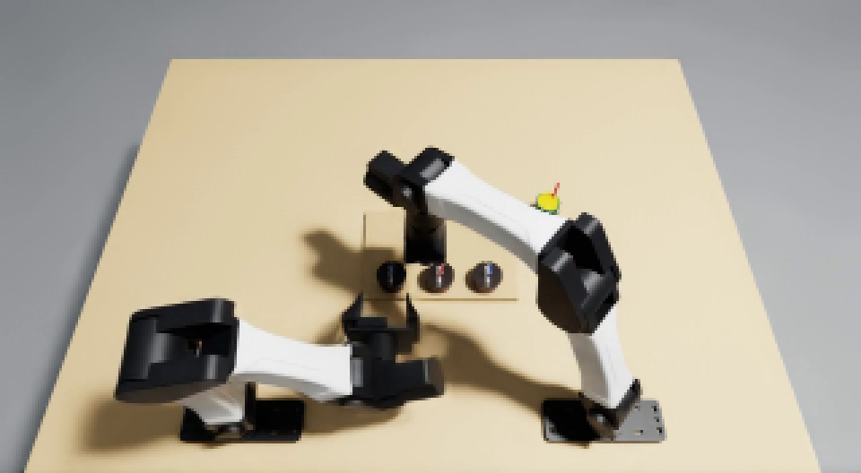

# Push a birthday candle into each of three cupcakes until it stands upright, steadying the soft cupcake without squashing it

Instruction given to the policy: `Put one birthday candle in each of the three cupcakes so that it stands upright.`

Files: `task.py` (scene, the squeeze and the squash, rules, score, the material table), `candles.py` (how a candle is
held by what it stands in, and how it snaps), `mechkit.py` and `demo_kit.py` (the kit, version 0.9), `demo.py` (the
scripted runs), `trials.py` (checks in the simulator: rest and start pictures, the squeeze, the wrist cameras' views,
the cupcake's give, the hold, a shallow candle's fall), `hold_trial.py` and `fall_trial.py` (the trials' own scenes),
`hands.py` (the hands' reach and clearances on the URDF's collision hulls, without the simulator),
`tests/test_cupcake_candles.py` (scene, law, and every level and limit by states set directly), `task.json`,
`start_*.png`, `cue_*.png`, `end_top_policy_x3.png`, `README.md`.



The first picture of a trial (seed 0: the table's layout), both arms in their ready pose. In the middle the beech board,
from above nearly the bench's colour: a slightly lighter rectangle whose near long edge runs across the picture just
under the three cupcakes (3.5 cm from them) and whose far edge lies level with the egg cup in the picture. To the
right, under the right arm's gripper, the dark green egg cup with the yellow lump of Play-Doh and the four candles
standing in it. Four thin candles do not stand in a cup by themselves: the Play-Doh holds them upright, 15 mm deep, at
the corners of a 22 mm square. Every loose part is in the first frame (here and in the reference run's first frames).

 

The wrist cameras at the ready pose, at the policy's 320 x 176, enlarged three times. Right: the four candles, blue,
red, blue, red, each about 3 px wide and 15 px long and about 13 px from the next; the camera looks 30 degrees forward
of straight down from about 30 cm, so even upright candles splay outward in the picture. Left: the bench in front of
the left arm; the cupcakes come into its view when the hand comes round one (below, Can it be seen).

## Scene

Bench coordinates in metres: x away from the arms, y left from the midline, z up from the bench top. The arms' bases
are at (0, +0.305) and (0, -0.305).

| Part | Size, mass | Where |
|---|---|---|
| Beech board, loose | 300 x 200 x 15 mm, 0.63 kg (beech at 700 kg/m3) | middle (0.325, -0.03), long side along y |
| Three Hostess CupCakes (chocolate, white loop of icing), loose, unwrapped | 60 mm across the top, 50 at the base, 35 mm high (a); 45 g (the pack's serving weight) | on the board in a row along y, 9 cm apart, 3.5 cm from its near edge: (0.26, +0.06), (0.26, -0.03), (0.26, -0.12) |
| Egg cup, porcelain, dark green, loose, on a foot, with a 2 oz can of yellow Play-Doh pressed into it | 51 mm across, 45 mm inside, 58 mm high to the rim, the lump domed 2 mm over it; 126 g with the Play-Doh (a) | (0.42, -0.25): in the right wrist camera's picture at the ready pose, and near enough that the right hand, pointing down, stands 2.5 cm over the candle tops |
| Four birthday candles (Wilton 2 1/2 in; two blue, two red, with thin white bands) | 63 x 5 mm, 1 g each (a) | standing 15 mm deep in the Play-Doh at the corners of a 22 mm square round the cup's middle |

The seed moves the row along the board's edge by up to 1 cm and each cupcake by up to 7 mm more, in any direction;
seed 0 puts them as listed. Nothing else varies. Under the harness a run started with `--seed 0` gets the trial seed
1415158438 (inspect-robots 0.60.0): its start has the row 4.1 mm along the edge (to the left) and the cupcakes 2.9,
3.5 and 8.7 mm off the table's places (cake2 8.6 mm towards cake1). The reference run (`w7c-f4`) is at seed 0, the
model run (`w7c-m1`) at that trial seed.

**Every start the seeds can draw can be done; the script does seed 0.** The scripted run plans from the table's
places and does not look: at the trial seed its holding hand, opened 75 mm, would come round cake2 with a pad 1.1 mm
inside the cupcake's outline. A policy has to find the cupcakes in its pictures. With every cupcake moved 17 mm along
the row and 7 mm across it (the most a seed can move one), both arms reach every pose of the script's hold and push
(inverse kinematics within 0.08 mm and 0.02 degrees; least joint margin 15.1 degrees on the left, 1.7 on the right,
the right hand over cake0 moved 17 mm left and 7 mm away). Two cupcakes 7.6 cm apart (the nearest a seed brings them):
a hand centred on one with its pads opened to 68 mm clears it by 4.0 mm and the next one by 5.1 mm as it comes round
the rim, and holding it, the next one by 9.8 mm; opened 75 mm, as the script does, only 1.7 mm (`hands.py seeds`).

Real bench: one box of Hostess CupCakes opened the same day, at room temperature; one box of Wilton 2 1/2 in candles
(the dark ones); a 2 oz can of Play-Doh; a beech cutting board; any egg cup that stands out from the bench. Gripper pad
covers: nitrile finger cots, changed after every trial (the simulated pad friction is the cots' on the icing and on
wax, below).

## What stands in for what

- **The cupcake gives under a squeeze.** It is one rigid body whose surfaces give under a press (a compliant contact):
  pressed between two pads it goes in by the force over the contact's stiffness, 420 N/m, calibrated to the table's
  4 N at 4 mm of closing (below). Flat pads on a cupcake that is wider at the top (60 mm) than at the base (50) touch
  only its rim, the edge of the icing cap, 35 mm over the board, and that is where the squeeze is read: how far the
  pads have closed past touch on the rim (the pads' gap against the rim's 60 mm).
- **A squashed cupcake is a piece swapped in, a drawing only.** Each cupcake's squashed shape is built beforehand and
  waits on a shelf 40 cm under the bench, out of every camera's view. When the closing reaches 4 mm, the cupcake goes
  to the shelf and its squashed shape takes its place, turned so that its narrow side lies between the pads; a candle
  in it comes loose. Its size (6 mm lower, 55.5 mm across where the pads pressed, 6 mm wider the other way) is assumed
  and is not scored: what scores a squeeze is the closing, in the simulation and on the bench (Rules).
- **A candle in a cupcake.** A rigid cake cannot hold a candle that has gone into it, and a weld would hold it at any
  depth. Every candle carries three hidden bodies at its tip (rods inside the candle, carried weightless): when its
  tip goes into a cupcake's top (within the rim), they are joined to the cupcake where the tip went in. From then on
  the candle (1) slides along its own axis against a resistance with no wall: 3 N while the tip is less than 2 mm in
  (the icing cap), 1 N beyond, the same on the way out; (2) turns about the point where it went in, held by a spring
  that rises with the depth: 0.0002 N m per radian at 8 mm and 0.002 at 15 mm, a power law through both (exponent
  3.66), resting along the candle's own direction when it last went deeper (a crooked push leaves a crooked candle);
  (3) leaning more than 25 degrees from that direction, it tears out; pulled back to the surface, it comes out, and the
  cupcake keeps the hole (a candle put there again meets no icing). The candle's lower 38 mm go through the cupcakes;
  what stops a candle pushed too far is the board under the cupcake (at 35 mm deep, 28 mm still show).
- **The lump of Play-Doh is a block with four holes.** The egg cup is one solid body: foot, stem, and a cup 51 mm
  across, its top drawn as the yellow lump 45 mm across, 2 mm over the rim. The candles stand in it by the cake's law
  with the Play-Doh's figures (0.3 N along the candle, 0.0003 N m/rad at 8 mm and 0.003 at 15 mm, tearing out at 35
  degrees); their lower 38 mm and their hidden rods pass through the solid cup. So the lump holds each candle in a
  hole of its own; a candle taken out leaves its hole, and one put back goes into the lump by the same law.
- **A candle snaps.** A candle is two pieces built as one: the lower 38 mm and the upper 25 mm with the wick, joined by
  two sprung hinges 38 mm from the tip, just under the pads of a hand that pinches it 1 cm under the wick end, where a
  pinched candle bends most. Their stiffness, 0.15 N m/rad (assumed), stands for the wax's bending and the cake's give
  at the tip together (the hidden pivot holds the tip rigidly sideways): the wax alone, 40 mm of a 5 mm paraffin rod
  (E 0.2 GPa), would give 0.46 and snap at 2.5 degrees, a 1 mm drift of the hand. Their springs' torque is the bending
  moment; at 0.02 N m (7.6 degrees, about 4 mm of sideways drift of the hand with the tip in a cake) the weld between
  the pieces is cut: the lower piece stays where it is, the upper in the hand. The limit: paraffin breaks at about 1.5
  to 3 MPa in bending, 0.018 to 0.037 N m on the 5 mm section (pi d^3 / 32 = 12.3 mm3); 0.02 is kept.
- **The candle weighs 10 g, carrying only 1 g of weight.** A 1 g candle pinched between two pads and held at its other
  end by a joint gives way in the solver: told to close to nothing on it (12 N a pad), the pads went through its 0.4 g
  upper piece and snapped it (run `w7c-t2`). So the candle's two pieces weigh 6 and 4 g, and every control step the
  task carries the weight over the real candle's 1 g for them (a steady upward force on each piece at its middle): a
  candle stands, leans and falls under 1 g of weight, as the hold law was checked with. What it changes is the
  inertia: with the hidden bodies (2 g rods, two of them at the bending joint) the candle turns about the point where
  it went in with 127 g cm2 at 8 mm deep, a real 1 g candle with 8.8. So it falls the same way, only more slowly: an
  8 mm candle left leaning 1 degree off its hole leans 25 degrees and tears out after 2.9 s, a real one after 1.05 s
  (computed from the hold law, its damping and these inertias, not measured: the two trials meant to measure it,
  `w7c-s1` and `w7c-s2`, are void, below in Limits).
- **The pinch.** The pads are told to close to 2.5 mm on the 5 mm candle: 1.25 mm short on each side against the
  gripper's 5000 N/m, about 6 N a pad, which grips the wax (0.45 with the nitrile cots) with 5.4 N against the icing's
  3 N. A real candle takes it: 6 N over the cot's contact on the wax (about 1.5 mm wide along 16 mm of pad) is about
  0.25 MPa, against paraffin's roughly 1 to 2 MPa; on the bench, the closing to use is the one that holds a candle
  pushed into a cupcake on the scale at 3 N without slipping.
- **The task file does what the rigid simulation cannot**, once per control step: the entry of a candle, the
  resistance, the hold's stiffness for the depth, tearing out, pulling out, the squeeze and the squash, the snap, the
  weight carried. It never moves a body except the squashed cupcake's swap.

## Materials (the one table: `task.py`, `MATERIALS`)

| Quantity | Value in the simulation | Source, and how it is measured |
|---|---|---|
| cupcake: mass; top, base, height | 45 g; 60, 50, 35 mm | pack (mass); assumed, to be measured on the bought box: kitchen test step 1 |
| cupcake on beech | friction 0.5 | assumed: step 1, the board tilted until a cupcake slides |
| squeeze across the rim | 1 mm per N; squashed for good at 4 mm of closing past touch (4 N) | assumed: step 3 |
| the cupcake's surface give | 420 N/m per contact | calibrated in the simulation to the line above at 4 mm (run `w7c-g1`) |
| squashed cupcake (drawn only, not scored) | 6 mm lower and wider | assumed |
| candle | 63 x 5 mm, 1 g | Wilton 2 1/2 in (length); assumed: diameter and mass, to be measured on the bought box |
| candle in the simulation | 10 g, 9 g of it carried | a stand-in for the solver (above) |
| candle through the icing cap | 3 N until the tip is 2 mm in | assumed: step 2 |
| candle in the cake | 1 N along its length, no wall | assumed: step 2 |
| the cake holds the candle sideways | 0.0002 N m/rad at 8 mm, 0.002 at 15 mm, a power law through both | assumed (the constants HOLD_K_8MM and HOLD_K_15MM): step 2 |
| tears out | at 25 degrees from where it rests | assumed: step 2 |
| candle bends (wax and the cake's give, lumped) | 0.15 N m/rad | assumed: step 2 |
| candle snaps | at a bending moment of 0.02 N m (0.4 N sideways at 5 cm) | assumed, paraffin's 1.5 to 3 MPa gives 0.018 to 0.037: step 2, one candle bent over a table edge onto a kitchen scale |
| Play-Doh: pull-out; sideways hold; tear-out | 0.3 N; 0.0003 N m/rad at 8 mm, 0.003 at 15 mm; 35 degrees | assumed: a candle pulled out of the Play-Doh on the kitchen scale |
| board; egg cup with Play-Doh | 0.63 kg; 126 g | beech 700 kg/m3; assumed: porcelain egg cup 70 g, Play-Doh 56 g |
| pad covers on icing; on wax | friction 0.6; 0.5 | assumed: nitrile finger cots |

**The kitchen test** (ten minutes, one box of cupcakes, one box of candles, one can of Play-Doh). 1. Weigh and
measure three cupcakes; slide one on the beech board tilted until it moves (friction). 2. A cupcake on a kitchen scale:
push a candle in through the icing, note the highest reading and the reading while it goes on; push one 8 mm and one
15 mm deep and tilt the cupcake until each falls over; bend one candle over the table's edge with the scale under its
end until it snaps; pull a candle out of the Play-Doh with the scale under the cup. 3. Squeeze a cupcake's sides
between two flat things, one of them on the scale: the reading and the millimetres when it gives for good.

## Rules

| Score | Asked | On a real bench |
|---|---|---|
| 1.0 | each cupcake carries one candle that stands by itself, not more than 10 degrees off the vertical, at least 12 mm deep (not more than 51 mm showing), within 12 mm of the middle of the top; no cupcake squashed (4 mm or more of closing past touch), none off the board or tilted 30 degrees or more; no candle snapped; both grippers clear (the point between each gripper's pads 6 cm from the middle of every cupcake's top and 7 cm from the lower end of every candle in one); nothing moving (every cupcake and candle slower than 5 mm/s and 0.05 rad/s) | a photo from the side of each cupcake against a set square (the lean), a rule (the candle's height above the icing), the fixed rim camera's calibrated video (the squeeze: below), the video (a snapped candle, the hands, at rest) |
| 0.75 | the same with one flaw: one candle leaning 10 to 25 degrees, or less than 12 mm deep but standing, or off the middle; or one candle snapped (a spare used) | as above |
| 0.5 | two cupcakes as for full score | as above |
| 0.25 | one cupcake as for full score | as above |
| 0 | less; or two or more cupcakes squashed or off the board | |

A candle counts in a cupcake while it is held by it (it went in and has neither torn out nor been pulled out) and
leans 25 degrees or less; two candles in one cupcake count for none; which candle goes into which cupcake does not
matter. The score that counts is the one at the end. The run limit is 120 s (2,400 steps at 20 Hz): the full run
(91.8 s) plus 30 %.

**The squeeze on a real bench: a calibrated rim camera.** A camera on a fixed mount beyond the board at x 0.60,
y -0.03, its lens about 45 mm over the bench, level with the cupcakes' rims, looks straight back towards the arms: it
sees the three rims edge-on and both pads of the gripper that steadies a cupcake; the pushing hand works above the
rims and the egg cup is off its line of sight. Before the trials a millimetre scale stood upright at the middle
cupcake's place, in the rims' plane, is filmed to give the pixels per millimetre there (about 6 with a 1080p camera and
a 30 cm wide view); the camera is not moved afterwards. The gap between the inner faces of the steadying gripper's pads
is read frame by frame in millimetres, and a cupcake counts as squashed when that gap has fallen 4 mm or more under the
gap at first touch on its rim: the same closing the simulation scores (`task.py`, `squeeze_on`: the pads' gap against
the rim's width, 4 mm past touch).

## Checks

**(c) The hands, before anything was built** (`hands.py`: exact distances between the URDF's convex collision hulls,
GJK; the arms' inverse kinematics from the ready pose).
- Both hands pointing down at one cupcake (the first idea): the arms overlap by 32 to 35 mm, in the forearms
  (left link 3 against right link 3 and link 5), for every pair of closing directions. So the holding hand comes from
  the near side, 15 degrees under level, closing along y, its grasp point 26.9 mm over the board so that the rim lies
  on the rubber pads: 19.5 mm between the hands at the end of a push with the candle pinched 30 mm under its wick end
  (22.9 if the pushing hand closes along y; 23.4 / 25.0 pinched 20 mm under), fingertips 11.2 to 12.3 mm over the
  board, the hand's body 23.7 mm over the bench, 22.7 mm to the next cupcake (16.9 with the pads opened to 72 mm for
  the approach), joint margin 20 to 23 degrees; alike at all three cupcakes 9 cm apart.
- The pads' contact runs down the cupcake's wall 3.5 mm for each mm of closing (the wall leans in 1 mm per 7 mm of
  height): at the squash limit, 14 mm under the rim; it would reach the pads' lower edge (10.8 mm over the board) at
  6.9 mm, past squashed.
- One candle out of four upright ones: pinched 20 or 30 mm under its wick end, every spacing (12 to 24 mm squares)
  and turn of the hand hits a neighbour; pinched 10 mm under, a square of 18 to 24 mm leaves 3.3 to 5.1 mm.

**(a) The candle in the cake, a law and not a weld** (run `w7c-a2`, `hold_trial.py`, with the first, one-piece 1 g
candle). Cupcakes on sprung hinges to the world, jolted 3 degrees at 1 s, then tilted 7.5 degrees a second to 60. Held
as first planned (0.02 N m per radian at 8 mm), candles 8, 12 and 15 mm deep never fall: 1.2, 0.8, 0.7
degrees from their holes at 60 degrees of tilt; a 1 g candle's weight gives only 0.00023 N m per radian at 8 mm. Held
with a hundredth of that (square law): the 8 mm candle was over at once (0.1 s; likely not a fall but the jump of a
candle built inside a cupcake that `w7c-s1` and `w7c-s2` show, see Limits), the 12 mm one stands (the jolt leans it
7.9 degrees, it comes back to 0.2) and falls at 56 degrees of tilt, the 15 mm one is still in at 60 degrees (13
degrees from its hole). The constants used (0.0002 and 0.002 N m/rad, exponent 3.66) give: 8 mm falls (hold
0.87 of the weight's), 9 mm stands with 1.4 and falls with the cupcake tilted 12 degrees, 10 mm 2.1 (45 degrees),
12 mm 4.6 and 15 mm 12 (never). The resistance along the candle: 12 mm deep, under 0.9 N it moved 0.25 mm and held;
under 1.1 N it went on from 12 to 28 mm. (The first build crept at 12 mm/s under 0.9 N: the slide's damping, 50 N s/m
on a 1 g candle; at 5 N s/m it holds. The run before, `w7c-a1`, is void: a weld to a cupcake moved by write_pose did
not drag the candles.)

**(b) The squeeze, and a push from above** (run `w7c-b1`, `trials.py squeeze`). The left hand at the middle cupcake's
rim. Pushed straight down from above while held (1.9 N of squeeze): 3 N 4 mm off its middle turned it 0.02 degrees,
10 N 10 mm off 1.78 degrees; it never slipped in the pads or tipped. The give as first built (2000 N/m per side) was
stiffer than the table and stiffening: 0.77 mm at 1.9 N, 1.44 at 3.9, 2.47 at 8.8 (the gripper's own force reading),
so the calibration below sets the contact's stiffness.

**The cupcake's give, calibrated** (run `w7c-g1`, `trials.py calibrate`): the left hand closed on the rims of three
cupcakes whose contacts had 250, 500 and 1000 N/m, 1 mm of commanded gap at a time. At 4 mm of closing past touch the
gripper read 2.5 N (250 N/m), 4.7 N (500, between 3.5 mm 3.7 N and 4.1 mm 4.8 N) and 9.6 N (1000, at 4.1 mm): the force
goes nearly with the stiffness, so 420 N/m gives the table's 4 N at 4 mm. At 420 N/m (between the measured curves)
1.0 mm of closing takes 0.6 N, 1.5 mm 1.0 N, 2.0 mm 1.4 N, 4.0 mm 4.0 N: softer at first than the table's straight
1 mm per newton. The full runs hold at 1.20 to 1.24 mm with 0.76 to 0.80 N on the gripper's reading: 3.2 times under
the squash limit by closing, 5.0 times by force.

**(d) What the wrist cameras show** (run `w7c-d1`, `trials.py view`). The pushing hand's camera 12 cm from a candle
standing in a cupcake: the candle is 8 px wide at 320 x 176, but the camera looks 25 degrees off the hand's axis and
sees it nearly end-on: an upright candle and one leaning 10 degrees look alike. The holding hand's camera looks at the
cupcake's top from above and behind at about 8 cm: a candle in it is seen from the side. The top camera has about
1 px per candle: it shows where the candles are, not how they stand.

## Reference run

Scripted, recording `w7c-f4` of 2026-11-20 (commit `a768f31`), seed 0, 20 Hz, run limit 120 s. `w7c-f3` (commit
`f6e216c`, recorded before the run limit was set; then 270 s) is the same run and gives the same figures to the
rounding. For each cupcake, nearest the right arm first (cake2, cake1, cake0): the right hand, pointing down and open
15 mm, comes 2.5 cm over the candle tops until it is straight over a candle, comes down onto it, pinches it 1 cm under
its wick end (told to close to 2.5 mm: about 6 N a pad) and pulls it straight up out of the Play-Doh; the left hand
comes from the near side, 15 degrees under level, open 75 mm, round the cupcake's rim and closes 1.5 mm past touch;
the right hand brings the candle 15 mm, then 4 mm over the middle of the top and pushes it down along its axis, the
hand's target lowered 2 mm every 0.25 s ten times (16 mm into the cupcake, commanded), pressing 4 N down; it rests
0.5 s, lets go of the candle and rises; the left hand opens and backs away. After the third cupcake both hands start
to move away; the run ends 1 s after the score has reached 1.0.

What the script reads (only what a robot knows beforehand or senses itself): the places, from the table's layout; whether a candle is in the hand, from the
gripper's own width (closed on a 5 mm candle its pads stop near 5 mm apart, on nothing they meet: more than 3.75 mm
counts as held, and the hand takes the candle again once if not); the push is a commanded descent from a height that
follows from the layout and the pinch point. Nothing else: not the candle's depth or lean, not the cupcake's place,
not the score.

| Run | Score | What the recording shows |
|---|---|---|
| `full` (`w7c-f4`) | 1.0 at 90.85 s; the run ends at 91.8 s (1,836 of 2,400 steps) | 0.25 at 23.3 s, 0.5 at 53.6, 1.0 at 90.85, never dropping. The candles come out of the Play-Doh at 7.3, 37.8 and 68.3 s and go into their cupcakes at 22.0, 52.5 and 83.0 s, first seen 1.07, 1.78 and 2.27 mm under the top, 4.2, 2.8 and 2.7 mm off its middle, leaning 0.80, 0.42 and 0.64 degrees. At the end: candle2 in cake2 20.21 mm deep, 1.08 degrees off the vertical, 4.2 mm off the middle; candle1 in cake1 21.83 mm, 2.50 degrees, 2.8 mm; candle0 in cake0 23.95 mm, 1.77 degrees, 2.7 mm; the spare untouched in the Play-Doh; nothing squashed or snapped; cupcakes 0.04 mm and 0.01 degrees from where they started, board and egg cup unmoved; the hands 73 and 93 mm from the nearest cupcake top |

The push: commanded 16 mm in, the candles went 20.4, 22.1 and 24.2 mm in at the deepest and ended 20.2, 21.8 and
23.9 mm in: pressing 4 N the hand runs ahead of its target (the arm's own give). Nothing stops a candle in a cupcake
but the board under it: the tips stayed 14.6, 12.9 and 10.8 mm over the board at the deepest.

Contact sheets looked at: the top and both wrist cameras of `w7c-f4`. The right hand comes over the egg cup, down onto
a candle and up with it; the left hand comes round the cupcake's rim from the near side; the candle comes over the
cupcake and goes down into it; the right hand lets go and rises, the left backs away; three times. In the left wrist
camera the blue candle stands in cake2 from 33.5 s, the red one in cake1 from 58 s, the blue one in cake0 at the end;
the spare stays in the lump.

Model run: Dream-1, 2,400 steps (the whole run limit), `--seed 0` (trial seed 1415158438): score 0.0; both arms came
down in front of the board and the right hand crept towards the egg cup without reaching it; nothing was touched.

The lower levels are shown by states set directly (below, States set directly). `demo.py` keeps their short trials of the
middle cupcake (`t_shallow`, `t_squashed`, `t_one_hand`, `t_one_hand_off`, `t_crooked`), not run. One trial of the
middle cupcake end to end before the full run, `w7c-t3` (`t_one`), scored 0.25 after 35.6 s: candle1 21.8 mm in,
1.89 degrees, 3.7 mm off the middle.

## Can it be seen



 

The left (holding) hand's camera at the size a policy gets (320 x 176), enlarged three times, run `w7c-f4` at 27.4,
57.9 and 88.4 s: the right hand has let go and gone up, the left still holds the cupcake (its fingers at the lower
corners). Each candle stands in its cupcake seen from the side and above at about 8 cm: 15 to 19 px wide at the
policy's size and 70 px or more long (it runs off the picture's lower edge), its white bands and wick plain; a lean of
10 degrees across the view moves its top about 13 px against where it leaves the picture, 2.5 degrees about 3 px. The
egg cup with the three candles still in it shows at the upper right of the first picture.



The top camera at the end of `w7c-f4` at the policy's size, enlarged three times: the candles show as a few pixels of
colour on the dark cupcakes, the spare as a red mark in the lump: where the candles are, not how they stand.

## Limits and readings

| Limit in the score | On the real bench | Reading in the full-score run (`w7c-f4`: cake2, cake1, cake0) | Run that shows the limit | Set directly (`tests/`) |
|---|---|---|---|---|
| lean: 10 degrees for full score, 25 to count at all | a photo against a set square | 1.08, 2.50, 1.77 degrees | none | 9.9 and 10.1; 24.9 and 25.1; a candle fallen over (80 degrees) |
| depth: 12 mm (51 mm showing) | a rule from the icing to the wick end | 20.2, 21.8, 23.9 mm | none | 12.1 and 11.9 mm; 9 mm standing: one flaw |
| off the middle: 12 mm | a rule from above | 4.2, 2.8, 2.7 mm | none | 11.9 and 12.1 mm |
| squashed: 4 mm of closing past touch (4 N) | the rim camera's calibrated video: the pads' gap 4 mm or more under the gap at first touch | at most 1.20, 1.21, 1.24 mm (0.76 to 0.80 N) | none | 3.9 and 4.1 mm of closing, through the step hook; two squashed: 0 |
| on the board, tilted less than 30 degrees | a photo | while pushed at most 0.05 mm and 0.96 degrees; at the end 0.04 mm, 0.01 degrees | none | 29 and 31 degrees; on its side: 0.5; two on their sides: 0; 2.5 cm past the board's edge: 0.5 |
| snapped: a bending moment of 0.02 N m | the video | at most 0.0054, 0.0061, 0.0069 N m: 2.9 times under the limit (less than the threefold margin asked of a correct run; 0.02 is kept, above) | none | 0.0199 and 0.0201 N m, through the step hook; snapped with the spare in its place: 0.75 |
| grippers clear: 6 cm from every cupcake's top, 7 cm from the lower end of every candle in one | the video | 73 mm (right hand) from the nearest top at the end | none | 59 and 61 mm over a top; 69 and 71 mm beside a candle's lower end |
| at rest: slower than 5 mm/s and 0.05 rad/s | the video | at rest from 90.85 s (the score's own check) | none | 4.9 and 5.1 mm/s; 0.049 and 0.051 rad/s |
| one candle in each cupcake, any candle in any cupcake | a photo | one each | none | two in one and none in the next: 0.25; one left in the Play-Doh: 0.5; the candles swapped round: 1.0 |

Not scored, read beside the law's limits: lean from the direction the cake holds the candle along at most 3.6, 1.1
and 1.9 degrees (it tears out at 25: 24.9 and 25.1 set directly, through the step hook); the tips at least 14.6, 12.9
and 10.8 mm over the board (nothing else stops a candle pushed too far); at least 9.6 mm between bodies that are not
meant to touch (the board and candle0's lower end, at 85.6 s); the arms' worst inverse kinematics 0.08 mm and 0.02
degrees.

## States set directly

`tests/test_cupcake_candles.py` (35 tests) sets every state without the simulator, and runs the task's step hook on
some of them as it runs in the simulator, recording what it would tell the simulator. The scene as specified (sizes,
masses, places, the candles 15 mm deep in the Play-Doh, every material with its source; the cupcakes moved by the seed
within 1 cm); every weld made during a trial anchored on
its child; every pair of one candle's bodies jointed or passing through each other. The law: the hold through
0.0002 N m/rad at 8 mm and 0.002 at 15 mm with the weights' margins 0.9, 1.4, 2.1, 4.6 and 12.4 at 8, 9, 10, 12 and
15 mm, the resistance stepping from 3 to 1 N at 2 mm, the slide's rest following like dry friction; a candle turned
24.9 degrees from its hole stays in, 25.1 tears out; bent with 0.0199 N m it holds, with 0.0201 it snaps. The squeeze
read at the rim from the pads' gap (0 to 4 mm, off the axis, not between the pads, over the top); closed 3.9 mm past
touch the cupcake stays, 4.1 mm the step swaps the squashed one in and the candle comes loose. The score: three good
candles 1.0; each flaw (leaning 15 degrees, 11.9 mm deep, 13 mm off the middle, one snapped) 0.75; leaning 26 degrees
counts for nothing; two flaws 0.25; two cupcakes 0.5; squashed, off the board, on its side, two candles in one, one
left in the Play-Doh, an 8 mm candle fallen over or torn out; the straddles of the table above.

## Limits

- The cupcake is rigid apart from its surface's give: it does not tear, crumble or crack round the candle; the icing
  is not smeared. A candle does not smear wax. The squeeze is read only across the sides (a press on the top is not
  scored).
- A candle that goes in through a cupcake's side, or lying flat, is not held: it goes through (its lower 38 mm pass
  through cupcakes). A candle that tore out lies half in the cupcake it fell from.
- The candle in the simulation turns about the point where it went in with 14 times a real candle's inertia (the 10 g
  stand-in and its hidden rods): it falls the way a real one would, about 2.7 times more slowly (computed, above).
- A candle built inside a cupcake at the start jumps at the first control step: in the trials `w7c-s1` (cupcakes fixed
  to the bench, candles leaning 1 degree) and `w7c-s2` (cupcakes on sprung hinges, candles upright) one hinge of the
  candle's hidden pivot turned 20 to 90 degrees in the first 0.05 s and the 8 and 9 mm candles tore out, with 10 g and
  with 1 g (in `w7c-s1` the 15 mm stand-in too); cause not found. The task never builds a candle there: its candles start in the Play-Doh, where they stand
  still (rest check `w7c-b5`: 0.00 degrees), and the candles pushed in during `w7c-f3` and `w7c-f4` stood. So the
  shallow candle's fall time above is computed, not measured.
- The hidden bodies, the shelf with the squashed cupcakes and the bending joint are not seen.
- The tip's entry is checked once per control step (20 Hz): a candle pushed fast may be 2.5 mm in before it is held.
- The pushing hand's camera does not show a candle's lean; the holding hand's does.
- The scripted run plans from the table's layout and does the seed-0 start (above, Scene).

## Review of this submission (TK-3279XL)

The review asked (Scoring, not met): "A 32 mm height block cannot establish whether the cupcake rim was squeezed 4 mm
past first contact, and the claimed 6 mm height loss is unverified ... either specify a calibrated, unobstructed video
measurement of that compression, or use a measurable permanent-deformation criterion in both real and simulated
scoring."

What changed: the first option. On a real bench the squeeze is read by the fixed, calibrated rim camera (Rules): the
gap between the steadying gripper's pads against the gap at first touch on the rim, 4 mm or more of closing counting as
squashed. That is the reading the simulation scores, so the bench and the simulation read the same thing. The 32 mm
block and the 6 mm height loss are gone from the scoring; the squashed cupcake's shape stays only as a drawing, its
size assumed and not scored. Unchanged: the instruction, the scene, the scorer, the run limit, the reference run
`w7c-f4` and the model run `w7c-m1`.

## Earlier review of this idea

Searched (all states; the task board's titles, open holds, EFE task details, BEHAVIOR-1K activities, RoboCasa365
tasks; 2026-11-20): no task stands a candle in a cake or a cupcake. The nearest: #2255 (closed: press and twist a taper
candle into a brass candlestick: a rigid socket), #2561 (peel a baking cup off a muffin), #2318 and #2790 (box a
decorated cake, cake dome), #1919 (icing worked with a tool), #1787, #659, #2576, #2298 (cakes served,
turned out, split, lifted; two closed as too hard to reproduce with home-baked cakes: hence a packaged cupcake here),
RoboCasa365 GarnishCupcake and GarnishCake (a garnish set down on or beside a cake: nothing is pushed in, nothing has to
stand). Here a slender, breakable thing is driven into a light, soft one to the depth at which the soft one holds it
upright, while the other hand keeps the soft one from moving without crushing it.

## How to run

    scripts/rta check mech/tasks/cupcake_candles
    scripts/rta demo <id> mech/tasks/cupcake_candles full [--quick]
    scripts/rta demo <id> mech/tasks/cupcake_candles t_shallow,t_squashed,t_one_hand,t_one_hand_off,t_crooked
    scripts/rta simpy <id> mech/tasks/cupcake_candles/trials.py /workspace/robocurve/outputs/<id> rest,squeeze
    scripts/rta simpy <id> mech/tasks/cupcake_candles/trials.py /workspace/robocurve/outputs/<id> calibrate   # CUPCAKE_GAUGE
    scripts/rta simpy <id> mech/tasks/cupcake_candles/trials.py /workspace/robocurve/outputs/<id> view        # CUPCAKE_VIEW
    scripts/rta simpy <id> mech/tasks/cupcake_candles/trials.py /workspace/robocurve/outputs/<id> hold
    scripts/rta simpy <id> mech/tasks/cupcake_candles/trials.py /workspace/robocurve/outputs/<id> fall
    scripts/rta dream <id> mech/tasks/cupcake_candles/task.py 120
    PYTHONPATH=<yam-isaac-lab-arena> python3 mech/tasks/cupcake_candles/hands.py <out> [cup|row|seeds]

The model run, the standard command (the run limit is 2,400 steps):

```bash
inspect-robots run --embodiment yam_arena --policy dream \
  -E task=mech/tasks/cupcake_candles/task.py -E object_jitter=0 -E control_hz=20 -E cam_width=320 -E cam_height=176 \
  --instruction "Put one birthday candle in each of the three cupcakes so that it stands upright." \
  --scorer task_score --max-steps 2400 --seed 0 --no-prompt --store-frames --log-dir <log dir>
```

`-E object_jitter=0` is required: the scripted run takes the layout from the task file's constants, and the task
moves the row and the cupcakes by the seed itself.

Runtime per trial: about 92 s simulated for the scripted run (1,836 steps), 2,400 steps (120 s) at most. On one RTX
4090 the scripted run took 7 min 22 s of wall time: 6.3 min of stepping at a median 205 ms a step with the three
cameras rendered, the rest start-up; a trial of the full 2,400 steps takes about 9 min, besides the policy's own time.

Meshes, textures, sounds: none; every shape is a primitive built in `task.py` and `candles.py`.
