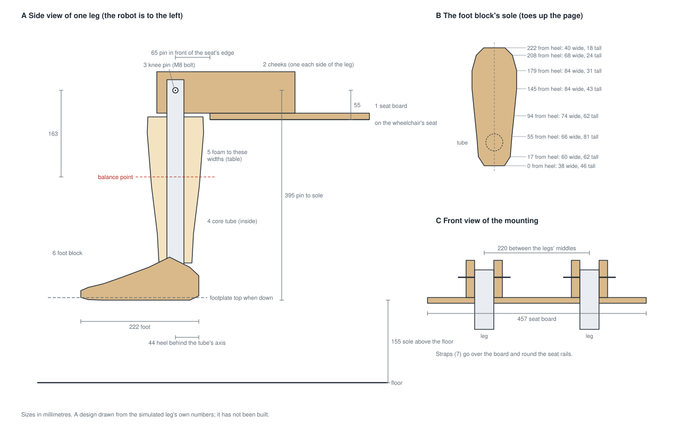

# Put a seated care manikin's feet on a wheelchair's footplates

A folding manual wheelchair stands with its wheel locks on, facing the robot. An adult care manikin has just been
seated in it. The swing-away footrests are in place, but both flip-up footplates are still folded up, as they are left
for a transfer, and the manikin's lower legs hang limp from the knee, with the feet exactly where the plates will come
down. The robot has to fold each plate down and put the foot on it, then let go.

The table, and a board of the same height behind it, stand in for the floor. Everything is at full size.

## Why it takes two hands

- A footplate is hinged along its outer edge and folds down toward the middle of the chair. The hanging foot is in its
  way: a plate that is let go lands against the leg and stops at about 45 degrees.
- A limp lower leg does not stay where it is put. Lifted and let go, it swings back and hangs again.
- So one hand lifts a lower leg forward and holds it there, the other tips that plate over, the plate falls onto its
  down stop under the lifted leg, and the foot is lowered onto it. The heel lands on the plate and the leg stays.

The leg here is hinged at the knee only, so the foot cannot be moved sideways out of the plate's way as a carer might
do: it has to be lifted about 50 degrees forward for the plate to pass under the shin (by the kit's shapes, 45 degrees
leaves 2 cm and 40 degrees does not clear it; the demo holds it at 48).

## Files

| File | What it is |
|---|---|
| `task.py` | The layout, the instruction, the record kept every control step, the scoring rule. |
| `footkit.py` | The wheelchair, the footplates and their hinges, the manikin and its two free lower legs: shapes, sizes, measurements. |
| `demo.py` | A scripted demo that reaches full score, and five control runs. |
| `test_scoring.py` | 20 checks of the shapes, the measurements and the scoring rule; no simulator needed. |
| `task.json` | The task's description for the board. |
| `legs.svg` | Drawing of the lower-cost legs for real trials (see "Building the legs"). |

## Running and scoring a trial

```bash
# a policy (Dream-1 here), 1,800 steps at 20 Hz; the score is printed at the end and written to the log
inspect-robots run --embodiment yam_arena --policy dream -E task=task.py -E object_jitter=0 -E control_hz=20 \
  -E cam_width=320 -E cam_height=176 --scorer task_score --max-steps 1800 \
  --instruction "The resident manikin has just been seated in the wheelchair. Fold both footplates down and put its feet on them, then let go."

python demo.py task.py out_dir                 # the scripted demo: videos, setup.png, result.json
FOOT_LOT=B python demo.py task.py out_dir      # the second layout
python -m pytest -q test_scoring.py            # the offline checks
```

- `object_jitter=0` is required: the chair and the manikin are fixed and the layouts are exact.
- There are no seeds. `FOOT_LOT` picks the layout: A, or B (the chair 2 cm further from the robot and 1.5 cm to the
  left).
- A trial ends at full score held for 1 s, or at the run limit of 1,800 steps (90 s).
- Time per trial on one L40S: about 4 minutes for the demo (942 steps, with start-up) when two demos shared the GPU, about 7 minutes for the 640 x 352 recording beside a Dream-1 run; 6 minutes for the 1,800-step Dream-1 run. No run was timed alone.
- `result.json` from the demo holds the score, each side's record and a trace every five steps.
- The overhead camera sees the feet, the footplates and the shins at the far edge of its picture; the knees, the
  manikin's body and the rest of the chair are beyond it. The wrist cameras see them when an arm is raised (the setup
  picture puts such a view beside the overhead one).

## Scoring

Each side is scored by itself at the end of the trial, and the two are added.

| Side's score | State |
|---|---|
| 0 | The footplate is not down on its stop (more than 5 degrees from level). |
| 0 | The plate touched that leg (came within 2 mm of it) at some time while the plate was not down: it was folded onto a foot that still hung, or leaned on the leg. |
| 0.25 | The plate is down, and never touched the leg on its way. |
| 0.5 | The plate is down; the foot rests on it; both grippers are at least 3 cm from that leg; leg and plate are at rest (turning under 5 degrees a second). |

"The foot rests on it" means: the middle of the heel's pad (3 cm in front of the heel's back) and the middle of the
foot (11.1 cm in front of it), both on the sole's midline, are over the plate's top, and the sole's lowest point is no
more than 5 mm above the plate's top.

The whole trial scores 0, whatever the end state, if at any time:

- a knee turns faster than 90 degrees a second (the leg was jerked, or dropped: a leg let fall from 45 degrees
  reached 254 degrees a second in the control run below; the demo's fastest is 17 on layout A and 34 on layout B);
- a lower leg is taken more than 80 degrees forward of hanging, or more than 15 degrees back (forced toward the end
  of its range; the hinge's own stops are at 85 and 20).

So the possible totals are 0, 0.25, 0.5, 0.75 and 1.0, and doing nothing scores 0. The score depends only on the state
at the end and on those three events; nothing is added up over time.

Ways through that were considered, and what they score:

- Tipping a plate over without lifting the leg: 0 for that side (run below). The plate lands on the leg.
- Leaning the plate on the leg and then lifting the leg out from under it, with one hand: the plate does fall onto
  its stop, but it touched the leg first, so that side scores 0.
- Lifting the leg, tipping the plate and letting the leg fall onto it: 0 for the whole trial (the knee's speed).
- Leaving the leg held up over a plate that is down: 0.25 for that side, not 0.5 (run below).

## Scoring a real trial

Tools: a phone on a stand at each side of the chair, level with the footplates; a protractor card behind each knee;
a ruler; a 2 mm feeler strip.

1. Plate down: on the side photo the plate is level within 5 degrees (it is either on its stop or visibly not).
2. Foot on the plate: the heel's pad and the middle of the foot are over the plate (mark both on the sole's midline
   with tape beforehand; read them against the plate's edges from above), and the heel sits on the plate (a 5 mm card
   does not pass under the lowest part of the sole).
3. Let go and at rest: both grippers 3 cm from the leg; nothing visibly moving in the last second of the video.
4. Plate against the leg: on the side video, the plate never rests on or strikes the leg while it is coming down.
5. Jerk, drop and range: the lower leg's angle is read frame by frame against the protractor card (more than 3
   degrees between frames 1/30 s apart is faster than 90 degrees a second); it stays between 15 degrees back and 80
   forward.

This procedure has not been tried on a physical rig.

## The demo

`demo.py` reaches 1.0 on both layouts. It never reads a part's state: every target comes from the layout constants
and the kit's sizes, and the only feedback is each hand's own measured position, used to correct for the arm's sag
under the leg's weight (the hand hangs up to 6 cm below where it is sent).

The leg is not gripped. A closed, level hand, fingers pointing away from the robot, comes in from the front under the
ball of the foot, and the sole lies on the fingers; the knee's hinge keeps the leg in its plane. Gripping the shin or
the ankle was ruled out before the first simulator run: from the front a gripper runs into the foot once the leg is
past about 35 degrees, the shin is about 8 cm wide against a 9.4 cm opening, and from either side the upright plate,
its hanger or the other leg is in the way.

For the manikin's right foot (on the robot's left) the right arm reaches across and supports the foot and the left
arm, which is next to that plate, tips it over; for the other foot the arms change roles.

| Step (layout A) | What happens |
|---|---|
| 60 | The right hand has crossed over in front of both feet, turning level; the left hand stands outside the manikin's right footplate. |
| 145 | The right hand is under the ball of the right foot and starts to lift. |
| 210 | The leg is past 45 degrees; it is held at 48. |
| 255 | The left hand has pushed the plate past upright; it falls (46 mm from the leg at its nearest). |
| 265 | The plate is down on its stop: 0.25. |
| 365 | The leg has been lowered; the heel is on the plate at 13 degrees. |
| 420 | The right hand has drawn out from under the toes and is 3 cm away: 0.5. |
| 650 | The arms have changed roles: the left hand is under the left foot and lifts. |
| 770 | The left plate is down (36 mm from the leg at its nearest): 0.75. |
| 925 | The left foot is on its plate and let go: 1.0. |
| 942 | Full score has held for 1 s: the trial ends as a success. |

Layout B: the same steps (0.25 at 265, 0.5 at 420, 0.75 at 770, 1.0 at 925, success at 942). Steps are read from a trace
kept every five steps. In both runs no plate touched a leg, and each foot ends on its plate with the heel's pad
3.5 cm behind the plate's middle and 9 cm in from the hinge.

## Control runs

All on layout A.

| Run | Score | What happened |
|---|---|---|
| `--mode still` | 0.0 | Nothing moves (200 steps). |
| `--mode plate` (the first plate is tipped over while the foot hangs) | 0.0 | The plate lands on the leg and stays there, 45 degrees from level. |
| `--mode drop` (the first leg is lifted, then the hand is taken away) | 0.0 | The leg falls and swings; the knee reaches 254 degrees a second (trial void from step 237). The plate was never touched. |
| `--mode held` (the first leg is lifted, its plate tipped, the leg left held up) | 0.25 | The plate is down; the foot is 9 cm above it on the hand. |
| `--mode one` (the first foot only) | 0.5 | The right foot rests on its plate from step 420; the left side is untouched. |

## Dream-1

One run, 1,800 steps, layout A, after a 200-step test (also 0.0): **0.0**. Both arms reached out toward the feet.
The right gripper tipped the plate on its side over while that foot still hung; the plate landed on the foot and stayed
there. The other plate stayed up, and neither leg was lifted.

## Building it for real

- **Wheelchair.** A standard adult folding manual wheelchair with an 18 x 16 in seat, 19.5 in seat-to-floor height,
  8 in casters, 24 in rear wheels and swing-away footrests with flip-up composite footplates. Wheel locks on.
  Adjust the footrests' length so that the plates' tops are 16 cm above the floor.
- **Manikin.** An adult care manikin with jointed knees whose lower legs swing freely: the KERi Complete Nursing
  Skills Manikin (LF04020), listed as 58 in tall and about 28 lb, with "Knee - Extension, Flexion". Seat it with its
  hips against the back and belt its trunk and thighs to the chair. The listing also gives its ankle as jointed; here
  the ankle is rigid at a right angle, so splint or tape the ankles.
  A full nursing manikin is costly. The lower-cost stand-in is a pair of jointed lower legs on a seat board:
  see **Building the legs** below. Nothing in the task touches the manikin above the knees.
- **Floor.** A platform level with the arms' mounts, 1.6 m deep in front of them, or the arms mounted at floor level.
- **Check before a trial:** each hanging sole is about 5 mm below the level of its plate's top; each plate, folded up,
  stays up, and falls onto its stop when its top is pushed 4 cm inward.
- **Safety.** Light parts and forces of a few newtons; the plate weighs 250 g and falls 15 cm. Nothing sharp, hot or
  powered.

Measure the real chair and manikin first. Apart from the catalogue sizes listed under Sources, every size and mass
here is an estimate (next section).

## Building the legs



Two jointed lower legs on a seat board stand in for the manikin. They are plywood, a plastic tube, foam and bolts
from a hardware store, cut with a saw and a drill. **This is a design drawn from the simulated leg's own numbers; it
has not been built.** The checks at the end are part of the build, not an option.

### Parts

| No. | Part | Size | Notes |
|---|---|---|---|
| 1 | Seat board | 12 mm plywood, 457 x 400 mm (the seat's 18 x 16 in) | Lies on the chair's sling seat, front edge level with the seat's front edge |
| 2 | Cheeks, four | 18 mm plywood, 200 x 78 mm | Two per leg, 40 mm apart, standing on the board and screwed to it from below, overhanging its front edge by 100 mm. An 8.5 mm hole for the pin, 65 mm in front of the board's front edge and 43 mm above the board's top (55 mm above the seat) |
| 3 | Knee pin, two | M8 x 100 mm bolt with a self-locking nut, a washer either side of the tube | Done up so that the tube turns freely with about 1 mm of side play |
| 4 | Core tube, two | Rigid plastic tube, 32 mm outside diameter (or a hardwood dowel of that size), an 8.5 mm cross hole 20 mm from its top end | Its lower end goes 40 mm into a hole in the foot block. Cut it so that the pin's centre is 395 mm above the sole |
| 5 | Foam | Closed-cell foam (pipe insulation or a camping mat) wrapped round the tube and taped | Built up to these diameters, within 5 mm: 104 mm at 50 mm below the pin, 106 at 80, 90 at 180, 68 at 270, 62 at 325. It starts 50 mm below the pin, clear of the cheeks |
| 6 | Foot block, two | Softwood, 222 mm long, sole flat, widths and heights as in view B of the drawing | The tube's axis is 44 mm in front of the heel's back, on the sole's midline, square to the sole. Glue and screw the tube in: the ankle does not move |
| 7 | Straps, two | Cam-buckle or ratchet straps | Over the board and round the chair's seat rails, one near the front and one near the back |
| 8 | Ballast | Steel washers or fishing weights | Taped inside the tube or screwed to the top of the foot block |
| 9 | Covering | Vinyl tape or sheet over the foam and the foot | Closer to a manikin's vinyl skin under the gripper's fingers |
| 10 | Stops, two per leg | Wood screws or small blocks on a cheek | Stop the leg 20 degrees back of hanging and 85 degrees forward |

### How it goes together

1. Screw the four cheeks to the seat board, a pair for each leg, the pairs' middles 220 mm apart and centred on the
   board.
2. Glue and screw each tube into its foot block, toes pointing square to the cross hole's axis, and cut the tube to
   length (pin's centre 395 mm above the sole).
3. Wrap the foam to the listed diameters and cover foam and foot with vinyl.
4. Put each leg between its cheeks on its pin, toes away from the board. Fit the two stops.
5. Lay the board on the wheelchair's seat, front edges level, and strap it down. The two legs put about 1.6 kg in
   front of the seat's edge, so the rear strap has to be tight.

### Checks

- **Mass.** Each finished leg, off its pin, weighs 780 g (760 to 800 g). Add ballast, or hollow the top of the foot
  block, until it does.
- **Balance.** Laid across a pencil, the leg balances 163 mm below the pin's hole (150 to 175 mm), measured along the
  tube. Move the ballast up or down until it does. The 163 mm is the simulated leg's centre of mass, worked out from
  its shapes at uniform density.
- **Free knee.** Held 45 degrees forward and let go, the leg swings back through hanging and comes to rest hanging.
  A letter scale or spring scale hooked at the ankle, 340 mm below the pin, moves the hanging leg at 0.15 N (15 g)
  or less. The simulated knee's friction is 0.05 N m, an estimate.
- **Place.** With the board strapped down, each hanging sole is 155 mm above the floor, the pins are 220 mm apart
  and centred on the chair, and the toes point straight ahead. Then set the footrests' length so that the
  folded-down plates' tops are 160 mm above the floor: 5 mm above the hanging soles, as in the simulation.

## What the simulation simplifies

- **The leg.** Each lower leg and foot is one rigid piece on a hinge at the knee. The ankle does not move, the thigh
  and trunk are fixed, and the leg cannot roll or move sideways. A real limp leg can be moved a little sideways at
  the hip, so a carer needs a smaller lift than the 50 degrees needed here. With the ankle at a right angle the foot
  rests on the plate on its heel, toes 13 degrees up, not flat.
- **Sizes and masses that are estimates, not measurements:** knee to sole 39.5 cm, foot 22.2 x 8.4 cm, the leg's
  shape, 780 g for lower leg and foot (6.1 percent of the listed 28 lb), knees 22 cm apart; the knee's friction
  (0.05 N m); the footplate's size (6 x 6 in, 1.2 cm thick), mass (250 g) and hinge friction (0.02 N m), the 5
  degrees it leans past upright when folded up, and that it falls by itself once past upright; the footrest hangers'
  shape; where the plates sit under the knees.
- **The chair** is one fixed body. Its seat and back are rigid. Only the parts near the feet collide (front posts,
  casters, hangers, seat); the rest is drawn only. The footplates do not collide with the chair's own frame: their
  hinges' stops hold them.
- **Heel loops** are left off the footplates.
- **Touching** between plate and leg is judged by distance once per control step (20 times a second), from the kit's
  shapes: a touch shorter than a step can be missed, and passing within 2 mm counts as a touch.
- No limit on the force on the leg is enforced beyond the knee's speed and range.

## Related tasks on the board

- "Give a care manikin's ankle three passive range-of-motion repetitions, leg held on the bed, without forcing it"
  (accepted) turns the foot of a training leg that lies on a pad. Here a hanging leg is lifted, held and set down on
  a moving part of a wheelchair.
- "Open a folded wheelchair with both arms and leave it in place" (accepted) spreads an empty chair's frame; its
  footrests are removed.
- "Ready a free-rolling wheelchair for a transfer: both wheel locks on, both footrests swung aside", "Bring a
  wheelchair round alongside the bed for her transfer and lock both its wheels before she gets up" and "Remove a
  wheelchair's swing-away leg rests: squeeze the release, swing out, lift off the pins, set down on the floor" (all
  pending) prepare an empty chair before the transfer. This is the step after it, with the person seated: none of
  them handles a leg or puts a foot on a plate.

## Sources

- O*NET OnLine, 31-1131.00 Nursing Assistants: "1,505,900 employees" (2025); task: "Transport patients to treatment
  units, testing units, operating rooms, or other areas, using wheelchairs, stretchers, or moveable beds."
- A nursing school's skills checklist, "Checklist: Transferring a Patient from Bed to Wheelchair"
  (src.bryanuniversity.edu/wp-content/uploads/Checklist_-Transferring-a-Patient-from-Bed-to-Wheelchair.pdf): "10. Lock
  the wheelchair brakes before beginning the transfer." "11. Move footrests out of the way or remove them if
  possible." "25. Position the patient in proper body alignment with feet supported on footrests." "28. Unlock the
  wheelchair brakes only when ready to move the patient."
- MedlinePlus, "Moving a patient from bed to a wheelchair" (medlineplus.gov/ency/patientinstructions/000428.htm):
  "Put the brakes on and move the footrests out of the way."
- Manikin: a distributor's listing of the KERi Complete Nursing Skills Manikin, MPN LF04020
  (3bscientific.com, item 1013742): "Full-size adult manikin - measures 58"", "Lightweight - approximately 28 lbs.",
  "Knee - Extension, Flexion", "Ankle - Eversion, Inversion, Dorsiflexion, Plantarflexion". It gives no leg or foot
  sizes.
- Wheelchair: a maker's brochure for a standard folding manual wheelchair (Invacare Tracer SX5, form 11-225): seat
  14 to 22 in wide by 16 in deep, seat-to-floor 17.5 or 19.5 in, back 16 or 18 in, casters 6 or 8 in, wheels 20, 22
  or 24 in, overall depth without riggings 34 in, 34 lb without rigging. It gives no footplate or footrest sizes.
