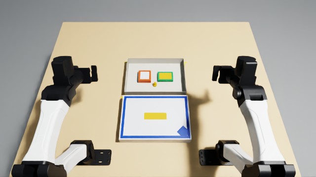
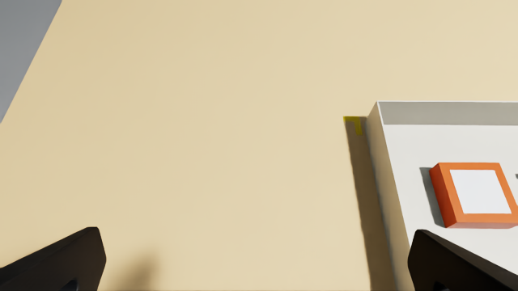
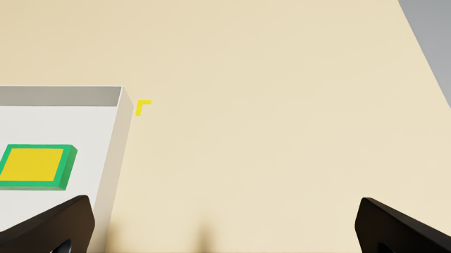
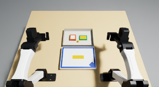
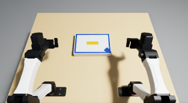

# Put the close-fitting lid on a packed board-game box with both hands, seating all four sides without wedging

Instruction: `Put the lid squarely onto the packed game box so it seats all the way down over the base without spilling the contents or moving the box off its marks.`

 

## Why it matters

The lid is wider than one gripper both ways (335.0 x 231.0 mm against a 94 mm jaw), a few degrees of tilt jams its 53 mm skirts on the base's rim, and only a level, square, two-arm lower seats it. Everyone has closed a two-piece board-game, jigsaw or shoe box.

## The box and its figures (`parts.py`)

Default preset `ravensburger_20847`: **Ravensburger Junior Labyrinth, article 20847** (EAN 4005556208470), on sale today; the maker's page gives its size and contents, every other figure its derivation.

| Figure | Constants | Current | Source |
|---|---|---|---|
| Closed box outside (= lid outside) | `LID_OUT_L, LID_OUT_W, LID_OUT_H` | 335.0 x 231.0 x 55.0 mm | maker's page ravensburger.de/de-DE/produkte/spiele/kinderspiele/junior-labyrinth-20847: "Schachtelgröße: 5,50 x 33,50 x 23,10 cm" |
| Base outer & wall | `BASE_L, BASE_W, BASE_H, BOARD_T` | 328.4 x 224.4 x 52.0 mm, 1.8 mm | estimate: maker's size - 2 x 1.8 mm walls - 2 x 1.5 mm play; wall between a game-box printer's "1.5mm" standard board and the "2mm" it advises for boxes over 8.5 x 8.5 in (printninja.com/two-piece-board-game-box) |
| Lid inner & play | `LID_IN_L, LID_IN_W, LID_IN_H, CLEAR_SIDE` | 331.4 x 227.4 x 53.2 mm (1.50 mm/side) | estimate: maker's size - 2 x 1.8 mm walls; skirt = 55.0 - 1.8 mm roof; play set so a level lid falls home and one tilted past about 3 deg catches; box makers give "0.5-1mm" (brandedboxes.us/box-styles/two-piece-boxes) and for game boxes "1.5 to 2 millimetres" (vivopak.com.au/custom-boxes/?p=347403) lid inside to base outside, per side or total not stated |
| Rim chamfer | `CHAMFER_IN, CHAMFER_H` | 0.8 / 3.0 mm | estimate: folded-paper lead-in at the skirt lip |
| Masses | `BASE_MASS, CONTENTS_MASS, LID_MASS` | `175, 320, 185 g` | estimate: shell area x 1.8 mm x 0.75 g/cm3 chipboard; contents from the maker's list "1 Spielplan, 4 Spielfiguren, 17 Gänge-Karten, 12 Geheimnis-Chips", board taken as its "Abmessung: 31,00 x 31,00 x 0,30 cm" |
| Frictions | `BENCH_FRICTION, BOARD_FRICTION` | 0.38, 0.42 | estimate: printed-chipboard slip angles ~21 deg on laminate, ~23 deg on itself |
| Wedge tilt | `WEDGE_TILT_DEG` | 2.80 deg (11.3 mm at 6 deg) | derived: `LID_IN_L cos t - LID_IN_H sin t = BASE_L` |

Play sensitivity (maker's outside held): the lid catches when tilted past 1.02 deg at 0.5 mm a side, 1.95 at 1.0, 2.80 at 1.5, 4.36 at 2.5, 5.07 at 3.0. Every case needs a level two-handed lower, and no rule depends on the play; step 1 below calipers it.

## First minutes of a real trial

Buy the named box (article 20847). (1) Caliper the base outside, the lid inside between skirt walls, the wall, and the closed height with the lid pressed fully home; `CLEAR_SIDE = (LID_IN - BASE_OUT)/2` (~4 min). (2) Weigh empty base, contents, and lid on a kitchen scale (~2 min). (3) Tilt the packed base with a protractor app until it slides (`tan theta` = `BENCH_FRICTION`); repeat lid-skirt-on-wall (`BOARD_FRICTION`) (~2 min). (4) Squeeze the lid's short walls at about 10 N (luggage scale) and see it still drops over the base; lower it tilted ~5 deg to feel where the skirt catches, then seat it level from opposite short ends and time one reset (~3 min; ~15 s). A differing figure replaces its constant in `parts.py`; checks, trials and demo re-run unchanged.

## Scene

Station bench in cm (`left` (0.0, +30.5), `right` (0.0, -30.5), `x` forward, `y` left, `TABLE_TOP = 74.75 cm`), fixed layout (`object_jitter = 0`).

| Object | As built | Source |
|---|---|---|
| `box_base` | Junior Labyrinth base: 5-wall body 328.4 x 224.4 x 52.0 mm (1.8 mm wall, 175 g) at (43.5, 0.0) cm +/- 1.0 mm (`yaw +/- 0.5 deg`), long axis `y` | maker + estimates |
| `tile_stack`, `card_deck`, `wood_pawn` | Stand-in blocks for the game's own contents (the real trial packs those): tile stack (70 x 70 x 24 mm, 160 g), token deck (58 x 86 x 18 mm, 126 g), pawn (24 x 34 mm, 34 g), >= 15.7 mm below the rim (495 g packed) | estimate |
| `box_lid` | Matching 5-wall lid: 331.4 x 227.4 x 53.2 mm inside (1.50 mm/side), 335.0 x 231.0 x 55.0 mm outside, 185 g; top-up at (18.5, 0.0) cm +/- 1.0 mm (`yaw +/- 0.5 deg`, 22.3 mm gap) | maker + estimates |
| `corner_marks` | Four yellow tape L-marks (30 x 30 x 0.4 mm, 8 mm wide, `solid = False`) 4.5 mm outside `box_base` (1.2 mm visible when closed) | bench tape |

## What stands in for what, and bilateral forces

Pure 240 Hz PhysX 5-wall compound contact (`contact_offset = 0.4 mm`), **zero welds, zero hidden joints, zero `mk.push` calls**. Three rigid blocks carry the contents' estimated 320 g (no separate board); contents only weigh the base down below the rim, clear of the skirts, so the lid's difficulty stays. Bevel boxes model wrapped skirt edges; `solid = False` bands model roof print. Not modelled: cardboard wall flex, trapped-air cushioning, artwork text.

| Stated interaction | Code | Body & reaction | Release / seating | Sim reading (`g3x15`, `g3x16`) |
|---|---|---|---|---|
| Opposed outer-wall carry (10.0 N/arm) | `demo.py`, `parts.py` | `box_lid` <-> left & right pads | `unclamp` (0 N) then 52 mm `+-y` retract | squeeze `[-9.35, +9.61] -> [0.59, -0.52] N`; max `lid<->base` force 0.61 N |
| Skirt guidance, wedging & seating | `task.py`, `parts.py` | `box_lid` <-> `box_base` (0.42) | 1.5 mm/side play; level lower seats to 55.0 mm | `tilted_wedge` catches rim 7.3 N, rests cocked at 80.4 mm (0.5); level seats 1.0 |
| Packed base on bench | `parts.py` (floor 0.38, `min`) | `box_base` <-> bench | slides above `0.38 x 4.86 N = 1.84 N` | 0.64 mm shift; `side_shove` slides it off the marks (0.0) |

## Rules, shortcuts, and readings

Score at trial end (`SCORE_OVER = "end"`); ends early once 1.0 holds `SUCCESS_HOLD_S = 3.5 s`. Run limit 1,200 steps (60 s at 20 Hz). Real-trial reading (ruler): 1.0 every corner within 1 mm of the closed height calipered on this box with the lid pressed fully home (first minutes, step 1; 55.0 mm in the simulator), lid level; 0.5 the lid rests on the box but a corner stands more than 1 mm proud.

- **Whole-trial 0.0 (video):** `box_base` tilts > 15.0 deg, any outer corner shifts > 25.0 mm, or a piece leaves `box_base`.
- **1.0 (1.0 s continuous):** seated, roof height only — every roof corner within 1.0 mm of the closed height calipered on this box with the lid pressed fully home (step 1; `CLOSED_H = 55.0 mm` in the simulator), tilt <= 2.0 deg, lid over the box; no centring test (the walls bound it to <= 1.5 mm). Plus pieces inside, grippers >= 30.0 mm clear, all bodies at rest (< 10 mm/s, < 0.10 rad/s), box on its marks.
- **0.5 (1.0 s at rest):** the lid rests ON the box but is not seated — over the box and pressing on it (>= 0.5 N contact), hands clear, tilt <= 15.0 deg, and the seated geometry fails (a corner proud); a lid cocked with one skirt inside the base counts.
- **0.0:** otherwise (idle, lid off the box or lying on the bench, moving, hands not clear, any fault).
- **Shortcuts:** 1-hand pinch impossible (`231.0, 335.0 > 94 mm`); sideways shove shifts the base > 25 mm (0.0); hands kept at the walls while cocked (0.0).

| Limit | Bench tool | Sim reading | Shown by |
|---|---|---|---|
| Base tilt <= 15 deg, shift <= 25 mm, pieces in | video, rule | 0.00 deg, 0.64 mm (`g3x16`); `side_shove` fault | `test_base_*`, `test_spilled_*`, `trials.py` |
| Every roof corner within 1.0 mm of the closed height calipered on this box, lid pressed fully home (55.0 mm in the simulator) (1.0) | ruler, caliper | corner dev 0.0 mm seated (`g3x16`); off-centre drop still 1.0 (`g3x15`) | `test_seated_is_roof_height_only`, `trials.py` |
| Lid on the box, corner proud (0.5) | ruler | `tilted_wedge` rests cocked at 80.4 mm, tilt 8.96 deg, 0.92 N contact (`g3x15`) | `test_cocked_*`, `trials.py` |
| Grippers >= 30 mm, rest `< 10 mm/s, 0.10 rad/s` | video | > 245 mm at `READY`, held 4.45 s (`g3x16`) | hold and speed tests |

## Checks, states, seed, nearest tasks

 

- **Visibility (320 x 176):** `box_lid` 74.0 x 47.1 px, `box_base` 63.3 x 37.9 px, >= 13.8 px clear of both `READY` arms; all four L-marks visible (views: `start_left_wrist_policy.png`, `start_right_wrist_policy.png`, `seated_top.png`).
- **Dry checks (`checks.py`, the named box and two smaller sizes):** IK <= 0.09 mm, joint margins >= 9.8 deg, push effort 0.16, TCP separation >= 212 mm, bench and skirt finger clearances >= 16.6 mm.
- **States set directly:** none in `demo.py` or `trials.py` (arm joint targets only); `test_game_box_lid.py` uses `mk.set_state`.
- **Seed:** one fixed layout (`object_jitter = 0`): nothing varies by seed; `--seed 0` gives trial seed 1415158438, which starts from this one layout like every seed.
- **Nearest tasks:** `MetaWorld+: Box close` drops a small lid onto a narrow box with one arm by a top handle; here the handleless lid needs both arms and a level lower within 2.8 deg.

## How to run

In the container from the repo root: `python mech/tasks/game_box_lid/checks.py && python -m pytest -q mech/tasks/game_box_lid/test_game_box_lid.py`; policy: `inspect-robots run --embodiment yam_arena --policy <policy> -E task=mech/tasks/game_box_lid/task.py -E object_jitter=0 -E control_hz=20 -E cam_width=320 -E cam_height=176 --instruction "<the instruction above>" --scorer task_score --max-steps 1200 --seed 0`; check demo & trials: `python mech/tasks/game_box_lid/demo.py <out_dir> --check` and `python mech/tasks/game_box_lid/trials.py <out_dir>`. Assets: none (primitives in `parts.py`).
