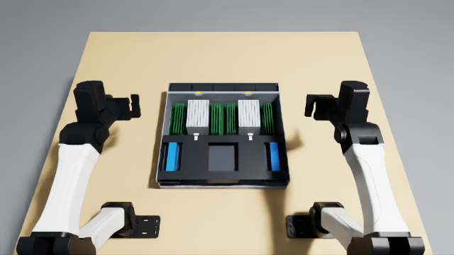
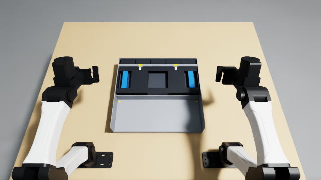

# Refit a 2U server's air shroud: tuck both front tabs under the fan-wall lip and seat it between the heatsinks

Instruction: `Seat the 2U server's air shroud flat in the motherboard bay with both front tabs engaged in the fan-wall slots, without touching the processor heatsinks or memory modules with the grippers, and let go.`

Files: `task.json`, `task.py` (rules, `score()`), `scene.py` (bodies), `parts.py` (figures, sources, 3.0 mm cut-list), `checks.py`, `trials.py`, `demo.py`, `test_server_shroud.py`, `mechkit.py`, `demo_kit.py`, `kit_extra.py`, `start_top.png`, `start_top_policy.png` (320 x 176), `start_left_wrist.png`, `start_right_wrist.png`, `end_top.png`, `end_top_policy.png`.



## What the task tests

- **Nose-down tab tuck before flat seating.** The bay between the 52.0 mm divider (`x = 30.75 cm`) and 83.0 mm fan bulkhead (`x = 47.30 cm`) is 165.5 mm long, whereas the 418.0 mm shroud with its two 10.0 mm front tabs is 170.0 mm long. Lowered flat, the front tabs strike the 83.0 mm lip (front roof 88.7 mm) or the rear floor strikes the 52.0 mm divider (rear roof 87.5 mm). Pitching ~18 deg nose-down foreshortens the shroud and aims both tabs beneath the lip into the two `22.0 x 7.5 mm` slots (`h = 70.5..78.0 mm`).
- **Tight bimanual lowering without fouling internals.** From `0.5`, both hands hinge the rear down from 18 deg to 0 deg so four CPU duct walls (`83.0 mm` inner spacing) glide either side of two `78.0 mm` LGA4677 heatsinks (`2.50 mm` per-side gap) without yawing into the fins or touching coolers or DDR5 RDIMMs with a gripper.
- **Pure rigid contact.** 240 Hz PhysX (`contact_offset = 0.6 mm`); zero welds, latches, `write_pose`, or scripted pushes in task or demo.

## Scene and 3.0 mm ABS cut-list

Positions in cm from the arm-base midpoint (`x` forward, `y` left); heights `h` above bay floor (`3.0 mm` over bench).

- **EIA-310-D 2U bay fixture** (`chassis`, fixed/clamped, `x = 12.5..52.5`, `y = -21.5..+21.5`, unshrunk `430.0 x 400.0 x 88.1 mm` outer, `424.0 mm` inner width, `3.0 mm` grey ABS): front deck `x = 12.8..30.45` (`h = 8.0 mm`, yellow ticks); divider `x = 30.45..30.75` (`h = 52.0 mm`); bay `x = 30.75..47.30` (`165.5 mm`); bulkhead `x = 47.30..47.60` (`h = 83.0 mm`, `11.0 mm` hood `x = 47.30..48.40` at `h = 78.0..83.0 mm`, two white-trimmed `22.0 x 7.5 mm` slots at `y = +/-9.5`, `h = 70.5..78.0 mm`).
- **Internals:** two **Dynatron S2** passive LGA4677 2U coolers (`118.0 x 78.0 x 64.0 mm`, `526.6 g`, on `8.0 mm` spacers at `x = 39.15, y = +/-9.5`, tops `h = 72.0 mm`); four 4-card **JEDEC MO-329 DDR5 RDIMM** banks (`133.35 x 31.25 x 3.80 mm` in `7.0 mm` rails at `x = 39.15`, inner `|y| = 1.6..4.3`, outer `|y| = 15.8..18.5`, tops `h = 38.25 mm`); five unpowered **ARCTIC S8038-7K** fans (`80.0 x 80.0 x 38.0 mm`, `146 g`) in `x = 48.4..52.2`.
- **2U black ABS shroud** (`shroud`, free `532.4 g`, 39 non-overlapping `3.0 mm` ABS plates in `parts.py`, `418.0 x 160.0 x 78.0 mm`, zero protrusion above `78.0 mm`): two CPU ducts (`y = +/-9.5`, `83.0 mm` inner width, `75.0 mm` ceiling); `46.0 mm` DIMM floors; two recessed **26.0 mm blue touchpoint U-bridges** (`y = +/-17.28`, `104.0 mm` long, flush at `78.0 mm`, `20.25 mm` slots each side); two white `10.0 x 16.0 x 3.0 mm` `+x` tabs (`y = +/-9.5`, `z = 72.0..75.0 mm`). Starts at `x = 21.0, y = 0.0` (`+/-2 mm, +/-2 deg`), tabs `+x`.
- **Grasp:** Left (`y = +17.28`) and right (`y = -17.28`) grippers lean 32 deg forward, open to `39.0 mm` (`<= 94 mm`) in the recessed slots, and pinch the `26.0 mm` bridges (`29.1 N/pad <= 40 N`, TCP `<= 141 mm` over bench, `345.5 mm` apart).

## Rules, bench tools, and shortcuts blocked

- **0 for good** (whole-trial rules, read from trial video; final photo confirms end state) if either gripper touches a processor heatsink or DDR5 module, or if the shroud falls outside the `430 x 400 mm` bay.
- **0.5:** both front tabs project `>= 5.0 mm` past `x = 47.30 cm` inside their `22.0 x 7.5 mm` slots beneath the `78.0 mm` roof (`centre within 5.0 mm of y = +/-95.0 mm`), while rear is unseated or hands are not clear.
- **1.0:** both tabs `>= 5.0 mm` in slots, all four outer roof corners at `78.0 +/- 1.5 mm` above bay floor (`3.5 to 6.5 mm` below `83.0 mm` lip), both hands `>= 30 mm` clear of shroud and internals, held `1.0 s` (`20` steps) with `<= 2.0 mm` drift (`SUCCESS_HOLD_S = 3.0 s`, arms at `READY`). Limit: `1,000` steps (`50 s` at `20 Hz`).
- **Bench tools:** `150 mm` steel rule (4-corner roof height, tab depth) and trial video.
- **Shortcuts blocked (`0.0`):** flat drop hits `83.0 mm` lip (`88.7 mm`, `0` tabs); `-x` shift hits `52.0 mm` divider (`87.5 mm`, `0` tabs); `< 2` tabs engaged scores `0.0`.
- **What stands in for what:** `3.0 mm` ABS bay fixture and `3.8 mm` FR4/acrylic `MO-329` blanks plus real `Dynatron S2` coolers and `ARCTIC S8038-7K` fans (`~$210`) replace an `$8,000` `SSI-EEB` 2U server while keeping exact `2.50 mm` heatsink and `22.0 x 7.5 mm` slot clearances.
- **States set directly:** none in `task.py`, `scene.py`, or `demo.py`; only `trials.py` sets initial poses.
- **Can it be seen:** in `start_top_policy.png` / `end_top_policy.png` (`320 x 176`) and `start_left_wrist.png` / `start_right_wrist.png`, blue bridges, white tabs, white-trimmed slots, silver coolers, and green RDIMMs read clearly; seated `78.0 mm` sits recessed below the `83.0 mm` lip.

## Key figures and their sources

| Figure | Value | Source |
|---|---|---|
| 1U & 2U bay height | 44.45 mm; 88.1 mm | standard: EIA-310-D `'44.45 millimetres (1.75 in) in height'`, `'h = 44.45n - 0.794'` (`n = 2`) [eia]; cf. Inter-Tech 2U-2129-N `'89 x 482 x 680mm'`, `'eATX, SSI EEB'` [it2u] |
| Dynatron S2 cooler (x2) | 118 x 78 x 64 mm, 526.6 g | maker PDF: `'Model Number: S2 ... Socket LGA 4677 ... Dimension: 118 x 78 x 64 mm'`, `'Weight: 526.6 g'` [s2pdf]; listing `'88885621'`, `'0,526 kg'` [s2page] |
| DDR5 RDIMM (KF560R32RB-16) | 133.35 x 31.25 mm | maker PDF: `'JEDEC standard electrical and mechanical specifications'`, `'PCB: Height 1.23" (31.25mm)'`, `'133.35'` mm [kpdf] |
| ARCTIC S8038-7K fan (x5) | 80 x 80 x 38 mm, 146 g | maker: `'Dimensions: 80 (L) x 80 (W) x 38 (H) mm'`, `'Weight: 146 g'` [arctic] |
| Bay `430 x 400`, `165.5` bay, `22 x 7.5` slots, shroud `418 x 160 x 78`, `26` bridges, `10 x 16 x 3` tabs, `2.50` gap (mm) | as in Scene | our fixture (`parts.py` 3.0 mm cut-list) |
| ABS density & shroud mass | 1,070 kg/m3; 532.4 g | estimate: midpoint of `'1.060-1.080 g/cm3'` [abs] times volume of 39 non-overlapping 3.0 mm plates |
| RDIMM thickness; friction; offset | 3.80 mm; 0.35; 0.6 mm | estimate: 1.27 mm MO-329 PCB + FBGA; dry thermoplastic 0.30-0.40; `< 1/4` of 2.50 mm gap |

`parts.FIGURES`: 7 maker, 2 standard, 0 hand-checked, 23 our fixture, 4 estimate (36 total).

## First minutes of a real trial

On the bought parts and cut ABS (~6 min): weigh shroud on a scale against 532 g (1 min); caliper-check `22.0 x 7.5 mm` slots, `165.5 mm` bay, `83.0 mm` ducts, and `2.50 mm` heatsink gap (2 min); tilt shroud on deck with a protractor app until it slides (`tan` = 0.35 friction, 1 min); confirm by hand that flat drop catches on the `83.0 mm` lip while ~18 deg nose-down tucks both tabs and seats to `78.0 mm` (2 min). A different reading replaces the estimate.

## Forces

| Force | Primitive | Acts on | Reaction on | Ends when |
|---|---|---|---|---|
| Weight (5.22 N) | PhysX gravity (`0.5324 kg`) | `shroud` | `chassis` or pads | continuous |
| Lip, slot & duct contact | 240 Hz PhysX (`0.6 mm` offset) | `shroud` | `chassis` | tabs withdraw `-x` |
| Pinch (29.1 N/pad) | YAM finger drives (`5,000 N/m`) | `shroud` bridges | `left_robot` & `right_robot` pads | jaws open to `39 mm` |

## Checks, differences, assets, and how to run

- **Checks:** `13/13` tests; `24` poses IK `<= 0.059 mm` (`dry <= 0.08 mm`), margin `>= 36.4 deg`, `z <= 140.8 mm`, TCPs `345.5 mm` apart, hulls `>= 169.2 mm` apart; 2 s idle `0.0 mm` / `0.0`; 6/6 PhysX trials (`flat_drop 0.0` at `88.7 mm`, `rear_shift 0.0` at `87.5 mm`, `tucked_hung_half 0.5` at `5.61/7.16 mm`, `tucked_and_seated_full 1.0` at `5.86 mm`, `heatsink_touch_zero 0.0`, `dropped_outside_zero 0.0`); `demo.py` reaches `1.0` (`414/1,000` steps = `20.7 s`, `0.5` at `10.85 s`, `1.0` at `17.75 s`, pitch `19.4 deg`, tabs `6.07/6.70 mm`, corners `78.0 mm`, `5.22 N`, pinch `29.1 N/pad`, arms at `READY`).
- **How it differs:** Unlike vertical pin-drop fan cages, four-skirt lids, or screwed brackets, this 418 mm shroud is longer with its front tabs (`170.0 mm`) than the bay (`165.5 mm`), requiring bimanual nose-down tab-hooking under a bulkhead lip before hinging flat through `2.5 mm` heatsink gaps.
- **Assets & sources:** Zero third-party meshes, textures, or sounds (`mechkit` primitives only). `[eia]` https://en.wikipedia.org/wiki/19-inch_rack ; `[it2u]` https://www.inter-tech.de/produktdetails-3/2U_2129-N.html ; `[s2pdf]` https://www.inter-tech.de/files/images/cooler/88885621/S2-Specs-Dynatron.pdf ; `[s2page]` https://www.inter-tech.de/4181/S-2.html ; `[kpdf]` https://www.kingston.com/datasheets/KF560R32RB-16.pdf ; `[arctic]` https://www.arctic.de/en/S8038-7K/ACFAN00288A ; `[abs]` https://en.wikipedia.org/wiki/Acrylonitrile_butadiene_styrene

Run: `scripts/rta check server_shroud`; `scripts/rta demo <id> mech/tasks/server_shroud` (`--check` no video). Limit 50 s (`1,000` steps); fixed layout (`--seed 0` gives seed `1415158438`, same start).

```bash
inspect-robots run --embodiment yam_arena --policy dream \
  -E task=mech/tasks/server_shroud/task.py -E object_jitter=0 -E control_hz=20 -E cam_width=320 -E cam_height=176 \
  --instruction "Seat the 2U server's air shroud flat in the motherboard bay with both front tabs engaged in the fan-wall slots, without touching the processor heatsinks or memory modules with the grippers, and let go." \
  --scorer task_score --max-steps 1000 --seed 0 --no-prompt --store-frames --log-dir <log dir>
```


