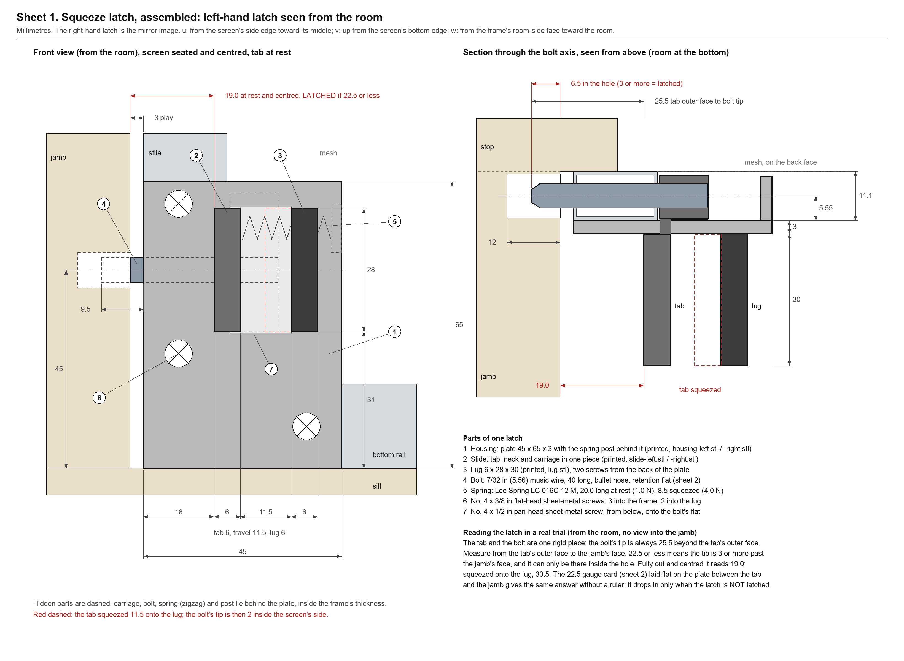

# Refit a window insect screen on its spring latches

A cropped section of a small window is fixed on the bench in front of the robot: the wall below it with its stool
(the inside sill board), two jambs, the head, and a stop that frames the opening from behind, with the glass beyond.
The window's aluminium insect screen leans back against the stool's front edge, as left after it was washed. The
robot is told:

> Refit the insect screen in the window, seated on all four sides and latched, then let go of it.

## Credit to the original task

This task takes up the idea of PR 1911, "Add refit-window-insect-screen task" (TK-9FXQU5, revised as TK-M74T74),
whose 48-hour hold after its second review lapsed without a revision. The scene, scoring and demo here are written
from scratch.

| Review point on PR 1911 | How this task answers it |
|---|---|
| TK-9FXQU5: "Reseating the insect screen requires aligning with all 4 sides, not just the bottom." | The screen seats against a stop that laps its edge by 10 mm on all four sides (sill, head and both jambs), between two jambs with 3 mm play a side. Credit needs every corner of its back face within 2 mm of the stop, its bottom on the sill, square and upright within 2 degrees, no side edge past a jamb, and both latch bolts in holes that line up only when the screen is in that place. |
| TK-M74T74: "Insect screens typically come with spring tabs that need squeezing during installation." | The screen has two spring latches, one near each bottom corner, each a tab that the hand squeezes toward a fixed lug (11.5 mm) to draw a bolt back from 9.5 mm proud of the screen's side to 2 mm inside it. With the bolts out the screen is 13 mm wider than the opening, so it cannot be put in without squeezing both tabs; once it is in place, releasing the tabs lets the bolts spring into the jambs' holes, and only that holds it. |

## Real objects (full size)

- **Screen:** 406 x 356 mm (16 x 14 in), for a small window, 0.22 kg (estimate). It is made from a bought kit,
  Prime-Line MP8239: roll-formed aluminium frame, 7/16 x 3/4 in profile (11.1 mm thick, 19.05 mm face), mill finish,
  square-cut plastic corners, vinyl spline and charcoal fibreglass mesh, cut down from 36 x 36 in.
- **Spring latches:** two, near the bottom corners, on the room-side face: a black printed housing plate (45 x 65 mm,
  3 mm thick) with a fixed lug and a sliding tab (each 30 mm proud, 6 mm thick, 28 mm tall, centred 45 mm above the
  bottom edge; the tab's travel 11.5 mm). The tab drives a steel bolt through the side rail (stile), 45 mm above the
  bottom edge. The bolt is 7/32 in (5.56 mm) wire, the diameter of common screen plunger bolts (for example
  Prime-Line PL 14660); it stands 9.5 mm (3/8 in) proud of the screen's side when out, the projection this design uses. The
  way it is worked (draw both bolts in toward the screen's middle, set the screen in, let go) is how a screen with
  spring plunger bolts is fitted. Unlike a sash whose spring latches are pushed home by the frame, here the bolts
  cannot be pushed in by the jamb face: both tabs must be held squeezed while the screen is carried in, then
  released in place. The spring is a stock part, Lee Spring LC 016C 12 M (0.263 N/mm): 1.0 N on the tab at rest
  and 4.0 N squeezed (the model: 250 N/m with 4 mm preload, 1.0 N and 3.9 N).
- **The latch is a custom part with a fabrication package.** No commercial screen latch was found that is worked
  by pinching a tab toward a fixed lug. Commercial plunger bolts (for example PL 14660) are drawn in by the cap on
  the bolt; this latch is drawn in by squeezing a tab toward a lug, the squeezing that the review of TK-M74T74
  pointed to. It keeps the plunger bolt's diameter and its place in the frame.
  [`fabrication/`](fabrication/README.md) supplies, for making the two latches and fitting them to the kit's
  frame: three dimensioned drawing sheets (SVG and PNG), STL files for
  the three printed parts of each latch and for a gauge card, a parts list with part numbers for the frame kit, the
  bolt wire and the spring, 17 numbered assembly and checking steps, and how each scoring condition is read on the
  real fixture. The dimensions the drawings share with the model (`fabrication/dimensions.json`) are checked
  against it by `near_misses.py`. The package is a design; no physical copy has been built yet.
- **Window section:** painted wood, fixed to the table. Wall below the window 70 mm tall, its top the stool
  (projecting 60 mm into the room) and the opening's sill. Jambs 40 mm wide (cropped), their inner faces 3 mm beyond
  the screen's sides, 45 mm deep in front of the seated screen. Head 366 mm above the sill (10 mm above the seated
  screen's top). Stop: 12 mm thick, lapping the screen by 10 mm on all four sides. Each jamb has a latch hole
  10 mm wide (front to back), 8 mm tall and 12 mm deep, centred on the seated screen's bolt. Glass behind the stop.
- **Crop:** the jambs and head are cropped to 40 mm out from the opening, the head 35 mm above it, and the section
  ends 10 mm behind the glass; the wall below runs 0.37 m either side and the rest of the wall is left out. Every part that touches the screen is full size.



Why the screen is this size: the latches sit low on the screen, so the robot's grip stays under 0.20 m above the
table (the pinch is 45 mm above the screen's bottom edge, 115 mm above the table with the screen seated). The
screen's width keeps its leaning start clear of the arms' ready pose in every lot.

## Run a trial

From this folder, in a shell with the yam_arena environment active:

```bash
inspect-robots run --embodiment yam_arena --policy dream \
  -E task=task.py -E object_jitter=0 -E control_hz=20 -E cam_width=320 -E cam_height=176 \
  --instruction "Refit the insect screen in the window, seated on all four sides and latched, then let go of it." \
  --scorer task_score --max-steps 700 --epochs 3 --store-frames --log-dir ~/yam-eval/insect-screen-dream
```

Trial k uses lot k mod 3 (A, B, C), and `task_score` reports the mean. `TASK_LOT=A|B|C` in front of the command
pins every trial to one lot. Submissions run with `-E object_jitter=0`.

The scripted demo is the task file's `demo()`, run by the stock scripted policy (`--policy yam_scripted`) with the
same arguments.

## Lots

| Lot | Screen's start |
|---|---|
| A | centred on y = 0 (the screenshot) |
| B | 25 mm to the robot's left |
| C | 25 mm to the robot's right |

The opening has 3 mm of play a side, so a replay of one lot's motions puts the screen 25 mm off in the others and it
cannot go in. The lots stop one fixed replay; a policy that memorised all three layouts is not ruled out.

## Scoring

Judged in the simulator after every control step.

**0 for the whole trial if at any step:** the hands or the screen could not be read (fail closed), or the screen
was dropped: its origin falling faster than 0.5 m/s while every hand point is at least 20 mm from it.

**Seated on all four sides:** every corner of the screen's back face within 2 mm of the stop's face; both bottom
corners from 1 mm below to 1.5 mm above the sill; within 2 degrees of upright; no side edge more than 0.5 mm past
a jamb's face.

**Latched:** a bolt's end inside its jamb hole and at least 3 mm past the jamb's face (6.5 mm when the screen is
centred and the latch fully out).

| Score | State |
|---|---|
| 1.0 | seated, both bolts latched |
| 0.5 | seated, one bolt latched |
| 0 | anything else, including seated with neither latched |

Credit also needs both hands let go and the scene still: every sampled point of both grippers and fingertips (each
collision hull's vertices and its faces sampled every 3 mm) more than 5 mm from the screen and its latches, and no
corner of the screen or latch moving more than 1 mm, for 1 s. Doing nothing or refusing scores 0. Trials are run on
lots A, B and C and averaged.

### Reading a real trial

The simulator reads the bolt directly. On the real fixture nothing inside the jamb needs to be seen: each tab and its
bolt are one rigid piece, with the bolt's end 25.5 mm beyond the tab's outer face (sheet 1 of the drawings), so the
bolt's reach is read from the tab.

| Condition | How it is read | Tool |
|---|---|---|
| A bolt is latched (its end 3 mm or more past the jamb's face, in the hole) | The distance from that tab's outer face to the jamb's inner face, taken at the tab's root on the latch plate, is 22.5 mm or less. The readings fall in separate bands: a tab that has sprung fully back reads 16.0 to 22.0 mm wherever the screen sits in its 6 mm of side play (19.0 mm centred); a bolt that missed its hole stops on the jamb's face and reads 25.5 mm or more; a tab squeezed onto the lug reads 27.5 mm or more. A reading between 22.0 and 25.5 mm means a tab stuck part-way, and the 22.5 mm limit decides it | Ruler or calipers from the room side; a square-on photo with the ruler or the card in view; or, as the go/no-go, the printed gauge card laid flat on the latch plate: the card's 22.5 mm width drops in between tab and jamb only when the bolt is not latched |
| Seated against the stop on all four sides (every back corner within 2 mm) | The screen's room-side face is 43 mm or more behind the jambs' room-side faces at each corner (45 mm hard against the stop); 40 mm or more where the 3 mm latch plate covers the corner | Depth rod or ruler; or the gauge card's 43 mm and 40 mm edges |
| Bottom on the sill (no corner more than 1.5 mm up) | A 1.5 mm feeler does not enter under either bottom corner | Feeler gauge, or the gauge card's 1.5 mm thickness |
| Upright within 2 degrees | Follows from the four corner depths and the sill reading | none |
| Let go and still for 1 s | Every part of both grippers more than 5 mm from the screen and its latches, and nothing moving, for 1 s | Video |
| Dropped at any time (0 for the trial) | The screen falls with both grippers 20 mm or more from it; the rule's 0.5 m/s is reached after about 13 mm of free fall | Video |

1.0: seated and both tabs read 22.5 mm or less. 0.5: seated and one tab does. 0: anything else. The rule that no
side edge is more than 0.5 mm past a jamb's face only guards against bodies passing through each other in the
simulator. `near_misses.py` checks, over the screen's whole side play and the tab's whole travel, that the 22.5 mm
reading and the simulator's 3 mm bolt depth give the same answer.

## Scripted demo

`demo()` plans from the published start layout of the current lot (where the screen stands) and the fixed window;
it reads nothing from the simulator. Each arm:

1. comes down in front of its latch with the fingertips leaned 40 degrees in toward the screen (`tilt.py`, so the
   wrist stays clear of the mesh), fingers open either side of the lug and tab;
2. squeezes the tab onto the lug (the bolt draws in) and keeps squeezing;
3. lifts the screen, stands it upright and carries it over the stool, centred on the opening;
4. moves it in between the jambs, back against the stop and down onto the sill;
5. opens its fingers part way (the tab springs out, the bolt goes into the jamb's hole), draws back and returns to
   the ready pose.

The demo uses `tilt.py` (a runtime patch of the stock grip rotation, in the task's own process; it affects only the
scripted demo, never Dream-1 or the scoring), `parts.py` (articulated parts: the screen's two latches are spring
sliders) and `lots.py` (per-trial layouts).

Results (L40S, `-E object_jitter=0`, 700 steps per lot, `--epochs 3`): the scripted demo scored 1.0 in each of lots
A, B and C (mean 1.0). In a lot A trace the tabs closed fully onto the lugs (bolts drawn in 11.5 mm), the screen went
in between the jambs with its bottom sliding on the sill, and after the fingers opened both bolts sprang out, 7.1 and
5.9 mm into their holes, with the screen 0.3 mm off the stop and 0.6 mm off centre; success held from step 490 (24.5 s).
Dream-1 scored 0 in each lot (mean 0), reaching the 700-step limit in all three trials.

This revision adds the fabrication package, the real-trial readings and offline checks for them. The scene, the
scorer and the demo (`task.py`, `parts.py`, `lots.py` and `tilt.py`) are unchanged from the first submission, so
no run was repeated: the results above and the videos and screenshot are those of the first submission.

## Files

| File | What |
|---|---|
| `task.py` | Scene, scoring, the trial record and the scripted demo |
| `near_misses.py` | Every tier's limits on both sides, unintended outcomes and the whole-trial rules, checked offline; also that the 22.5 mm real-trial reading agrees with the scorer and that the dimensions in `fabrication/dimensions.json` are the model's |
| `fabrication/` | The real fixture: build instructions and parts list (`README.md`), three drawing sheets, STL files, `dimensions.json`, and the script that writes them |
| `parts.py` | Kit for articulated parts (the screen's latches) |
| `lots.py` | Per-trial layouts |
| `tilt.py` | Tilted grips for the scripted demo |

## Real-world trials

Build the screen and latches from [`fabrication/README.md`](fabrication/README.md) and the window section from the
setup in `task.json`; clamp the window section to the table. Score each trial with the readings under "Reading a
real trial" above. The screen weighs about 0.22 kg; a dropped screen ends the trial with 0 and is not a hazard. The
latch springs are weak (about 4 N squeezed). The only pinch point is between the tab and the lug, as for a person.

## Runtime

A trial is 700 control steps (35 s); a three-lot run takes about 3 minutes plus about 1 minute for Isaac Sim to
start. The layout is fixed per lot (`-E object_jitter=0`); there are no seeds to choose.
