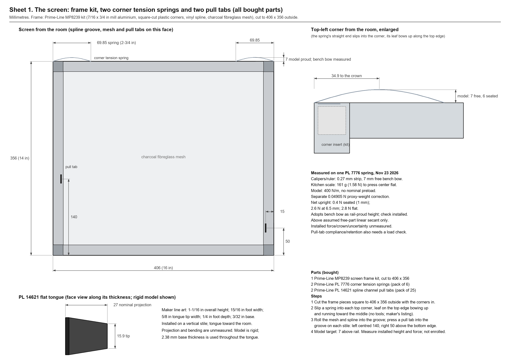

# Building the real fixture: the screen and the window section

The screen is made entirely from bought parts: a screen frame kit, two corner-mounted screen tension springs and two
spline pull tabs. The window section is a simple wooden mock-up with a sill channel and a head channel. All dimensions
are millimetres unless marked. Nothing in this folder has been built or fit-checked yet; the drawings,
`dimensions.json` and the model in `task.py` use the same numbers (`near_misses.py` checks `dimensions.json` against
the model).

## How the screen is held

This is the ordinary spring-loaded screen of a sliding or single-hung aluminium window. A flat bowed steel spring is
slipped into each top corner of the frame; its leaf lies along the top edge and bows up out of it. The head channel's
ceiling presses both leaves down a little when the screen is seated, which keeps the screen down in the sill channel.
To fit it, the top is pushed up into the head channel, pressing the springs nearly flat, the bottom is swung in over
the sill lip, and the screen is let down. To take it out, the same in reverse. The maker sells the springs for exactly
this: "used to help hold screens tightly in window channels" (Prime-Line's product page, below). The pull tabs are
sold to aid screen removal; they do not latch anything, and the springs are never held.

## Files

| File | What |
|---|---|
| `sheet-1-screen.svg` / `.png` | The screen from the room, spring and pull-tab positions, the top corner enlarged, the spring force estimate, parts list and steps |
| `sheet-2-window-section.svg` / `.png` | Section through the window section; the head and sill channels enlarged |
| `sheet-3-scoring.svg` / `.png` | Ruler/depth-rod positions, nominal upright readings, tilt correction and mandatory apex/visible-frame hold checks |
| `sheet-4-probe-access.svg` / `.png` | Straight room-side probe ports, blade witness depths and visible frame landmarks; physical access not yet enrolled |
| `dimensions.json` | The dimensions the drawings and the model share |
| `make_package.py` | Writes every drawing and dimension file above from one table (Pillow for the PNG files) |

## Parts list and real-trial cost

Prices below are USD listings opened on Nov 23, 2026, before tax and shipping.

| Qty | Part | Source and price |
|---|---|---|
| 1 kit | Screen frame kit: 7/16 x 3/4 in roll-formed aluminium, mill finish, four square-cut plastic corners, vinyl spline, charcoal fibreglass mesh; builds up to 36 x 36 in, cut down to 16 x 14 in | Prime-Line MP8239, $22.38: https://www.primelineparts.com/screen-frame-kit-7-16-in-x-3-4-in-x-36-in-x-36-in-aluminum-mill-1-kit/ |
| 2 (pack of 6) | Corner mount screen tension spring, heat-treated steel, 1/4 x 2-3/4 in; slips into the frame's corner, no tools | Prime-Line PL 7776, $7.70 a 6-pack from the maker: https://www.primelineparts.com/1-4-inch-slip-in-corner-springs-2-3-4-inch-spring-steel/ ; also $3.98 at https://sutherlands.com/products/item/1105352/prime-line-products-corner-flat-tension-spring (fits 5/16, 3/8 and 7/16 in frame) and $3.71 at https://www.hardwareworld.com/pn7nuev/PrimeLine-Corner-Mount-Screen-Tension-Spring-6pk |
| 2 (pack of 25) | Spline channel pull tab, black vinyl | Prime-Line PL 14621, $10.97 for 25: https://www.primelineparts.com/spline-channel-pull-tab-black-25-per-tub/ |
| about 2 m | Softwood or MDF strip and board for the window section (sheet 2), 6 mm clear acrylic for the glass, screws, glue, white paint, two clamps | Required stock; price not verified. The earlier unsupported $60 allowance is withdrawn. |
| 1 | ATO-DF-10 digital push-pull gauge, 10 N capacity, 0.01 N division, maker precision ±1%; use with a flat platen | ATO-FG-DF listing USD $124.23; choose 10 N model and confirm delivered/variant price: https://www.ato.com/push-pull-force-gauge-10n-500n . Listed delivery 8–12 days, not same-day supply. |

Verified screen-parts subtotal: USD $41.05 (one kit and the two packs). Screen parts plus the gauge listing give USD $165.28 before delivery/tax; no complete fixture/tool total is claimed. Wood, acrylic, fasteners and clamps remain unpriced. Ordinary workshop cutting/assembly tools are also required. This is an open reproducibility/budget limitation.

**Measured spring source and model.** One package-checked Prime-Line PL 7776 was measured Nov 23, 2026,
with digital calipers, a ruler and a kitchen scale (1 g display increments): **0.27 mm strip thickness, 7 mm free bow
height (table to top), and 161 g / 1.58 N to press the center flat**. The record is in [MEASUREMENTS.md](MEASUREMENTS.md).
These are measured values on one free spring.

The nominal model uses **400 N/m**, 1.77 times the measured free-part endpoint secant
`1.58 N / 0.007 m = 225.7 N/m`. A separate 0.04905 N drive offset compensates the artificial 5 g crown weight
upright; the constant rest target is -0.122625 mm, applied once after reset. No installed preload was measured;
the nominal model therefore has none. Upright static net axial resistance is `400*q` N with q in metres:
**0.4 N seated, 1.6 N at 4 mm, 2.6 N at 6.5 mm and 2.8 N flat**. Total elastic drive adds 0.04905 N.
At lean a the static axial estimate is `400*q + 0.04905*(1-cos(a))`; it is not a contact-force sensor or a
ceiling-normal measurement. In frictionless static equilibrium with a compressed slider, ceiling-normal reaction
would be axial resistance divided by cos(a), not multiplied by it. Damping and joint-stop reactions are separate.
The equal internal reaction acts on crown and frame; neither gravity nor episode poses are modified.

For every q in 0–7 mm, the nominal linear net resistance is at least the **assumed free-part linear secant**
`225.7*q`; full-compression resistance 2.8 N also exceeds the measured 1.58 N endpoint. This states exactly what
the bound covers. It **does not prove an upper bound on an unknown nonlinear installed curve**, preload or gauge
uncertainty, and it does not assume that a free-part secant measures installed stiffness. Enrol both springs in
their actual corner keys across the executed loading/unloading path. Reject or remodel any assembly whose
measured resistance plus uncertainty exceeds the model, or whose proud height/travel differs materially.

Engineering cross-check, not another measurement: use the measured 0.27 mm thickness with nominal 69.85 x 6.35 mm
strip dimensions and 200 GPa modulus. A simply supported center-load strip gives
`delta = P L^3/(48 E I)`, `I = b t^3/12`, hence `k = 4 E b t^3/L^3`, approximately 293 N/m.
ABB's [design-data sheet, beam formula table](https://library.e.abb.com/public/0def9a2314cf4e939bdb6a65e35abd05/TDS000768.pdf?x-sign=zA%2FEhQ4IBoH8rl2IGP1QYa5kJZDb4g5Dd25iwHN%2B9%2F%2FvGjxlNuVIH4SoI5XPKLmi)
provides that beam relation and steel modulus 29,500,000 psi (about 203 GPa, rounded here to 200).
The simulation uses the stated conservative envelope, not this straight-strip boundary-condition estimate.

**Required spring enrolment.** Install each spring in the actual MP8239 top corner with the actual corner key.
Photograph its orientation with a ruler. Measure free crown and crown-center position in mm with calipers. Hold the
frame fixed and lower a parallel flat platen onto one crown at a time using a compression force gauge; record the
force in N at 0, 1, 2, 3, 4, 5, 6 and 7 mm displacement where travel permits, including loading and unloading, three
cycles. Record tool model, resolution, zero and mounting. For the proposed ATO-DF-10 use at least ±0.10 N uncertainty (conservatively interpreting its ±1% precision as full-scale) until a calibration certificate establishes a smaller value. Do not force a real leaf past flat. Record any installed
preload. The model is eligible only if its **net resisting contact load**, after accounting for proxy crown mass/gravity and over all executed poses/rates, is at least the measured installed resistance plus instrument uncertainty throughout the actual installation path, and its crown/travel match the fixture; otherwise replace the
named constants SPRING_CROWN/SPRING_K/SPRING_PRELOAD_N and model any consequential preload/nonlinearity, regenerate drawings
and rerun demo/Dream evidence. No real assembly has passed this check.

**Mass.** The approximately 406 x 356 mm outside dimensions give a 1.524 m outside perimeter. The 0.22 kg complete
assembly mass remains an uncalibrated estimate. Weigh the finished screen including mesh, corners, springs and tabs;
record grams and scale model before physical trials.

## Assembly

Screen

1. Cut the kit's frame stock square so that, with the four corner inserts pressed in, the frame measures 406 mm wide
   and 356 mm tall outside (approximately 16 x 14 in). Assemble it with the spline groove on the room-side face.
2. Slip a PL 7776 spring into each top corner (no tools), its leaf lying on the top edge and bowing up, running from
   the corner toward the middle. Measure crown height and center and perform the spring enrolment above; 7 mm/35 mm are model assumptions, not maker acceptance specifications.
3. Roll the mesh and spline into the groove. Press a pull tab into the groove on each stile, standing out from the
   face: on the left stile (seen from the room) centred 140 mm above the bottom edge, on the right stile 50 mm. The
   tabs are at different heights to resist rotation in the rigid-tab model; actual loaded carrying/rotation must pass the tab enrolment below.
4. Weigh the finished screen (the model uses 0.22 kg, an estimate).

Window section (sheets 2 and 4)

Build the head in layers: leave two 16 mm wide gaps in its 3 mm high layer from 359 to 362 mm above the sill floor, extending the complete 40.2 mm passage depth. Fit a flat continuous roof at 362 mm; do not cut the bearing ceiling or stop. This avoids drilling a blind bent probe path. Verify each finished straight passage before assembly/trials.

5. Wall below: a block 70 mm tall whose top is the stool, projecting 60 mm in front of the jambs' room-side faces,
   and continuing behind as the sill channel's floor.
6. Interior jambs (the reveal) 40 mm wide (cropped), their inner faces 40 mm out from the screen's sides, from the
   room-side face back to 12.6 mm in front of the stop; behind that the window frame's sides, 412 mm apart (3 mm
   play each side of the screen).
7. Stop: 12 mm thick, its face 56.1 mm behind the jambs' room-side faces, lapping the screen by 10 mm on all four
   sides. Glass (or clear acrylic) 24 mm behind the stop's face.
8. Sill lip: a strip 6 mm front to back and 4 mm tall across the opening, its back face 12.6 mm in front of the
   stop's face (a 12.6 mm sill channel: the 11.1 mm frame plus 1.5 mm).
9. Head: its underside, in front of the channel, 350 mm above the sill channel's floor; its back face 15.9 mm in
   front of the stop's face (an approximately 5/8 in head channel, cut with a 5/8 in router bit or built from strips); the
   channel's ceiling 362 mm above the floor (6 mm above the seated screen's top). Paint the head's front 10 mm and
   the sill lip in a contrasting colour.

Checks before trials

10. Seat the screen by hand: push its top up into the head channel, swing the bottom in over the sill lip and let it
    down. Both springs press it down onto the sill channel's floor. Seated and pushed back against the stop, the
    screen's room-side face is 45 mm behind the jambs' faces, 15.05 mm of the bottom rail shows above the sill lip
    and 13.05 mm of the top rail below the head lip. Lift it 4 mm or more (6 mm presses the springs flat) and the
    bottom swings out over the lip; let go of it lifted and it drops back in.

## Reading a trial on the real fixture

| What the scoring asks | Reading | Tool |
|---|---|---|
| Seated against the stop (every back corner within 1.5 mm of it) | The screen's room-side face is 43.5 mm or more behind the jambs' room-side faces at each corner | Depth rod or ruler |
| Down in the sill channel (bottom corners within 1.5 mm of the floor) | At both ends, the bottom rail shows 16.55 mm or less above the sill lip (15.05 mm when down) | Ruler; or a square-on photo with a ruler in view |
| Upright within 2 degrees | Follows from the corner depths and the sill reading | none |
| Top captured in the head channel (the 0.5 tier) | At both ends, the top rail shows 16.05 mm or less below the head lip (13.05 mm when seated) | Ruler |
| Both spring apices bearing (required for 1.0) | Each apex line has some width point within 0.10 mm of ceiling, positive compression and positive model axial resistance; installed load and physical access still require enrolment | Straight 0.10 mm feeler through dimensioned head ports, near/far witness marks and known-open controls; sheet 4 |
| Let go and still for 1 s | Every sampled gripper point more than 5 mm clear; four rigid-frame back corners stay within 1 mm Euclidean displacement from hold start | Calibrated room-side views of visible frame landmarks; accuracy unvalidated |
| Dropped at any time (0 for the trial) | Origin falls faster than 0.5 m/s between adjacent 0.05 s observations while all sampled hand points are at least 20 mm clear | Video sampled at 20 Hz; this is not a continuous peak-speed test |

The rail readings in the table are nominal upright readings. For a tilted screen use the projected rail width and
thickness in a photo with a ruler (sheet 3); do not use 16.05 mm alone. For width-axis lean a, the lowest top rise is
`19.05 cos(a) - 11.1 max(0, sin(a)) - exposed front-rail height` in mm. Check both ends and account for roll. A depth
rod checks the top edge's position behind the lip. Real fixture parts cannot pass through the stop, ceiling or floor;
the scorer rejects such end states with small contact allowances.

## Differences from the simulated model

- Each spring's bowed leaf is modelled as a 6.35 x 20 mm pad at its crown that slides down into the rail against a
  400 N/m spring, 7 mm travel, no nominal preload and 0.04905 N proxy-weight correction (installed preload/curve unmeasured); the real leaf bends and its
  force need not be linear. The pad's moving mass is an uncalibrated 5 g solver proxy.
- The PL 14621 pull tab is a flat tapered tongue, not a loop. Maker's line art gives overall height 1-1/16 in
  (27.0 mm), spline foot width 15/16 in (23.8 mm), tongue tip width 5/8 in (15.9 mm), foot depth 1/4 in
  (6.35 mm), and base thickness 3/32 in (2.38 mm). The model uses those nominal dimensions as a rigid tapered
  tongue projecting 27 mm toward the room from each stile; the 2.38 mm thickness is used throughout. Its installed
  projection and bending compliance have not been measured. Perform the tab enrolment below before trials.
- The model's frame face is 19.05 mm (3/4 in). Frame and mesh are one rigid body.

## Pull-tab checks before trials

The PL 14621 maker [line art](https://cdn11.bigcommerce.com/s-4ytrikgs1c/images/stencil/3840w/products/15237/28321/PL-14621d__69615.1745437950.jpg?compression=lossy)
specifies overall part dimensions, not an installed projection, tongue stiffness, load capacity or spline retention.
The rigid 27 mm projection and uniform 2.38 mm thickness are model assumptions. Fit both tabs under the specified
spline in the actual frame at the drawn heights. Photograph each installed tab from front and side beside a ruler;
record projection, tip/foot thickness and angle in mm/degrees with calipers. With the intended gripper pads, measure
slip, bending and any spline lift while carrying the actual screen and applying the measured maximum installation
load, then execute the full tilt/top-in/lift/swing/lower path three times. Record applied loads in N and tab/pad
motion in mm on video; reject this rigid-grip model if folding, withdrawal or slip prevents that path or changes its
contact geometry materially. Model consequential compliance/slip and repeat all evidence; do not reinforce the
vinyl or substitute custom rigid handles. No assembly has passed this check and no photographs are available.

Both hands carry the screen by the tabs; neither presses a spring. The demo's split of roles (left held, right swinging the bottom) is a scripted choice, not shown to be required.

After the swing, both complete the 2 s high segment before lowering.

## Room-side spring check and visible-frame hold

Why the springs bear when the screen is seated: each spring stands 7 mm above the top rail, and a seated screen's top is 6 mm below the channel ceiling, so a seated screen with both springs in place presses both. The feeler check below confirms this directly at each spring.

These are the specified fixture dimensions; verify installed spring height during the fit check. The probe ports are scoring aids in the test fixture.

The room-side head has two straight horizontal probe ports, **16 mm wide × 3 mm high**, centered 168.075 mm
either side of the opening center. Their top is flush with the channel ceiling, 362 mm above the sill floor;
bottom is 359 mm. Each passage goes from the jamb/head room face to the head-channel front face, **40.2 mm long**.
The ceiling over the spring, the stop and all channel dimensions stay intact. Sheet 4 shows the path.

Use a straight **0.10 mm thick blade, at most 13 mm wide and at least 80 mm long**; no bent tip or turn through the
4.8 mm frame slot. Center it on the spring's longitudinal apex and keep its upper face against the port roof/ceiling.
From the room face, the nominal spring near/far width edges are **47.375/53.725 mm** deep. Treat those as nominal reference edges. Use **45 mm and 55 mm as the near/far probe witness depths**: this interval encloses the model leaf for all tested full-score frame offsets, rather than assuming the frame is exactly against the stop. The blade must reach the 45 mm witness freely; failure before that is an invalid access check,
not spring contact. Then attempt passage to the 55 mm witness, stopping at first resistance without forcing the leaf.
If it passes over the complete apex line, that spring has at least a blade-thickness gap and fails the full-score
contact test. Refusal *within* the witnessed 45–55 mm interval, after a passed access control and with no other object in that interval, establishes that
some point of the apex line is within 0.10 mm of the ceiling. Test both springs after the uninterrupted hold.
Reject a probe reading if video shows the frame moving more than 1 mm during it; repeat the hold after withdrawing.
Blade thickness/flatness and measurement uncertainty must be recorded; an ambiguous boundary reading is not a pass.

Before trials, with the screen removed prove that the blade traverses each entire port and channel without binding.
Next hold the real leaf at a **known 0.30 mm open apex gap** using a measured temporary setup, photograph it and
demonstrate passage to the far witness on both sides. Remove all temporary supports before a trial. Also test an
independently confirmed touching leaf. A blocked tunnel, misplaced blade or friction against a port wall is not
evidence of contact. These controls are specified, **not performed**; no fixture, blade-access photograph or actual
nondisturbance reading is available.

The simulator tests the same leaf-apex definition: two width-edge points at the longitudinal center of each moving
crown, at least one within the unchanged 0.10 mm ceiling tolerance, both inside the head channel, positive compression
and positive calculated static axial resistance. It no longer demands four corners of a rectangular pad all touch:
those corners have no physical counterpart on a bowed leaf. The full pad is still checked for penetration beyond
0.10 mm, and link/travel/finite-state guards remain. A clear/nonbearing spring allows at most the legitimate 0.5
top-capture tier. This definition change corrects the physical landmark; the earlier demo already scored 1.0, and no
numeric tolerance was widened to rescue it.

For the 1 s hold, score the **four frame back corners**, reconstructed from the known rigid profile and the four
visible front frame/mesh intersections (19.05 mm in from each outside edge), not eight fictional pad corners.
Use two fixed calibrated room-side oblique cameras, both viewing all four intersections, a scale and a stationary
fixture reference. Reconstruct the rigid frame pose at 20 Hz and transform its four back corners; each corner's
Euclidean displacement from its own hold-start position must remain at most 1 mm throughout the second.
The >5 mm hands-clear gate and whole-trial sampled-drop rule are unchanged. Verify reconstruction with known 1 mm
translations in depth and across the image before trials; report uncertainty and reject occluded/ambiguous records.
The visible landmarks remove the hidden-crown view requirement; camera calibration/accuracy still needs physical
validation. A single front photo cannot establish depth motion. No real full-score trial is certified by drawings.

Reconstruction method: calibrate and undistort both fixed cameras using a measured calibration target, with world axes tied to the fixture. Triangulate the four corresponding visible frame/mesh intersections from the two projection matrices at each 0.05 s sample. Fit the known four local front coordinates to those four 3D points with a rigid least-squares rotation/translation (SVD fit), then transform the four back-face corners by that pose. Check the reconstructed outer frame against independent ruler/depth-rod readings. Reject missing correspondences, camera movement or frame flex inconsistent with that rigid fit. Measure reconstruction/displacement uncertainty using independent known translations; a real pass requires the measured displacement plus its uncertainty to remain within 1 mm, not just a nominal pixel estimate. No actual calibration or accuracy result is supplied.

