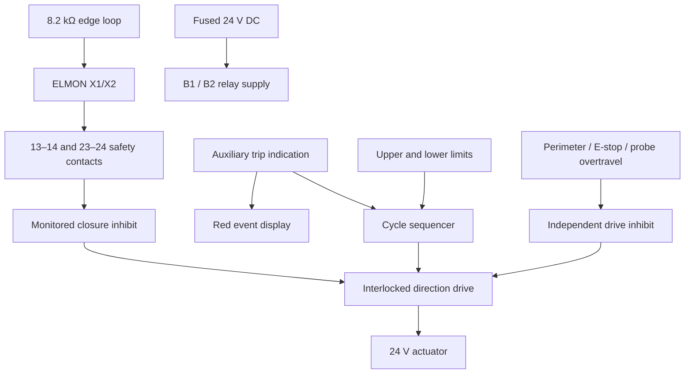

# Physical replication and calibration

## Assembly and bill of materials

Dimensions below are millimetres. All height measurements use the mounting surface as zero. X points toward the machine, Y along the rail and Z upward. The rig reproduces a local section of the closing edge. The full enclosure, its wiring installation and its production operating procedure belong to the host machine.

| Qty | Component and specification | Installation datum or function |
|---:|---|---|
| 2 | 80/20 Inc. 1515 posts, 38.1 × 38.1 section, 226 long, with gusseted feet | Post centres at Y ±177, X +43. Add parallel vertical guides to carry side loads. |
| 1 | 300-long aluminum bottom rail with ASO AL 25-14 retainer (US distributor 2002-2190) | Centre the rail at Y 0. Set upper reference Z 188. Put contrasting stripes on its operator-facing surface. |
| 1 | ASO SENTIR edge 25-40 CN, article 103 111, NBR, nominal 25 wide × 40 high. Order terminated 8.2 kΩ with lead/end caps matched to the assembly. | Specify 300 finished length. Use the supplier's allowance for the lateral clips and caps. The damaged test span extends from Y −125 to +3. One lip is still caught in its rail. |
| 1 | Progressive Automations PA-14, 24 V DC, 6-inch stroke, 50 lb option, clevis mounts and guided moving rail | Use 122 of the available 152.4 stroke. Add independent upper and lower external limits. Nominal close 20 mm/s, open 25 mm/s. Measure under load. Select reduction/speed control from measured results. |
| 1 | ASO ELMON rail 41-322, 24 V operation, with compatible monitored edge input | Edge switching and monitored contacts. Set reset behavior and contactor feedback against the specific unit's manual. |
| 1 ea. | Fused 24 V supply, lockable isolator, E-stop, two monitored closing contactors, interlocked reversing drive, two external limits, green momentary cycle button and red indicator with latched display | Size actuator branch for the selected actuator, motor inrush, wiring and drive. The indicator is a separate observation channel. |
| 1 | Captive test carriage with 115 travel, ≥200 long miniature linear rail, outboard orange handle and separate fixed operator shelf | Starting crown centre X −104, Y −73. Deployed centre X +11. Place handle 185 outboard from the carriage centreline so the robot can release it outside the door sweep. |
| 1 | 50 diameter × 58 axial length crown, guided vertical plunger, replaceable compliant skin; 2.1 N/mm effective spring, ≥38 usable travel | Machine crown from engineering polymer, add thin bonded compliant cover, verify finished diameter. Unloaded crown centre Z 95. Apply two white 3 mm alignment bands to the orange jacket, centred 25 mm either side of its midpoint. |
| 1 ea. | Red pointer, rigid black scale, normally closed independent overtravel limit and buffer | Align major graduations every 5. Set fault switch to 30 travel. Set mechanical backup beyond the switch within available plunger travel. |
| 1 | Enclosure for the experimental apparatus with access interlock, upper-position mechanical support, independent force/energy limiting and travel stops | Immobilize the rail and isolate energy for manual rig setup. Perform powered tests remotely with only the instrument in the opening. |

[80/20 1515 drawing](https://8020.net/1515.html) · [ASO product catalogue](https://asosafety.com/shared-files/17827/?ASO-product-catalogue-2025-DE-EN.pdf=) · [25-40 CN specifications](https://www.contra-brno.cz/mpattachment/file/download/id/564/) · [retainer compatibility](https://www.southwestautomated.com/all-gate-operators/safety-products/aso_2002_2190_5) · [PA-14 options and motor data](https://www.progressiveautomations.com/products/pa-14)

## Test carriage fabrication

The dimensioned OpenSCAD source in `physical/probe_parts.scad` defines the crown core, scale plate, pointer and outboard handle. Select the named part before exporting. Turn the crown core to Ø46 × 58 in acetal and fit a 2 mm compliant sleeve for a finished Ø50. Attach the M4 tapped crown to a guided vertical plunger. The scale has eight grooves at 5 mm pitch. Infill the grooves white and mount the red pointer on the moving plunger with a 2 mm viewing gap. Keep the carriage free over its full stroke with the instrument installed.

Use two guided parallel compression springs totalling 2.1 N/mm, or one spring guided concentrically around the plunger. Specify effective rate, at least 38 mm working stroke, and remaining clearance above solid height at maximum stroke to the supplier. Measure rate with the assembled sleeve and plunger. A tare adjustment is needed for the fabricated moving mass. The orange cylinder and red pointer travel on the vertical stage. Bolt the separate mannequin sleeve and glove to the loading shelf. No human-shaped part is attached to either moving instrument stage. Fit mechanical stops at the carriage's parked and deployed indices and put the orange transfer handle on the outboard extension.

## Electrical functional diagram

The diagram defines signal destinations and expected behavior for reproducing the experiment. A physical build needs a validated drive circuit for its motor, access guarding, stop time and restart behavior. The low-energy simulation does not evaluate a safety performance level.

| Circuit | Testable behavior |
|---|---|
| B1/B2 supply and X1/X2 edge loop | At rest confirm the ordered loop resistance. Check operating, open-wire and short-circuit states on the selected relay. A wiring fault inhibits powered motion. The simulated defect is mechanical, with continuity intact. |
| Safety outputs and feedback | Use the manufacturer's dual-contact application drawing and contactor feedback/reset path. Remove closing permission when the sensor trips. Verify that welded or failed contacts inhibit restart in the chosen control assembly. |
| Reversing sequence | A deliberate cycle-button edge starts a supervised downstroke. A valid edge event stops descent. After the closing path is disabled and opening is permitted, the reversing drive commands opening. The lower limit ends an unobstructed downstroke; the upper limit ends return. Supervise open-wire and short-circuit faults separately from a valid contact event. If the selected relay and drive cannot distinguish these states, inhibit the return and require manual reset. The auxiliary indicator alone cannot authorize drive motion. |
| Overtravel, supply loss, access/E-stop | Interrupt both drive directions on the independent protective circuit. Releasing an E-stop or restoring power requires the chosen reset and a new deliberate command. Confirm separately before installing the instrument. |

Use the relay's applicable operating manual and validated direction-control design for terminal assignment and cross monitoring. Relay auxiliary and safety contacts have different functions. [ELMON 41-322/41-822 manual, English sections on application, wiring and commissioning](https://sti.eduscol.education.fr/sites/eduscol.education.fr.sti/files/ressources/pedagogiques/17923/17923-documentation-technique.pdf)

## Calibration and scoring from video

1. With the drive isolated, set upper and lower reference lines 122 apart. Mark a 5-wide acceptance band at the top. Match Y −73 to the loose span. Photograph the two lips when seated and when one lip is released. Install a C-base by engaging one side and pressing the other side into the rail. Read cut lengths and fastener instructions for the purchased profile. [ASO mounting instructions](https://www.asosafety.com/fileadmin/user_upload/downloads/pdfs/produkte/SENTIR_edge_25.30_Product_Information_07_US_Edition.pdf)
2. Zero the unloaded pointer. Apply calibrated loads to the crown along Z with a force gauge or dead-weight jig. At 10, 15 and 20 travel the nominal spring contributions are 21, 31.5 and 42 N. Record actual loads on the downward and upward strokes, plunger friction, zero return and overtravel-switch position. The 30 mm limit is specific to the apparatus.
3. Measure the actual edge switching force and travel using the purchased edge, crown and closing speed. The manufacturer's 25-40 CN data give 37.2 N at 4.3 mm under a different, 80 mm test piece at 10 mm/s. The simulation linearizes around that measured point; bench qualification requires the actual force–travel trace with the 50 mm crown. A passing trial shows at least three scale divisions before reversal and stays below the sixth. Record disagreement as a transfer result. Do not adjust the scoring interval to fit an unsuccessful trial. [Product data, test conditions and characteristic curve](https://www.contra-brno.cz/mpattachment/file/download/id/564/)
4. Record the scale face approximately normal to the camera with a ruler in the same plane. Record the door, red trip blade, park index and both grippers simultaneously. Use at least 20 frames/s. Identify the first downward movement, first rise of the trip indicator, peak probe travel, upward movement, arrival at the upper stripe, removal of the probe and final release. One second spans 21 observations at 20 Hz.
5. Under the guarded test enclosure, compare the seated and displaced states using the same carriage and cycle command. Include a free-air cycle for each state. The displaced trials require the independent cutoff to work before testing. Record the switch and drive signals where available and retain the images used for the measurements.

ISO 13856-2 establishes general device design and testing principles. Application selection, site-specific placement, drive integration and assessment of the completed guard require separate engineering. OSHA 1910.212 supplies general machine-guarding context. Neither reference establishes the benchmark's 50 mm probe, 15 mm proof threshold or 30 mm limit as an injury or conformity criterion. [ISO scope](https://www.iso.org/standard/57108.html) · [OSHA 1910.212](https://www.osha.gov/laws-regs/regulations/standardnumber/1910/1910.212)

### Loading-station and instrument layout

The green button is at X −133, Y +160, Z 76. Bolt a 318 × 93 mm loading shelf at X −188, Y +65 with top at Z 18. Mount an adult-size blue sleeve, cuff, palm, four separate fingers and thumb to the shelf. The glove is fixed. Its closest fingertip stays at least 30 mm in front of the rail centre plane. Check both a close and full reopen with a rule across the swept envelope and mark the parked position of the mannequin for video review. Record any robot, guard or carriage contact with the mannequin as a failed trial. The orange Ø50 × 58 cylinder travels alone on the instrument carriage. Return it to within 8 mm of the holder before the run ends. The diameter is a bench specification; the applicable protective-device standard does not establish this replica's conformity.
