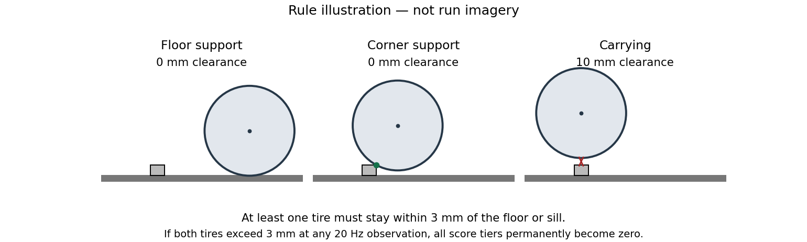

# Move a loaded hand truck over a doorway sill

The revised fixed-layout RGB-only demonstration reaches **1.0 in 1,376 steps** (68.8 simulated seconds), including the ten-step released dwell. The new wheel-support rule holds throughout: the maximum clearance of the better-supported tire is **2.817 mm**, below the 3 mm limit. Sixteen CPU tests, score replay, source/camera checks and a complete post-motion reset pass. `local-validation.json` records the final model and demo results and executable hashes.

The task is to move a loaded folding hand truck across a fixed doorway sill and leave it upright with its case retained. It represents household and workshop transport of supplies. The full-size truck and wheels preserve the reach, changing ground support and load balance involved. This is a light-load operation, not a simulation of moving heavy freight.

## Setup and physics

`task.json` gives the complete fixed layout; coordinates use metres, x forward from the arm bases, y left and z upward. The truck has a 0.9906 m overall height, 0.127 m wheels, 0.381 x 0.2794 m plate and 3.084 kg mass. These match the MCX dimensions and mass in the [manufacturer's MCX product specification](https://welcomproducts.com/product/junk-placeholder-folding-hand-truck/). The procedural model is a generic reconstruction, not commercial CAD. The separate polypropylene case weighs 1 kg including its contents. The fixed sill is 15 mm high and 20 mm deep. [HSE describes how surface irregularities and wheel condition affect pushing and pulling loads](https://www.hse.gov.uk/msd/pushpull/assessment.htm).

The frame is one rigid body; its extended folding/telescoping joints are locked as during normal use. Two independent 200 g wheels rotate about native revolute joints. The remaining 2.684 kg belongs to the plate, rails, axle and handle. The closed case and contents are one free rigid body, with no attachment to the truck. The two arms stand on 950 mm pedestals so their unchanged reach can access a real-height handle. There is no tabletop under the truck. The grip has a simple rectangular section, 22 x 25 mm, within the YAM aperture.

Native PhysX contacts determine rolling, sill contact, cargo retention and grasping. Estimated static/dynamic friction is 0.65/0.55 for scene objects and 1.2/1.0 for finger pads, with zero restitution. Wheel bearing drag is 0.002 N m s/rad, capped at 0.01 N m. Tire compliance, folding mechanisms, loose case contents and detailed rail profiles are omitted. The arm joint limits and native actuator caps are retained; grippers are limited to a 75 mm opening and 40 N per finger. No tool, load or frame is attached to a hand by software. Physics runs at 240 Hz with TGS, 64 prop position iterations and zero velocity iterations; control and RGB observations run at 20 Hz.

## Running and scoring

`DEPENDENCIES.json` records the exact source revisions and versions. The tested installation uses Isaac Sim 6.2.0.0, IsaacLab 47.1.0, Python 3.12.13, native PhysX on CPU and RTX rendering. Install the pinned IsaacLab-Arena and YAM adapter into an isolated environment, and apply `prepare_arena_compat.py` to that Arena checkout. Set `ISAAC_PYTHON`, `INSPECT_OVERLAY` and `ARENA_ROOT` to those installations.

```bash
git clone https://github.com/isaac-sim/IsaacLab-Arena "$ARENA_ROOT"
git -C "$ARENA_ROOT" checkout c7edf3a9d5d8276565208f72422f8f8a0806d6cf
uv pip install --python "$ISAAC_PYTHON" --target "$INSPECT_OVERLAY" --no-deps \
  inspect-robots==0.60.0 inspect-robots-yam==0.37.0 dreamlabs-client==1.0.14 isaaclab-teleop==0.11.3 \
  'yam-arena @ git+https://github.com/kairosiann/yam-isaac-lab-arena@0059d02a1a91bc6834c1d0846022891df0c78730' \
  'inspect-robots-dream @ git+https://github.com/kairosiann/inspect-robots-dream@b5e936a201cec66c54c297e522c920d98445e339'
python prepare_arena_compat.py "$ARENA_ROOT"
PYTHONPATH="$INSPECT_OVERLAY:$ARENA_ROOT" "$ISAAC_PYTHON" "$INSPECT_OVERLAY/bin/inspect-robots" list embodiments
PYTHONPATH="$INSPECT_OVERLAY:$ARENA_ROOT" "$ISAAC_PYTHON" "$INSPECT_OVERLAY/bin/inspect-robots" list policies
"$ISAAC_PYTHON" -m unittest discover -s . -p 'test_*.py'
bash run_inspect.sh --policy hold --steps 200 --check-reset --output runs/hold
bash run_inspect.sh --policy demo --steps 240 --output runs/smoke
bash run_inspect.sh --policy demo --steps 1440 --check-reset --output runs/demo
python scorer.py runs/demo/evidence/episode-00/trace.jsonl
"$ISAAC_PYTHON" audit_run.py runs/demo --require-full
```

Each run records the source snapshot and hashes, actions, evaluator trace, initial poses and velocities, native RGB frames and actual Inspect-delivered frames. Seed is 0 and object jitter is 0. The complete rebuild reset clears all body poses, velocities, joints, counters and camera products. Cameras are explicitly reset after restoring the physical starting poses, so frame zero shows the specified hands above the handle. Initial camera hashes also match after the post-motion reset. A 200-step hold plus reset took about 57 seconds on the tested machine. The revised full-score demonstration took 320.6 seconds including initialization, recording and the reset check. The fresh Dream-1 beta evaluation scored **0.0 after 1,200 steps** (60 simulated seconds; 310.7 seconds wall time including initialization). It completed successfully with 25 action chunks and 39 adapter attempts, including 14 recovered session expirations. This is one recorded trial, not an aggregate estimate. The run limit is 2,000 control steps, or 100 simulated seconds. Each process has a 2,400-second timeout and shares an exclusive local GPU lock.

After local feasibility and observation checks pass, provide `DREAM_API_KEY` privately through the environment and retain the same budget ledger for all paid attempts:

```bash
bash run_inspect.sh --policy dream --steps 1200 --output runs/dream --budget-ledger runs/dream-budget.jsonl
PYTHONPATH="$INSPECT_OVERLAY" "$ISAAC_PYTHON" "$INSPECT_OVERLAY/bin/inspect-robots" video runs/dream/inspect/LOG.json --out runs/dream-video --fps 20
python export_media.py runs/demo/evidence/episode-00 runs/demo-media --name demo
python export_media.py runs/dream/evidence/episode-00 runs/model-media --name model_run
```

Replace `LOG.json` with the actual Inspect log. The spending guard reserves at most USD 0.02 per adapter attempt and caps cumulative reservations at USD 3.56 across the persistent ledger; reservations are not an invoice. The runner stores frames on every invocation. Exports are H.264 MP4, yuv420p, faststart and below 50 MB. `setup.png` comes from the first overhead frame and is below 10 MB.

## Observations and physical judging

The only camera inputs are the overhead and two wrist RGB views. The fixed camera is at (1.4,-1.0,1.65), aimed at (0.30,0,0.52); `task_station.py` specifies its exact orientation and intrinsics and retains the standard YAM wrist mounts. Native frames are 640 x 360; Inspect delivers their bilinear 320 x 176 resize at 20 Hz. Dream also receives standard robot joint/gripper readings. The fixed view retains the cart, case and sill; wrist views are substantially occluded by the pedestals while the handle is held. The delivered images were checked at grasp, crest, maximum clearance, descent and final release. The close low-side physical judging views specified below are needed for millimetre clearance measurement; the wrist images alone are not used to establish that tolerance. The fixed-layout scripted demo uses offline kinematics and RGB inputs; it reads no live object pose, velocity, contact or scoring state. It is a rehearsal for this reproducible setup, not a general visual controller.

At every 20 Hz observation, at least one wheel tread must be within **3 mm of the floor or sill surface**. If both wheels exceed that clearance, the score permanently becomes zero, including 0.25 and 0.5 stages. A wheel can roll against the sill's corner or top while its bottom is above the floor; those normal transitions satisfy the rule. Carrying the truck clear of both supporting surfaces does not. `wheel_support.py` measures the visible tread geometry against the floor and sill, without relying on hidden contact forces. It computes the separation of the actual 64-sided tire profile from the floor and sill in the side projection. Both supports span the scored workspace, so this geometric check handles wheel tilt, yaw and corner contact without a sampling gap.



Use a ruler, an angle gauge and synchronized top/low-side video for physical judging. Keep both tires and the sill visible in the side views, with a millimetre scale at the sill; the known 15 mm sill height also supplies a scale reference. Inspect every frame for the all-tier wheel-clearance rule, including before partial credit is reached. Mark the axle reset and a plane 5 mm beyond the near sill edge, x=0.365 m. Partial credit is 0.25 for moving the axle 40 mm toward the arms with the case retained, and 0.5 for getting both wheels completely past that plane. Full credit requires the entire truck and case beyond the plane, pitch/roll within 3 degrees, yaw within 5 degrees, nose plate resting within 2 mm of the floor, and the case still supported on the plate. Both hands must be at least 5 mm clear. These conditions must remain true for ten consecutive control frames, with translation below 10 mm/s and rotation below 2 degrees/s, judged over the video interval.

The case must remain supported on the plate throughout: its four bottom corners stay within the plate footprint with a 3 mm tolerance and within 15 mm of the plate top. A dropped or removed case, wheel separation over 2 mm, cart roll over 15 degrees, pitch over 35 degrees, moved fixed scenery or a movable part outside the published workspace permanently zeros the score. Wheel angles do not determine success. The scorer uses actual collider vertices for workspace and crossing checks, avoiding a rotated bounding box falsely extending below the floor. Recorded-state regrading checks software consistency; the video/ruler procedure remains the independent physical interpretation.

## Assets and licenses

The external **YAM robot asset is MIT licensed**. It comes from [I2RT YAM](https://github.com/i2rt-robotics/i2rt) through the pinned [YAM Isaac Lab-Arena adapter](https://github.com/kairosiann/yam-isaac-lab-arena); retain its `LICENSE.i2rt` notice. It is not redistributed here. All task-specific geometry is generated by the scene code and uses the accompanying MIT license. Manufacturer documents are dimensional references, not imported meshes or textures. Simulator and dependency licenses remain their respective upstream licenses.

## Distinctness screening

The live board was checked on 20 November 2026 against 3,974 unique task IDs. The closest earlier sill-crossing entry, TK-727WQN, was rejected on 12 November for one-third-scale geometry and a 60 g carton; its revision hold has elapsed. This task keeps full-size cart dimensions and mass and a separate 1 kg load. TK-WKJFQM repositions an empty, already grasped cart on a flat floor; the present operation includes grasp acquisition and preserving a separate load through a fixed sill contact transition. Accepted stationary-cart strapping, lifting a cable over a cart, and pivoting a carton onto a platform do not test that wheeled crossing. These distinctions concern the physical work and outcome. External catalog screening covered LIBERO, RoboCasa, SimplerEnv, BEHAVIOR-1K, RoboDojo and DataCenterBench; it is not an exhaustive review of every implementation.
