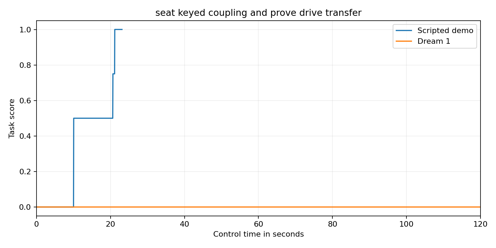

Seat a keyed coupling and prove drive transfer

Robot drive maintenance requires a coupling to transmit rotation after assembly. This task checks both seating over unequal drive dogs and actual motion of the lower rotor. Placing the coupling on top without transferring rotation cannot earn full credit.

Setup

Use the official bimanual YAM station. The tabletop is at z 747.5 mm. x points forward. y points left. z points up. All props are rigid PA12 polymer prototypes. All joint positions start at zero. The hub fixture has an initial outer envelope of 100 by 315 by 43 mm. Its authored root is at x 280 mm and y -30 mm and z 747.5 mm. Its initial yaw is 0.0 radians. Its root is fixed to the tabletop. The coupling has an initial outer envelope of 90 by 70 by 82 mm. Its authored root is at x 170 mm and y -200 mm and z 747.5 mm. Its initial yaw is 0.0 radians. Its mass is 0.085 kg. Its root is free to move. The inventory lists each collider and body mass and joint anchor and travel limit. Local solid positions are measured from the named body root. Outer envelope sizes describe the reset pose.

Scoring

Score zero if the coupling ever goes more than 4 mm below the table. A seated coupling must have its centre within 4 mm on each axis of x 280 mm and y negative 30 mm and z 811.5 mm. Tilt must be below 5 degrees. Coupling yaw relative to the measured lower rotor angle must be below 5 degrees. Seating earns 0.5. Engagement is recorded only when seating occurs while the lower rotor is within 5 degrees of zero. After engagement the rotor must turn beyond 80 degrees and remain below 100 degrees while the coupling stays seated. Translation must be below 8 mm per second and rotation below 0.1 radians per second. This earns 0.75. Both measured grippers open beyond 35 mm raises this to 1.0. Full success must hold for 2 seconds. Engagement clears if the coupling is no longer seated. Rotor travel of 5 degrees or more without continuous engagement scores zero. Direct contact between any robot body and the lower rotor at that angle also scores zero. Robot contact is sampled each physics step with a separation threshold of 1 mm. All other outcomes score zero.

Fidelity

Rigid PA12 polymer props with unequal drive dogs and matching pockets. A passive rotor has angular damping 0.005 with no drive force. Contact transmits rotation. The fixture is fixed. Robot contact with the lower rotor is checked through a PhysX contact view each physics step. A 1 mm separation threshold counts as contact. This is an unpowered prototype. No wear or deformation is modelled.

Run and reset

Use the official YAM launchable. Run from this task folder. Install the runtime in the simulator environment. Install the policy adapter included in this folder. It uses inspect_robots_dream with the current Dream SDK bridge. Install dreamlabs version 1.0.37 and dreamlabs-client version 1.1.3. Start policy/current_api_bridge.py in a separate process with DREAM_BRIDGE_PORT=8241 and JAX_PLATFORMS=cpu. The Dream credential stays outside the repository.

```bash
source /data/IsaacLab-Arena/yam.env
uv pip install --python /data/IsaacLab-Arena/.venv/bin/python --no-deps -e runtime -e policy
TASK_INSTRUCTION=$(python -c 'import json; print(json.load(open("task.json"))["instruction"])')
OPENBLAS_NUM_THREADS=1 OMP_NUM_THREADS=1 MKL_NUM_THREADS=1 inspect-robots run \
  --embodiment yam_articulated --policy dream_current \
  -P server_url=http://127.0.0.1:8241 \
  -E task="$PWD/task.py" -E object_jitter=0 -E control_hz=20 \
  -E cam_width=1280 -E cam_height=720 --seed 0 --epochs 1 \
  --instruction "$TASK_INSTRUCTION" --scorer task_score --max-steps 2400 \
  --store-frames --log-dir runs/model
```

For the demo use yam_scripted and omit the server_url option. Use a separate log directory. Each trial starts from a fresh reset. Restore every object to the starting pose in scene_inventory.json and every joint to zero. Nothing is consumed. Use one epoch with seed 0 and object_jitter=0.

The current model and demo receipts are stored in validation.json. Scores come from the measured task scorer. A failed API trial is not scored as a valid zero. Model session expiry fails the trial. The model has no scripted fallback. Native camera videos are 1280 by 720 at 20 frames per second. Every recording includes its initial frame and every control step. Render a completed log with inspect-robots video LOG.json.

The source hashes and video checksums describe the evaluated revision. This is an unpowered simulation prototype. The mechanical idea is unchanged from the earlier submission. The revision strengthens the safety gates and supplies separate genuine model evidence.

Recorded score trace



The blue curve is the separate scripted demo. The orange curve is the genuine Dream 1 run. The underlying sampled values are in evidence/score_series.json.
