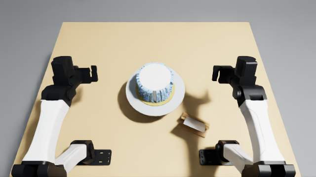
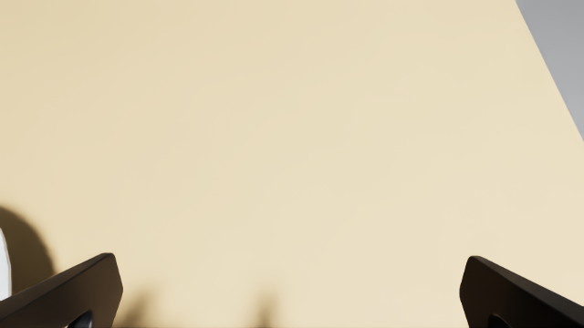
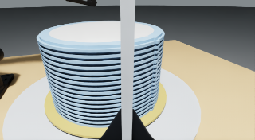
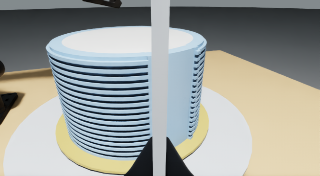
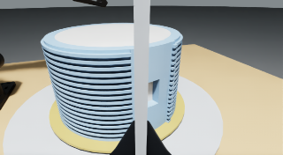

# Smooth the icing on a cake's side with a smoother, on a turntable

Instruction given to the policy: `Smooth the icing on the side of the cake with the smoother, then put the smoother back in its block.`

Files: `task.py` (scene, the icing and its rules, score), `mechkit.py` (the mechanism kit the task file imports), `demo.py` (the scripted full-score run, and a check of the take alone), `demo_kit.py` (the runner behind the scripted runs), `trials.py` (checks in the simulator: rest and the first pictures, what drawing the icing costs, the hand's hold of the smoother under known loads and the cue pictures), `reach.py` (the arms' reach for every pose the job needs, without the simulator), `test_cake_smooth.py` (the rule tests, without the simulator), `start_top.png` and `start_right_wrist.png` (the first pictures of a trial), `cue_ridged.png`, `cue_smoothed.png`, `cue_bare.png` (the right wrist camera's picture as a policy gets it), `README.md`.

 

The first pictures of a trial, both arms in their ready pose (rest trial `b2k57`). Top camera: the cake on the stand, its ridged blue side with the comb's scar and the dummy's white top. Right of the cake, towards the right arm, the smoother leans in its block: the plate's face shows, with the block's back at both its ends. Right wrist camera: the bench in front of the right arm, the fingertips, and the edge of the stand's top at the left margin.

## What the task tests

- The icing is a named material, Wilton Creamy White Decorator Icing at medium consistency. The side starts combed: ridges 3 mm high and 6 mm apart running round, the comb's take-off scar down the side and an out-of-round, the last two from the seed.
- The smoother's straight edge cuts the ridges down to itself and fills the troughs from the roll of icing it carries. Where it leaves the icing, the roll stays as a mark; where it goes closer than 1 mm to the foam, the foam shows.
- The cut pushes back on the smoother, along the turning and outward, and on the cake as hard the other way. A hand that gives way, or one held so that the drag swings the edge into the icing, shows in the icing.
- Full credit asks for an even side. At 16 ticks round the cake board, a 1.2 mm feeler leaf must go in nowhere under a steel rule held upright against the side, nor under an arc gauge of the side's radius laid round it at three heights. Only cutting and filling give that. An edge that stands off the icing leaves the ridges, 3 mm deep under the rule, and such a side scores nothing (rule test `test_the_combed_start_fails_clearly`).
- The score is read from the icing at the end of the trial. The smoother's place counts only as "back in its block", and how the cake was turned not at all.
- The instruction names the job and the tool. It does not say to hold the smoother still, to turn the stand, how deep to set the edge or how to take it off.

## Scene

Bench coordinates in metres: x forward from the line through the two arm bases, y left from the midline, z up from the bench top. The arms' bases are at (0, -0.305) and (0, +0.305).

| Part | Size, mass | Where |
|---|---|---|
| Revolving cake stand (Ateco 612): aluminium top on a cast-iron base | top 305 mm across (12 in), 3 mm thick (the maker: 1/8 in, 3.2 mm), its upper face 127 mm over the bench (5 in); base: a foot 170 mm across and 25 mm high (a) and a column; 3.0 kg in all (2.4 kg base, 0.6 kg top (a)) | its axis at (0.30, 0.00); the base stands loose on its non-slip pad; the top turns freely, no pegs, no stops |
| Cake: a decorator's foam practice round on a cake board on a non-slip mat | dummy 152 mm across, 102 mm high, white; board 203 mm across, 3 mm (a), with 16 ticks on its rim every 22.5 degrees (not drawn in the simulation); mat 1.5 mm (a); about 450 g with board and icing (a) | on the stand's top, its axis on the stand's axis (within 0.5 mm at the reset) |
| Icing (Wilton Creamy White Decorator Icing, 4 lb tub, medium consistency, at 20 to 22 C, tinted pale blue with gel food colour) | 243 g on the side only (our estimate; 218 to 268 g at the reset), turned once under the coarse teeth of a decorating comb held in a jig: ridges running round, 6 mm apart, their tops 82.5 mm from the stand's axis (6.5 mm of icing) and their valleys 3 mm deeper; the comb's take-off scar 2 mm high down the side; out of round by up to 1 mm high to low, so the ridge tops stay within 0.5 mm of 82.5 mm | on the dummy's side; the scar's place and the out-of-round are drawn from the seed |
| Smoother (Ateco 1447 decorating comb and icing smoother) | aluminium plate 6 x 3.8 in, 152 x 96.5 mm (the maker's catalogue; retailers list 6 x 4 in), 2 mm thick (a), 79 g by its size (a); three toothed edges and one straight edge, a long one (a) | standing on a short edge in the block's groove, its foot against the lip, leaning on the back's top edge about 36 degrees from upright, its straight edge facing 65 degrees from +x |
| Beech block (a): a small stand with a grooved foot and a leaning back, the kind sold as a plate or tablet stand | beech, glued, 180 g (0.7 g/cm3). Base 140 x 80 x 15 mm. On it, tilted 30 degrees about its long side, a cradle 140 x 22 x 8 mm; on the cradle's rear edge a back 140 x 10 x 39 mm, and on its front edge a lip 140 x 6 x 4 mm. Between back and lip runs a channel 6 mm wide and 4 mm deep, its floor lined with a non-slip strip. The cradle's rear lower edge rests on the base, with the channel's floor 27.5 mm over the bench where the plate stands; the base reaches 25 mm in front of the channel's line and 55 mm behind it, under the lean | at (0.17, -0.20), loose on the bench, its channel along 65 degrees from +x |

Both grippers' fingers wear clean, snug, powder-free nitrile finger cots over their pads, so that icing cannot reach the shared rig. All four cots are replaced after every trial. Two smoothers are used in turn, so a clean one stands in the block at every start; the used one is washed and dried, and the beech stand, the turntable and the bench are wiped clean of any stray icing.

Sizes marked (a) are assumed; the others are the makers' or retailers' figures for the named parts. Which edge of the Ateco 1447 is straight is not given by its maker ("three toothed edges, one straight"); a long one is assumed. If the bought comb's straight edge is a short one, any straight scraper 152 mm long does the same job. Which toothed edge is the coarse one is not given either; the jig's comb needs coarse teeth along at least the side's 102 mm (section "Repeating the real trial").

The icing is tinted and the dummy is white so that bare foam shows white on blue, to a camera and to a bench photo, and the ridges throw a visible shade. The block leans the plate 30 degrees: upright, the plate showed the top camera, which hangs almost over the block, only its 2 mm top edge. The first block had a slot 3 mm wide and 18 mm deep with a jaw on either side, like a knife block's. The pinched plate drawn out of it jammed, which a 2 mm plate in that slot does past 3.2 degrees off the slot's line with friction 0.5, and the block came away on it, in three recordings (`b2k20`, `b2k28`, `b2k30`). In front of the plate the stand has only the lip, 4 mm high. A back 30 mm high could not hold the plate: leaning on the back's top edge, its foot needs friction 0.89 to stay; it slid to the lip and the stand, then 50 mm wide, tipped over onto its back before anything moved (rest trial `b2k37`). The back is now 39 mm high, as high as it can be: the closing fingertip passes 2.8 mm over its top edge (44 mm: 2.0 mm into it, `b2k40`). There the foot needs friction 0.55, and the non-slip strip gives 1.0. The plate is built where it comes to rest, foot against the lip and face on the back's top edge, 1 mm up the groove; it drops 1.3 mm into place in the first step and stands still (rest trial `b2k55`).

Hidden state, from the seed: the scar's place round the cake and the out-of-round (its size up to 1 mm and its phase). With seed 0 the scar is in column 81 of 96 (306 degrees round from +x) and the out-of-round is 0.27 mm high to low. A model run started with `--seed 0` under the harness gets the trial seed 1415158438: the scar in column 76 (287 degrees) and an out-of-round of 0.04 mm. The reference script reads neither. It sets the edge from the icing's mean thickness, so it can do the job from every start the seed can draw.

## The icing

Every number the simulation uses for the icing, in one table (`MATERIAL` in `task.py`), and the icing's density, used only for the reset's weighing. All are assumed (a) or our estimate; how each is measured on the bought icing is given below the table.

| Quantity | Value | What it is |
|---|---|---|
| Mean thickness | 5 mm | as the jig leaves it: half way between the ridge tops (6.5 mm) and valleys (3.5 mm) |
| Ridges | 6 mm apart, 3 mm high to low | the comb's coarse teeth (their sizes are not given by the maker); in the field: the rows alternate 1.5 mm over and under the mean |
| Scar | 2 mm high, one column (5.3 mm) wide, up the whole side | the comb's take-off where the turn under the jig ends |
| Out of round | up to 1 mm high to low, once round | the cake within 0.5 mm of the stand's axis under the jig: the ridge tops within the reset's 0.5 mm |
| Cut push | 0.4 N per mm of depth per 100 mm of edge (4 kPa on the cut section), along the icing's motion past the edge and outward, each | what the icing pushes the edge with while it is cut; in the range of buttercream |
| Roll | 10 mm2 in section, along each row the edge works | the icing the edge carries along its length and fills from; what it cuts beyond that stays on the blade's face, out of the work |
| Fill reach | 2 mm | a cell this far under the edge is still filled from the roll |
| Bare | under 1 mm of icing | the foam shows through |
| Density | 0.96 g/cm3 (our estimate) | from the maker's yield, "One 4 lb. tub yields 8 cups of frosting": 1,814 g in 1,893 cm3; used only for the reset's weighing |

How to measure them (kitchen tests, on the bought icing at 20 to 22 C):

- Cut push: spread the icing 5 mm thick on a flat board standing on a kitchen scale, and comb it. Hold the smoother's straight edge across the ridges in a guide that sets it 1 mm under their tops, the plate upright, and draw it 100 mm along at about 2 cm/s with a spring scale pulling. The spring scale reads the push along the motion; the kitchen scale's rise reads the push outward (off the icing). Each, divided by the depth and the length of edge in the icing, gives the figure; repeat at 2 and 3 mm.
- Roll: after one turn of a combed cake under the edge, photograph the bead on the blade's face from its end with a ruler beside it, and measure its section.
- Fill reach: comb a board, then draw the edge over it at heights 1, 2 and 3 mm over the troughs; the highest at which the troughs still fill is the reach.
- Ridges, scar, out of round, thickness: the depth pin through the icing at four ticks, on a ridge top and in a valley, after the jig has combed it (section "Repeating the real trial").
- Bare: icing thinned to 0.5, 1 and 1.5 mm on the foam, photographed in the bench's light: the thinnest at which no foam shows.

## How the side is measured

The side is read where and as a bench reads it, in this order. The simulator reads the same places in the same way (`upright_gaps`, `round_gaps`, `thickness_readings` in `task.py`).

- **Ticks**: 16 ticks on the cake board's rim, every 22.5 degrees (drawn with a printed 16-point ring; not drawn in the simulation). In the simulator the ticks stand at the middles of columns 0, 6, ..., 90.
- **Up**: a steel rule (150 mm) held upright against the side at each tick, its end on the board. A cylinder's side is straight upright, so the rule sits against an even side along its length. It rests on the side's two outermost points; the gaps under it are read from 9 mm over the board to 9 mm under the top (the band: rows 3 to 30 of the field's 34, counted from 0 as in task.py).
- **Round**: an arc gauge, 3 mm clear cast acrylic, laser-cut: a plate 70 x 40 mm, along one 70 mm side a concave arc of radius 81 mm across a 50 mm chord (the dummy's 76 mm and 5 mm of icing; 3.95 mm deep at its middle), the 10 mm shoulders either side cut back 3 mm so that only the arc touches, and a 30 x 20 mm tab on the opposite side to hold it by. It lies level on a beech spacer, 40 x 15 mm in section and 24, 48 or 75 mm high (+/- 0.2 mm), standing on the board's bare rim outside the icing with its 40 mm along the rim (the rim is 19 mm wide outside the start's ridge tops: the board's 101.5 mm radius less 82.5 mm), its arc against the side, centred on each tick in turn: 3 heights x 16 ticks. Its 3 mm edge covers one 3 mm row of the simulator's field: rows 8, 16 and 25, counted from 0 as in task.py (24 to 27, 48 to 51 and 75 to 78 mm over the board). It spans 36 degrees of the side, so its placements 22.5 degrees apart overlap by 13.5 degrees.
- **The reading**: a 1.2 mm leaf of a feeler gauge set (Vogel 411009, 21 leaves 0.05 to 2.00 mm, 100 mm long, with a 1.20 mm and a 1.50 mm leaf). If the rule or the gauge rocks, it is rocked onto each side in turn. The leaf is tried only between the two points it rests on, never under an end that a bulge has lifted off the side. In the simulator, a point's gap is its depth under the outer convex hull of the points under the rule or the gauge, which is where an edge pressed onto them comes to rest.
- **Thickness, last**: a depth gauge with a thin pin (a tyre tread depth gauge read to 0.1 mm (a)), pushed through the icing to the foam at the 16 ticks at 50 mm over the board, after every other reading.
- **Time**: reading a trial takes about 6 minutes (our estimate): 16 rule placements, 48 gauge placements and 16 pins, about 4 s each, and the photos.

Marks between readings, read both ways:

1. No place between the reading positions goes unchecked: the gauge's placements round overlap, a mark that falls between two upright lines is crossed by the gauge at the three heights, and the take-off mark counts as the one allowed flaw at 0.75 if it is the only one.
2. The measuring itself leaves no mark that changes a later reading: the rule and the gauge are laid on lightly and lifted straight off, the feeler goes in only where a gap is seen, and the thickness pins are read last.

Why an arc gauge round the side: a 50 mm straightedge laid round a side of radius 81 mm stands 3.95 mm off it at its middle, more than three times the 1.2 mm limit. The gauge's 81 mm against the finished side's radius (76 mm and the icing left, 79 to 81 mm for full credit) is negligible: on a radius of 79 mm the gauge touches at its middle and its ends stand 0.10 mm off (0.05 mm on 80 mm), a stand-off a feeler never reads, since it is outside the gauge's one touch. The simulator takes the gauge's curve as the side's and reads the gaps on the thickness round the side.

What the simulator resolves: its field has cells 5.3 mm wide round and 3 mm high. A mark one cell wide reads 0.79 to 0.89 of its height under the gauge, depending on where it falls between two ticks, as a gauge rocked onto a narrow ridge does: rule test `test_a_wide_raised_band_is_not_one_mark_and_the_scar_is_read_apart`. A side bulged round or up its height rocks the gauge and leaves no gap between its touches. An even slope (a side cut with the edge tilted) or a side out of round leaves none either, where the earlier reading, high minus low within 50 mm, failed them: rule test `test_a_smooth_slope_or_an_out_of_round_side_passes_where_high_to_low_would_not`.

## Repeating the real trial

The start, a side iced and combed into ridges, is made with a comb held in a jig while the stand turns once under it, so it repeats from trial to trial. The jig needs no change to the scene: it stands on the bench beside the stand during the reset only.

The comb jig (beech, glued and screwed; a second Ateco 1447 stays in it):

| Part | Size | Where |
|---|---|---|
| Base | 250 x 60 x 18 mm, a 90-degree V-notch at one end | lies on the bench, its V against the stand's round foot, at a pencil mark on the bench |
| Post | 300 x 40 x 40 mm | upright on the base, its inner face 5 mm outside the stand's top (305 mm across): 157.5 mm from the stand's axis |
| Cheek | 180 x 40 x 10 mm; two M5 x 70 mm carriage bolts with wing nuts, 165 mm apart, through cheek and post; a 2 mm spacer on each bolt between cheek and post | over the post's side face (157.5 to 197.5 mm from the stand's axis). The bolts pass above and below the comb's 152 mm plate, whose outer 18.5 mm (157.5 to 176 mm from the axis: tooth tips at 79.5 mm plus its 96.5 mm) the cheek pinches against the post. Loosened, the plate slides along the post's face to set it |

The jig's comb stands with its coarse-toothed edge upright towards the cake, its lower end 1 mm over the board; that edge must cover the side's 102 mm. On the Ateco 1447 it does if the coarse teeth are on the long edge opposite the straight one (152 mm); if they are on a short edge (96.5 mm), any coarse icing comb at least 102 mm long serves in the jig, clamped the same way. It is set once, with the dummy bare: the tooth tips 3.5 mm from the foam (the 2.00 and 1.50 mm feeler leaves stacked between a tip and the foam). The tips then stand 79.5 mm from the stand's axis and the notches between the teeth 82.5 mm (the coarse teeth 3 mm deep and 6 mm apart (a); the maker does not give their sizes). The wing nuts stay tight from then on.

The reset, step by step (our estimate of each step's time):

1. Scrape the worked icing off the side into a bowl and discard it; it is never reused (40 s).
2. Weigh the icing tub (10 s).
3. Ice the side from the tub with an offset spatula so that the icing stands proud of the comb's notches all round, about 390 g (90 s).
4. Put the jig at its mark, turn the stand once slowly by hand under it, and draw the jig straight back where the turn ends. That place leaves the comb's take-off scar, about 2 mm high; it varies from trial to trial as the simulation's seed varies it (30 s).
5. Scrape the icing the comb took off back into the tub; it has touched only the spatula and the comb. Weigh the tub again. The difference is the icing on the cake: 243 g, accepted from 218 to 268 g (10 s for the scrape, 10 s to weigh).
6. Check the start:
   - The arc gauge on the ridge tops at four ticks at 50 mm: no gap over 0.5 mm.
   - The depth pin at the same four ticks, on a ridge top: 6.5 +/- 0.5 mm. The pin's four small holes are filled by the smoother's roll (60 s).
7. Stand a clean smoother in the beech stand's groove, straight edge upright. Two smoothers are used in turn: the one just used is washed and dried after the reset, and the beech stand is wiped with a damp cloth and dried (10 s).
8. Replace the four nitrile finger cots. Wipe the turntable, the beech stand and the bench of any stray icing (60 s).

Time: about 5.5 minutes (our estimate, the steps above), after about 6 minutes of reading the trial before it (section "How the side is measured").

Tolerances of the start and how each is checked:

- Ridge tops: 82.5 +/- 0.5 mm from the stand's axis, i.e. 6.5 +/- 0.5 mm of icing. Checked by the depth pin at four ticks.
- Ridge depth: 3 +/- 0.5 mm, set by the comb's teeth. Checked by the depth pin in a valley at one tick (3.5 +/- 0.5 mm of icing).
- Icing on the cake: 243 g, from 218 to 268 g. Checked by the tub's two weighings.
- The cake on the stand's axis: within 0.5 mm. Checked by a ring drawn on the top and by the pins: a cake off the axis shows as a difference between the four readings.
- The take-off scar: 2 +/- 0.5 mm over the ridge tops, about 5 mm wide.

The simulation's start lies inside these tolerances:

- Its ridge tops stand 82.5 mm from the axis.
- Its out-of-round, up to 1 mm high to low once round, keeps them within 0.5 mm of that (rule test `test_the_icing_starts_combed_with_its_scar_and_out_of_round_by_seed`, seeds 0, 1, 1415158438 and none).
- Its ridges are 3 mm deep.
- Its scar is 2 mm high and one 5.3 mm cell wide.

The icing's mass is our estimate, the layer's volume times the icing's density:

- **Volume**: the simulated start layer is 253 cm3.
- **Density**: 0.96 g/cm3, from the maker's yield, "One 4 lb. tub yields 8 cups of frosting" (1,814 g in 1,893 cm3).
- **The accepted band**: 0.5 mm on every radius is 25 g.

A 4 lb tub ices 7 cakes, since the combed-off icing goes back into the tub and only the worked icing is discarded.

## How it is built

Simulated (PhysX, 240 Hz): the stand's base, standing loose on its pad; its top, on a free hinge on the base; the cake, one free body (mat, board and foam dummy) resting on the top on its mat; the smoother; the block; both arms. Contact and friction between all of them. The tiles that draw the icing take part in no contact.

Computed by the task file, once per control step:

- The icing: a field of thicknesses on the side, 96 cells round by 34 up (5.3 mm round and 3 mm up at the surface), that turns with the cake. The smoother's straight edge is found in the cake's frame, row by row. Every cell it has passed in a row since the last step (in the order passed, its distance from the foam taken in a straight line between the two steps) is cut down to the edge where it stood higher, what was cut going onto the roll; or filled up to the edge from the roll where it stood lower by up to 2 mm. Where the edge leaves a row, that row's share of the roll stays on the side as a mark.
- The cut's push: 4 kPa times the cut section now (the depth the edge cuts in each row times the row's height), along the icing's motion past the edge and outward, each; on the smoother at the cut's middle, and the same backward on the cake. In full from 2 mm/s of the icing past the edge, in proportion below; nothing while the edge does not cut.
- The bearing's drag: 0.01 N m (a), in proportion below 0.2 rad/s.
- The drawing: one tile per cell, a thin box moved in and out with the cell's thickness and hidden where the icing is thinner than 1 mm, so that the white foam shows. Drawing costs 4 % of a step for a turning cake: median steps of 325, 338 and 433 ms in run `b2k5`, with no tile moved, with 170 tiles moved a step (as a turning cake moves them) and with all 3,264 moved every step. Steps have since become faster on this host (105 ms at rest in `b2k55`); the share is what counts.

What stands in for what, and the stated departures from a real cake:

- The icing is a field of thicknesses changed by rules, not a soft body: no slumping, air pockets, temperature, crumbs or sticking to the hand. It has no mass of its own in the dynamics; its weight is in the cake's. The difficulty stays: the edge must be held at a depth and upright against a push while the other hand turns the cake.
- The roll the edge carries stays on the blade when the smoother goes back into its block; the plate is not wiped. (There is no plate to wipe it on in the scene: nothing unscored is.)
- Only the straight edge works the icing. The toothed edges are drawn as the plate's plain edges and do nothing.
- Icing on the cake's top edge is not modelled (the top is left bare).
- The cut's push is one figure for every speed from 2 mm/s up; real icing pushes harder the faster it is cut.
- The foam dummy is rigid: an edge pressed against it is stopped by it.
- The ticks on the board, the comb jig, the rule, the gauge, its spacers and the depth pin are bench tools, not in the simulation; the simulator reads the side at the same places in the same way.

States set directly: none in the reference run. It moves the arms only; the icing changes only by the edge's contact and motion.

## Rules and score

Read at the end of the trial at the 16 ticks (`MARK_COLUMNS` in `task.py`), as given in "How the side is measured". The trial ends early with 1.0 once the 1.0 condition has held for 1 s.

| Score | Condition |
|---|---|
| 1.0 | a 1.2 mm feeler leaf goes in nowhere under the rule held upright at each tick (from 9 mm over the board to 9 mm under the top) nor under the arc gauge centred on each tick at the three heights; no bare place; the mean of the 16 depth-pin readings (at the ticks, 50 mm over the board) 3 mm or more; the cake's axis within 5 mm of the top's axis; the smoother in its block; both hands' collision hulls 3 cm or more from the smoother, the iced cake, the board, the stand's top and the block |
| 0.75 | the same but for one flaw: one mark (connected cells standing out above the side's median, at most 4 columns (21 mm) round and 2 mm high), or one bare place smaller than 2 cm2; mended (the flaw's cells set to the median), no gap over 1.2 mm. At the bench: every gap over 1.2 mm is beside the one mark, or at the one bare place |
| 0.5 | the gap under the upright rule under 1.5 mm at 8 or more of the 16 ticks (the 1.50 mm leaf does not go in) |
| 0.25 | the edge has cut at least half the band's height in a quarter of the columns (at the bench: the video) |
| 0 | less; or the cake 15 mm or more off the top's axis, or the stand's base 15 mm or more off its place; or more than a third of the band bare |

A side at 1.0 or 0.75 by its icing but with the smoother not in its block, or a hand within 3 cm, scores 0.5.

The smoother is in its block when the two lowest corners of its plate's middle plane are in the groove: within its length, between the lip and the back (with 0.5 mm play), and from 2 mm under its floor to the lip's top.

Run limit: 2,700 control steps at 20 Hz (135 s): 35 % over the first reference run (100 s), 42 % over the revised one (94.8 s).

## Can the icing be seen

The cue pictures: the right wrist camera from the hand's working pose at the cake, the smoother held, at the size a policy gets in the program's model runs (320 x 176). The icing is set to each state directly (run `b2k16`, `trials.py hold`). The block had a slot then and the plate was 102 mm wide; the block is not in these pictures.

  

- Ridged: the whole side shows dark lines running round, the shade under each ridge.
- Smoothed band: to the right of the plate (where the turning has passed the edge) the side is a plain pale blue up to the cake's outline; the lines stop at the plate.
- Bare place: a white patch, 4 columns by 10 rows (21 by 30 mm), in the smoothed band.

## How each level is shown

One recorded run, the full-score reference run `b2k56` (below). Every other level and rule is shown by a rule test in `test_cake_smooth.py` that sets the icing and the parts' places directly, without the simulator:

| Level or rule | Shown by | What it sets and reads |
|---|---|---|
| how the rule and the gauge read | `test_the_rule_and_the_gauge_rest_on_the_outermost_points_and_read_the_gaps_between` | a dip reads its depth; an even slope and a crown read nothing; a narrow ridge reads its height less its flank; the gauge's span (36 degrees, 4.79 columns either side) and its overlapping placements; a 50 mm straightedge round a radius of 81 mm stands 3.95 mm off |
| 1.0 | the reference run `b2k56`; `test_an_even_side_scores_one_and_its_limit_is_a_gap_of_1_2_mm` | an even side (1.0); a groove round the side and a dip down it 1.19 mm deep (1.0) and 1.21 mm deep (0.5); the side with its ridges (0) |
| 1.0 for an even slope and an out-of-round side | `test_a_smooth_slope_or_an_out_of_round_side_passes_where_high_to_low_would_not` | 3 mm at the foot to 6 mm at the top (high to low 1.45 mm within 50 mm): 1.0; 5 mm high to low once round: 1.0 |
| 0 at the start | `test_the_combed_start_fails_clearly` | seeds 0, 1415158438 and none: 3.0 mm under the rule at every tick, 1.58 to 1.77 mm under the gauge beside the scar |
| 0.75, one mark | `test_one_mark_or_one_small_bare_place_scores_three_quarters` | a mark down the side 1.9 mm high (0.75) and 2.1 mm high (0.5); two marks of 1.6 mm (0.5) |
| 0.75, one small bare place | the same test | a bare place of 12 cells, 1.9 cm2 (0.75), and of 13 cells, 2.1 cm2 (0.5) |
| 0.5 | `test_the_lower_levels` | half the way round smoothed, 8 ticks, the rest as combed (0.5); the side even but 2.9 mm thick on the pins (0.5) |
| 0.25 | `test_the_lower_levels` | 42 columns (7 ticks) smoothed and the edge's cut over 24 columns (0.25); over 23 (0) |
| 0, a third of the band bare | `test_the_lower_levels` | 33 of 96 columns bare (0) |
| 0, the cake or the stand off its place | `test_one_point_zero_needs_the_smoother_in_its_block_the_hands_clear_and_the_cake_centred`, `test_the_stand_pushed_off_its_place_scores_nothing` | the cake 4.9, 5.1, 14.9 and 15.1 mm off the top's axis (1.0, 0.5, 0.5, 0); the stand's base 14.9 and 15.1 mm off (1.0, 0) |
| the smoother in its block, the hands clear | `test_one_point_zero_needs_the_smoother_in_its_block_the_hands_clear_and_the_cake_centred`, `test_the_smoother_is_in_its_block_only_down_in_the_groove` | the smoother at the cake (0.5); a hand 29 and 31 mm from the icing (0.5, 1.0); the plate moved up the groove, through the lip, into the back and along the groove, each just inside and just outside its bounds; the other short edge down (in) |
| the start | `test_the_smoother_is_built_1_mm_up_the_groove_from_where_it_settles`, `test_the_icing_starts_combed_with_its_scar_and_out_of_round_by_seed` | the plate's place against the lip and the back's top edge, as rest trial `b2k47` found it; the ridge tops within 0.5 mm of 82.5 mm for every seed tried |
| how the icing is cut, filled and marked | `test_the_edge_cuts_the_high_rows_and_fills_the_low_ones_as_the_cake_turns`, `test_a_deep_edge_leaves_foam_bare_and_a_straight_pull_leaves_its_roll_as_a_mark`, `test_the_roll_is_capped_and_what_it_cannot_hold_stays_on_the_blade`, `test_drawn_away_along_the_turning_the_mark_is_smaller_than_pulled_straight_off`, `test_the_cut_pushes_the_blade_along_the_icing_and_outward`, `test_a_wide_raised_band_is_not_one_mark_and_the_scar_is_read_apart` | the smoother put against the icing and the cake turned under it, step by step |

## The hand's hold on the smoother

How far the held edge gives under the cut's push (rule 4 of the build rules), measured before the limits were set (run `b2k16`, `trials.py hold`, with the plate then 102 mm wide). The plate was built where the hand holds it at the cake, its edge 20 mm off the icing's mean surface; the hand closed on it, the weld that held it was cut, and loads were put on the edge's middle for 1.5 s each, with 1 s unloaded after each:

| Load on the edge | The edge's middle moved, from where the load before left it | Slip of the plate in the fingers |
|---|---|---|
| 0.2, 0.5, 1 N outward | 0.006, 0.109, 0.239 mm outward (0.376 mm from where it stood before any load) | 0.003 to 0.028 mm |
| 0.2, 0.5, 1 N along the turning (clockwise from above) | 0.1, 1.4, 3.5 mm along; 0.0, 0.3, 0.9 mm inward | 0.036 to 0.316 mm |
| 0.44 N each way at once | 0.4 mm along, 0.2 mm inward | 0.322 mm |

The cut's push at the reference run's depth is about 0.3 N each way. Along the turning the hand gives most, and the plate is swung 20 degrees from the cake's radius: when the cake turned clockwise, the drag swung the edge into the icing, from 3.9 mm off the foam to the foam in 0.5 s, and the plate shoved the cake 75 mm off the top's axis (recording `b2k28`, score 0). The cake now turns anticlockwise, so the icing comes at the edge from the side of the plate's free end, as a scraper is held, and the drag swings the edge off the icing.

## Limits and readings

What each scored limit is, how a real bench reads it, and what the runs and trials read (the reference run `b2k56` below):

| Limit | Value | A real bench reads it from | Readings |
|---|---|---|---|
| The gap under the rule held upright, for 1.0 | 1.2 mm | the steel rule at the 16 ticks and the 1.20 mm feeler leaf; a photo of the side at each tick | the combed start (seed 0): 3.00 mm at every tick. `b2k56`: 0.221 mm at most. The first submission's recording `b2k49`, read by the revised rules: 0.003 mm |
| The gap under the arc gauge, for 1.0 | 1.2 mm | the arc gauge on its spacers at 3 heights x 16 ticks and the 1.20 mm leaf | the start: 1.74 mm beside the scar (the harness's seed: 1.77 mm), 0.007 mm elsewhere. `b2k56`: 0.370 mm at most, clear of the scar; 0.019 mm over it. `b2k49`: 0.35 mm |
| One mark, for 0.75 | at most 2 mm high and 4 columns (21 mm) round; mended, no gap over 1.2 mm | the rule and the gauge beside the mark | `b2k56`: the side's highest cells stand 1.0 mm over its median at the foot of one column (its lowest 18 mm, rows 0 to 5 counted from 0, where the edge first met the icing); every reading stays under 0.4 mm |
| Bare | under 1 mm of icing; one place under 2 cm2 is one flaw; more than a third of the band, 0 | a photo: the white foam through the blue icing | `b2k56`: thinnest 3.38 mm, no bare cell; `b2k28`, with the edge swung into the icing: 1,724 bare cells |
| The rule's gap under 1.5 mm, for 0.5 | at 8 or more of the 16 ticks | the 1.50 mm leaf under the rule | the start: 0 of 16; `b2k56`: 16 of 16 |
| The pins' mean, for 1.0 | 3 mm or more | the depth pin at the 16 ticks at 50 mm, read last | `b2k56`: 3.615 mm (the band's mean 3.621 mm); `b2k49`: 3.55 mm |
| The cake on the top's axis | within 5 mm for 1.0; 15 mm or more, 0 | a photo from above against a ring drawn on the top | rest: 0.002 mm in 3 s (`b2k55`); `b2k56`: 0.00 mm all through; `b2k28`: 75 mm |
| The stand's base off its place | 15 mm or more, 0 | tape marks on the bench round the foot | rest 0.0 mm; `b2k56`: 0.0 mm |
| The hands clear | 3 cm from the smoother, the iced cake, the board, the stand's top and the block | the final photo | `b2k56`: 145.3 mm at the end |
| The smoother in its block | the plate's two lowest corners in the groove | the final photo | `b2k56`: in at the end. `b2k36`: on the 30 mm back, out (the stand tipped over at the start) |

## Reference run

Scripted (`demo.py`), seed 0. Run `b2k56` of 2026-11-20, recorded on commit 90a7943; its run folder holds the run's result and readings files, the icing's end state, a video per camera, the setup picture uploaded with the task and contact sheets. Both videos start 0.3 s into the trial: in the reference run the renderer drew the smoother only from the fifth frame after the reset; by then the right hand had begun its first move by 2.5 mm, and nothing else had moved.

The right hand comes up behind the smoother, pointing level along its plate, slides its open fingers over it and closes 60 mm from the straight edge at mid-height. It draws the plate 20 mm up its own plane, takes it 7 cm off the block and turns it over on the way to the cake. There it sets the straight edge upright against the icing, the plate's lower corner just over the board, the plate swung 20 degrees from the cake's radius towards the arms, and holds still. The left hand, pointing down with its fingers closed, pushes the stand's rim round from outside, about 98 degrees a stroke, anticlockwise from above, 13 times. Over the last two strokes the right hand draws the edge 3 mm away while the cake turns, then takes it clear, carries the smoother back and lowers it into the groove 1 mm off the back; let go, it settles onto the back. Both hands go to their ready pose.

What the script reads from the simulator: where the smoother, the block and the cake are (to put the hand on them), the icing's mean thickness (where a person sees the surface) and how far the stand's top has turned. It does not read the ridges, the gauges or the score.

| Score | Ended | First reached | Strokes, turns | Readings |
|---|---|---|---|---|
| 1.00 | as a success after 94.8 s (1,896 of 2,700 steps) | 0.25 at 17.5 s, 0.5 at 22.35 s, 0.75 and 1.0 at 93.85 s (the smoother back in its block and the hands clear: the side was even long before) | 13 strokes of 97 to 100 degrees, 3.55 turns | the largest gap 0.221 mm under the rule and 0.370 mm under the gauge; the pins' mean 3.615 mm; the edge stood upright (each column within 0.10 mm from bottom to top, the median; 1.0 mm in the one column marked at its foot); the cut's push 0.19 N each way on average while cutting, 1.03 N at most; on the blade's face at the end 73 cm3; worst inverse kinematics 0.11 mm |

What the contact sheets show. Right wrist camera: the ridged side behind the plate at 12.6 and 19.1 s; at 25.1 and 31.6 s a plain pale blue band right of the plate, the ridges still to the left; from 38 s an even pale blue side all round; at 94.5 s the cake from the side, smooth, the plate in its block at the right. Top camera: the plate taken off the block by 6.5 s and carried to the cake by 12.6 s; the left arm at the rim's far side, then pushing round to the near side, again and again; at 88 s the plate on its way back; at 94.5 s the plate leaning in the block again and both arms in their ready pose.

Runs `b2k20`, `b2k28` and `b2k30` ran the same code through the take, and read the same at every point compared there (the hand's height and its joint springs' push, every 0.5 s from 3 to 7.5 s).

## Model run

One trial of the Dream-1 model (`dreamlabs/dream-1-beta`), the stock embodiment and scorer, 2,700 steps at 20 Hz, `--seed 0` (trial seed 1415158438), run `b2k66` of 2026-11-20 on commit 90a7943: score 0.0 after all 2,700 steps (the model run's evaluation log). The model held both arms at the ready pose for its first 32 steps (1.6 s), then folded both arms up near their bases. Later the right hand came down near the block and rose again; its camera had the stand's rim in view from about 80 s and the cake's ridged side at the end. The smoother was never taken and the side kept its ridges. Every body is drawn in this run's first picture. The first submission's model run, `b2k50` on commit a4864f0, also scored 0.0: the smoother was never taken there either.

## Checks run so far

- Reach, without the simulator (`reach.py`, `demo.py --quick`): the pinch at the block and at the cake, the rim pushed from outside from 70 to 165 degrees round, and the whole plan followed move by move at 20 Hz. Every move is followed within 0.1 mm and every joint stays at least 3.2 degrees inside its limits (`b2k43`; with the plate at its maker's size, `b2k53`).
- The hands' collision hulls along the take, against the plate and each of the block's boxes, without the simulator (`b2k54`, the plate at its maker's size, as built). Nothing touches while the hand slides over the plate. Closing, the fingertip under the plate passes 2.8 mm over the back's top edge.
- Rest, the plate at its maker's size (`b2k55`, `trials.py rest`): over 3 s the stand, its top and the cake move 0.0 to 0.002 mm. The block, built 1 mm over the bench, settles that 1.0 mm and stays upright. The plate, built 1 mm up the groove, drops 1.3 mm in the first step to a lean of 36.0 degrees and stands still in the block. Median step 105 ms.
- The first pictures: the block and the plate are missing from the first pictures after a reset at random, one or both, a different one from run to run with the same scene. Missing: `b2k44`, `b2k46` (the block, built standing on the bench), `b2k50` (the plate, frames 0 and 1), `b2k51`, `b2k55`, `b2k56` (the plate, frames 0 to 4), `b2k58` to `b2k60`, `b2k64`, `b2k65`. Drawn: `b2k47`, `b2k49`, `b2k52`, `b2k57`, `b2k61` to `b2k63` and the model run `b2k66`.
  - Three ways round it, three rest trials each, left it to chance and were not kept: Isaac Lab's renders after a reset (`num_rerenders_on_reset` 3, `b2k57` to `b2k59`); the renderer made to forget its earlier frames for the first 10 steps (`mk.redraw`, `b2k60` to `b2k62`); 60 pictures rendered after the reset instead of the kit's 8 (`b2k63` to `b2k65`).
  - The block and the plate are built 1 mm over where they come to rest, and drop into place in the first step.
  - Every picture from the sixth on shows every body. The videos start 0.3 s into the trial (above).
  - The start pictures above are from `b2k57`, the scene of commit 90a7943.
- Drawing the icing (`b2k5`, `trials.py cells`): 4 % of a step (above).
- The hand's hold and the cue pictures (`b2k16`): above.
- The first submission's recording, `b2k49` (commit aefe071, the plate then 102 mm wide and built upright in the groove), read by the revised rules: 0.003 mm under the rule, 0.35 mm under the gauge, pins 3.55 mm: still 1.0.
- Earlier recordings, each stopped by what it showed:
  - `b2k20`: the left hand pressed on the stand's top 15 mm inside the rim, its body over the cake, and shoved the cake 11.8 mm; the rim is now pushed from outside.
  - `b2k28`: turned clockwise, the edge swung into the icing (above).
  - `b2k20`, `b2k28`, `b2k30`: the plate jammed in a 3 mm slot and the block came away on it. In `b2k30` the block's weight sagged the hand 4.4 mm, the plate's lower corner sat on the board, the edge tilted 1.8 degrees and each column was left 3 mm thicker at the top than at the foot (score 0.25).
  - `b2k36`: on a stand with a 30 mm back, the plate slid and the stand tipped over before the arms moved (score 0).

## Nearest tasks elsewhere

Tasks that wipe or spread move a tool across a flat, fixed surface and judge the result by eye. Here the surface is the curved side of a cake that turns: one hand holds the tool still, upright and at a set depth against a push, while the other turns the stand by its rim. The result is read with a rule and a gauge against a 1.2 mm limit. Taking the smoother off without leaving a mark, and putting it back in its stand, are part of the job.

## Review TK-J8V5XG (2026-11-20)

Thank you for the review. It asked, word for word:

> Flags: Note for the team: Protect the gripper pads from icing accumulating on the smoother and clean the tool and stand between trials.
>
> Scoring (not met): A straightedge laid around the curved cake cannot measure the specified 1.2 mm surface variation, and eight upright readings do not check circumferential variation.
>
> Clarity and reproducibility (not met): The hand-iced reset takes about ten minutes and lacks a specified icing mass and tolerances that make the starting profile repeatable.
>
> What to change: Please revise two practical details: - Specify a simple curvature-aware way to measure both vertical and circumferential icing variation, including where to measure and how to handle marks between readings; align the written score and simulator with that method. A straightedge placed around the cake does not sit against an even curved surface. - Give a quick, repeatable reset procedure for the iced dummy, including a target icing mass or equivalent thickness measurement and acceptable starting-profile tolerances. Use a guide or standard stand-in if needed to make preparation consistent within a few minutes.

What changed:

- **Measuring**: the side is read at 16 ticks on the board, up with a steel rule and round with an arc gauge of the side's radius at three heights. Its placements overlap. The pins are read last. The simulator reads the same places in the same way (section "How the side is measured"), and the score's text says so. The earlier reading, high minus low within any 50 mm, is gone. Under it a smooth slope failed. Under the gauge it passes, as a person would judge it.
- **Marks between readings**: answered both ways (the two numbered sentences in "How the side is measured").
- **The reset**: the ridges are now combed by a comb held in a jig while the stand turns once under it, with the cut list, the steps and their times, the tolerances and how each is checked, and the icing's mass (243 g, 218 to 268 g, from the tub's two weighings). About 5.5 minutes in all (section "Repeating the real trial").
- **The flag**:
  - All four gripper pads wear nitrile finger cots, replaced after every trial.
  - Two smoothers are used in turn, so a clean one stands in the block at every start; the used one is washed and dried, and the beech stand is wiped and dried.
  - The turntable and bench are wiped of stray icing.
- **The smoother is at its maker's size**, 6 x 3.8 in (152 x 96.5 mm), not the retailers' 6 x 4 in.
- **The smoother is built 1 mm up its groove** from where it settles, as the block is built 1 mm over the bench, so that it drops into place at the start (section "Checks run so far").
- **New runs on the revised code**: the reference recording `b2k56` and the model run `b2k66` replace `b2k49` and `b2k50`, both on commit 90a7943.

What did not change: the instruction; the scene otherwise; the icing's start and every number of its model; the limits (a gap of 1.2 mm for 1.0, the one flaw for 0.75, 1.5 mm under the rule at half the ticks for 0.5, a quarter of the way round worked for 0.25); the run limit of 2,700 steps.

## How to run

Rule tests, no simulator: `python -m pytest -q test_cake_smooth.py` in this folder, with yam_arena installed.

The reference run: `scripts/rta demo <id> mech/tasks/cake_smooth full` (results in `outputs/<id>/full/`); `take` instead of `full` runs the take alone (out of the block, off it, held); with `--quick` appended, the plan is checked against the arms' reach and joint limits without the simulator. The checks in the simulator: `scripts/rta simpy <id> mech/tasks/cake_smooth/trials.py /workspace/robocurve/outputs/<id> rest,cells` and, in a process of its own, `... hold`. The reach check without the simulator: `scripts/rta simpy <id> mech/tasks/cake_smooth/reach.py /workspace/robocurve/outputs/<id> plan:full` (or `all`, `stroke outside`, `blocks`, `take`).

One model trial with the stock embodiment and scorer (20 Hz, 320 x 176 pictures, fixed layout):

```bash
inspect-robots run --embodiment yam_arena --policy dream \
  -E task=mech/tasks/cake_smooth/task.py -E object_jitter=0 -E control_hz=20 -E cam_width=320 -E cam_height=176 \
  --instruction "Smooth the icing on the side of the cake with the smoother, then put the smoother back in its block." \
  --scorer task_score --max-steps 2700 --seed 0 --no-prompt --store-frames --log-dir <log dir>
```

`-E object_jitter=0` is required: the scripted runs take the layout from the task file's constants, and the task draws the icing's hidden state from the seed by itself.
