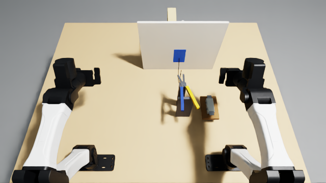

# Strip a 14 AWG wire to a receptacle's strip gauge and push it into the hot-side push-in hole

The robot wires a new receptacle at a wall box. The black conductor of a 14/2 NM-B cable comes out of a single-gang box
in a section of drywall. The robot strips its end with an ordinary hand wire stripper to the 5/8 in (16 mm) strip gauge
of a duplex receptacle, picks up the receptacle and holds it beside the box, then pushes the bare end into a push-in
("backstab") hole on the receptacle's brass (hot) side. The strip has to be the right length (too long leaves live
copper showing outside the receptacle; too short never reaches the spring clamp), made in the right hole (a smaller
hole nicks the copper) and pulled clean, and the wire has to go on the right side (the silver side reverses the
receptacle's polarity, a shock hazard).

**Recorded results:** scripted demo **1.0** in 1,248 control steps (62.4 s simulated); Dream-1 **0.0** in 2,400 steps.

## Why it matters

Every conductor an electrician connects is first stripped to the length its terminal calls for. From the O\*NET 31.0
task ratings (incumbent surveys) and BLS employment:

| Occupation | O\*NET task | Done daily or more | US jobs |
| --- | --- | --- | --- |
| Electricians (47-2111) | Core: "Connect wires to circuit breakers, transformers, or other components." (N = 53) | 73.0 % | 818,700 (BLS OOH, 2024): about 598,000 doing it daily |
| Helpers, electricians (47-3013) | Core: "Strip insulation from wire ends, using wire stripping pliers, and attach wires to terminals for subsequent soldering." (N = 73) | 84.7 % (39.9 % hourly or more) | in addition |
| HVAC mechanics and installers (49-9021) | Core: "Lay out and connect electrical wiring between controls and equipment, according to wiring diagrams, using electrician's hand tools." | 60.3 % | in addition |

The task combines the three things that make a termination right: tool and hole choice (the stripper's 14 AWG hole; a
smaller hole nicks the conductor), length (the device's strip gauge), and polarity (black/hot to the brass side).

## Instruction

> Strip the black wire coming from the wall box to the receptacle's 5/8 inch (16 mm) strip gauge with the wire stripper,
> then pick up the receptacle, push the wire fully into a push-in hole on the brass (hot) side of its back, and let go of
> the wire.

## Setup



World frame: x forward from the arm bases, y to the robot's left, z up; heights above the table top (z 0.7475 m). One fixed
layout; seeds do not move anything (`-E object_jitter=0`). Both arms start in the ready pose with open grippers.

| Item | Specification and starting pose |
| --- | --- |
| Wall section | 1/2 in (12.7 mm) gypsum drywall, its front face at x 0.520, 400 mm wide (y -0.300 to 0.100) and 340 mm tall from the table, on a 2x4 SPF stud (38 x 89 mm, behind the drywall from y -0.0715 to -0.0335, full height) and a 2x4 bottom plate (38 x 89 mm, along the wall's foot). |
| Wall box | Blue PVC nail-on single-gang box, ABB/Carlon B118A pattern (3-3/4 x 2-1/4 x 2-7/8 in: 95 mm tall, 57 mm wide, 73 mm deep, 3 mm walls), nailed to the stud's side with its open front flush with the drywall: opening centred at y -0.100, 120 mm up. |
| Cable and conductor | One 14/2 NM-B cable (Southwire pattern: 9.4 x 4.5 mm, white sheath) down the stud's face, stapled to it 150 mm above the box, and into the box's top knockout; its sheath ends inside the box, held there. The white and bare conductors are folded back into the box (not used). The black conductor (14 AWG solid copper, THHN-type: 1.63 mm copper, 2.69 mm over the PVC insulation and nylon jacket, as Southwire spec 10003) is 357 mm long from the sheath's end, 314 mm of it outside the box. It is bent by hand (solid 14 AWG holds the shape) in the plane y -0.100, through these points (x, height, in mm): (560, 110) at the sheath's end in the box, (517, 108) at the box's front, (505, 75), (492, 45), (475, 22), (452, 12), (428, 14), (408, 30), (396, 55), (398, 80), (400, 100), then straight up to its end at (400, 170). The loop's lowest point is 12 mm above the table (wire centre). |
| Wire stripper | Klein 11055 pattern (solid 10-18 AWG, stranded 12-20 AWG): 181 mm overall, 154 g, steel jaws with stripping holes for 10, 12, 14, 16 and 18 AWG solid along the jaws' meeting line (larger holes nearer the pivot; the 14 AWG hole 26 mm from it), straight blue and yellow vinyl-dipped handles, a return spring that holds the jaws open (about 4.3 N at the handle ends to start closing them, 6.6 N shut). Lying flat, jaws open and pointing +x (towards the wall), pivot at (0.300, -0.100) m, 200 mm up. |
| Stripper stand | Grey steel, two blocks: 24 x 30 mm under the pivot and neck (top 197 mm), centre (0.294, -0.100); 12 x 70 mm under the handles (top 192.5 mm), centre (0.230, -0.112). The jaws overhang its front edge. |
| Receptacle | 15 A, 125 V duplex receptacle, Leviton T5320-W pattern (push-in holes accept #14 AWG solid copper only; strip gauge 5/8 in): white nylon body 72 x 33 x 22 mm, steel strap 106 x 22 mm, 45 g. Loose, lying face up (back down) on the tray, centred at (0.250, -0.240), its length along x; the brass-screw (hot) side faces -y (the robot's right), the silver-screw (neutral) side +y. Push-in holes on its back 10 mm either side of its centre along its length and 11 mm either side across its width: the brass pair on the -y side. |
| Tray | 1/2 in plywood, 120 x 80 mm, on a grey block 60 x 40 mm; top 60 mm above the table, centred at (0.250, -0.240). |

## Scoring

Scored at the end of the trial (`--scorer task_score`; `success` ends the trial early once it has held for 1 s). Where the
receptacle is, and whether a hand still holds it, does not matter.

- **0** if the wire is clamped in a push-in hole on the **silver (neutral) side** (reversed polarity), or the conductor
  was **nicked** (the jaws closed on it in a hole smaller than 14 AWG) or **cut between holes**.
- **Strip, 0.3:** the slug is fully off the copper and the bare length is **14 to 18 mm** (the 16 mm gauge, ±2 mm);
  **0.15** for 12 to 20 mm; otherwise 0.
- **Termination, 0.7 (only with strip credit):** the conductor is held by the spring clamp of a **brass-side** push-in
  hole, at least **12 mm** in, with at most **1.5 mm of copper showing** between the jacket and the receptacle's back and
  the jacket no more than 1.5 mm inside the hole (else the clamp is on insulation),
  and the robot has let go of the wire: no fingertip within **8 mm** of the wire outside the receptacle.
- **1.0** = both, held for 1 s.

**Real trial** (after the robot lets go of the wire), with a caliper, a 10x loupe, a 1/8 in screwdriver and a spring scale:

1. Copper showing at the receptacle's back: feeler or caliper, at most 1.5 mm.
2. Side: the wire is on the brass-screw side (the silver side scores 0).
3. Clamp engaged: holding the receptacle, a 10 N pull on the wire, along it, for 5 s, must not move it out.
4. Release the wire with the screwdriver in the hole's release slot. Bare length by caliper (14 to 18 mm full, 12 to 20
   mm partial). Copper under the loupe: any nick, ring or scrape in the conductor scores 0.

## Reset

Each trial needs a fresh conductor end. Release the wire from the receptacle with a screwdriver in its release slot, put
the receptacle back face up on its tray, and clear the cut slug from the stripper's jaws. Pull the used cable out of the
box (with its staple) and fit a new length of 14/2 NM-B prepared the same way (sheath ending 40 mm behind the box's
front, white and bare folded into the box, the black conductor cut to 357 mm from the sheath and bent to the points
above).

## How the simulation works

Rigid bodies, PhysX at 240 Hz, control at 20 Hz, the station's YAM arms and cameras.

- **Stripper** (`stripper.py`): two halves on a sprung pivot (a `mechkit` articulation). Each jaw's edge has a U-shaped
  notch at every hole, 4.4 mm across with sloped sides, so a closing jaw guides a wire into the nearest hole without
  pinching its jacket; across each hole a 1 mm blade stands out to that gauge's conductor radius plus 0.3 mm. Squeezing
  the handles is the only way to close it.
- **Wire** (`wirekit.py`): the conductor from the box is a fixed-base PhysX articulation. Ten links of 20 to 43 mm
  follow the bent shape from the sheath's end, on hinges whose axes alternate between y and z. The last 70 mm (the end)
  is one rigid core: copper, plus the jacket below the last 50 mm, with that last 50 mm of jacket as 25 rings of 2 mm,
  each fixed to the core. Each hinge is a spring (1 N m/rad, about the copper's EI over a link) that holds the authored
  bend. It is perfectly plastic: once a hinge's spring passes 0.05 N m (annealed copper's yield stress times the
  conductor's plastic section modulus), its rest angle follows the hinge. The wire stays where a hand bends it, as solid
  copper does, and springs back only by the elastic part. The wire's colliders have a 4 mm torsional friction patch: a
  finger pad pinches it along a line, which resists the wire turning about the pinch.
- **Cut:** when the jaws are within about 2 degrees of shut with the wire through a hole (gap from the blade to the jacket
  under 1 mm for the 14 AWG hole), the rings at the blade stop colliding, so the jaws shut onto the copper. The hole
  decides the cut: the wire's own gauge cuts the jacket through; a smaller hole also bites the copper (nicked); a larger
  hole leaves it uncut through. Shutting on the wire outside every hole's notch cuts into it.
- **Strip:** after a clean cut the rings beyond it join into a slug held on the copper by a spring of 10 N per mm along
  it. The ring above the blade bears on the blade, so pulling the wire out stretches that spring; at 1 mm (10 N) the
  slug lets go and stays in the jaws while the copper slides out. The strip length is wherever the jaws closed, to the
  nearest 2 mm ring boundary.
- **Receptacle:** a loose rigid body (45 g); its push-in channels are 2.6 mm square (the 1.63 mm copper passes, the 2.69 mm jacket stops at
  the back), 17.5 mm deep, with a 1 mm lead-in chamfer 5 mm across at the back. Copper pushed 12 mm in, square to the hole, engages the clamp: a
  slide along the hole that holds the wire at the deepest point it has been pushed to (to 0.5 mm), as a push-in spring
  clamp does.

## Fidelity

Approximate. The cut and the clamp are rules in code (above); the slug's 10 N release is a spring, not a measured
strip force for this wire. The stripper's handles are straight boxes and its jaws U-notched, rather than the real
curved handles and semicircular holes; it is braced on a stand rather than held in the air (a two-finger gripper cannot
hold pliers level against the pull), so the robot pulls the wire out of the shut jaws rather than pulling the tool along
the wire: the same relative motion. The conductor bends only at its ten hinges and not along the 70 mm end, and its
plasticity is a perfectly plastic hinge (no work hardening). The jacket rings weigh 0.2 g each, heavier than real, and
the core's inertia about its own axis is raised, so the solver holds them. The slug stays in the opened jaws. The
receptacle's holes are square with a larger lead-in than a real device's; there is no strip-gauge marking modelled on it
(the instruction gives the length). The cable's sheath, the white and bare conductors, and the NM cable on the stud are
visual only; the black conductor is fixed where it leaves the sheath.

## Run it

Use the Robocurve YAM / Isaac Lab-Arena environment (Isaac Sim 6.1, Isaac Lab-Arena 0.3.1, `yam-isaac-lab-arena` with
Inspect Robots), on an RTX GPU, with Arena's environment active (`source <ARENA_DIR>/yam.env`).

```bash
# Offline checks (scorer, stripper and wire geometry): no simulator
python -m unittest discover -s tasks/strip-wire-push-in-receptacle/tests -v

# The scripted demonstration, rendered as the harness renders (writes OUT/full/demo.mp4, setup.png, result.json)
cd tasks/strip-wire-push-in-receptacle
python demokit.py task.py ~/strip-demo --device cpu --mode full --max-steps 1500

# The same, quickly, with the wrong ways too (no cameras, physics on the CPU)
python demokit.py task.py ~/strip-checks --fast --mode full,nick,long,short,silver,nostrip,none --max-steps 1500

# Dream-1 (from the repository root)
inspect-robots run --embodiment yam_arena --policy dream \
  -E task=tasks/strip-wire-push-in-receptacle/task.py -E object_jitter=0 -E control_hz=20 -E cam_width=320 -E cam_height=176 -E device=cpu \
  --instruction "Strip the black wire coming from the wall box to the receptacle's 5/8 inch (16 mm) strip gauge with the wire stripper, then pick up the receptacle, push the wire fully into a push-in hole on the brass (hot) side of its back, and let go of the wire." \
  --scorer task_score --max-steps 2400 --seed 0 --store-frames --log-dir ~/strip-dream
inspect-robots video ~/strip-dream/<log>.json
```

The demo is closed loop on object poses (as a scripted policy could read them), not on the scorer's state. The demo
and the Dream-1 run were recorded with physics on the CPU (`--device cpu`, `-E device=cpu`); `--fast` runs the same
physics without cameras.

**Runtime per trial:** run limit 2,400 control steps (120 s simulated). The demo takes 1,248 steps; with cameras and
physics on the CPU it ran at about 4.6 steps per second on a shared, busy RTX PRO 6000 machine (about 4.5 minutes), and
the Dream-1 trial took about 6 minutes. Seed: 0; the layout does not depend on it.

## Results

| Run | Score | Notes |
| --- | --- | --- |
| Scripted demo (`full`) | **1.0** | Stripped 16.0 mm in the 14 AWG hole; the right hand took the receptacle from its tray and held it beside the box; the wire was clamped in a brass-side hole with the jacket at the back (16.4 mm in); success at 62.4 s (1,248 steps, rendered with cameras). |
| `nick`: strips in the 16 AWG hole | 0.0 | Nicked. |
| `long`: strips about 22 mm | 0.0 | 22 mm bare, outside both length windows; pushed into a brass-side hole, 4.5 mm of copper shows outside the receptacle. |
| `short`: strips about 10 mm | 0.0 | 10 mm bare: the jacket meets the back before the copper reaches the clamp, so nothing latches. |
| `silver`: the right strip, into a silver-side hole | 0.0 | Reversed polarity. |
| `nostrip`: pushes the unstripped wire | 0.0 | The jacket stops at the back; nothing is clamped. |
| `none`: does nothing | 0.0 | |
| Dream-1 (`dreamlabs/dream-1-beta`) | **0.0** | 2,400 steps (step limit), seed 0, 20 Hz, 320 x 176 frames, physics on the CPU, recorded 2026-11-20 on this layout. The right hand moved over the receptacle on its tray several times without lifting it; the stripper and the wire were not used. |

## Files

| File | What |
| --- | --- |
| `task.py` | The task file: scene, scoring, and the scripted demo (`demo_script`, with the cheat modes). |
| `stripper.py` | The wire stripper's geometry and mechanism. |
| `wirekit.py` | The strippable wire: the plastic conductor from the box, jacket rings, the cut and strip rules, the push-in clamp on the (moving) receptacle. |
| `mechkit.py`, `demokit.py` | Shared props-and-mechanisms and scripted-demo helpers for yam_arena task files; this `demokit` copy gives every IK solve at least 300 iterations. |
| `tests/test_offline.py` | Offline checks: scoring, stripper and wire geometry, the layout (box size, conductor lengths, receptacle sides). |

## References

- Klein Tools 11055 wire stripper/cutter (solid 10-18 AWG, stranded 12-20 AWG; 7-1/8 in): https://www.kleintools.com/product/11055
- Leviton T5320 / 5320 duplex receptacle (push-in terminals accept #14 AWG solid copper only): https://leviton.com/products/5320-4w
- Leviton receptacle installation sheet (strip with the 5/8 in strip gauge on the device): https://cdn.shopify.com/s/files/1/0011/5517/0351/files/Updated_Manual_-_Tamper_Resistant_Duplex_Receptacle_T5325-WH.pdf
- Southwire THHN/THWN-2 spec 10003 (14 AWG solid: conductor 0.064 in, 16 mil insulation, 5 mil nylon, approx. OD 0.106 in): https://www.southwire.com/wire-cable/building-wire/thhn-thwn-copper-silicone-free/p/SPEC10003
- ABB/Carlon B118A single-gang nail-on PVC box (3-3/4 x 2-1/4 x 2-7/8 in, 18 cu in).
- Southwire Romex SIMpull 14/2 NM-B (about 0.372 x 0.176 in over the sheath).
- NEC 300.14: at least 6 in of free conductor at each box, at least 3 in of it outside the box's opening.
- O\*NET 31.0 database, task statements and task ratings: https://www.onetcenter.org/database.html
- BLS Occupational Outlook Handbook, Electricians: https://www.bls.gov/ooh/construction-and-extraction/electricians.htm
