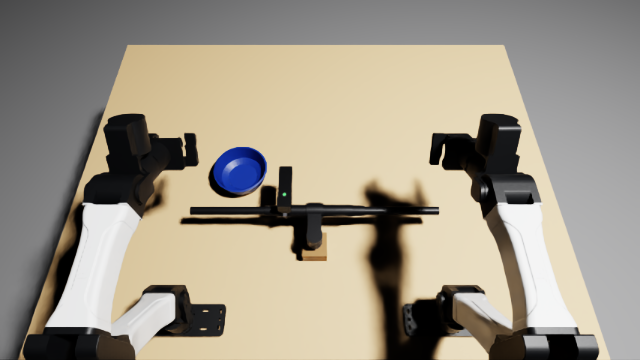
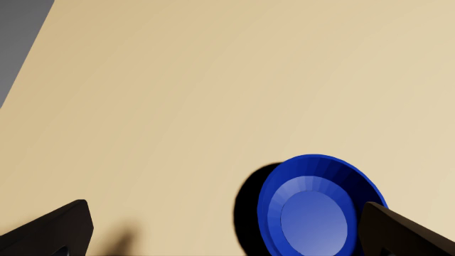
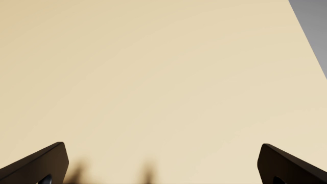
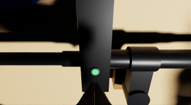
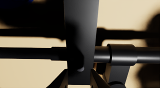
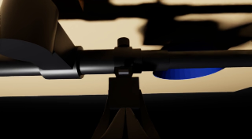
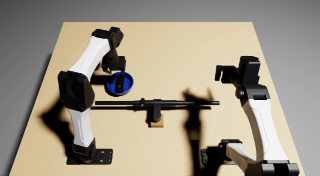

# Take a bike light off its handlebar bracket, switch it off, put it in the bowl

Instruction given to the policy: `Take the light off the handlebar, switch it off and put it in the bowl.`

Files: `task.py` (scene, the catch, the switch, rules, score), `task.json`, `mechkit.py` and `demo_kit.py` (the kit
and the runner, linked from `mech/`), `plan.py` (where the hands go), `demo.py` (the scripted job: `dry`, `trial`,
`record`), `checks.py` (simulator checks: `start`, `catch`, `letgo`, `yank`), the pictures below, `README.md`. Rule
tests: `tests/test_bike_light.py`.



 

The first pictures of the recorded run `w6b-f1`, both arms ready. Top camera: the bar across the bench, the stem's
wooden block under its middle, the bracket left of it with the light on it (black; the button's indicator a green
dot), and beyond the bar the lapis bowl. At the ready pose the left wrist camera has the bowl in view between its
fingertips; the right one sees the bench.

## Scene

A flat handlebar is held at its middle by a stem bolted to a block on the bench, as a bike's stem holds it: bar,
stem, bracket and light are the real ones at true height over a bench, and only the rest of the bike is left out,
because nothing in the job touches it. The bar lies across the bench (along y) at x 0.24, its axis 80 mm over the
bench. The light rides its bracket 70 mm left of the stem and points away from the arms, as on a bike seen by its
rider. The bowl stands loose beyond the bar. Places in m, x away from the arms, y to the left.

| Thing | As built | Source |
|---|---|---|
| Light | CatEye Volt 400 front light (HL-EL461RC): a box 108 x 31 x 31 mm, 120 g with its button, black, the lens on its front; anodised aluminium and plastic, friction 0.4 | spec; size, mass and friction assumed |
| Button | 10 mm across, 2 mm proud of the top, 30 mm from the rear face; 1 mm travel, 1.5 N at rest, 3 N pressed fully; its indicator lit green while the light is on | assumed, to be measured on the bought light |
| Bracket | CatEye H-34N FlexTight (part 5338827N), on the bar 70 mm left of the stem: a band round the bar, a rail 30 x 16 mm on top, 8 mm over the bar; the FlexTight dial under the bar | spec; rail sizes assumed |
| Lever | a tab 10 x 8 mm under the rail's rear end, sticking out behind it (its middle 6 mm behind, its top 2 mm under the rail's top); 1 N at rest, 3 N at 2 mm down, a stop at 3 mm | spec; sizes and forces assumed |
| Bar | flat bar, for instance Ritchey Comp flat bar: 31.8 mm over its middle 180 mm, 27 mm to 120 mm out, 22.2 mm grips; 600 mm wide, straight (no sweep) | spec; width, steps and the straightness assumed: name and measure the bought bar |
| Stem, block | a 70 mm stem on a 28.6 mm steerer stub in a wooden block 60 x 60 x 40 mm screwed to the bench at x 0.17 | assumed |
| Bowl | Fiesta small bowl, item 460, Lapis: 143 mm across, 48 mm high, 330 g, at (0.38, 0.20); inside a floor 80 mm across 6 mm up and a wall curving to the rim, drawn as two flat rings (to 112 mm across at 14 mm up, then to the rim, 133 mm inside); glaze friction 0.35 / 0.30 | spec; profile, mass and friction assumed |

The bar stands at x 0.24 and 80 mm up, not at the spec's x 0.30 and 100 mm: there the light hand reached its joint
limit at the slide's end (margin 0.5 degrees) and the two hands' hulls came within 5.9 mm. The bowl stands at
(0.38, 0.20), not (0.25, 0.20): there it stood under the bar.

## What stands in for what

- **The rail and its catch.** The light is welded to a hidden shoe (10 g, the inertia of a 3 cm piece) that slides
  along x on the bracket, with dry friction 3 N (the light slides off with 2 to 4 N while the lever is held). Caught,
  the slide's stops stand 0.5 mm apart where the light is. The task's step hook reads the lever once per control step
  (20 Hz): pressed 2 mm or more, the stops open; let go, they close round the light where that step found it.
- **Off the rail.** At the first control step that finds the shoe 30 mm along (the light's shoe past the rail's
  front end) the weld is cut: the light is free, and the empty shoe goes back into the rail. Until that step the
  slide still guides the light: at most one control step past the rail's end. The open slide's front stop stands
  150 mm further, out of reach (see the checks). A light once off is not put back on (not part of the job).
- **The release direction.** The light leaves the rail forward, away from the rider: forward, to be checked on the
  bought bracket. The maker's pages say press the release and draw the light out; none states the direction for the
  H-34N. Back, towards the rider, the hands would meet.
- **The switch.** A sprung button on a slide in the light. Held down 0.8 mm or more for 1.0 s (read at 20 Hz), it
  switches the light off; a press that starts while the light is off switches it on (the maker's on: one press; to
  check on the bought light). On, the lens and the button's indicator are drawn lit; off, dark, with the kit's
  redraw so that the lit dot does not linger in the pictures.
- **The lit indicator** stands in for what tells a rider the light is on when the lens faces away: assumed (the
  Volt's switch shows its battery while on), to be checked on the bought light. The lens itself faces away from the
  top camera.
- The bracket and the bar are fixed bodies: they stay where they are. The bar's roundness under the band, rubber
  parts and the light's beam are not modelled.

## Rules

Score, read from the end state:

- **1.0**: the light in the bowl (its middle inside the rim, 66.5 mm from the bowl's axis, and between 6 and 48 mm
  over the bowl's foot), switched off, both grippers' grasp points 3 cm or more from the light, the light at rest
  (under 2 cm/s over 0.25 s); held 1 s (`SUCCESS_HOLD_S`). The bracket and the bar cannot move.
- **0.75**: the light in the bowl but on (or off, with a gripper within 3 cm of it or the light still moving); or
  switched off and lying on the bench (its middle no higher than when it stands on an end) within 15 cm of the
  bowl's rim.
- **0.5**: the light wholly off the rail (cut free), anywhere on the bench.
- **0.25**: freed from its catch (slid 5 mm or more along the rail) but still on the rail.
- **0**: still caught; or the light off the bench (its middle 2 cm or more under the bench's top).

Run limit: **900 steps (45 s at 20 Hz)**, 1.6 times the scripted job (27.9 s to success).

## Can it be seen

 

The left wrist camera at the size a policy gets (320 x 176) in `w6b-f1`: at 4.0 s, over the button, the light on
(the indicator a green dot of 3 to 4 pixels), and at 10.0 s, over the light after the switch-off (the button dark
grey). The top camera cannot tell on from off: the indicator is about a pixel there and the lens faces away.



The tab in the right wrist camera at 13.0 s, the hand 6 cm behind its press: a grey sliver under the light's rear
face (the picture is upside down: the bar runs across its middle, the light hangs below it, the bowl to the right).
At 320 x 176 the tab is about 15 x 4 pixels.



The end of `w6b-f1` at 320 x 176: the light lies in the bowl, the left hand going back.

Further pictures in this folder, all from the recorded run `w6b-f1` (640 x 360 as rendered; `_policy` at 320 x 176
as a policy gets them):

- `start_left_wrist_policy.png`, `start_right_wrist_policy.png`: the two wrist cameras' first pictures, as above, at
  the policy's size.
- `tab_right_wrist.png`: the right wrist camera at 13.0 s behind the tab, as rendered (the policy-size one is above).
- `end_top.png`: the top camera's last picture (27.9 s) as rendered: the light in the bowl.
- `end_left_wrist.png`, `end_left_wrist_policy.png`: the left wrist camera's last picture (27.9 s), from over the
  bowl: the light lying in it, its button dark (off).

## The checks before the script

Dry (`yam_arena` IK and the hands' hulls from the URDF; the light hand's figures redone at 13:13 after a reflected
rotation had been used):

- (a) lever hand (right) from behind, its approach tipped 45 degrees down, closed fingertips on the tab; light hand
  (left) from above, pinching across the 31 mm at the light's middle and drawing it forward. IK 0.0 mm; joint
  margins 11.5 (right) and 20.7 to 16.9 degrees (left, over the slide); the two hands' hulls 48.9 mm apart at the
  slide's start and 33.6 mm at 45 mm. Both from above was not taken: two hands pointing down at one small object
  meet in the forearms.
- (b) the button pressed by the left hand's closed fingertips from above: margins 14.7 degrees (light on the
  bracket) and 37.6 (in the bowl); the right hand cannot reach the bowl's place.
- (c) the start pictures above (run `w6bst`): everything still for 3 s (0.0 mm).

The whole plan (`demo.py dry`): worst IK error 0.09 mm; least joint margin 6.8 degrees (left, lifting the light) and
11.5 (right, on the tab). Hull clearances along it: right hand 2.7 mm from the light and 4.1 mm from the bracket at
the press, 10.1 mm from the bar; the two arms 29.4 mm apart at least.

## The mechanism, checked with loads put on directly

Runs `w6bca`, `w6bcb`, `w6bya` (`checks.py catch`, `letgo`, `yank`; forces pushed on the bodies every control step):

- Lever not held, the light pulled 10 N and 40 N for 1 s: it stays, 0.5 mm along (the catch's play).
- Tab pushed 5 N: 3.0 mm down (its stop), the catch open. Pulled 2.5 N: held by the rail's friction (0.17 mm).
  Pulled 5 N: it slides off, is cut free at 30 mm and falls on the bench (score 0.5).
- Let go mid-slide, the light drawn at 2 cm/s: tab let go at 10.4 mm, the catch held it at 11.4 to 11.6 mm under a
  pull of 4.4 to 4.9 N (within 0.25 mm of where the next control step found it, 1.25 mm past the let-go); the same
  at 25 mm. Then 40 N for 1 s: it stays.
- Pulled 20 N from rest with the tab held: cut free at 161.5 mm (6.5 m/s) in the one control step after the catch
  opened, short of the open slide's front stop at 180 mm. (With the stop 10 mm past the rail's end, a constant 5 N
  threw the light into it for one control step, run `w6bca`; it was moved out then.)
- Button pushed 4 N: held 0.9 s, still on; held 1.1 s, off; the lens and the indicator dark.

## Reference run

`w6b-f1` (commit 2f992fd, seed 0, recorded; the trial `w6bt1` before it gave the same numbers): **score 1.0**, success
at 27.9 s (558 steps). The left hand switches the light off where it sits caught on the bracket (the button held from
5.9 s, 1.07 mm down under 3.6 N; off at 6.9 s; the light moves 0.36 mm down under the press and 0.02 mm along the
rail); it pinches the light from above (13.0 s; the light shifts 0.53 mm sideways in the joint's give); the right
hand presses the tab from behind (2 mm down at 14.9 s, then 3.18 mm with 5.6 N); the left draws the light 45 mm
forward with 3.7 N (slid 5 mm at 17.55 s: 0.25; cut free at 30.2 mm at 19.25 s: 0.5), lifts it 40 mm, carries it
to the bowl (beyond the bar all the way), lowers it in (24.9 s; 0.75 from 24.7 s) and lets go; 1.0 from 26.95 s.
The light ends level in the bowl, on its axis (0.1 mm off), its middle 29.7 mm over the bench, still; the left
grasp point 115 mm from it, the right 558 mm. The instruction does not fix an order: switching off first, while the
bracket holds the light still, is the reference run's choice.

The contact sheets (`sheet_top.png`, `sheet_left.png`, `sheet_right.png`) show the two arms apart throughout, the
right forearm low behind the bar while the left works over it, the light in the left hand from 13 s to 25 s, and
the bowl unmoved. In the simulator the right hand came no nearer than 3.19 mm to the light and 4.03 mm to the
bracket (the hands' hull corners placed at each step's grasp pose): no touch moved the light before the tab was down.

Model run: Dream-1, 900 steps (the whole run limit), --seed 0: score 0.0; both hands went down to the bar near its grips and worked along its outer parts; neither reached the light or the lever; the light stayed caught and on.

## Limits and readings

| Limit in the score | Reading in `w6b-f1` | Shown by |
|---|---|---|
| freed: slid 5 mm or more (0.25) | slid 30.2 mm when cut free | rule tests (10 and 12 mm); `w6bcb` (stopped at 11.4 mm) |
| off the rail: the shoe 30 mm along (0.5) | cut at 30.2 mm, 19.25 s | `w6bca` (fell on the bench, 0.5); rule test |
| lever held: 2 mm down | 3.18 mm while held | `w6bca` (3.0 mm at 5 N) |
| off: button 0.8 mm down for 1.0 s | 1.07 mm, held 1.95 s, off after 1.0 s | `w6bca` (0.9 s on, 1.1 s off); rule tests |
| in the bowl: within 66.5 mm of its axis, under its rim | 0.1 mm off its axis, middle 29.7 mm up | rule tests |
| grippers 3 cm from the light | 115 and 558 mm | rule test (a gripper 4.5 mm over it: 0.75) |
| at rest: under 2 cm/s over 0.25 s | 0.0 mm/s | rule test (4 cm/s: not at rest) |
| off and within 15 cm of the bowl's rim (0.75) | not reached | rule tests (10 cm: 0.75; 20 cm: 0.5) |
| off the bench: middle 2 cm under its top (0) | not reached | rule test |

No force is scored. The forces the job meets are all assumed until measured on the bought parts, with a push-pull
gauge: the tab's force at 2 mm down (3 N assumed); the pull that slides the light while the tab is held (2 to 4 N,
3 N built); the pull the catch holds with the tab up (40 N assumed; built as a stop that holds any pull); the
button's force (1.5 N at rest, 3 N at its 1 mm stop) and the time it must be held (1 s, the maker's off).

## States set directly

`tests/test_bike_light.py` (13 tests, no simulator): the parts as built (the light 0.5 mm over the rail, the button
and the tab where the table puts them, the springs' forces); the bowl clear of the bar and the light lying inside it
(its middle about 30 mm up, 18 mm under the rim); pulled with the lever not held (stays, score 0); lever held (the
catch opens, 0.25 at 10 mm, cut free past 30 mm, the empty shoe sent back); let go at 12 mm (caught there, 0.25);
the button held 0.9 s (on) and 1.1 s (off), a press too shallow (0.7 mm: nothing), a new press while off (on); every
level from states set directly (off the rail on the bench 0.5; in the bowl on 0.75; in the bowl off, clear and still
1.0; a gripper 4.5 mm over it 0.75; off on the bench 10 cm from the bowl 0.75, 20 cm 0.5; off the bench 0); a moving
light (4 cm/s) not at rest; the hand rotations are rotations.

## Seed

`--seed 0` under the harness gives the trial seed 1415158438 (inspect-robots 0.60.0); the task draws nothing from the
seed, so every seed is the same start. The bowl is the only loose thing: with `-E object_jitter=0` it stands where it
was built.

## Fidelity note

Rigid bodies at true size. The catch is a sprung tab: while it is pressed 2 mm or more the light slides along the rail
against 3 N; let go, it stops within 0.5 mm of where the next 20 Hz step finds it. The light is set free at the first
20 Hz step past 30 mm of slide. The switch is a sprung button that turns the light off when held down for 1 s. Lever,
rail and button forces assumed until measured on the bought parts. Not modelled: the bar's roundness under the band,
rubber parts, the beam. (495 characters, as in `task.json`.)

## How to run

Meshes, textures, sounds: none (every body is built from boxes and cylinders in `task.py`).

Runtime per trial: the scripted run (558 steps, three cameras recorded) took 1 min 37 s of wall time on one GPU, of
which 72 s stepping (130 ms a step) and the rest starting the simulator. A model trial runs up to 900 steps.

Rule tests: `scripts/rta check bike_light`.

Checks in the simulator: `scripts/rta simpy <id> mech/tasks/bike_light/checks.py outputs/<id> start|catch|letgo|yank`.

The scripted job: `scripts/rta demo <id> mech/tasks/bike_light dry|trial|record [seed]` (results in `outputs/<id>/`:
`result.json` with a row per step, videos and contact sheets with `record`, `cue_*.png` at the policy's size).

One model trial with the stock embodiment and scorer (20 Hz, 320 x 176 pictures):

```bash
inspect-robots run --embodiment yam_arena --policy dream \
  -E task=mech/tasks/bike_light/task.py -E object_jitter=0 -E control_hz=20 -E cam_width=320 -E cam_height=176 \
  --instruction "Take the light off the handlebar, switch it off and put it in the bowl." \
  --scorer task_score --max-steps 900 --seed 0 --no-prompt --store-frames --log-dir <log dir>
```
