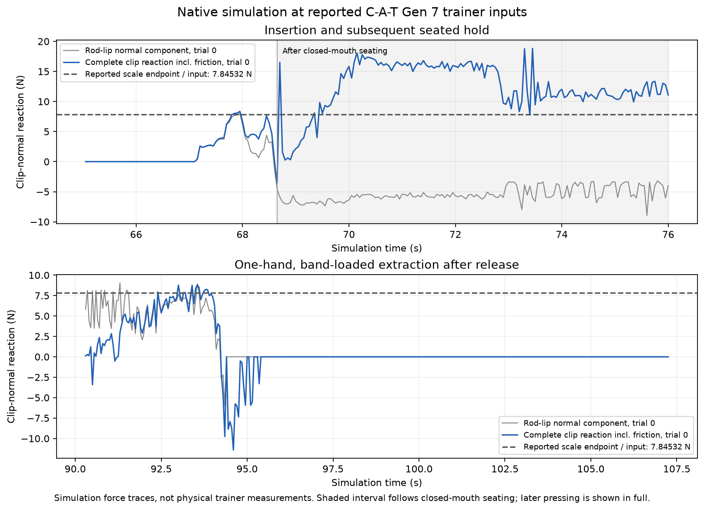

# Native validation at the measured trainer inputs

The mechanism is frozen at task.py SHA256 `3d854739b95447bc767734363821684491d98490f1e47caad0564e2c4889aa9a`. Both final policies use the executable/assets in `frozen-source.json`, identical instruction, zero object jitter, 20 Hz control, 2,400 steps and two epochs. Final scripted A/B demo scores 1.0/1.0; the single Dream-1 run scores 0.0/0.0. Both have zero trial errors.

## Product readings and model scope

Forces were measured on a C-A-T Gen 7 trainer with a scale by a technician who works with this product, Nov 2026: 2.2 kg at a 65 mm lever, 270 degrees, separately measured 0.8 kg insertion and 0.8 kg extraction, 12 mm rod and 10 mm mouth. See `TECHNICIAN-READINGS-NOV23.md` for the conversions.

The simulated loads match these measurements. Winding torque at lock equals the measured value exactly. Native insertion 8.00 N, 2% above its reading; native pull-out 8.80 N, 12% above the 7.85 N reading, because in simulation the clip also carries the band's winding load during the pull.

The insertion figure in that sentence is the normal rod-lip component used by the unchanged force gate. Complete entry reaction is 8.359 N. The model uses the measured lock torque as static recoil and a linear winding curve from snug to lock; intermediate pressure, tilt and the clip's internal spring geometry are model choices.

## Force observations on this mechanism

| Quantity | Reported input | Observed native value |
|---|---:|---:|
| Turning endpoint | 1.40235095 N m at 270 deg | Native joint stiffness 0.297588 N m/rad gives that configured endpoint; damping is separate |
| Advancing insertion, rod-lip normal | 7.84532 N | 8.001192 N (+1.99%) |
| Complete insertion reaction | 7.84532 N comparison | 8.358807 N (+6.55%) |
| One-hand band-loaded extraction, complete reaction | 7.84532 N | 8.797802 N (+12.14%) |
| Extraction, normal-only channel peak | Separate component | 9.051403 N |
| Direct robot/clip contact | Excluded from force comparison | 0 N through both windows |
| Released retained hold | At least 1 s for full score | 9.95 s in diagnostic |

The contact-work witness completed at 67.90 s, before first closed-mouth seating at 68.65 s. The force, 1 mm advancing contact, 1 mJ work, both-lip, reversal, alignment, closure and clearance thresholds were not loosened. Under-force entry followed by later seated pressing cannot qualify; the production history regression checks that case.

The diagnostic repeats the positive 270-degree demo into the hip clip, preserves its released hold, then regrips and pulls with one hand. The other hand remains clear; the band's winding load is not counterheld or reduced. The pull follows the existing tilt hinge arc, initially tangent to the clip normal. Its final score after intentional extraction is not qualification. Other hook/direction force curves were not independently measured or validated by this probe.

## Reproduction, data and source proof

Apply `EXTRACTION-PROBE.patch` to a scratch copy of this folder and run the README command with TRACE_OUT pointing to an existing log directory. Executable differences are limited to diagnostic motion and success termination; `extraction-probe-source.json` proves identical mechanism/scoring AST and support-file hashes. Actual host executable hashes are retained in `native-force-summary.json`.

`native-force-trace.jsonl.gz` contains the full native trace; its uncompressed SHA256 is in the summary. `native-force.csv` retains the scalar fields and first completed-entry flag. Entry comparison ends at the first geometric seat with mouth <=11.8 mm, independently of scoring. The plot also shows all later seated pressing. The extraction comparison covers the whole 90.25–107.25 s pull/hold segment. Peaks are observed at 20 Hz, not continuous physical force curves.

For hip clip yaw 156 degrees and pitch 21 degrees, the normal is `(sin21*cos156, sin21*sin156, cos21)`. Normal reaction is the projection of summed lip normal forces. Complete reaction adds clip-base normal and lip/base friction vectors before projection. Extraction resistance is the negative of that projection; the full signed trace remains visible.

## Native settings and API audit

The host uses Isaac Sim 6.1.0. Actual winding/lip stiffness, damping, drive-force limits and masses match this source (`native-load-proof.json`). Lip springs are 41.761/91.532 kN/m, damping 36.56/54.12 N s/m, effective mass 8 g each and fixed internal drive limits 10.62/23.29 N. Slopes and bounds are unmeasured model fits. The same passive bounded response applies throughout both directions of the trial; there is no state-driven latch or parameter switch. Drive limits do not bound every instantaneous contact reaction. Lower retaining edges are rounded, with a 1.0 mm flat upper entry face, lower bead centre 3.0 mm above the nominal rod centre. Clip friction 0.05/0.04 uses minimum combining; rod/hand grip material is unchanged.

The normal-force matrix excludes friction. Per-contact normal magnitudes times their normals reproduce that matrix; `native-normal-api-proof.json` records the numerical comparison on this complete trace. `audit_normal_api.py` reproduces the check from the decompressed trace. Friction is read separately. These are read-only observations, not force injection or product measurements. Only the gauge needle's visual transform is animated; no scored object or robot pose is written to perform the task.

Primary references opened November 24: [NVIDIA contact/friction API](https://docs.omniverse.nvidia.com/kit/docs/omni_physics/109.0/extensions/runtime/source/omni.physics.tensors/docs/api/python.html), [Isaac Lab contact sensor behavior](https://docs.nvidia.com/isaaclab/concepts/sensors/contact-sensor), [material combine mode](https://isaac-sim.github.io/IsaacLab/v3.0.0-beta/_modules/isaaclab/sim/spawners/materials/physics_materials_cfg.html).

## Checks and final policies

The frozen executable passed the full factory checker in both fixed lots and all 43 synthetic boundary, history and clearance controls. The named-input wiring proof passes; the separate complete-raw-data guard accepts its explicitly synthetic schema fixture and rejects 11 unsupported evidence cases. No synthetic fixture is installed as trainer data. Final folder checks are repeated after final text/media preparation.

| Final policy | Run ID | Lot A | Lot B | Trial errors |
|---|---|---:|---:|---:|
| Scripted | demo-20261124T072408 | 1.0 | 1.0 | 0 |
| Dream-1 (single run) | dream-20261124T073904 | 0.0 | 0.0 | 0 |

Both runs use the frozen executable and assets, verified before and after each run. The source file predates both runs. Scripted trials ended at 79.05 s after the one-second released hold. Both Dream-1 trials reached the 2,400-step limit, returned actions, and made no verified snap or released hold; the pressure proxy remained 60 mmHg. The run record contains no explicit refusal. It is reported as unsuccessful task execution, without a retry or instruction change. The official status `success` means the evaluation completed, not task success.

| Scripted lot | Advancing entry normal | Complete entry reaction | First entry witness | Closed-mouth seat | Released hold | Final clearance |
|---|---:|---:|---:|---:|---:|---:|
| A | 8.001192 N | 8.358807 N | 67.90 s | 68.65 s | 1.00 s | 135.085 mm |
| B | 8.560856 N | 9.244892 N | 68.00 s | 68.60 s | 1.00 s | 135.085 mm |

The entry comparisons end at first closed-mouth seating, preventing later pressing from entering the force comparison. Both lots complete the work witness before that seat. Later seated normal pressing in B peaks at 13.699 N; the full CSV retains it. This is not presented as the entry force. The one-second hold is represented as 0.9999999999999432 s in the trace; the fixed scorer's existing numerical tolerance handles the rounding.

`final-policy-results.json` records official scores/status, log and telemetry hashes, six executable/asset hashes, run IDs, termination reasons and policy request summaries. `final-demo-native-sim.csv` and `final-dream-native-sim.csv` contain the complete scalar traces. The force-calibration diagnostic remains separate from these qualification results. Old estimate-source media is not used to qualify these inputs.
