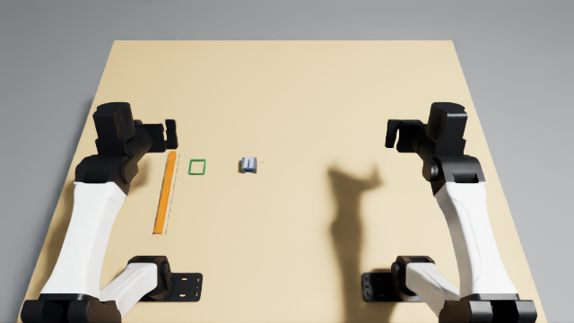

# Extract a robot-assembly spacer with a pusher

**Category:** Impact on AI timelines  
**Status:** Release evidence complete: three fresh-reset demonstrations scored 1.0; the complete Dream-1 attempt scored 0.0 at 2,400 actions. All four traces agree on independent replay on both VM and local host. All 97 checks pass; final code review found no blockers. Reviewer acceptance is pending.



## Task

Use the long pusher to push the spacer out through the covered channel. Put the spacer flat in the green recovery nest, return the pusher flat to its starting outline, then open both grippers and move clear. Keep both parts within the table edges throughout.

Robot assembly sometimes leaves a temporary spacer where a gripper cannot reach it. This task models pushing that spacer out with a tool, then collecting the part and putting the tool away. See [NOVELTY.md](NOVELTY.md) for the board and benchmark comparison.

## Station, geometry, and reset

Use the official calibrated YAM station. Coordinates are metres in a world frame where x points forward from the arm-base line, y points left, and z points up. The table top is z = 0.7475 m. The table is 1.10 × 1.30 × 0.06 m; arm-base positions are (0, +0.305, 0.750) m and (0, −0.305, 0.750) m. Use the supplied robot and camera geometry.

[assets/setup.json](assets/setup.json) lists the **14 task objects** with type, size, material, mass/fixed status, and exact starting pose. [assets/setup.svg](assets/setup.svg) is the dimensioned top-plan schematic; it is not the anonymous simulator reset screenshot required for review.

| Objects | Size and material | Starting layout |
|---|---|---|
| 2 channel walls | Each 40 × 8 × 30 mm PETG, fixed | x centre 350 mm; y centres 82 and 118 mm; z centre 762.5 mm. |
| 2 roof rails | Each 40 × 12 × 8 mm PETG, fixed | x centre 350 mm; y centres 92 and 108 mm; z centre 781.5 mm. The inner edges leave a 4 mm viewing slit; the underside is 30 mm above the table. |
| 4 nest rails | 2 at 4 × 44 × 8 mm and 2 at 44 × 4 × 8 mm PETG, fixed | Open-top nest centred at (350, 260) mm; z centre 751.5 mm. |
| 2 pusher park marks | Each 264 × 1 × 0.5 mm PETG, fixed | x centre 270 mm; y centres 322 and 358 mm; bottom on the table, top 0.5 mm above it. The orange pusher starts between them. |
| 2 extraction marks | Each 1 × 8 × 0.5 mm PETG, fixed | x centres 330 and 370 mm; y centre 64 mm; bottom on the table, top 0.5 mm above it. |
| Pusher | 260 × 16 × 16 mm PETG; model mass 60 g | Centre (270, 340, 755.5) mm, length along x. The rear grip target is x = 160 mm. Its 60 g mass represents a printed part with an assumed effective density/infill; the solid PETG volume is not modeled as a fully dense part. |
| Spacer | 28 × 24 × 24 mm aluminium; 43.55 g | Centre (351, 100, 759.5) mm, inside the covered channel. Mass corresponds to solid aluminium at 2.70 g/cm³. |

The channel is 40 mm long, 28 mm wide, and 30 mm clear at the walls. The spacer begins with its long axis along x. The pusher and spacer are loose dynamic rigid boxes; no mesh, hidden joint, automatic attachment, or teleport is part of the task. Fixture rails and marks are fixed boxes. The park marks are guides only, not a mechanical dock.

For reset, restore all objects and both arms to the declared starting poses, zero object velocities, clear per-episode evaluator state, and allow 0.5 seconds to settle. Use `object_jitter=0`. The layout contains no sampled placement: geometry is identical across Inspect reset seeds. Each actual per-trial seed is retained in its trace and evidence summary. The initial score must be 0.0. The exact object transforms and station settings are in `setup.json`.

The setup uses the official YAM station’s 240 Hz physics and 20 Hz control. Friction values are simulator assumptions (static/dynamic 1.2/1.0), not calibrated material measurements. The evaluator samples the geometry at control frames; it does not measure contact force or inspect every physics substep.

## Scoring

Read the final state; earlier partial scores are not kept. Positions below are (x,y,height above tabletop), in mm.

0.25: The pusher has moved the spacer forward by at least 40 mm while touching it. The spacer is fully beyond x=370 mm and its centre is within 10 mm of y=100 mm.

0.50: After that extraction, the spacer rests flat in the green nest. Its centre is within 8 mm in x/y and 4 mm in height of (350,260,12) mm, with orientation error ≤10°, speed <15 mm/s and spin <0.75 rad/s.

1.00: The spacer stays in that position and the pusher is back within 12 mm in x/y and 10 mm in height of its start, with orientation error ≤10°, speed <10 mm/s and spin <0.5 rad/s. Both grippers are at least 80% open and their tool centre points are at least 80 mm from both parts. All these conditions must hold for one continuous second; contact or movement that breaks them restarts the timer.

0: No listed outcome, or either part ever leaves the table bounds: x=-190 to 910 mm, y=-650 to 650 mm, with no underside more than 10 mm below the tabletop (solver allowance). Direct removal does not count. At the spacer's first full exit, it must still touch the pusher after at least 25 mm of measured push; otherwise the trial stays at zero. Count paired forward motion while the parts touch and subtract backward spacer motion. Contact and alignment tolerances are specified in the README.

### Simulator contact checks

The evaluator estimates contact from pose, orientation, full oriented-box separation tests, transverse bounds overlap, and frame-to-frame motion. It permits up to 2.001 mm oriented-box separation and a rear-face axial gap from −4 to +2.001 mm; tool/spacer long axes must be within 10° of the channel and a long face within 5° of horizontal. The spacer centre must be within 4 mm of 12 mm above the table; the pusher centre must be within 5 mm of 8 mm above the table. Their bounds must overlap by more than 8 mm along y and more than 6 mm vertically. Any paired positive forward displacements above a 1-nanometre numerical epsilon accumulate toward the 40 mm stroke, without an imposed push-speed range; backward motion subtracts credit before the exit event. The first full exit must occur in aligned contact after at least 25 mm of verified stroke, otherwise a permanent zero-score failure applies. The reported displacement and contact are a geometric proxy; they are not force measurements. The exact implementation and tolerances are in `src/spacer_extraction/tracker.py` and `src/spacer_extraction/evaluation_io.py`.

### Physical inspection procedure

Record overhead and side footage. Use the two orange marks (40 mm apart) as a scale, or a ruler, to measure the spacer’s forward movement while its rear face remains against the pusher. Verify the part exits through the channel, then measure its final centre against the nest centre and its flatness with a side photograph/protractor. Check the returned pusher against its starting outline. The released dwell is one continuous second on the video clock, with no renewed contact. Both jaw gaps must be at least 75.1 mm (80% of the supplied 93.9 mm full pad opening); the TCP is the point between the pads 13 mm short of their tips, and its minimum distance to either part’s box bounds must be at least 80 mm. In simulation, these distances are reconstructed from measured joints and the supplied YAM geometry. The 20 Hz contact estimate is a disclosed geometric proxy, rather than a force sensor or microscopic displacement requirement.

## Install and run

Use the organizer’s [simulation walkthrough](https://tasks.robocurve.org/walkthrough) and its validated environment. Source `yam.env` in each shell and retain the provided dependency pins. The validated launchable uses YAM-Arena commit `0059d02a1a91bc6834c1d0846022891df0c78730` and Isaac Lab-Arena commit `c7edf3a9d5d8276565208f72422f8f8a0806d6cf`. Its existing `ARENA_NUCLEUS_DIR` override points to the production Isaac 6.1 asset mirror instead of staging; this asset-location configuration was retained. No task changes were made to those upstream physics/runtime sources. From this folder:

```bash
source /data/IsaacLab-Arena/yam.env
"$HOME/.local/bin/uv" pip install --python /data/IsaacLab-Arena/.venv/bin/python --no-deps -e .
inspect-robots list embodiments
inspect-robots list policies
```

Run the scripted demonstration:

```bash
inspect-robots run --embodiment spacer_extraction_yam --policy spacer_extraction_demo \
  -E trace_path=/tmp/spacer-demo.jsonl -E control_hz=20 -E object_jitter=0 \
  -E cam_width=320 -E cam_height=176 \
  --instruction "Use the long pusher to push the spacer out through the covered channel. Put the spacer flat in the green recovery nest, return the pusher flat to its starting outline, then open both grippers and move clear. Keep both parts within the table edges throughout." \
  --scorer task_score --max-steps 2400 --store-frames --log-dir /tmp/spacer-demo
```

For Dream, change the policy to `dream` and use fresh trace and log paths. Keep the Dream key in the official credentials store. The policy observation contains the 14 `joint_pos` values and the `top_cam`, `left_cam`, and `right_cam` images at 320 × 176. The task evaluator and raw geometry trace are kept outside policy observations.

To view a run live, use the supplied desktop and add `-E headless=false`; follow the official YAM desktop-forwarding instructions. Do not expose the unauthenticated desktop publicly.

## Rescore and prepare evidence

```bash
spacer-extraction-rescore /tmp/spacer-demo.jsonl
inspect-robots video /tmp/spacer-demo/ACTUAL_LOG.json
ffmpeg -i INPUT.mp4 -c:v libx264 -pix_fmt yuv420p -movflags +faststart -an OUTPUT.mp4
```

To reproduce the submitted three-view video without cutting any frames:

```bash
inspect-robots video /tmp/spacer-demo/ACTUAL_LOG.json --out /tmp/spacer-cameras
ffmpeg -i /tmp/spacer-cameras/scene-0-e0_top_cam.mp4 \
  -i /tmp/spacer-cameras/scene-0-e0_left_cam.mp4 \
  -i /tmp/spacer-cameras/scene-0-e0_right_cam.mp4 \
  -filter_complex '[0:v]scale=640:352[top];[1:v][2:v]hstack=inputs=2[bottom];[top][bottom]vstack=inputs=2[out]' \
  -map '[out]' -c:v libx264 -crf 21 -pix_fmt yuv420p -movflags +faststart demo.mp4
```

The top panel is `top_cam`; bottom left/right are the corresponding wrist cameras. Use fresh output directories for each trial.

Use the actual log filename reported by Inspect. Video export creates separate `scene-0-e0_top_cam.mp4`, `scene-0-e0_left_cam.mp4`, and `scene-0-e0_right_cam.mp4` clips. The rescorer checks the complete 20 Hz trace, the recorded task and evaluator hashes, the terminal reason and step count, and scorer agreement at each frame. Interrupted runs are incomplete. Keep every completed Dream attempt. Final videos must be H.264 MP4, `yuv420p`, fast-start, and no larger than 50 MB. The anonymous reset screenshot must match the actual scene and be no larger than 10 MB; the current SVG is only a schematic.

## Licensing and readiness

Task geometry and code are MIT-licensed under `LICENSE`. The package uses the organizer-provided YAM, Isaac Lab-Arena, and Inspect environment; it vendors no third-party meshes or robot code. The pusher/spacer mass and friction assumptions are documented above. The corrected evaluator passed three fresh-reset demonstrations with independent trace agreement; all 97 scoring and trace checks pass. The separate-copy installation passed. The native reset screenshot and complete demonstration/Dream videos are prepared with measured scores in `task.json` and `RESULTS.json`. Earlier engineering recordings were retained privately and are not used as release evidence.

## Recorded demonstrations

The three fresh processes each completed 545 actions in 27.25 simulated seconds. Measured wall-clock durations were 146.124, 129.572 and 135.127 seconds, including simulator startup. Each used Inspect reset seed `1415158438`, `object_jitter=0`, and initial score 0.0. The complete initial object and robot states had the same SHA-256 in all three runs: `43e2828467e5f8f51e458bddf0b62c784bf4c3c3e9835aab9470105e35c6d249`. Each final trace contained 546 frames including reset, and independent replay reported `score=1.0`, `success=true`, `trace_agrees=true`.

To capture the anonymous reset screenshot at the native 640 × 360 camera resolution (before the policy image resize), run `python tools/capture_reset.py --out /tmp/spacer-reset`. This inspection applies no policy actions and is not scored as a completed trial. Its image shows the same fixed reset as the scored videos.

## Recorded Dream attempt and independent replay

The release Dream attempt completed all 2,400 actions (120 simulated seconds), scoring 0.0 with no infrastructure error. Measured wall-clock runtime was 531.308 seconds including simulator startup and inference; mean inference latency was 0.678 seconds. `RESULTS.json` records versions, seeds, hashes and all four actual outcomes. The compressed selected raw traces are included for independent replay:

```bash
gzip -dc reference_traces/demo.jsonl.gz > /tmp/spacer-reference-demo.jsonl
gzip -dc reference_traces/dream.jsonl.gz > /tmp/spacer-reference-dream.jsonl
spacer-extraction-rescore /tmp/spacer-reference-demo.jsonl
spacer-extraction-rescore /tmp/spacer-reference-dream.jsonl
```

Expected scores are 1.0 and 0.0 respectively, both with `trace_agrees=true`. `pytest -q tests` runs the 97 scorer and trace checks in the official environment.

The verified model video, full-score demonstration and matching reset screenshot were uploaded together as media `M-RZSZM2`, named by `task.json`. Both videos use H.264/I420 (`yuv420p`) at 20 fps with fast start and contain every recorded frame. The model video is 3,862,455 bytes; the demo 934,567 bytes; the native reset image 187,963 bytes.
