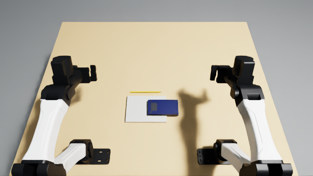
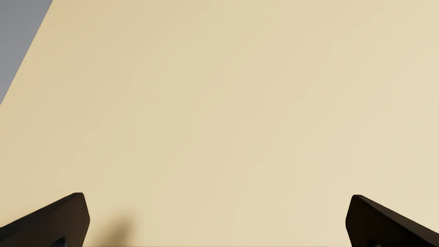
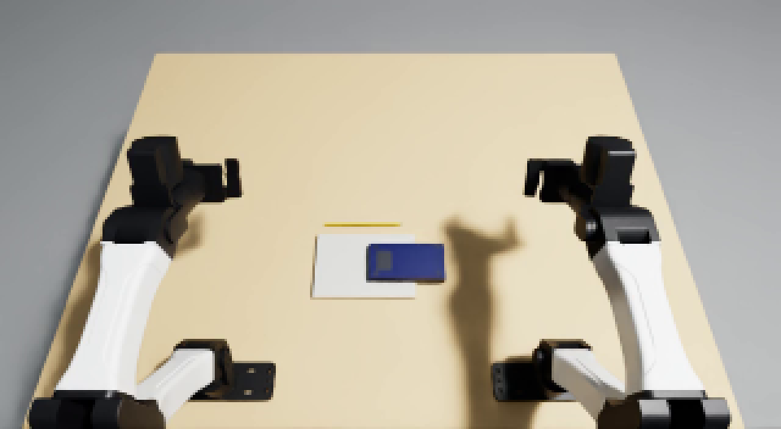
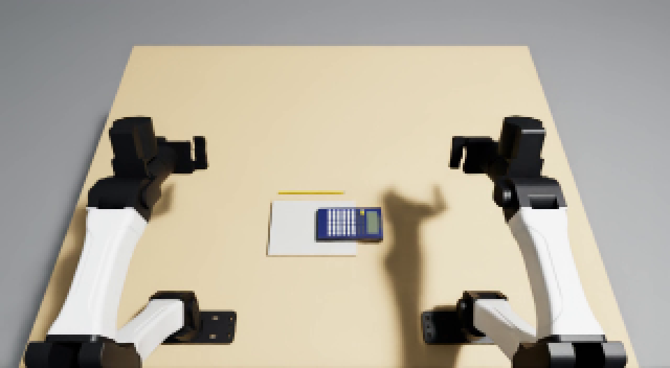
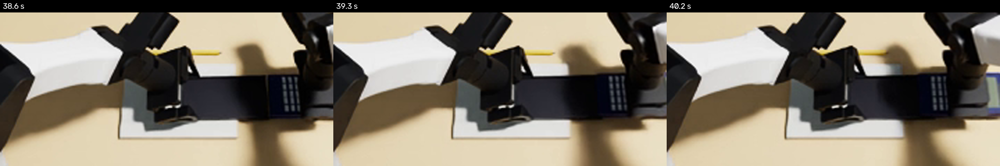

# Turn a school calculator keys up in its slide cover: draw it out, hand it over and roll it in the air, slide it back in

Instruction given to the policy: `Take the slide cover off the front of the calculator and slide it onto the back, so that the calculator lies keys up in its cover.`

Files: `task.py` (scene, the cover's rails, rules, score), `mechkit.py` and `kit_extra.py` (the mechanism kit, version
1.0, that the task file imports), `demo.py` (the scripted full-score run; with `--quick` the same plan through the
arms' IK without the simulator, with the two arms' clearance over the whole plan), `demo_kit.py` (the runner behind
it), `clearance.py` (the distance between the two arms' collision shells), `check.py` (the rails and the click under
known loads in the simulator, no arm), `dry_checks.py` (the hand's figures against the parts, no simulator),
`test_calc_cover.py` (rule tests), `task.json`, and the pictures below.

 

The first pictures of a trial, both arms in their ready pose: a closed light grey notebook in the middle of the bench; on it,
lying along the arms' line, a navy calculator keys down in its black slide cover (seen from above: the calculator's
back with its battery door), the cover's open end 60 mm past the notebook's right edge; a yellow pencil beside the
notebook. The wrist cameras, at the ready pose, see only the bench; the parts come into their view when the hands
come over them.

## What is hard

The cover runs on the calculator only along its rails: its two side lips slide in grooves along the calculator's
sides, it is closed at one end, and it cannot be pressed on from above. To move it from the keys to the back, one hand
holds the cover while the other draws the calculator out along the rails, 155 mm, first by a bare strip 8.9 mm high
(above the cover's walls the only part of its sides that is bare), then over its middle; the calculator is handed
over, rolled keys up in the air and handed back; then its end is brought to the cover's open end in line with the
rails, within about half a millimetre across, 0.6 mm up or down and a degree, by arms that stand 1 to 3 mm off where
they are sent, and pushed home through a click of about 6 N. The roll has to be made in the air: the robot hand's
level grip, the one that can roll it, needs 54 to 74 mm clear below its grip point (from the hand's model,
`dry_checks.py`: held level to 25 degrees nose-down the hand reaches 51 to 71 mm below the grip point, and 3 mm to
spare), while the calculator's middle lies 26 mm over the bench. And neither part is fixed: the other hand holds the
loose cover in line against the click (about 6 N; 9 N pushing home in the reference run).

## Scene

Bench coordinates in metres: x forward from the line through the two arm bases, y left from the midline; heights over
the bench top. The arms' bases are at (0, -0.305) and (0, +0.305).

| Part | Size, mass | Where | Source |
|---|---|---|---|
| Calculator: Texas Instruments TI-30XIIS, navy; its face drawn (display, solar cell, 40 keys, the 2nd key yellow), on its back the battery door and four feet | 155 x 81 x 19 mm, 100 g; along each side at mid-thickness a groove 2.4 mm high and 1.5 mm deep, open at both ends | keys down in its cover on the notebook, along y, its middle at (0.24, -0.0475), 12.5 mm over the notebook | (a): retailers' figures 155 x 81-82 x 19 mm, 22 mm with the cover, 119-136 g with it; the grooves assumed |
| Slide cover: 'Ti-30XIIS Scientific Calculator Slide Cover' (Underwood Distributing, underwooddistributing.com/products/ti-30xiis-slide-cover), black (also sold in navy), or the slide cover the calculator is sold with, measured | 156.5 x 84.4 x 13.1 mm, 30 g: plate 1.5 mm; walls 1.2 mm thick, 0.5 mm of play beside the calculator; lips 1.2 mm thick reaching 1.4 mm in (0.6 mm of play over and under them in the grooves); an end wall 1.2 mm thick at the ON-key end, open at the display end; the walls' and lips' first 3 mm at the open end half as thick (the lead-in) | under the calculator, channel up, over its keys: home (the calculator's end 0.3 mm from the end wall, clicked in); its open end 60 mm past the notebook's right edge | (a): one end closed and the other open from photos of the case (Wikimedia Commons); the rest assumed |
| Notebook: an ordinary A5 hardback, any make, light grey | 210 x 148 x 15 mm | flat, its long side along y, its middle at (0.24, 0.04); taped to the bench with double-sided tape on marks at its four corners | (a) |
| Pencil: Staedtler Noris HB, yellow | 7.2 mm across, 168 mm long | along y beside the notebook, its middle at (0.344, 0.05); taped to the bench with double-sided tape on marks at its two ends, for the desk's look | (a) |

Nothing varies by seed: every trial starts as above. `--seed 0` under the harness gives the trial seed 1415158438,
which is this same start.

Which sizes are measured and which assumed. Texas Instruments publishes no drawing of the slide case, so every size
is (a). From retailers' listings: the calculator's length, width and thickness, the pair's thickness with the cover
(22 mm) and its mass (119-136 g; built 100 + 30 g). From photos of the case: one end closed, at the ON-key end; the
calculator's sides bare above the walls. Assumed, to be measured on the bought pair (bench test below): the grooves'
size and height, the cover's plate, walls, lips, end wall and their play, its mass, the rails' 1.5 N and the click's
6 N.

## How the cover runs on the calculator, and what stands in for what

On the real pair the cover's lips slide in the grooves; it goes on and off only at the ends, and at home a small bump
clicks. In the simulator:

- **The lips and the grooves are real shapes with the real play.** A cover offered from above lands on the
  calculator's edges; the calculator enters only through the open end, in line, helped by the lead-in (the first 3 mm
  of the walls and lips half as thick).
- **The rails' fit is a joint made when the part enters within the play; the largest correction it applies is
  0.5 mm across, 0.6 mm up or down and 1 degree.** Once a lip is 6 mm into its groove, in the front or the back
  position, and for two control steps the calculator lies off the cover's rail line by no more than the rails' real
  play (0.5 mm across: the walls' play; 0.6 mm up or down: the lips' play; both read at the calculator's leading
  (ON-key) end, where the walls and the lips act on a calculator that is entering; and its direction within 1 degree),
  the calculator is set exactly on the rail line and the cover is welded to a hidden carrier that slides along the
  calculator: from then on it moves along the rails only. Beyond any of the three it is not taken. Read at the cover's
  origin instead, 70 mm past the leading end during the entry, a 0.5 degree yaw alone counted 0.6 mm: in recording
  w12c21 an entry inside the walls was never taken, was pushed on by contact alone and tipped the overhanging cover up
  1.7 mm. The largest correction is at the leading end (at most 0.8 mm); the far end, in the hand, moves at most
  3.5 mm (0.8 mm and 1 degree over 155 mm). Every correction is recorded in the report; in the reference run: one take,
  0.10 mm across, 0.09 mm up or down and 0.74 degree. Why a joint: 155 mm of rails with half a millimetre of play
  cannot be slid along on contacts alone in this simulator (in an early check the calculator, pushed in by a virtual
  hand, pitched 15 degrees and jammed 5 mm in).
- **The rails' resistance and the click** are a spring on that slide whose force is capped: 1.5 N while it slides
  (assumed), its rest following the calculator, so that it does not creep under a hand's jerks; within 3 mm of home
  6 N (assumed, "about 6 N"): the click; within 1 mm of home the spring draws it home and holds it. Slid 1 mm past the
  rails' length the weld is cut and the cover is free.
- **The click is read once a control step (50 ms).** A calculator pushed in slower than about 3 cm/s stops at the
  click and needs 6 N to go home; faster, it goes straight home, as a fast push passes the click to the end wall on
  the bench.
- **The hidden carrier** weighs 30 g, its weight carried for it by an upward push (a carrier of a few grams is not
  held steady by a spring this stiff). It touches nothing.
- **The cover is rigid**; the real plastic flexes a little.

## Rules and score

On the rails: taken as above. Off: slid 1 mm past the rails' length. Home: within 3 mm of the end stop (the end wall).
Keys up: the calculator's face within 20 degrees of up; lying flat: within 10 degrees. At rest: calculator and cover
slower than 20 mm/s. Let go: both grasp points 3 cm or more from both parts. Left the bench: the calculator or the
cover 2 cm or more under the bench top at any moment.

| Score | Asked | On a real bench |
|---|---|---|
| 1.0 | the cover on the calculator's back, home; the calculator keys up and lying flat; both at rest; both grippers 3 cm clear | a rule laid along the side: the calculator's end within 3 mm of the end wall (it clicked: lifted by the cover alone the pair comes up as one piece); a photo from above: keys up; the video: let go |
| 0.5 | the cover on the back, the calculator keys up and 40 mm or more into the back rails, the other 1.0 conditions not all met (not home, not flat, moving or still held) | a rule along the side |
| 0.25 | the cover came off the front at some moment and is not on the front rails at the end, the 1.0 and 0.5 conditions not met (the parts apart, the calculator less than 40 mm in, or lying keys down) | the trial video and a photo from above |
| 0 | the cover on the front rails at the end (the start, also with the pair turned over), or a part left the bench | the photo; the trial video for 'left the bench' |

The state at the end counts, except 'came off the front' and 'left the bench', which hold over the whole trial and are
read from the trial video. A trial succeeds when the score has been 1.0 for 5 s, and then ends: 5 s rather than the
harness's 1 s so that the trial ends with both arms back in their ready pose and the result in plain view (with 1 s
the reference run ended with both hands still over the calculator). Run limit: 1,500 steps (75 s at 20 Hz), the
reference run (1,176 steps, 58.8 s) plus about 28 %.

Shortcuts: the cover cannot be pressed on from above (its lips land on the calculator's edges, and the rails take the
calculator only through the open end, in line). Turning the pair over with the cover still on the keys scores 0 (the
cover is over the keys). Laying the calculator keys up beside the cover scores 0.25.

## Can it be seen

The top camera at the size a policy gets (320 x 176), enlarged three times: frame 0 and the last frame of the
reference run `w12c25`. At the start the calculator shows its navy back with the battery door, on the light grey
notebook; at the end its light keys and its display face up, in the black cover. A pixel there is about 5 mm, so home
(within 3 mm of the end wall) is not seen from above; it is read on the bench with a rule, and in the simulator from
the rails' travel.

The entry, from the top camera (640 x 360, enlarged three times): the left hand holds the cover by its walls at the
closed end; the right brings the calculator keys up to the cover's open end, in line, and pushes it in; it is taken
onto the rails at 39.3 s and is 30 mm in at 40.2 s. Neither wrist camera sees the entry close: the right one is over
the calculator's middle (it sees the keys), the left one looks along the cover's channel from the closed end.

## The grasps

| Grasp | Hand | Figures |
|---|---|---|
| the cover's walls near its closed end, from above, leaning back 35 degrees towards the arm's base, the fingertips 3 mm over the notebook (a deep pinch) | left | 84.4 mm of 94 (4.75 mm a side, open) |
| the calculator's bare strip over the cover's walls, 20 mm from its display end, from above: the fingertips 2.5 mm over the walls' top, the pads on 5.6 mm of the 8.9 mm strip (a shallow pinch) | right | 81 mm of 94 (6.45 mm a side) |
| the calculator over its middle, out of the cover, from above, over its sides' whole height (fingertips 3 mm under it) | right | 81 mm of 94 |
| the calculator's ON-key end, 20 mm deep, level across its thickness, the hand pointing to the right, then rolled half a turn about its pointing axis | left | 19 mm of 94 |

The middle grip carries the calculator in the air; the end grip turns it in place. A pinch across the width holds a
lever only by the pads' twist: held that way by its end, the free calculator swung 35 degrees (run w12c14). The left
hand's level pinch across the thickness at the ON-key end holds it with its pads' faces: when the right hand let go
it tilted about 3 degrees in that hand, it came out of the half roll about 6 degrees off level, keys up, and the right
hand's pinch over its middle took it back within about 3 degrees (run w12c25, read from the calculator's face to
about 2.5 degrees). The left hand
leans back on the cover because straight down its wrist met the right hand's (run w12c10): the dry run of the plan
(`demo.py --quick`) measures both arms' collision shells every 0.1 s over the whole plan: at least 24.3 mm apart (the
two hands' fingertips at the hand-over); IK within 0.09 mm; the smallest joint margin 4.4 degrees (the right wrist,
lifting out of the turn). Read in the reference run (the arms' spring forces, good at rest): 6.4 N out of the click,
the left holding the cover back with up to 6.8 N; 2.2 to 2.5 N along the rails; 9.1 N to click home, the left holding
back with 8.8 N; at most 0.18 of a joint's torque. The grips closed at 84.5 mm on the cover, 80.9 to 81.5 mm on the
calculator and 18.9 mm across its thickness.

## The checks before the script

Dry checks (`dry_checks.py`, no simulator): no level pinch across the pair's thickness is possible near the bench
(from the robot hand's model: held level to 25 degrees nose-down the hand reaches 51 to 71 mm below its grip point,
so the grip point must be 54 to 74 mm over the bench with 3 mm to spare, and the calculator's middle lies 26 mm over
it), so every grasp at the notebook is from above across the width; the
shallow pinch holds 6.9 mm of the strip with the fingertips 1.5 mm over the walls (now 2.5 mm: 5.6 mm); the left
hand's level pinch and roll in the air are in reach about 11 to 14 cm over the bench.

The rails and the click under known loads, no arm (`check.py`, run w12c4 of 2026-11-20; the cover held where it lies,
the loads on the calculator along the rails, its weight carried): held by the click under 0.8 x 6 N, 0.4 mm out (the
spring's stretch); out of the click under 1.2 x 6 N within one step; held on the rails under 0.9 N (0.0 mm in 1 s);
slides under 2.1 N; the cover free 1 mm past the rails' end. Put 8 mm into the back rails 0.2 mm across, 0.3 mm up
and turned 0.15 degree about its ON-key end's middle: taken in 2 steps, the correction recorded -0.38 mm across (the
rule then read the offsets at the cover's origin, 69.5 mm past the ON-key end; at the leading end they are the 0.2 mm
and 0.3 mm it was put), -0.3 mm up, 0.15 degree; pushed in at a hand's 2 cm/s it stops
at the click 2.68 mm from home, stays there under 2.1 N, goes home under 7.2 N and stays; score 1.0. Offered 3 mm out
of the open end 2.5 mm across or 2 mm up and pushed along the rails with 2.1 N: not taken.

## Reference run

Scripted, recording `w12c25` of 2026-11-20 (commit `c6a7f74`, the final code), seed 0 (the one start), 20 Hz, arm actions only. When
it plans each stage the script reads the parts' poses from the simulator (where to take them; the calculator's error
before the entry, read twice) and the grips' openings (it stops if a hand closed on the wrong width).

| Run | What it does | Score | What the recording shows |
|---|---|---|---|
| `full` | the left hand takes the cover by its walls at the closed end, leaning back; the right takes the calculator by the strip near its display end, draws it 100 mm out along the rails, takes it again over its middle and draws it out; lifts it; the left takes its ON-key end level, the right lets go, the left rolls it half a turn, keys up; the right takes it over its middle, the left lets go and takes the cover's closed end again; the right brings the calculator in line with the back rails, pushes it 30 mm in, takes it by the strip and pushes it home through the click; both hands go back to the ready pose | 1.0 | off the front at 16.2 s (0.25); taken onto the back rails at 39.3 s; 0.5 from 47.75 s; at the click (2.7 mm from home) at 50.8 s, home at 51.95 s; 1.0 from 53.85 s; ended by success at 58.8 s (1,176 steps) with both arms 2 s at the ready pose; worst IK 0.09 and 0.1 mm |

Looked at: the top camera's picture before the first step and frame 0 of all three cameras (every part drawn; the
wrist cameras see only the bench at the ready pose) and six evenly spaced frames of each camera's video. Top camera: the start; the hands at the notebook, the
calculator half drawn out; the calculator in the air between the hands; held keys up at the cover's open end; in the
cover, being pushed home; the end, both arms at the ready pose and the calculator keys up in its cover on the
notebook. The recordings before it: `w12c19` (the same plan, 1.0, but ended 1 s after the full score with both
hands still over the calculator, and the navy calculator on a dark red notebook) and `w12c21` (the light notebook and
the 5 s hold; the entry was never taken while the rule read the play at the cover's origin: 0.25) and `w12c23` (the
same plan, events, frames and score, made before the take rule got its lower bound on travel).

## Model run

Dream-1 (`dreamlabs/dream-1-beta`), run `w12c24` of 2026-11-20, the task file of commit `d832a31` with its
instruction (made before the take rule got its lower bound on travel, which that run never reached: the cover stayed
on the keys, so the rule was never asked), `--seed 0` (trial seed 1415158438: the one start), over the whole run limit: 1,500 steps (75 s) in 12.1
minutes, mean answer 0.48 s. Score 0, not refused. Within the first 15 s both arms fold up beside their bases and stay
there; the calculator lies untouched, keys down in its cover on the notebook, for the whole run (top camera, six frames
over the 75 s).

## States set directly

`test_calc_cover.py` (11 tests, no simulator): the start as described (keys down in the cover, the open end 60 mm past
the notebook's edge); the cover home on either side with no shape of one inside the other and the play as stated
(least gap 0.3 mm, at the end wall); the bare strip above the walls 8.9 mm, the lips reaching inside the calculator's
outline (no cover goes on from above); the rails' resistance holds within its stretch and follows beyond it; an
offer tells front from back and holds the play and the tilt; the correction bounded by the real play (0.49 mm, 0.59 mm
and 0.99 degree at once taken; 0.51 mm, 0.61 mm or 1.01 degrees not); the play read at the leading end (turned
0.9 degree about that end it is taken, though the cover's origin lies 1.1 mm off the line; the cover's origin on the
line but the leading end 0.6 mm off: not taken); held in line beyond the cover's closed end, 25 cm away or 2 mm past
the end wall, for 10 steps: not taken (the take's lower bound on travel); off the front past the rails' end, then taken
onto the back in line, the correction recorded, and home: 1.0; every score level from states set directly.

The full-score reference run uses arm actions only; the rails' rule above is the only state the task sets.

## Owner's bench test (15 minutes: the bought calculator and cover, a caliper, a spring scale, a rule)

1. With the caliper: the calculator's length, width and thickness, the grooves' height, depth and height on the
   side; the cover's outside, plate, walls, lips and end wall; weigh both.
2. Photograph the case's two ends: one closed, one open.
3. Slide the cover along the calculator with the spring scale: the reading while it moves (1.5 N assumed) and as it
   leaves home (6 N assumed).
4. The play: how far the calculator moves across and up or down in the cover (0.5 and 0.6 mm assumed).
5. On the robot hand itself, with the rule: turned level (closing up and down), from the middle between its pads down
   to the hand's lowest point: 71 mm by its model (51 mm tipped 25 degrees nose-down); more than the 26 mm over the
   bench at which the calculator's middle lies.

## How it differs from the nearest tasks

Unlike a carriage pushed onto a rail fixed to the bench, neither part is fixed here: the calculator is drawn out
against the click, held first by a bare strip 8.9 mm high and then over its middle; it is handed over, rolled keys up
in the air and handed back, because the robot hand's level grip, the one that can roll it, needs 54 to 74 mm clear
below its grip point; then it
is entered into a loose cover that the other hand holds in line and against the push.

Putting a disc back in its jewel case or glasses into a hard case closes a lid over the object. Here the object
itself is drawn out of its case along rails, handed over, rolled in the air and handed back, and entered again
into the rails from one end, within about half a millimetre and a degree, and pushed through a click while the other
hand holds the case. BEHAVIOR-1K's 'turn off a normal school calculator' and 'organizing school stuff' do not touch
the cover.

## Run and score

    inspect-robots run --embodiment yam_arena -E task=task.py -E object_jitter=0 -E control_hz=20 \
        --instruction "Take the slide cover off the front of the calculator and slide it onto the back, so that the calculator lies keys up in its cover." \
        --scorer task_score --max-steps 1500 --seed 0 --policy <policy>
    python demo.py <out dir>                 # the scripted full-score run, about 3.5 minutes on one simulator
    python demo.py --quick                   # the plan through the IK, no simulator, with the two arms' clearance
    python check.py <out dir>                # the rails and the click under known loads
    python -m pytest test_calc_cover.py      # the rule tests

Meshes, textures, sounds: none (primitive shapes only).
