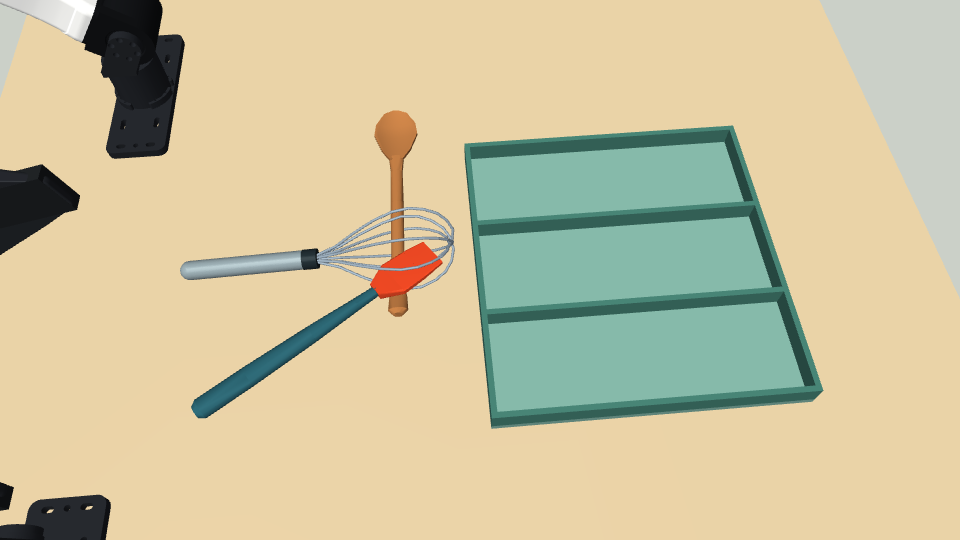
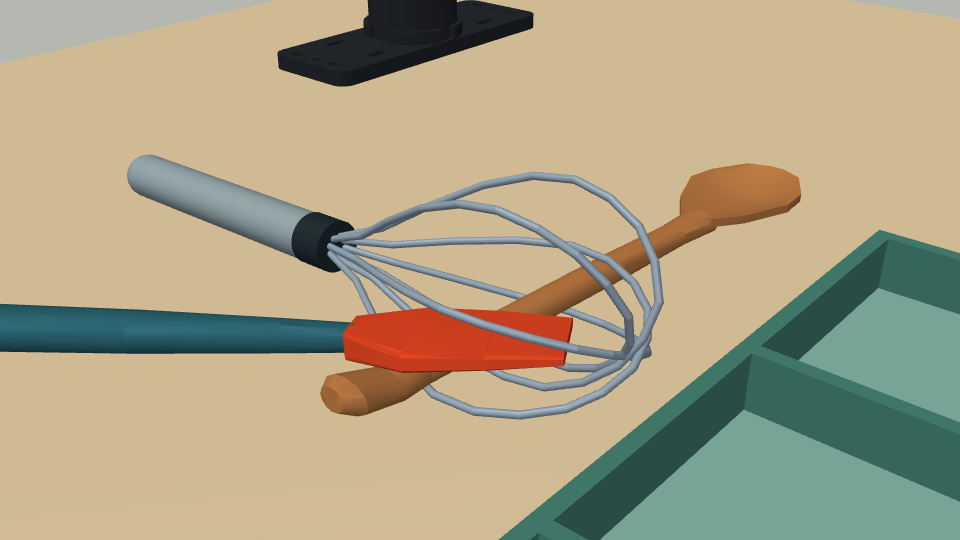

# Untangle kitchen utensils

> Separate the whisk, wooden spoon, and spatula, then put them in the holder so I can take any one out on its own.

The recorded bimanual YAM demo scored **1.0 in 641 of 1,000 actions** (32.05 simulated seconds). The holder is a horizontal three-slot drawer organizer. Each utensil lifts straight out. [Demo video](evidence/demo.mp4) · [Measured scores](evidence/scores.json)





## Assemble the tangle

Face the table from between the two arm bases. Measure x forward and y to the left from their midpoint. Heights below refer to the worktop. The 1,100 × 1,300 mm worktop is 747.5 mm above the station origin. Center the fixed polymer holder at x = 554 mm, y = 0. Its long dimension along x is 322 mm. The floor is 7 mm thick and the dividers rise 22 mm above it. The three openings are each 310 × 105 mm inside.

1. Hold the 298 mm steel balloon whisk by its 21 mm diameter handle, pointing its nose away from the arms. Its four closed wire loops form an approximately 83 mm wide cage. Center a gap on each side of the cage at the widest section. The two wires bordering the left gap are at approximately 22.5° above and below horizontal.
2. Hold the 293 × 52 mm wooden spoon bowl-up on the left. Feed the **handle end first** through the left gap and out through the opposite right gap. Leave about 40 mm of handle projecting beyond the right side. The bowl stays outside on the left.
3. Hold the 288 mm spatula by its blue-green handle on the near-right side. Feed the 75 × 46 mm silicone blade into the **right gap**, broad face nearly parallel to the table. Slide it over the wooden shaft, between the flared handle end and the overlying wire. The red blade should occupy the spoon's path back through the gap.
4. Lower the utensils together, release them, and let them settle for one second. Leave all three holder slots empty.

The following alignment points specify the fixed pose immediately before settling. Heading runs from forward toward the left. Positive pitch lowers the working end. Roll is zero for all three tools.

| Alignment point | x (mm) | y (mm) | Height (mm) | Heading | Pitch |
|---|---:|---:|---:|---:|---:|
| Whisk ferrule at the wire roots | 222 | 34 | 29 | 0° | −7° |
| Spoon shaft, 77 mm from the handle end | 310 | 34 | 34 | 90° | +8° |
| Spatula blade root, 213 mm from the handle end | 283 | −20 | 44 | 32° | −10° |

## Score and measured checks

| Trial | Score | Observation |
|---|---:|---|
| Dream-1 | **0.0** | At action 1,000 the spoon still crossed both whisk gaps and the spatula blade still occupied the right gap. |
| Untouched | **0.0** | The wooden shaft crosses the left and right gaps. The blade enters the right gap. |
| Spatula withdrawn and stowed | **0.5** | The spoon still crosses both gaps. |
| Braced whisk, spoon pulled first | **0.5** | The blade resisted the wooden shaft and moved with it before the spoon cleared. The spatula stayed caught. |
| All three released in the holder | **1.0** | Each slot supports one utensil, and all three independent removals pass. |

In a separate reset, only the left gripper grasped the spoon and lifted straight up. A **73.75 mm gripper rise raised the whisk crown 32.89 mm** and the ferrule 14.94 mm. Both utensils remained caught. During a straight horizontal pull with the other arm bracing the whisk, the blade opposed withdrawal with up to **0.66 N** and its tip moved **50.55 mm**. Peak elastic joint bends were 12.03° in the wires during the pull and 5.29° in the blade during the lift. [Coupling measurements](evidence/coupling.json)

| Removed from the same completed state | Measured rise | Lowest point above holder rim | Largest neighbor motion |
|---|---:|---:|---:|
| Whisk | 99.84 mm | 61.13 mm | 0.005 mm |
| Wooden spoon | 100.00 mm | 78.00 mm | 0.057 mm |
| Silicone spatula | 99.98 mm | 76.22 mm | 0.057 mm |

The scorer checks the current arrangement. It gives 0 while both tools remain caught and 0.5 as soon as either clears. It intersects the spoon profile and the articulated blade and handle with the measured openings of the four wire loops and the gaps between adjacent wires. These measurement surfaces exert no force. Any release order and any assignment of utensils to slots are valid.

Full credit requires all physical geometry to lie within three different slot footprints (1 mm wall tolerance), each slot floor to carry at least 80% of its utensil's weight, and the tools to be released without contact with one another. A 250 ms rest check allows up to 3 mm of marker movement. Each whisk crown must close within 2 mm and each opposed belly diameter must measure 52–97 mm.

For each removal, the scorer restores the **same saved final integration state**, including robot targets, velocities and solver state. A force-limited test hand raises one handle by 100 mm. It must rise at least 90 mm and its lowest point must clear the rim by 10 mm. The other two must stay seated in their original slots and their tracked points must move at most 5 mm. The lifted tool must stay clear of the robot and both neighbors throughout. The state digest accompanies each result. [Saved checkpoints](evidence/states.npz) · [Scorer](scoring.py)

## Reproduce locally

From this isolated benchmark worktree's root, use the environment and GPU launcher in the workspace's `RUN_LOCAL.md`. The recorded run used local GPU 0, MuJoCo 3.11.0, Inspect Robots 1.0.0, Inspect Robots YAM 0.38.0 and YAM Arena revision `0059d02`. Each output directory is newly created.

```bash
workspace=$(cd ../.. && pwd)
task=tasks/untangle-kitchen-utensils
gpu=0
run=$(mktemp -d "$workspace/runs/utensils-XXXXXX")

"$workspace/scripts/run_on_gpu.sh" "$gpu" python "$task/run.py" reset --out "$run/reset"
"$workspace/scripts/run_on_gpu.sh" "$gpu" python "$task/run.py" check-tangle --out "$run/check"
"$workspace/scripts/run_on_gpu.sh" "$gpu" python "$task/run.py" demo --record --out "$run/demo"
"$workspace/scripts/run_on_gpu.sh" "$gpu" python "$task/run.py" score --states "$task/evidence/states.npz"
```

To score a fresh run, replace the final path with `"$run/demo/states.npz"`. The recorded demo took 15.20 seconds of wall time. The fixed seed is 0, each control interval is 50 ms, and the physics timestep is 2 ms. A separate local replay of the saved actions through stock Inspect Robots with all three public cameras enabled also returned `task_score` 1.0. The demo records every 14-value action and all three scoring checkpoints. [Recorded actions](evidence/actions.npz)

The controller initializes its robot-only kinematic model from public YAM joint positions and checks each grasp through the observed gripper opening. It uses the fixed reset geometry for its waypoints. Contact forces, utensil poses, and the two presentation cameras feed the evaluator and recording only. The Dream policy receives the instruction, measured joints and gripper openings, and the calibrated top and two wrist RGB cameras at 320 × 176.

### Dream-1 evaluation

Dream-1 used all 1,000 actions in 50 simulated seconds. The evaluator reported a score of **0.0** and zero errored trials. Replaying the recorded actions reproduced the score and all three final camera images exactly. The video shows the calibrated top view above the two wrist views. [Dream-1 recording](evidence/dream-1.mp4) · [Model measurements](evidence/dream-1.json)

This command runs one hosted Dream-1 evaluation with a 1,000-action limit (50 simulated seconds) using the same embodiment and the stock Inspect Robots `task_score` scorer.

```bash
"$workspace/scripts/run_on_gpu.sh" "$gpu" python "$task/dream_run.py" --out "$run/dream"
```

## Model and review scope

The 145 g whisk uses four continuous loops made of 2.9 mm diameter round wire. Each half-loop has two elastic bending joints and a constrained crown shared with its opposite half. The 54 g beech spoon has a flared grip and a concave bowl. The 77 g spatula has a polymer grip and a silicone blade with three bending spans. The tools have six free-body degrees of freedom each. YAM gripper friction and normal contact carry the utensils. The model approximates elastic response with springs and has no plastic yield or fracture. The utensil dimensions and spring constants describe this simulated set.

The task generates its utensils and holder locally. Both arms reference the installed I2RT YAM meshes, URDF and collision geometry (MIT). Station frames and camera calibration come from YAM Arena and YAMLab (YAMLab calibration MIT). The adapter also identifies the origins of the station geometry and colored meshes. [I2RT asset license](https://github.com/kairosiann/yam-isaac-lab-arena/blob/0059d02/yam_arena/assets/yam/LICENSE.i2rt) · [Station and asset provenance](https://github.com/kairosiann/yam-isaac-lab-arena/blob/0059d02/yam_arena/station.py) · [YAMLab calibration](https://github.com/ARISE-Initiative/yamlab/blob/ec0455d2b4ce35f21fc126418ea5e74ac567133d/yamlab/configs/robot/yam.yaml)

A focused board and PR check on 2026-11-21 at 03:29 UTC found no equivalent accepted or pending task, or rejection in the preceding 48 hours. The whisk-related reviews concerned mixing thickener into a drink and changing a blender attachment. [Task board](https://tasks.robocurve.org/board) · [Drink-thickening review](https://github.com/robocurve/benchmark-tasks/pull/2444) · [Blender-attachment review](https://github.com/robocurve/benchmark-tasks/pull/2443)
