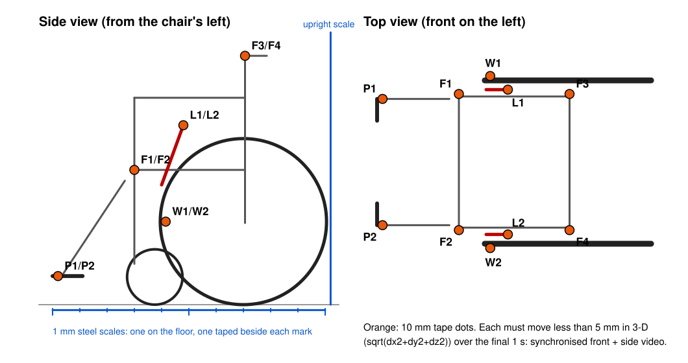

# Wheelchair transfer prep

Lock both wheels of a free-rolling manual wheelchair and swing both footrests aside, without letting it roll. Empty chair only:
no patient, no transfer. Context: nursing assistants prepare wheelchairs for transfers as part of patient care
([O*NET 31-1131.00](https://www.onetonline.org/link/details/31-1131.00)).

## Run a trial

```bash
inspect-robots run --embodiment yam_arena -E task=task.py -E object_jitter=0 -E control_hz=20 \
  --instruction "Get the wheelchair ready for a transfer: lock both wheels and swing both footrests out of the way, without letting the chair roll." \
  --scorer task_score --max-steps 2400
```

- Run limit: 2,400 control steps (2 minutes at 20 Hz). One trial takes about 6 minutes of wall time on one RTX 5090.
- Seeds: none; the layout is fixed (`object_jitter=0`).
- Scripted demo: `yam_scripted` runs `demo()` in `task.py` (about 67 s of motion).

## Scoring

`score()` in `task.py` returns 0 if any of these holds:

- the chair tipped more than 10 degrees at any time;
- its reference point (the midpoint of the two front uprights, at floor level) ends more than 5 cm from where it started, or
  its heading (the chair body's yaw, i.e. the rear axle line's direction) more than 5 degrees from its start;
- any gripper jaw or pad point comes within 8 cm of the chair during the final 1 s (21 control steps);
- any of the 10 tape marks below moves 5 mm or more during the final 1 s (each mark's largest 3-D distance between any
  two of the 21 samples must stay under 5 mm), or any mark or hand value is not finite.

Otherwise it adds 0.25 for each of these, judged at the end:

1. left wheel lock engaged (handle still past its over-centre point);
2. right wheel lock engaged;
3. left footrest at least 80 degrees aside;
4. right footrest at least 80 degrees aside.

Possible scores: 0, 0.25, 0.5, 0.75, 1.0. A lock pushed over centre and later pulled back earns nothing.

## What is modelled

- Chair: Drive Medical Silver Sport 2, SSP218FA-SF (18 in seat, fixed arms, swing-away footrests), serial not starting 3J, with
  Drive's STDS801GT 8 in wheel-lock extensions, which Drive lists for the Silver Sport 1 and 2 excluding serial 3J. Drive's
  sheet gives no extension section; 0.75 x 1.1 in comes from a retail listing and is an estimate. Modelled mass 18.40 kg in all,
  against the maker's quoted 18.6 kg (41 lb): a 0.20 kg difference.
- Wheel lock: a hinged lever with an over-centre spring (0.67 N m to push it over centre). It is engaged while its handle is
  past centre, and then holds its rear wheel; pulled back past centre it springs off and frees the wheel. The shoe is drawn only;
  the grip on the tyre is the wheel-hold drive.
- Footrest: a hanger on a vertical pintle. Its latch releases when the front lever is pushed 3 mm into its 6 mm stroke
  (engineering estimates). It swings out to a 90 degree stop.
- Footrest hinge friction: a declared model, not a measurement. PhysX joint friction, coefficient 0.040 (dimensionless) on each
  footrest hinge. In this simulator, at 45 degrees with the hands parked and a slow torque ramp in both directions, its
  breakaway is about 0.043 N m, i.e. roughly coefficient + 0.003 N m; the match is local to that calibration. The 0.043 N m
  target is itself an estimate: mu 0.2 (chrome steel on steel or nylon, dry) times the hanger's 9.3 N weight on a 10 mm thrust
  radius, plus the radial pin load of its overhung mass. The demo also reaches 1.0 with coefficients 0.018 and 0.061 (about
  0.021 and 0.064 N m). With no friction, the released footrests creep back under the chair's slight settling tilt.

## Parts (prices as listed on 2026-11-20; check before buying)

| Item | Qty | Source | Price |
|---|---|---|---|
| Drive Medical Silver Sport 2 wheelchair, SSP218FA-SF (18 in seat, fixed arms, swing-away footrests) | 1 | [Drive Medical](https://shop.drivemedical.com/us/en/Products/Mobility/Wheelchairs/Standard-Wheelchairs/c/p/SSP218FA-SF); [Vitality Medical](https://www.vitalitymedical.com/drive-medical-silver-sport-2-wheelchair-bundle.html) | $220.19 for the SSP218FA-SF row as fetched 2026-11-20 00:40 EST; a second reading the same night showed $213.40 (prices vary; check before buying) |
| Drive wheel-lock extension STDS801GT (sold each; for Silver Sport 1 and 2 excluding serial 3J) | 2 | fit: [Drive Medical](https://shop.drivemedical.com/us/en/products/mobility/wheelchairs/accessories/wheel-lock-extensions/p/STDS801GT); price: [MFI Medical](https://mfimedical.com/products/wheelchair-wheel-lock-extension-for-chrome-sport-viper-gt-cruiser-iii-rebel-and-silver-sport-1-2-excluding-serial-3j-wheelchair?variant=42957402767437) (SKU DRV-STDS801GT, special order, delivery time not stated) | $18.45 each, $36.90 for two |
| Spring scale, 0 to 5 N, 0.05 N divisions | 1 | any lab supplier | about $15 |
| Steel tape measure and a protractor or phone inclinometer | 1 each | any | about $15 |

Chair and extensions: $257.09 at $220.19 ($250.30 at $213.40) before shipping and tax (the robot station is separate). Confirm the chair's serial does not
start with 3J before fitting the STDS801GT; Drive's compatibility listing is the fit authority, the retailers only the price.

## Real trials

Scope: an empty chair only. No person sits in or holds the chair during a trial, and no transfer is performed.

1. Level floor (under 0.5 degrees), hard and smooth (vinyl or sealed concrete). Mark the chair's four wheel contact points on the
   floor with tape.
2. Place the chair facing the two arms, centred between them, with its footplate front edges 7 cm in front of the arms' base
   line. Both locks off, both footrests latched forward, the casters trailing straight back.
3. Keep people out of the arms' reach envelope for the whole trial; stop the arms if anyone enters it.
4. Run one trial of at most 2,400 control steps.
5. Reset: pull both locks back off, swing both footrests forward until they latch, and put the chair back on its tape marks.

### Simple checks for the scorer's conditions

- Lock engaged: the handle stays forward of vertical past its snap point, and the rear wheel will not turn by hand.
- Footrest aside: a protractor at the pintle reads at least 80 degrees from straight ahead.
- Chair movement: mark the floor under the midpoint of the two front uprights at the start; it must end within 5 cm of that
  mark, and the rear axle line must turn by at most 5 degrees (tape marks under both rear wheels).
- Hands released: a ruler shows every gripper finger at least 8 cm from the chair throughout the last second of a video.
- Still: see "Stillness marks" below.

### Stillness marks (the same 10 points `_marks()` in `task.py` tracks)

Stick a 10 mm round dot of paper tape at each point, with the chair set up and before the trial:

| mark | where |
|---|---|
| F1, F2 | the outer face of the left and right front upright, at seat height (49.5 cm) |
| F3, F4 | the end of the left and right push handle |
| W1, W2 | the outer side wall of the left and right rear tyre, 2 cm in from the tread, at the tyre's front (it turns with the wheel) |
| L1, L2 | the top end of the left and right wheel-lock extension |
| P1, P2 | the centre of the front edge of the left and right footplate |



Measuring: record the trial with two synchronised cameras on fixed stands, one from the front and one from the side, at
1080p or higher, each framing the whole chair. Calibrate each view with a 1 mm scale (a steel ruler) held at each mark's
depth, for example taped beside the mark. For every pair of frames in the final second, recover each mark's three
displacement components (dx, dy, dz) from the two views and require sqrt(dx^2 + dy^2 + dz^2) < 5 mm for every mark. Two
projected displacements each under 5 mm do not by themselves show a 3-D displacement under 5 mm (3 mm in one direction
plus 4 mm in another is 5 mm). Use a resolution at which 5 mm spans at least 5 pixels (at 1080p a 1 m wide view gives
about 10 pixels), and repeat or refine any measurement that lands near the 5 mm boundary.

### Footrest hinge friction: measurement procedure (no values claimed)

To compare a real chair with the 0.043 N m model:

1. Release one footrest and swing it by hand to 45 degrees.
2. Hook a spring scale (0 to 5 N range, 0.05 N resolution) to the front edge of the footplate, pulling square to the line from
   the pintle. Measure that radius r from the pintle axis with the tape (to 1 mm).
3. Pull slowly (about 1 N per second) outward and note the force F at which the footrest starts to move. Breakaway torque T = F r.
4. Repeat 5 times outward and 5 times inward, and the same again at 80 degrees.
5. Repeat for the other footrest.
6. Compare the mean T for each footrest and direction with the model's 0.021 to 0.064 N m range (the range the demo reaches 1.0
   over). Record the readings, r and the scale used.

## Files

- `task.py`: the scene, the mechanisms, the scorer and the scripted demo.
- `labkit.py`, `arena_assets_fix.py`: shared helpers.
- `task.json`: task text and media ID.
